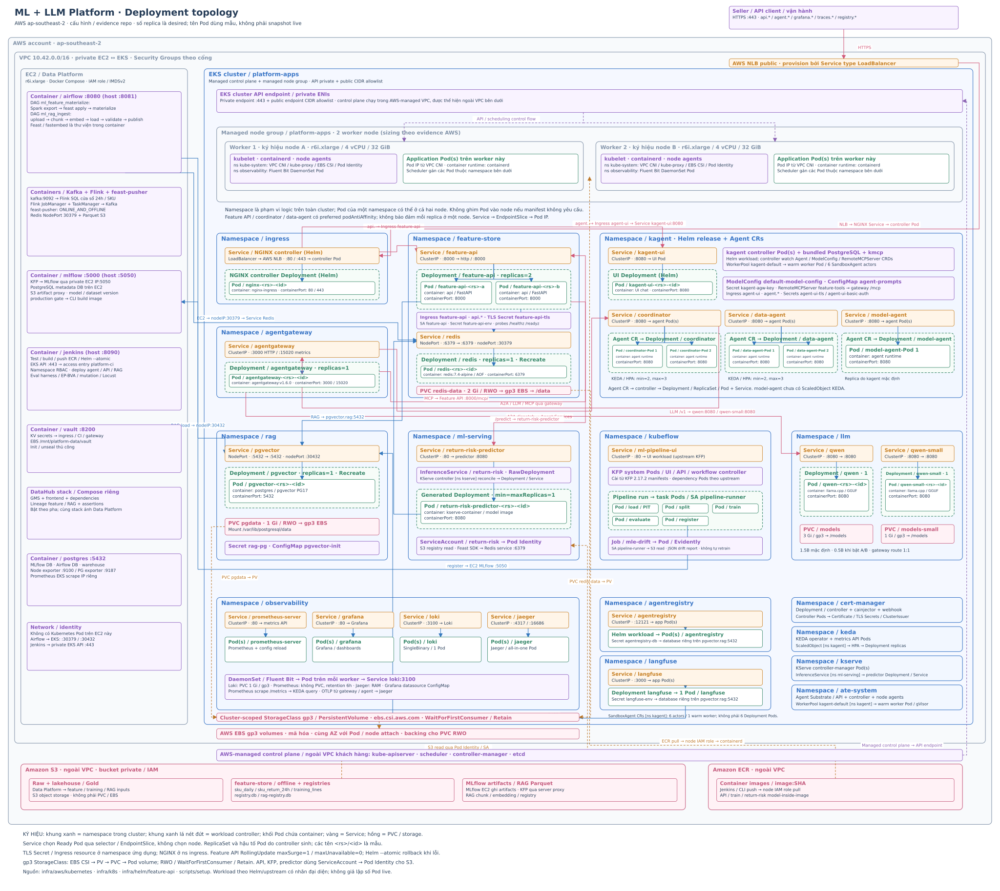

# Multichannel Data & AI Platform

Nền tảng dữ liệu và AI cho một Seller bán hàng trên Amazon, TikTok Shop, Shopify, Walmart và Shopee. Hệ thống chuẩn hóa dữ liệu đa kênh, dự đoán rủi ro Return hoặc Refund của từng dòng đơn hàng, và cung cấp agent trả lời câu hỏi bằng dữ liệu. Toàn bộ dữ liệu được sinh giả lập.

## Mục lục

- [Platform cung cấp gì?](#platform-cung-cấp-gì)
- [Bài toán nghiệp vụ](#bài-toán-nghiệp-vụ)
- [Kiến trúc](#kiến-trúc)
- [Bắt đầu](#bắt-đầu)
- [Tài liệu](#tài-liệu)
- [Cấu trúc repo](#cấu-trúc-repo)
- [Phát triển và đóng góp](#phát-triển-và-đóng-góp)
- [Kết quả kiểm chứng và giới hạn](#kết-quả-kiểm-chứng-và-giới-hạn)
- [Giới hạn đã biết](#giới-hạn-đã-biết)
- [Giấy phép](#giấy-phép)

## Platform cung cấp gì?

| Phần | Chức năng | Công nghệ chính | Hướng dẫn |
|---|---|---|---|
| **Data Platform** | Nguồn → Bronze / Silver / Gold → warehouse; batch, streaming, điều phối và quản trị | Spark, Kafka, Flink, Debezium, Iceberg, Lakekeeper, PostgreSQL, Trino, Airflow, DataHub | [Data Platform](docs/edai-1/README.md) |
| **ML Platform** | Feature store, training, model registry, serving và giám sát drift | Feast, Redis, LightGBM, Kubeflow Pipelines, MLflow, KServe, Evidently | [ML Platform](docs/edai-2/README.md) |
| **LLM Platform** | LLM inference, RAG, agent, gateway và đánh giá câu trả lời | llama.cpp, pgvector, agentgateway, kagent, Langfuse, KEDA | [LLM Platform](docs/edai-2/README.md) |

Trên AWS: Data Platform chạy trên một EC2 (Docker Compose) với dữ liệu ở S3; ML Platform và LLM Platform chạy trên EKS. Hạ tầng dựng bằng Terraform, cấu hình EC2 bằng Ansible.

## Bài toán nghiệp vụ

Một Seller bán trên bảy Storefront: Amazon US/UK/DE, TikTok Shop US, Shopify, Walmart US và Shopee VN. Mỗi kênh xuất dữ liệu theo schema riêng; hệ thống gom về một lakehouse Bronze / Silver / Gold rồi dựng feature cho bài toán:

> Dòng đơn hàng này có bị Return hoặc Refund trong 30 ngày sau giao hàng không?

Agent truy xuất feature, gọi model dự đoán và tìm chính sách trả hàng qua MCP. Chi tiết: [business domain](docs/shared/domain.md), [thuật ngữ](docs/shared/terminology.md), [contract nhãn](docs/edai-1/reference/return_label_contract.md).

## Kiến trúc

System architecture được chia theo đúng hai phạm vi: **Data Platform** và **ML + LLM Platform**.
Mỗi khối là một đơn vị triển khai; mũi tên đi theo chiều dữ liệu, đánh số và tô màu theo từng luồng.
Triển khai tham chiếu AWS ap-southeast-2: EC2 Data Platform + EKS `platform-apps`, S3 và ECR ngoài VPC.

### Data Platform

[](https://babyfat012.github.io/multichannel-data-ai-platform/docs/diagrams/data-platform-system-architecture.html)

Mọi luồng chạy cùng lúc. **[Mở bản phóng to được](https://babyfat012.github.io/multichannel-data-ai-platform/docs/diagrams/data-platform-system-architecture.html)** (bấm ô chú giải để xem riêng từng luồng) · [Ảnh tĩnh phóng to được](https://babyfat012.github.io/multichannel-data-ai-platform/docs/diagrams/data-platform-system-architecture.html?static) · [PNG](docs/diagrams/data-platform-system-architecture-excalidraw.png) · [Bản Excalidraw](docs/diagrams/data-platform-system-architecture.excalidraw)

### ML + LLM Platform

[](https://babyfat012.github.io/multichannel-data-ai-platform/docs/diagrams/ml-llm-platform-system-architecture.html)

Mọi luồng chạy cùng lúc. **[Mở bản phóng to được](https://babyfat012.github.io/multichannel-data-ai-platform/docs/diagrams/ml-llm-platform-system-architecture.html)** (bấm ô chú giải để xem riêng từng luồng) · [Ảnh tĩnh phóng to được](https://babyfat012.github.io/multichannel-data-ai-platform/docs/diagrams/ml-llm-platform-system-architecture.html?static) · [PNG](docs/diagrams/ml-llm-platform-system-architecture-excalidraw.png) · [Bản Excalidraw](docs/diagrams/ml-llm-platform-system-architecture.excalidraw)

Hai ảnh nối nhau qua Gold / feature / training data, replay Return qua Kafka và DataHub governance.
[Đối chiếu khối kiến trúc với rubric và cấu hình](docs/diagrams/README.md).

## Bắt đầu

Yêu cầu: Python 3.12+, `uv`, Docker Engine và Docker Compose v2. Chạy các lệnh từ thư mục gốc repo.
Kubernetes dùng cho ML/LLM; triển khai AWS dùng EKS `platform-apps`.

Bắt đầu triển khai từ [Cloud setup](docs/shared/cloud_setup.md), sau đó theo [AWS runbook](docs/shared/aws_deploy.md) và [IaC](docs/edai-2/iac.md). Kết quả đã chạy và phần còn mở nằm trong [kiểm kê AWS](docs/shared/rubric_cloud_audit.md).

<details>
<summary>Dựng nguồn dữ liệu local để phát triển</summary>

Môi trường phát triển dùng Docker Compose và kind cho Kubernetes.

```bash
cp .env.example .env          # đặt mật khẩu và cổng cho môi trường của bạn
uv sync --frozen
docker compose up -d --build
docker compose wait generator-load
```

Bước này dựng nguồn dữ liệu giả lập với MinIO và PostgreSQL. Các dịch vụ xử lý, ML và Agent được bật theo
profile và hướng dẫn riêng; xem [Docker Compose](docs/edai-1/docker.md).

</details>

### Chọn phần cần triển khai

| Mục tiêu | Hướng dẫn |
|---|---|
| Xử lý batch/stream, lakehouse và warehouse | [Data Platform](docs/edai-1/README.md) |
| Feature store, training và model serving | [ML Platform](docs/edai-2/README.md) |
| LLM inference, RAG và Agent | [LLM Platform](docs/edai-2/README.md) |
| Hạ tầng AWS và cấu hình dịch vụ | [Cloud setup](docs/shared/cloud_setup.md), [AWS runbook](docs/shared/aws_deploy.md), [IaC](docs/edai-2/iac.md) |

## Tài liệu

Tài liệu bám theo rubric và các lần triển khai AWS; mỗi trang có code/config, kết quả và ảnh bằng chứng.

| Phần | Nội dung | Tài liệu |
|---|---|---|
| EDAI-1 | Generator, Spark/Flink, storage, orchestration, governance, schema và novel ideas | [EDAI-1 — Data Platform](docs/edai-1/README.md) |
| EDAI-2 | LLM/Agent, RAG, Feature Store, training/serving, CI/CD, IaC và observability | [EDAI-2 — ML / LLM Platform](docs/edai-2/README.md) |
| Dùng chung | Domain, AWS setup/runbook, quyết định kiến trúc và quy ước code | [Dùng chung](docs/shared/README.md) |
| Đối chiếu | Dòng rubric, bằng chứng AWS và phần còn thiếu | [Rubric](docs/shared/rubric_guide.md), [kiểm kê AWS](docs/shared/rubric_cloud_audit.md) |

[Mục lục toàn bộ tài liệu](docs/README.md).

## Cấu trúc repo

```txt
├── generator/        # Sinh dữ liệu giả lập năm kênh (skew, schema evolution, duplicate, late arrival)
├── configs/          # Profile dữ liệu của generator (small → 100 GB)
├── contracts/        # Hợp đồng dữ liệu và schema từng kênh
├── spark_jobs/       # Spark batch: Bronze, Silver, Gold, CDC, bảo trì Iceberg
├── flink_jobs/       # Flink streaming: late arrival, dedup, window, feature 24h
├── sql/, trino/      # SQL warehouse và Trino liên nguồn
├── dags/             # Pipeline Airflow DP1–DP4, materialize feature, RAG
├── feature_repo/     # Feast: feature view, TTL, push stream vào offline/online store
├── ml/               # Training (Kubeflow), đánh giá, drift (Evidently)
├── serving/          # Feature API (FastAPI) + MCP tool, model KServe
├── rag/              # Chunking, embedding và truy xuất tài liệu
├── docker/           # Dockerfile các image (multistage)
├── infra/            # Hạ tầng
│   ├── aws/          #   Terraform (EC2, S3, ECR, EKS) và Ansible role cho EC2
│   ├── k8s/          #   Manifest Kubernetes: agent, ingress, observability, RAG, CI
│   └── helm/         #   Helm chart Feature API
├── ci/               # Jenkinsfile và cấu hình Jenkins
├── scripts/          # setup/ dựng dịch vụ · run/ chạy pipeline · evidence/ thu bằng chứng
├── notebooks/        # Notebook phân tích: model + bootstrap, drift, benchmark LLM/A/B, EDA nhãn (đã chạy, có output)
├── tests/            # Unit, Spark, harness kiểm thử
└── docs/             # Tài liệu theo rubric, ưu tiên kết quả AWS
    ├── README.md     # Mục lục chung
    ├── edai-1/       # Data Platform: mỗi mục rubric một file
    │   ├── README.md
    │   ├── docker.md
    │   ├── data_generator.md
    │   ├── processing_jobs.md
    │   ├── ...
    │   └── reference/    # Các trang kỹ thuật nhỏ, gom một chỗ
    ├── edai-2/       # ML / LLM Platform: mỗi mục rubric một file
    │   ├── README.md
    │   ├── llm_inference_platform.md
    │   ├── global_model_config.md
    │   ├── observability.md
    │   ├── ...
    │   └── reference/
    ├── shared/       # Domain, AWS runbook và kiểm kê rubric
    ├── diagrams/     # Sơ đồ triển khai
    └── evidence/, images/ # Receipt, log và ảnh chạy thật
```

## Phát triển và đóng góp

Đọc [quy ước code](docs/shared/code_style.md), [thuật ngữ](GLOSSARY.md) và tài liệu của thành phần cần thay đổi.
Khi gửi thay đổi, mô tả vấn đề, hành vi sau sửa và cách kiểm chứng; cập nhật tài liệu liên quan nếu đổi cách dùng.

```bash
uv sync --frozen
uv run pytest -q
uv run ruff format --check .
uv run ruff check .
```

Các lệnh trên kiểm tra code Python và bộ test mặc định. Hướng dẫn kiểm thử Spark, Web API và từng dịch vụ
nằm trong tài liệu thành phần.

## Kết quả kiểm chứng và giới hạn

Dự án dùng dữ liệu giả lập; các số đo gắn với môi trường, cấu hình và phạm vi dữ liệu của từng lần chạy.
Ngày chạy, run ID và artifact được giữ trong tài liệu kiểm chứng để phân biệt kết quả local với AWS.

- [Data Platform — bằng chứng và giới hạn](docs/edai-1/evidence.md).
- [ML/LLM Platform — bằng chứng và liên kết kết quả AWS](docs/shared/rubric_cloud_audit.md).
- [Trạng thái kiểm chứng theo rubric](docs/shared/rubric_cloud_audit.md), gồm phần còn mở và các điểm yếu của bằng chứng.
- [Tài liệu theo rubric](docs/shared/rubric_guide.md) dành cho việc đối chiếu coursework.

## Giới hạn đã biết

- [Agent eval](docs/edai-2/agent_evaluation.md): 12/12 trên AWS dùng SKU có `labeled_count_90d` dưới 7 chữ số; response mask `phoneNumber` che số đếm 7 chữ số, khiến lượt top seller chỉ đạt 9/12. Hướng sửa là bỏ `phoneNumber` khỏi response mask; đang chờ duyệt vì giảm một lớp guardrail.
- [Sandbox Agent](docs/shared/rubric_cloud_audit.md): gọi tool đúng nhưng model 1,5B đọc `830847` thành `83,084`; đã chứng minh đường gọi tool, chưa bảo đảm chất lượng câu trả lời của model CPU nhỏ.
- [Coordinator CI](docs/edai-2/cicd.md): deploy xanh nhưng cổng eval chưa đạt (31/10 đỏ sau 15 phút; 04/11 chạy hơn 20 phút chưa xong); một LLM chạy CPU phục vụ chung mọi Agent, chậm khi tải chồng ([số đo](docs/edai-2/agent_evaluation.md#coordinator-trên-aws-04112026)).
- [Ảnh chi tiết](docs/shared/rubric_cloud_audit.md): Spark UI Union/Window dedup, Flink RUNNING và late arrival, ERD DBeaver, Helm rollback, KEDA Model Agent/Coordinator đều có ảnh hoặc log trên AWS (04/11/2026); phần còn mở duy nhất là cổng eval Coordinator ở trên.
- [MLflow](docs/edai-2/training_pipeline.md): có ảnh Tags/Artifacts và đối chiếu SHA-256 của train/test với tag trên AWS; liên kết run MLflow với run KFP dựa vào thời điểm vì mã run KFP không được ghi vào MLflow.
- [Stream feature](docs/edai-2/stream_features.md): `approved_returns_24h` trên AWS được replay từ nhãn Gold; model `return-risk` trên AWS train trước khi feature có lịch sử nên chưa dùng feature này.
- [Partition Shopee](docs/edai-1/data_storage.md): chia tháng được áp dụng bằng maintenance rewrite; DP1 `createOrReplace` sẽ ghi lại partition ngày, chưa phải hành vi của pipeline.

## Giấy phép

Dự án được phát hành theo [Apache License 2.0](LICENSE).
