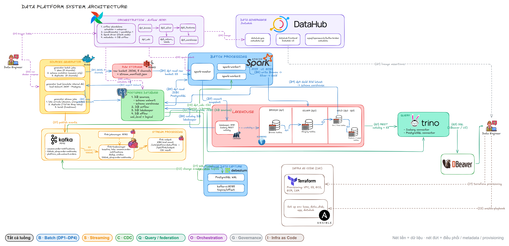

# Data Platform on AWS

This section describes the Data Platform component by component, based only on real deployments on AWS.

Infrastructure:
- The Data Platform runs with Docker Compose on a single EC2 instance; data is stored in S3.
- The ML Platform and LLM Platform run on the EKS cluster `platform-apps`; MLflow, Jenkins and Vault run on EC2.

Each result states which environment it ran in and what limitations remain. A result only proves that the run happened; it does not mean the service is still running.

## Page index

| Docs / evidence | Results and limitations |
|---|---|
| [Docker / Compose](docker.md) | Image measured on EC2: reduced from 2.4 GB to 698 MB, still with all 27 packages. |
| [Data Generator](data_generator.md) | Size measurements, batch data generation profiles, and the manifest (a file recording the configuration and counts) of the Stream on AWS. |
| [Processing Jobs](processing_jobs.md) | A Stream with real late-arriving messages. Four Flink jobs running continuously in the RUNNING state. The Spark UI on AWS shows the Union step (merging two schemas) and the Window dedup step (removing duplicates) of the Silver layer. |
| [Data Storage](data_storage.md) | Measurements from rewriting partitions and EXPLAIN output. Limitation: rerunning DP1 brings the table back to daily partitioning. |
| [Pipeline Orchestration](pipeline_orchestration.md) | Screenshots of the DAG graph, logs of the ingest/validate steps, and run IDs on AWS. |
| [Data Governance](data_governance.md) | Lineage (data flow between tables) and assertions (data-checking rules) on AWS; lineage is published from pipeline metadata. |
| [Schema Design](schema_design.md) | Zones, DESCRIBE output, and an ERD (relationship diagram) between dim and fact tables: one drawn with dbdiagram and one DBeaver screenshot with connecting lines, captured on Trino on AWS. |
| [Trino federation and WAL CDC](trino_federation_and_cdc.md) | A federation query (one SQL statement reading several sources) and a CDC test covering all three change types create/update/delete (c/u/d). CDC under load has not been measured yet. |

Each page has code/config, results and screenshots with explanations. The status of each capability and the parts still missing AWS evidence are in [AWS validation status](../shared/aws_validation.md).

## Deployment and verification

[Cloud setup](../shared/cloud_setup.md) · [AWS runbook](../shared/aws_deploy.md) · [IaC](../ml-llm-platform/iac.md).

[AWS evidence matrix](evidence.md).

[Technical reference](reference/README.md) · [Main index](../README.md).
