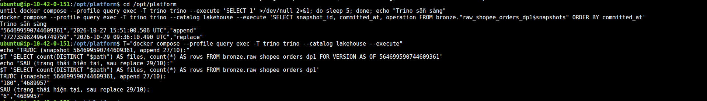

# Data Storage on AWS

This page covers storage optimization in the lakehouse (Iceberg on S3) and the warehouse
(PostgreSQL).

Code / configuration: [Partition rewrite](../../spark_jobs/maintenance/repartition_small_channel.py), [warehouse export](../../spark_jobs/warehouse/export_order_snapshot_lines.py).

The results below are from recorded AWS runs; this page does not claim the services are still running.

## Lakehouse on AWS: merging small files with partition evolution

**Conclusion:** changing the Shopee table's partitioning from daily to monthly reduced the file count from 180 to 6
and made queries clearly faster, while the data stayed the same.

**Problem.** The `maintenance_iceberg` DAG run on `bronze.raw_shopee_orders_dp1` was a **no-op** (nothing to do).
The table is partitioned by day and each day has exactly 1 file of about 2.4 MB. `rewrite_data_files` only merges files
within each partition, so there was nothing to merge. The root cause is that Channels differ greatly in size: Shopee is the smallest
but is still partitioned by day like Amazon (gap #16).

**Fix.** The job [`repartition_small_channel.py`](../../spark_jobs/maintenance/repartition_small_channel.py) does four
things:

1. Change the partition spec in place on the existing table (partition evolution):
   `ALTER TABLE … REPLACE PARTITION FIELD export_date WITH months(export_date)`.
2. Rewrite all files with the new spec: `rewrite_data_files(options => map('rewrite-all','true'))`.
3. Measure the metrics before and after.
4. Stop if the fingerprint (hash of the table content) changes, which would mean the data changed.

| | Before (daily) | After (monthly) |
|---|---|---|
| Data files | 180 | **6** |
| Average size | 2.44 MB | **73.13 MB** |
| Specs in use | 1 | 1 (every file moved to the new spec) |
| Whole-table `count(*)` (median of 3 runs) | 1.040 s | **0.286 s** (3.6×) |
| Filter on the last 30 days (median of 3 runs) | 7.943 s | **0.968 s** (8.2×) |
| Rows / fingerprint | 4,689,957 / -2551885948954549477803 | **identical** |

Why the 30-day filter is 8 times faster: before, about 30 small files had to be opened, each costing one footer read and one
S3 request; now only 1–2 monthly files need to be opened. The trade-off: filtering on exactly one day now has to read the whole monthly file containing
that day.

Limitation: the Bronze job `dp1` writes with `createOrReplace … partitionedBy("export_date")`, so rerunning dp1 brings the table
back to daily partitioning. To close gap #16 for good, the ingest step needs to choose the spec per Channel. To go back to the old spec: run
`CALL lakehouse.system.rollback_to_snapshot(...)` with the `snapshot_before` recorded in the receipt.

## Warehouse on AWS: 30 days, five Channels

**Conclusion:** an index on `seller_sku` makes queries for a rare SKU 28 times faster; for a common SKU, PostgreSQL still
scans the whole table, and that is the correct behavior.

The DAG [`dp4_warehouse`](../../dags/dp4_warehouse.py) copies the 30 days before the cutoff (2026-05-31 to 2026-06-30) of
`lakehouse.gold.fact_order_lines_dp2` into `warehouse.fact_order_lines_30d_dp2` on the EC2 PostgreSQL
([job](../../spark_jobs/warehouse/export_order_snapshot_lines.py)). The table has **37,045,741 rows** and weighs **5,513 MB**;
the `(seller_sku)` index weighs **250 MB**. Before creating the index, the job reconciles row counts per Channel against Gold.

Row counts per SKU are heavily skewed: the largest is `ELE-01103` with 2,011,389 rows (5.4%), the smallest is `APP-00482` with
4,517 rows (0.012%).

Method: run `EXPLAIN (ANALYZE, BUFFERS) SELECT count(*), sum(line_net_amount) … WHERE seller_sku = …` on the same
table, first after `DROP INDEX`, then after `CREATE INDEX` and `ANALYZE`. "Buffers read" is the number of data pages
PostgreSQL has to read.

| SKU | Index | Plan | Buffers read | `Execution Time` |
|---|---|---|---|---|
| `APP-00482` (0.012%) | no | `Parallel Seq Scan`, filtering out ~37M rows | 690,595 | **42,567 ms** |
| `APP-00482` | yes | `Bitmap Index Scan` → `Bitmap Heap Scan` | **4,475** | **1,497 ms** (28×) |
| `ELE-01103` (5.4%) | no | `Parallel Seq Scan` | 690,558 | 41,745 ms |
| `ELE-01103` | yes | **still `Parallel Seq Scan`** — the planner skips the index | 690,502 | 41,304 ms |

- An index only helps when the filter is **selective** (matches few rows): for the rare SKU, the number of disk pages read drops
  about 150 times.
- Rows of the common SKU (5.4%) are spread over almost every page. Going through the index would still open most pages, and in random
  order. So the planner chooses a sequential scan. This is expected behavior, not a bug.
- With the index in place `APP-00482` still takes 1.5 s, because its 4,517 rows are spread over 4,467 pages (the table is not ordered by
  SKU, and the EBS cache is still cold). There are two ways to make it faster: reorder the table by the index with `CLUSTER … USING`,
  or use a covering index (`INCLUDE (line_net_amount)`) so the query only needs to read the index.

The EXPLAIN screenshots and logs are embedded in the [AWS section](#on-aws).

## On AWS

This section collects the screenshots and logs for the two measurements above. Spark/Iceberg and PostgreSQL run with Compose on EC2; lakehouse
data lives on S3. The [AWS receipt](../evidence/aws/data-platform-aws-20261027.json) has two entries,
`lakehouse_repartition_shopee` and `airflow_dp4_warehouse`. For the detailed analysis see
[Lakehouse](#lakehouse-on-aws-merging-small-files-with-partition-evolution) and
[Warehouse](#warehouse-on-aws-30-days-five-channels).

**Lakehouse (Shopee).** The [partition evolution job](../../spark_jobs/maintenance/repartition_small_channel.py) changes
the partitioning from daily to monthly and then rewrites everything (rewrite-all). The file count drops from 180 to 6; the table still has 4,689,957
rows and the fingerprint `-2551885948954549477803` is unchanged. The median of three `count(*)` runs drops from 1.040 s to
0.286 s; the 30-day filter drops from 7.943 s to 0.968 s. These numbers come from the receipt; AWS screenshots taken separately before/after
compaction are right below. The earlier maintenance run was a no-op because each daily partition had only one file.

To get before/after screenshots without rerunning the job, read the same table at two snapshots (table versions) through Trino. These
statements are read-only; they were run on EC2 and the results are below:

```sql
-- 1. snapshot before the rewrite: the last snapshot with operation = append/overwrite before the replace
SELECT snapshot_id, committed_at, operation
FROM lakehouse.bronze."raw_shopee_orders_dp1$snapshots" ORDER BY committed_at;
-- 2. before (expected 180 files, 4,689,957 rows)
SELECT count(DISTINCT "$path") AS files, count(*) AS rows
FROM lakehouse.bronze.raw_shopee_orders_dp1 FOR VERSION AS OF <snapshot_id>;
-- 3. after (expected 6 files, 4,689,957 rows)
SELECT count(DISTINCT "$path") AS files, count(*) AS rows
FROM lakehouse.bronze.raw_shopee_orders_dp1;
```

**Results on AWS (Trino 483 on EC2).** Table `bronze.raw_shopee_orders_dp1` has exactly two snapshots:

- `564699590744609361` (`append`): the initial write.
- `2727359824964749759` (`replace`): the rewrite by the `repartition_small_channel` job.

The old snapshot has not been removed by `expire_snapshots`, so it can still be read:

| State | Data files | Rows |
|---|---:|---:|
| Before: `FOR VERSION AS OF 564699590744609361` (append, daily partitioning) | **180** | **4,689,957** |
| After: current (replace, monthly partitioning) | **6** | **4,689,957** |

Row counts are equal on both sides (data unchanged) and match the receipt (180 → 6 files; fingerprint unchanged).



If the old snapshot is later removed by `expire_snapshots`, it can no longer be read. In that case, only capture the result of step 3, together with
the receipt on EC2 (`/mnt/platform-data/airflow/logs/iceberg-maintenance/repartition-shopee.json`, which already has the
before/after numbers).

**Warehouse.** The DAG [dp4_warehouse](../../dags/dp4_warehouse.py), run `manual__2026-10-29T08:34:06.602356+00:00`,
calls the [export and index](../../spark_jobs/warehouse/export_order_snapshot_lines.py) job. The job copies 30 days of the five
Channels, compares the row count of each Channel with Gold, then creates the B-tree index `(seller_sku)` and runs `ANALYZE`.
The screenshots below show the problem without an index: filtering on a rare SKU still scans the whole table.


`APP-00482` has 4,517 out of 37,045,741 rows in total. Before the index, PostgreSQL uses a Parallel Seq Scan, taking
42,567.429 ms and reading 690,595 buffers. After the index, it uses a Bitmap Index Scan followed by a Bitmap Heap Scan, taking
1,497.187 ms and reading 4,475 buffers.
For the common SKU `ELE-01103` (2,011,389 rows), the planner still chooses a Seq Scan, because an index does not help when most
pages have to be read. These are EXPLAIN passes observed on EBS; the effect of the cache has not been isolated to make this a stable
benchmark.

<details>
<summary>Reference: design, development guide and records from before the AWS deployment</summary>

Local records keep their original environment and do not replace cloud evidence.

## Data Storage — Iceberg compaction

This section records real-run evidence for `rewrite_data_files`
on the full-period Amazon Bronze table. Measurement and run code: `spark_jobs/maintenance/inspect_iceberg_storage.py`
and `spark_jobs/maintenance/compact_amazon_order_snapshots.py`. The corresponding API docs are
[Apache Iceberg 1.11 Spark procedures](https://iceberg.apache.org/docs/1.11.0/spark-procedures/)
and the [metadata table `.files`](https://iceberg.apache.org/docs/1.11.0/spark-queries/).

## Choose the table from metadata, not from raw file counts

`/data/raw` has 5,774 JSONL files, but after Spark writes Bronze/Silver, the
DP1/DP2 tables have **one file per partition**. So just counting small files and then
running compaction will not reduce the file count: Iceberg keeps partition boundaries.

| Table | Files | Partitions | Partitions with several files |
|---|---:|---:|---:|
| `bronze.raw_amazon_orders_dp1` | 10 | 10 | 0 |
| `bronze.raw_walmart_orders_dp1` | 20 | 20 | 0 |
| `silver.stg_amazon_order_lines_dp2` | 28 | 28 | 0 |
| `silver.stg_walmart_order_lines_dp2` | 180 | 180 | 0 |
| `bronze.raw_amazon_orders` full period, before compaction | 187 | 180 | 7 |

The seven Amazon days with two files are 2026-02-23, 05-07, 05-16, 05-18, 06-11,
06-23 and 06-28. The measurement query scans only these seven days:

```sql
SELECT count(*) AS rows, sum(length(payload)) AS payload_chars
FROM lakehouse.bronze.raw_amazon_orders
WHERE export_date IN (
  DATE '2026-02-23', DATE '2026-05-07', DATE '2026-05-16',
  DATE '2026-05-18', DATE '2026-06-11', DATE '2026-06-23',
  DATE '2026-06-28'
);
```

`sum(length(payload))` forces Spark to read the data column, instead of answering `count(*)`
from metadata. Each side has one warm-up pass followed by three measured passes of the same SQL.

## Real-run results

`CALL lakehouse.system.rewrite_data_files` uses bin-pack,
`target-file-size-bytes=134217728`, `min-input-files=2`, and only one concurrent
rewrite group to fit in laptop RAM. It reports **12 files rewritten into 6
files**, 311,825,996 input bytes, 0 failed files, in 16.088 seconds.

| Metric | Before | After |
|---|---:|---:|
| Current files in the whole table | 187 | 181 |
| Rows in the whole table | 108,248,563 | 108,248,563 |
| Bytes of current files in the whole table | 8,525,005,070 | 8,524,986,535 |
| Rows of the seven-day query | 5,757,639 | 5,757,639 |
| Total payload characters of the query | 4,381,958,279 | 4,381,958,279 |
| Three scans, seconds | 10.511 / 10.348 / 9.451 | 9.641 / 9.405 / 9.066 |
| Median, seconds | **10.348** | **9.405** |

The median drops by 0.943 seconds, about **9.1%** on this machine. Row counts and total payload
characters match before/after. The after-measurement had to run in a new Spark session because
the first session was interrupted after Iceberg had committed the compaction; so the seconds are empirical
observations, and the effects of cache, machine load and startup cannot be separated.
One partition (`2026-06-28`) still has two files, so there are now 181 files instead of 180.

## PostgreSQL warehouse and index

`spark_jobs/warehouse/export_order_snapshot_lines.py` copied the Walmart slice of
`lakehouse.gold.fact_order_lines_dp2` into
`sources.warehouse.fact_order_lines_walmart_dp2`. The table has **1,875,607** rows,
`created_at` ranging from 2026-01-01 to 2026-06-29; before indexing it takes **253 MB**.
Only the six columns needed by the query are kept, to fit the dev machine's disk. This is a copy of Gold,
not a full five-Channel fact in PostgreSQL.

With the same query, SKU `FTW-00664` has 211 rows and a total net amount of 12,038.74 in
the source currency:

```sql
SELECT count(*), sum(line_net_amount)
FROM warehouse.fact_order_lines_walmart_dp2
WHERE seller_sku = 'FTW-00664';
```

Index DDL used for the measurement below:

```sql
CREATE INDEX idx_fact_order_lines_walmart_sku
  ON warehouse.fact_order_lines_walmart_dp2 (seller_sku);
```

| `EXPLAIN (ANALYZE, BUFFERS)` | Before index | After index |
|---|---|---|
| Plan | `Parallel Seq Scan` | `Bitmap Index Scan` → `Bitmap Heap Scan` |
| Rows filtered / read | 211 / 1,875,607 | 211 / 211 index keys |
| Buffers | hit 15,704, read 16,635 | read 213 |
| `Execution Time` | **51.611 ms** | **1.134 ms** |

The index `idx_fact_order_lines_walmart_sku` on `(seller_sku)` takes **13 MB**;
the table with the index is **266 MB**. These are two `EXPLAIN ANALYZE` passes on the same machine,
not a multi-pass benchmark; the cache may differ between the two. The strongest
evidence is that the plan changed from a full table scan to using the index, and the number of buffers
read dropped clearly.

## Measurement scope

This document records Iceberg compaction and PostgreSQL indexing. The comparison of the same
question between Iceberg and the warehouse with Trino is recorded separately in
[trino.md](reference/trino.md); z-order has not been measured in the current evidence set.

</details>

[Section index](README.md) · [Main index](../README.md)
