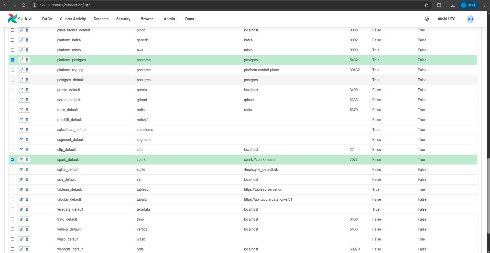
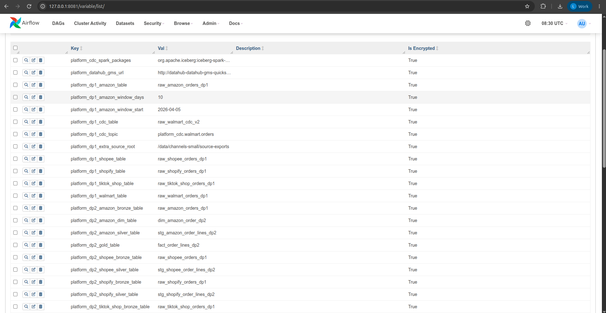
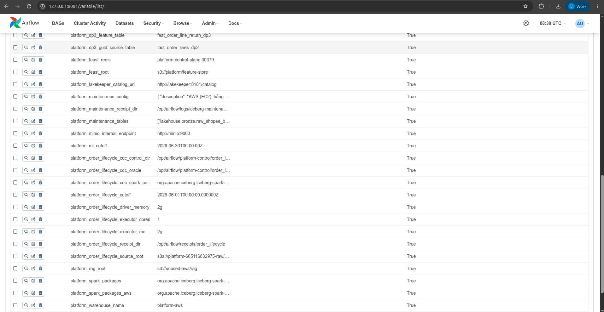
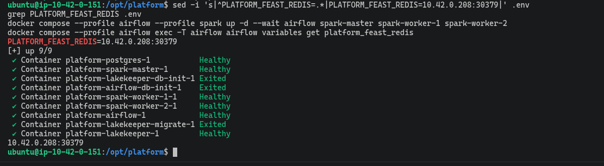
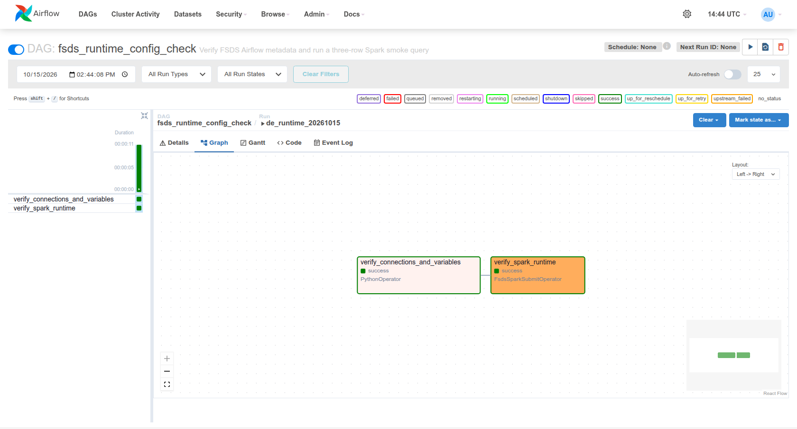
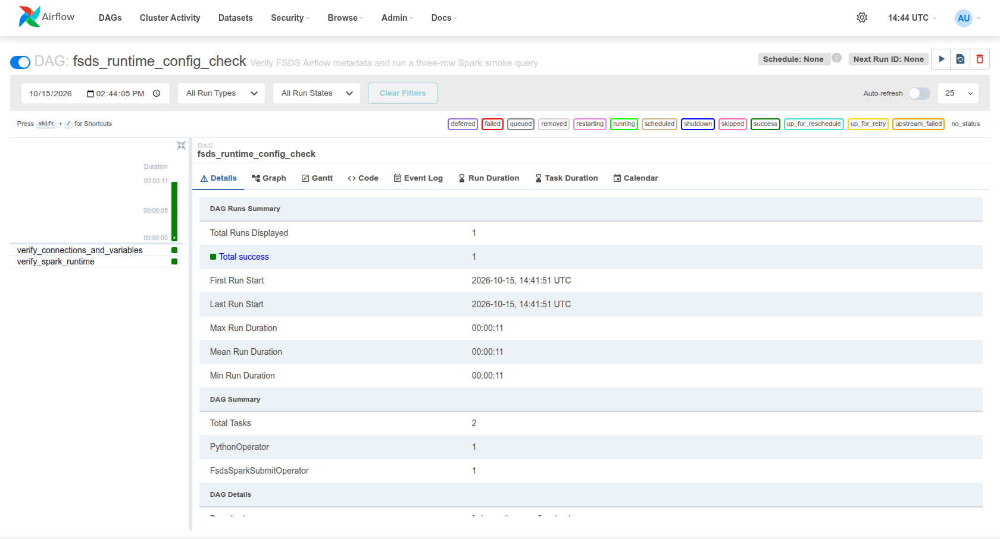

# Data Pipeline Orchestration on AWS

This page covers how Airflow orchestrates the ingest and validate steps of three DAGs:
- **DP1**: sources to Bronze.
- **DP2**: Bronze to Silver, then Gold and SCD2.
- **DP3**: Gold to offline features.

Code / configuration: [DP1](../../dags/dp1_bronze.py), [DP2](../../dags/dp2_silver.py), [DP3](../../dags/dp3_features.py).

The results below come from runs on AWS. They prove that those runs happened; they do not mean the services are still running.

## On AWS

Airflow and Spark run with Docker Compose on a single EC2 instance in the Sydney region. Source data is read from S3 (raw files) and from PostgreSQL on EC2.
Run_ids and measurements are stored in two files: the [AWS receipt](../evidence/aws/data-platform-aws-20261027.json) and the
[validation manifest](../evidence/aws/datahub-validation-aws-20261029.json).

### Connections and Variables on AWS

Airflow has two places that hold configuration:
- A **Connection** holds the connection details for a service (host, port, user, password).
- A **Variable** holds a pipeline parameter, so the source, date range or target table can change without editing DAG code.

The table below describes the configuration in the repo and how the DAGs use it. It is not a screenshot of the configuration
of the AWS runs below (the real screenshots are in the "Evidence on AWS" part).

| Configuration | Role in DP1–DP3 |
|---|---|
| Connection `spark_default` | Spark-submitting tasks use `conn_id="spark_default"`; the [setup script](../../scripts/setup/setup_airflow.sh) sets master `spark://spark-master:7077`, deploy mode `client` |
| Connection `platform_postgres` | DP1 takes host, port, database, user and password for the Walmart source over JDBC; the [operator](../../dags/platform_spark_operator.py) reads the Connection at execution time and passes it to the job as environment variables |
| Variable `platform_spark_packages` | Selects the Spark packages to load; Compose AWS provides the value through `AIRFLOW_VAR_PLATFORM_SPARK_PACKAGES` |
| Variables `platform_dp1_amazon_source`, `platform_dp1_extra_source_root` | Point to the exports on S3; [Compose AWS](../../docker-compose.aws.yml) sets `s3a://${RAW_BUCKET}/order_snapshots/source-exports/channel=amazon/dataset=orders` and `s3a://${RAW_BUCKET}/order_snapshots/source-exports` respectively |
| Variables `platform_dp1_amazon_window_days`, `platform_dp1_amazon_window_start` | Control Amazon's date window; Compose AWS sets `window_days=0` to read the full range, instead of the 10-day trial window of the local setup script |
| Table-name Variables `platform_dp1_*_table`, `platform_dp2_*_table`, `platform_dp3_gold_source_table`, `platform_dp3_feature_table` | Define the Bronze, Silver, Gold, SCD2 and feature tables for the corresponding ingest/build/validate tasks |
| Variables `platform_warehouse_name`, `platform_lakekeeper_catalog_uri` | Read by the operator at execution time and passed as `WAREHOUSE_NAME` and `LAKEKEEPER_CATALOG_URI` so Spark can reach the Iceberg catalog |

On AWS `PLATFORM_STORAGE=s3` is set, so the operator ignores the Connection `platform_minio` and the Variable
`platform_minio_internal_endpoint` (these two are only used for MinIO locally).
Spark and Iceberg get temporary credentials from the EC2 IAM role through IMDSv2 (the EC2 metadata service),
per [Compose AWS](../../docker-compose.aws.yml). So no MinIO access key is needed for this S3 path.
The Connection `platform_kafka` is used by the Kafka/CDC task group, not as a source for the batch DAGs DP1–DP3 described here.

**Precedence when Airflow reads a Variable.** Airflow reads the environment variable `AIRFLOW_VAR_<UPPERCASE_NAME>` first,
and only then the value of the same name stored in the metadata DB. Consequences:
- `AIRFLOW_VAR_PLATFORM_DP1_AMAZON_WINDOW_DAYS=0` of the AWS container can override the value `10` stored by the setup script.
- Variables provided through environment variables do not show in the Admin → Variables list.
- Editing the value in the UI does not replace the value from the environment variable, because the environment variable takes precedence.

So when checking the actual configuration, look at both the Compose file and the value Airflow actually resolves.

**Evidence on AWS (Airflow on EC2, opened through the tunnel `127.0.0.1:8081`).**

Admin → Connections has two main connections, and the list does not show passwords:
- `spark_default`: type `spark`, `spark://spark-master`, port 7077.
- `platform_postgres`: type `postgres`, host `postgres`, port 5432.



Admin → Variables has the DP1–DP3 variables (`platform_dp1_*_table`, `platform_dp2_*_table`, `platform_dp3_*`, `platform_spark_packages_aws`, `platform_warehouse_name = platform-aws`, `platform_ml_cutoff`...).





A real example showing that the environment variable takes precedence over the value stored in the DB:
- The UI shows `platform_feast_redis = platform-control-plane:30379`. This is an old value stored by the setup script.
- The container, however, gets `AIRFLOW_VAR_PLATFORM_FEAST_REDIS=10.42.0.208:30379` (the EKS node IP after restarting) from `.env`/Compose.
- `airflow variables get` returns this second value, i.e. the value from the environment variable:



The Connection/Variable lookup check in the reference section below was run **locally**.

### DP1: sources → Bronze

**Result:** run `manual__2026-10-27T14:58:12+00:00` succeeded with all 10/10 tasks. For Amazon, the row counts at the source and in Bronze are both 108,248,563, with no invalid rows.

Tasks in the [dp1_bronze DAG](../../dags/dp1_bronze.py):
- `ingest_amazon` reads JSONL files on S3.
- `ingest_walmart` reads from PostgreSQL over JDBC.
- `ingest_tiktok_shop`, `ingest_shopify`, `ingest_shopee` read each Channel's export files on S3.
- Each `validate_<channel>` runs right after that Channel's ingest task. It compares row counts between the source and Bronze, then checks the payload and the provenance (data origin) columns.

The Spark tasks run one after another, not in parallel, to limit how much RAM is used at once.


### DP2: Bronze → Silver → Gold and SCD2

**Result:** run `manual__2026-10-27T16:05:58+00:00` succeeded with all 14/14 tasks, after rerunning the Walmart validator once.
Gold has exactly as many Order Lines as Silver, and the checks found no errors.

The [dp2_silver DAG](../../dags/dp2_silver.py) has the following components:

| Component | Role |
|---|---|
| `ingest_amazon_silver` | [Parses the old/new Amazon schema, explodes Order Lines and keeps the latest revision](../../spark_jobs/silver/build_amazon_order_snapshots.py) |
| `ingest_walmart_silver` | [Normalizes Walmart JDBC rows, dedups on the source key](../../spark_jobs/silver/build_walmart_order_snapshots.py) |
| `ingest_tiktok_shop_silver`, `ingest_shopify_silver`, `ingest_shopee_silver` | [Normalize and dedup each Channel's export](../../spark_jobs/silver/build_file_order_snapshots.py) |
| `validate_amazon_silver`, `validate_walmart_silver` | [Check Order Line counts against the source, required columns, keys and run_id](../../spark_jobs/silver/validate_order_snapshots.py) |
| `validate_tiktok_shop_silver`, `validate_shopify_silver`, `validate_shopee_silver` | [Check Silver for each small Channel](../../spark_jobs/silver/validate_file_order_snapshots.py) |
| `build_gold_order_lines` | [Merges the five Silver tables into a shared fact](../../spark_jobs/gold/build_order_snapshot_lines.py) |
| `build_amazon_order_dim` | [Builds SCD2 versions from the Amazon Bronze snapshots](../../spark_jobs/gold/build_amazon_order_status_scd2.py) |
| `validate_amazon_order_dim` | [Checks that each Order has only one current version, valid validity intervals, and that keys from the fact point correctly to the dim](../../spark_jobs/gold/validate_amazon_order_status_scd2.py) |
| `validate_gold_order_lines` | [Compares Gold with Silver per Channel, checks errors and duplicate keys](../../spark_jobs/gold/validate_order_snapshot_lines.py) |

Numbers from the run:
- Gold and Silver both have 227,200,303 Order Lines. No invalid rows, no duplicate keys.
- Amazon SCD2 has 106,109,637 current versions and 1,062,966 historical versions. All checks found no errors.

The Gantt still shows one red bar for `validate_walmart_silver`. According to the receipt, the machine's root disk was full at that time;
after cleaning up the disk, the task was Cleared and rerun, and it PASSED.
`01:58:43` is the duration shown on the Summary page. Do not use this number as the end-to-end run time
(from the creation of the run_id until the last validate finished), because there were Clears along the way.


### DP3: Gold → offline features

**Result:** run `manual__2026-10-28T00:05:21.167441+00:00` succeeded with all 2/2 tasks. The feature table has exactly 227,200,303 rows, the same as Gold, and every error counter is 0.

The two tasks in the [dp3_features DAG](../../dags/dp3_features.py):
- `build_return_features` calls the [build job](../../spark_jobs/gold/build_order_snapshot_return_features.py). The job only takes attributes known at the time the Order was placed.
- `validate_return_features` calls the [validator](../../spark_jobs/gold/validate_order_snapshot_return_features.py). The validator compares the key set with Gold, checks for missing or extra rows and duplicate keys, and checks `event_timestamp = created_at`.

The Gantt shows the validate step took 01:03:55, longer than the build step, because it compares row by row.
This check is not yet a full proof of the PIT join (point-in-time join: joining features exactly as of a timestamp).


<details>
<summary>Reference: design, development guide and records from before the AWS deployment</summary>

Local records keep their original environment and do not replace cloud evidence.

## Verifying Connections/Variables and the Spark runtime

The DAG `platform_runtime_config_check`, run `de_runtime_20261015`, completed **2/2
tasks success** from 14:41:51 to 14:42:02 UTC after reloading the configuration with
`scripts/setup/setup_airflow.sh`. `airflow dags list-import-errors --output json`
returned `[]`. The [runtime manifest](../evidence/airflow-runtime-20261015.json) stores the state,
the timing of each task and two confirming log lines; it contains no credentials.

| Task | Verification result |
|---|---|
| `verify_connections_and_variables` | Looks up three Connections `platform_minio`, `platform_postgres`, `platform_kafka` and four Variables; resolves all 12 environment variables. The MinIO/PostgreSQL passwords are encrypted in the metadata DB; the Kafka demo has no password. |
| `verify_spark_runtime` | `PlatformSparkSubmitOperator` gets the configuration at runtime and submits to `spark://spark-master:7077`; Spark executes `range(3)` and returns a sum of 3. `table_writes=0`. |





This check confirms the lookup path and the new operator's execution; it does not rerun
DP1/DP2/DP3 or check real data connections to MinIO/Kafka. Spark uses one
worker, with no Python UDF and no table reads/writes.

To reproduce, start exactly PostgreSQL/Airflow/Spark master and one worker, load the
configuration, then trigger the DAG; neither the generator nor DataHub is needed:

```bash
env -u POSTGRES_PASSWORD docker compose --profile airflow up -d postgres airflow
env -u POSTGRES_PASSWORD docker compose --profile spark up -d spark-master spark-worker-1
env -u POSTGRES_PASSWORD bash scripts/setup/setup_airflow.sh
env -u POSTGRES_PASSWORD docker compose --profile airflow exec -T airflow airflow dags list-import-errors --output json
env -u POSTGRES_PASSWORD docker compose --profile airflow exec -T airflow airflow dags trigger platform_runtime_config_check
```

`scripts/evidence/capture_airflow_runtime_evidence.py` exports the proof of the fixed run
`de_runtime_20261015`; the script stops if the run has not succeeded on both tasks.

## Purpose

DP1 consists of **Ingest** and **Validate**. The DAG
`dags/dp1_bronze.py` has ten tasks, run sequentially so two Spark drivers do not pile onto the
laptop at once:

```text
ingest_amazon → validate_amazon → ingest_walmart → validate_walmart
→ ingest_tiktok_shop → validate_tiktok_shop → ingest_shopify → validate_shopify
→ ingest_shopee → validate_shopee
```

The Ingest tasks call the Bronze job with `SparkSubmitOperator`. Spark standalone
does not support `cluster` deploy mode for Python applications, so the driver runs in the
Airflow container (`client` mode) and the executors run on two Spark workers. Airflow
uses PySpark **3.5.3**, the same version as the Spark cluster, and Java **17** for the Iceberg jar.
Airflow 2.10.5 and Spark provider 5.0.1 are pinned in `docker/Dockerfile.airflow`.
This is a dev configuration on Compose; the ML Platform / LLM Platform only moved to Kubernetes later.

## What Validate checks

`spark_jobs/bronze/validate_order_snapshots.py` checks each source separately:

| Condition | Amazon | Walmart |
|---|---|---|
| Bronze table and columns exist | `payload`, `source_file`, `export_date`, `ingested_at`, `run_id` | `purchase_order_id`, `raw_payload`, `source_table`, `fetched_at`, `ingested_at`, `run_id` |
| Row count | equals the JSONL of exactly the loaded date window | equals `walmart.orders` in PostgreSQL |
| Payload | JSON has `AmazonOrderId` **or** `orderId` | JSON has `purchaseOrderId` matching the source column |
| Provenance | valid file, date, load time and `run_id` | valid source table, fetch/load time and `run_id` |

TikTok Shop, Shopify and Shopee use `spark_jobs/bronze/validate_file_order_snapshots.py` to
compare the number of JSONL responses of exactly that Channel with Bronze, and check source IDs, files, dates and
`run_id`. The small run has **1,810**, **910** and **354** responses respectively; all three
Validates succeeded.

Any failed condition makes the Validate task fail. Bronze **keeps** duplicates and both
Amazon schema forms; those two characteristics are not treated as errors. `run_id` links Bronze rows
to the Airflow run. The Amazon job rereads the source files during Validate to compare row counts; for
all 180 days, that is an extra read of about 80 GiB, so the cost needs to be measured when
moving from trial tables to real tables.

## Startup and running

Only start the services you need; `docker compose --profile airflow up -d` without service names
also pulls in the Batch generator in Compose and may regenerate the 100 GB of data.

```bash
env -u POSTGRES_PASSWORD docker compose up -d minio minio-init postgres
env -u POSTGRES_PASSWORD docker compose --profile spark up -d spark-master spark-worker-1 spark-worker-2
env -u POSTGRES_PASSWORD docker compose --profile airflow build airflow
env -u POSTGRES_PASSWORD docker compose --profile airflow up -d airflow
env -u POSTGRES_PASSWORD bash scripts/setup/setup_airflow.sh
env -u POSTGRES_PASSWORD bash scripts/setup/setup_dp1_file_channels.sh
env -u POSTGRES_PASSWORD docker compose --profile airflow exec airflow airflow dags list-import-errors
env -u POSTGRES_PASSWORD docker compose --profile airflow exec airflow airflow dags trigger dp1_bronze
```

`POSTGRES_PASSWORD` may already be declared in the shell (for example from another working
environment); `env -u` ensures Compose takes consistent credentials from the Data & AI Platform `.env` file.

Airflow UI: `http://localhost:8081` (port configured with `AIRFLOW_WEB_PORT`).
`airflow standalone` writes the initial admin password to
`/opt/airflow/standalone_admin_password.txt` in the `airflow-data` volume; view it with:

```bash
docker compose --profile airflow exec airflow \
  sh -c 'cat /opt/airflow/standalone_admin_password.txt'
```

Do not put passwords in screenshots or docs. Capture the DAG's Graph/Grid when all ten tasks
are green, together with the logs of the Validate tasks showing source rows = Bronze rows and invalid rows = 0.
Put the screenshots in `docs/images/airflow/` and explain the measurements right below each screenshot.

### DP1 evidence


Graph of run `manual__2026-10-13T10:03:29+00:00`: Spark loads Amazon into Bronze,
Validates Amazon, loads Walmart into Bronze, then Validates Walmart. All four tasks are
`success`. The Validate logs record source row counts equal to target row counts: Amazon **5,827,514 = 5,827,514**,
Walmart **1,293,525 = 1,293,525**, and **0 errors** for every Channel.


The Grid shows the same run with all four tasks green; Duration about 2 minutes 45 seconds.

## Trial tables and next steps

`scripts/setup/setup_airflow.sh` creates the Connection `spark_default`, the shared Connections
`platform_postgres`/`platform_minio`/`platform_kafka`, and the `platform_*` Variables.
`PlatformSparkSubmitOperator` reads the needed groups from the metadata DB at runtime;
credentials are not rendered into template fields or passed in application args.
MinIO credentials go through the AWS environment variables of the driver/worker, not through
SparkConf; the Compose workers get the same key pair from `.env` so the executors can access S3.
By default Amazon loads 10 consecutive days from 2026-04-05, and Walmart reads the existing PostgreSQL
table. The two target tables are `raw_amazon_orders_dp1` and
`raw_walmart_orders_dp1`, so the DAG does not replace the two Bronze tables used as evidence.
Rerunning setup resets the Connections and these Variables to trial values.
After a successful trial, change the Variables in Airflow to run the real range. Change
`platform_dp1_amazon_window_days` to `0` to select all 180 days; only switch the target table names
to the real names when the project owner decides to replace those tables.

The three new Channels read small sources from `out/channels-small/source-exports`, mounted into
Airflow and the Spark containers. Create the sources with the command in
`docs/data-platform/reference/silver_five_channels.md`, then recreate the four containers after adding the mount:

```bash
env -u POSTGRES_PASSWORD docker compose --profile spark --profile airflow up -d --no-deps airflow spark-master spark-worker-1 spark-worker-2
```

This source set is used to prove the data path;
Amazon/Walmart keep using the old large sources. DP2 is only complete once Gold exists; DP3
needs the offline feature table.

## The Silver stage of DP2

`dags/dp2_silver.py` uses the two Bronze `_dp1` tables as sources and runs sequentially:

```text
ingest_amazon_silver → validate_amazon_silver → ingest_walmart_silver → validate_walmart_silver
```

The two Ingest jobs parse Orders into Order Lines, normalize schema and status, then dedup. The job
`spark_jobs/silver/validate_order_snapshots.py` checks tables/columns, that the Order Line count is not lower than the source Order
count, that keys are not duplicated, that essential columns are not null, and that `run_id` matches the run.
The two trial target tables are `lakehouse.silver.stg_amazon_order_lines_dp2` and
`lakehouse.silver.stg_walmart_order_lines_dp2`; they do not replace other Silver tables.

After DP1 succeeds, load the separate Variables and run the DAG:

```bash
env -u POSTGRES_PASSWORD bash scripts/setup/setup_dp2_silver.sh
env -u POSTGRES_PASSWORD docker compose --profile airflow exec airflow airflow dags trigger dp2_silver
```

Historical note: the run below is the **Silver stage** of the run;
DP2 now has Gold, SCD2 and Validate in the run recorded in a later section.
The condition `Order Line ≥ Order` only holds for the current generator data,
where each Order has at least one product line; it does not prove each row's transformation is correct.

Run `manual__2026-10-13T14:49:53+00:00` had all four tasks `success`:

| Channel | Bronze Orders | Silver Order Lines | Invalid rows | Duplicate keys |
|---|---:|---:|---:|---:|
| Amazon | 5,827,514 | 8,314,312 | 0 | 0 |
| Walmart | 1,293,525 | 1,875,607 | 0 | 0 |

The numbers come from the logs of the two Validate tasks. This run is on the 10-day Amazon window
and the existing Walmart table, not yet the full 180 days of Amazon.


Graph of run `manual__2026-10-13T14:49:53+00:00`: two Silver jobs write in
order, each followed immediately by Validate. Amazon produces 8,314,312 Order Lines from 5,827,514
Orders; Walmart produces 1,875,607 from 1,293,525. Both Validates record **0 invalid rows**
and **no duplicate keys**.


The Grid confirms the four tasks of the same run are all green; Duration about 5 minutes 35 seconds.

The screenshots were captured from the running UI with `python scripts/evidence/capture_airflow_evidence.py`.
The script uses headless Chrome and the standalone account in the Airflow volume; the password
does not appear in the command or screenshots.

## Run with all five Channels

DP1 `manual__2026-10-13T15:30:09+00:00` completed **10/10 tasks** at 15:35:57
UTC, duration 5 minutes 47 seconds. The three new sources have response counts equal to the Bronze row counts:

| Channel | Source JSONL | Bronze | Validate |
|---|---:|---:|---|
| TikTok Shop | 1,810 | 1,810 | PASS |
| Shopify | 910 | 910 | PASS |
| Shopee | 354 | 354 | PASS |


DP2 `manual__2026-10-13T15:36:21+00:00` completed **10/10 tasks** at 15:45:32
UTC, duration 9 minutes 10 seconds. Amazon/Walmart keep their earlier Order Line counts of
8,314,312 and 1,875,607. New logs for the other three Channels:

| Channel | Unique Orders | Lines before dedup | Lines after dedup | Duplicates dropped | Invalid rows / duplicate keys |
|---|---:|---:|---:|---:|---:|
| TikTok Shop | 1,780 | 2,654 | 2,609 | 45 | 0 / 0 |
| Shopify | 891 | 1,350 | 1,316 | 34 | 0 / 0 |
| Shopee | 347 | 524 | 514 | 10 | 0 / 0 |

Each Validate reconciles distinct Order counts between Bronze and Silver and checks amounts,
required fields, `run_id` and the Order Line key. All three record `Silver validate: PASS`.


The new screenshots were captured with
`.venv/bin/python scripts/evidence/capture_airflow_evidence.py --suffix=-five-channels`;
the screenshots of the earlier four-task run are kept separately to compare progress. DP2 then only
proved the Silver stage; the Gold part of the later run is recorded below.

## DP2 complete through Gold

Run `manual__2026-10-14T03:53:52+00:00` completed **12/12 tasks** at 04:10:23
UTC. The ten Silver/Validate tasks of the five Channels were all `success`, followed by
`build_gold_order_lines` and `validate_gold_order_lines`, also `success`. Gold has
**10,194,358** Order Lines, exactly the total of the five Silver tables; Validate records **0
invalid rows and 0 duplicate keys**. For row counts per Channel and the schema see
[`gold.md`](reference/gold.md).

The first time, Walmart failed with `Java heap space` because the default executor only had 1 GiB.
The worker had 2 GiB but does not raise the executor heap on its own. The Walmart task was
rerun **within the same run** with a 1,536 MiB heap, 1 core and a 64 MiB adaptive partition
size. The log confirms the executor got 1,536 MiB and Walmart finished writing 1,875,607
Order Lines in 86.6 seconds. The two Amazon tasks that had already succeeded were kept as they were.


## DP2 after adding Amazon SCD2

The same run `manual__2026-10-14T03:53:52+00:00` was continued after adding
`build_amazon_order_dim → validate_amazon_order_dim` between Gold Build and Gold
Validate. The final result is **14/14 tasks success** at 04:50:03 UTC. The dimension
holds 5,779,561 versions; Validate records `invalid=0`, `duplicate=0`,
`multiple_current=0`, `bad_fact=0`, `missing_version=0`. The Amazon fact has the corresponding
version keys; Gold Validate is still `invalid=0`, duplicate keys `0`.

The first SCD2 attempt stopped when it found the same Amazon status with different source text
between schema v0 and 2026. The job now compares the normalized status when checking for conflicts and keeps
the source text of the latest export. The SCD2 task was rerun within the same run; the
Silver tasks that had already succeeded were not reloaded.


## DP3 offline features

Run `manual__2026-10-14T04:11:15+00:00` completed **2/2 tasks** at 04:13:31
UTC. `build_return_features` produces 10,194,358 rows from Gold;
`validate_return_features` confirms the count equals Gold, 0 invalid rows,
0 duplicate keys and `PASS`. The features only use information known when the Order was placed, with
`event_timestamp` being the time the Order was created.


After Gold got the Amazon version keys, the same run was rerun and completed
**2/2 tasks** at 05:02:40 UTC. The second Validate still records `feature invalid=0`,
`duplicate_order_line_key=0`; version keys and status do not enter the
features at Order time.


## DP3 Walmart label bridge

Run `manual__2026-10-14T04:15:18+00:00` of `dp3_walmart_labels` completed
the Build/Validate task at 04:24:21 UTC. The separate label table has **1,319,345** rows,
**0 duplicate keys and 0 invalid rows**. The first time the task failed because a Python UDF ran
between a 3.11 driver and a 3.10 worker; after preparing the keys with host Python as
Parquet, the task was rerun within the same run and reached `success`. For the key rules and
coverage see [`gold.md`](reference/gold.md).


## Additional CDC source for DP1

`dp1_cdc` is a separate DAG that loads the changes (CDC) of the Walmart source table. The task
`ingest_walmart_cdc` reads Kafka by offset and writes into an Iceberg Bronze table, then
`validate_walmart_cdc` checks it. This DAG does not replace the Batch load path of the five Channels.
Two successful runs put six events into `lakehouse.bronze.raw_walmart_cdc`. The Validate log records
**Kafka 6 = Bronze 6, unique offsets 6, missing 0, errors 0**: all six events in Kafka are present in Bronze,
each with its own offset, none missing and no errors. The Graph/Grid screenshots and the
stage measurements from commit at the source to arrival in Bronze are in [`cdc.md`](reference/cdc.md).

</details>

[Section index](README.md) · [Main index](../README.md)
