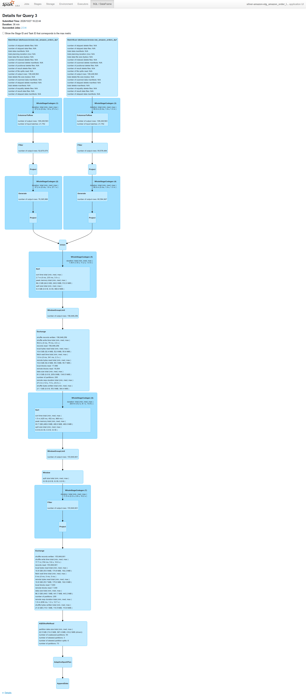
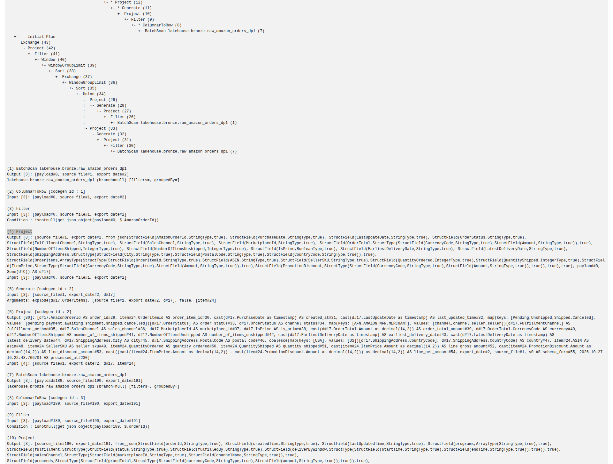
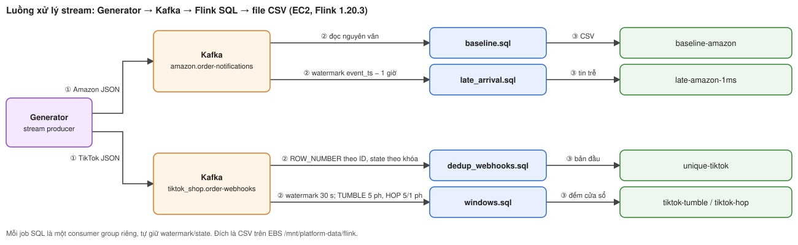
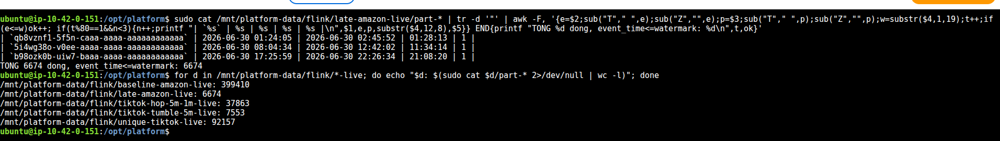
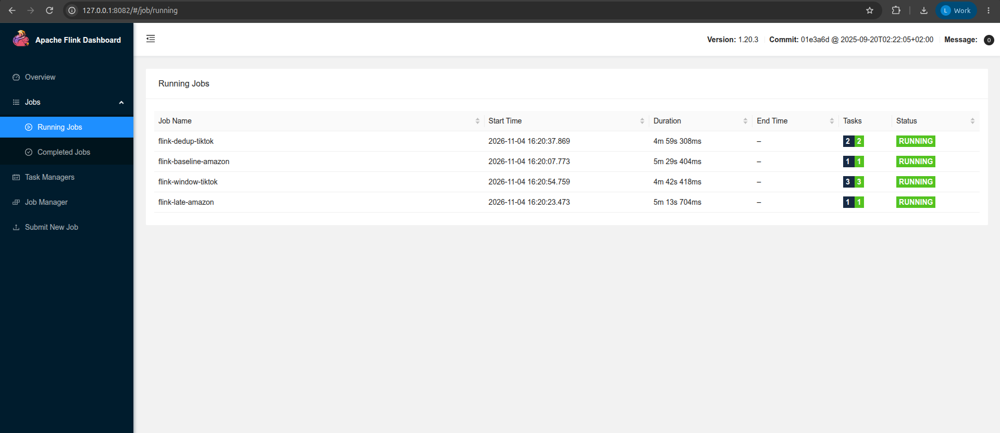
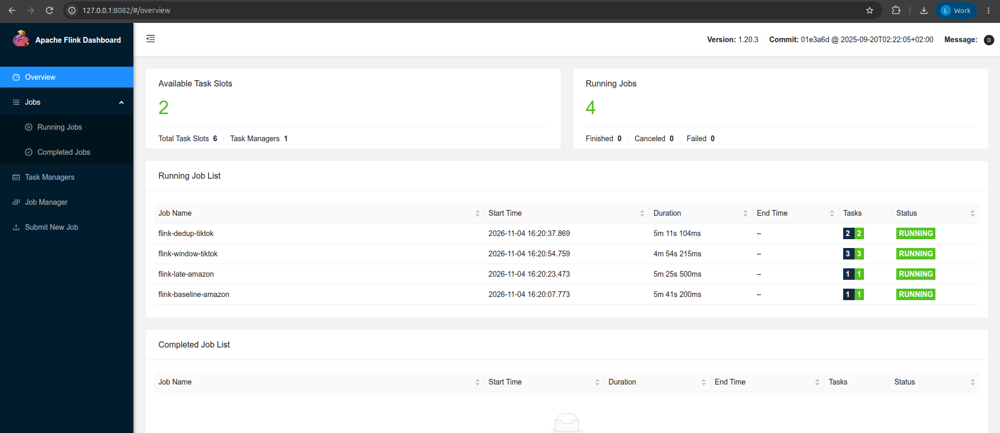

# Processing Jobs on AWS

This page covers the two kinds of processing:
- **Spark** for offline processing (batch, run in batches).
- **Flink** for streaming processing (runs continuously, message by message).

Both Spark and Flink run with Docker Compose on EC2; the lakehouse (Iceberg table store) lives on S3. Each section below states the baseline (control run), the configuration, the trade-offs chosen and the limitations of the screenshots on AWS.

<a id="g-remeasured-on-aws-2026-10-29-ec2-r6ixlarge-4-vcpu-s3a-source"></a>
## Spark: benchmark on EC2

**Conclusion:** keep the `hash` write mode. Dropping `hash` makes writes about 21% faster, but produces 15 times as many small files, slowing down every later read.

**What is measured.** The experiment compares two ways Spark distributes data before writing to an Iceberg table:
- `hash` (control): Spark shuffles the data to gather rows of the same day into the same task before writing.
- `distribution-mode=none` (option b): no shuffle; each task writes the data it already holds directly.

**How it is measured.** Run `PLATFORM_STORAGE=s3 bash scripts/evidence/measure_order_snapshots_bronze.sh
skew_0|skew_b` on EC2:
- The Spark driver runs in the Airflow container; there are 2 Spark workers with 2 cores each; raw data is read from S3 through the IAM role.
- The data is a 20-day sample, 12,627,457 rows per run.
- AQE (Adaptive Query Execution, Spark's mechanism for adjusting the plan at runtime) is disabled so the numbers are easy to compare.

| Run | Time ("DONE in") | Files | Average file size |
|---|---|---|---|
| control `hash` | **average 91.1 s** (three runs: 93.8 / 88.7 / 90.7 s) | 20 | 47.3 MB |
| **(b)** `distribution-mode=none` | **71.6 s** | **309** | **3.1 MB** |

How to read the table:
- The three `hash` runs differ by at most 5.1 s (5.6%). This is the measurement noise.
- Option (b) is 19.5 s faster, i.e. **−21.4%**, about 4 times the noise level, so the difference is real.
- In exchange, (b) creates 309 files instead of 20.

**What the Spark UI says** (read from the History Server on EC2):
- With `hash`, the write job has **2 stages**. Stage 0 reads 9.4 GiB with 114 tasks (44 s) and shuffles 2.2 GiB. Stage 1 receives those 2.2 GiB with 200 tasks (31 s) and writes 945.4 MiB.
- In stage 1, the median task runs only **2 ms and writes 0 rows**, while the longest task runs **12 s and writes 2,173,164 rows**. Reason: the data only has 20 days, so 180 of the 200 tasks receive no day at all, while the task holding the busiest day has to write about 2.17 million rows.
- With `none` there is only **1 stage** of 114 tasks (1.0 minute). Without a shuffle it is faster. However, each task writes a separate file for every day it encounters, resulting in 309 small files.

Deployment decision: **keep `hash`**. Writing 21% faster does not make up for having
15 times as many small files for every later read (see the compaction section, i.e. merging small files, in [storage.md](data_storage.md)).
The AWS screenshots are embedded in the [AWS section](#on-aws-2026-10-29).

<a id="on-aws-2026-10-29"></a>
## Spark: pipeline integration and Spark UI

The skew experiment (data piling up in a few tasks) runs with Compose on EC2 `r6i.xlarge`, with two Spark workers of two cores each, an S3 source,
20 days of Amazon data and AQE disabled. The numbers are in the [EC2 benchmark section](#g-remeasured-on-aws-2026-10-29-ec2-r6ixlarge-4-vcpu-s3a-source)
and in the [receipt](../evidence/aws/data-platform-aws-20261027.json) (the JSON file recording run results, entry `spark_skew_aws`).
Code: [measurement script](../../scripts/evidence/measure_order_snapshots_bronze.sh),
[ingest job](../../spark_jobs/bronze/ingest_amazon_order_snapshots.py).

Summary of what the Spark UI shows:
- The `hash` control run has 314 tasks in total across two stages.
- In the write stage, the median task takes 2 ms and writes 0 rows, but the longest task takes 12 s and writes 2,173,164 rows. That is, most hash partitions are empty, while a few tasks carry the days with lots of data.
- This is data skew by **write day**. It does not prove there is skew by SKU in a join.
- Setting `write.distribution-mode=none` removes the shuffle, leaving one stage with 114 tasks. Time drops from an average of 91.1 to 71.6 seconds, but the file count rises from 20 to 309.

So the project keeps `hash` to avoid many small files. Changing the spec for small Channels is measured separately in [Storage AWS](data_storage.md#on-aws).


**How Spark is called from the pipeline.** Airflow submits the Spark jobs through three DAGs:
- [dp1_bronze](../../dags/dp1_bronze.py): submits the ingest job, then validates each source.
- [dp2_silver](../../dags/dp2_silver.py): submits the normalize-and-dedup job (Silver), then builds Gold and SCD2.
- [dp3_features](../../dags/dp3_features.py): submits the feature-building job, then validates the features.

Airflow Graph, Gantt and log screenshots and an explanation of each component are in [Airflow AWS](pipeline_orchestration.md#on-aws).
The Spark Master screenshot below belongs to the DP1 run. The skew experiment above was run separately with a script,
so the benchmark's run_id is not attributed to a DAG run.


DP2 on AWS validated Silver and Gold with no errors (see [schema evolution and dedup](#on-aws-2026-10-28)).
The AWS Spark UI of the Silver Amazon job (the Union step merging old/new schema and the Window dedup step) is in the [Spark: schema evolution and dedup section](#on-aws-2026-10-28).
**Local** screenshots of the same job: [Union and Window dedup, schema details](reference/spark.md#10-silver-proof-schema-evolution-and-dedup-in-execution-3) (Spark UI, Amazon source).

<a id="on-aws-2026-10-28"></a>
## Spark: schema evolution and dedup

**Conclusion:** the Silver Amazon job reads both the old schema and Amazon's 2026 schema, and removes exactly 3,098,355 duplicates (1.974%). This rate matches the duplicate level the generator deliberately creates.

DP2 runs Spark with Compose on EC2; the Bronze, Silver and Gold data lives on S3.
The run is `manual__2026-10-27T16:05:58+00:00`, recorded in the [receipt](../evidence/aws/data-platform-aws-20261027.json).
The [Amazon job](../../spark_jobs/silver/build_amazon_order_snapshots.py) parses the two schema forms and normalizes them into one.
It then uses a keyed Window to keep only the latest revision of each row. The [DAG](../../dags/dp2_silver.py) places a validator step right after each Silver job.


Silver row counts per the receipt:

| Channel | Silver rows |
|---|---:|
| Amazon | 153,849,901 |
| Walmart | 15,562,675 |
| TikTok Shop | 33,338,110 |
| Shopify | 17,782,786 |
| Shopee | 6,666,831 |

Gold matches the count of each Channel. There are no invalid rows and no duplicate Order Line keys.
The two screenshots above prove the DAG state and the validator results. See also [Airflow AWS](pipeline_orchestration.md#on-aws).

### AWS Spark UI: Union of old/new schema and Window dedup (Silver Amazon)

The screenshots in this section come from the event log (the Spark log saved after a job runs) of the Silver Amazon task in DP2 run `manual__2026-10-27T16:05:58+00:00` (see the [receipt](../evidence/aws/data-platform-aws-20261027.json)):
- Application `app-20261027160606-0024`, named `silver-amazon-stg_amazon_order_lines_dp2`, ran for about 52 minutes and completed.
- The event log was reopened with the Spark History Server on EC2 (without rerunning the job) and captured with [`capture_spark_silver_evidence.py`](../../scripts/evidence/capture_spark_silver_evidence.py).
- Execution 3 is the main data processing part. The [REST](../evidence/aws/silver-amazon-execution-3-aws.json) export stores `status=COMPLETED`, the execution plan and the metrics.



How to read the plan in the screenshot above:
1. Both branches read the Bronze table. Each branch filters and parses one schema form.
2. `Generate` explodes the array of Order Lines in each Order into individual rows.
3. `Union` merges the two branches.
4. The data is sorted and partitioned by key; `WindowGroupLimit`/`Window` keep only the row with `row_number = 1` (the latest version).

The Details section of the plan shows how the two schemas are separated:
- The old-schema branch filters on `get_json_object(payload, $.AmazonOrderId)` and uses `from_json` with `AmazonOrderId`/`OrderItems`.
- The 2026-schema branch filters on `$.orderId` and uses `from_json` with `orderId`/`orderItems`.
- Both branches map to the same set of Silver columns.



| Execution 3 metrics (AWS) | Rows |
|---|---:|
| Order Lines from the old-schema branch (`Generate`, node 18) | 76,365,986 |
| Order Lines from the 2026-schema branch (`Generate`, node 26) | 80,584,967 |
| Before dedup (`WindowGroupLimit`, node 12) | 156,948,256 |
| After dedup (`Filter`, node 6) | 153,849,901 |
| **Duplicates removed** | **3,098,355 (1.974%)** |

The post-dedup count (153,849,901) matches the Silver Amazon count in the receipt. The 1.974% duplicate rate matches the offline duplicate level produced by the generator (1.98%).

<a id="flink-on-aws-2026-10-28"></a>
## Flink: baseline, late arrival, dedup and window

Flink 1.20.3 and Kafka run with Compose on EC2. The bounded run (it has an end: reads up to the last offset and stops) writes its output to the EBS disk at `/mnt/platform-data/flink`.
The [AWS manifest](../evidence/aws/stream-manifest-20261028.json) records the job_ids, input/output message counts and the generator configuration.
The Completed Jobs screenshot shows the baseline, late, dedup, state proof and windows jobs all in the FINISHED state.

### Overall stream processing flow



1. The generator publishes data into two Kafka topics: Amazon (with late and out-of-order messages) and TikTok (with duplicate-ID messages).
2. Each SQL job is a separate consumer group on Flink 1.20.3 (JobManager + TaskManager, Compose on EC2). Each job keeps its own watermark and state.
3. The output is CSV files on EBS `/mnt/platform-data/flink`, compared against the [manifest](../evidence/aws/stream-manifest-20261028.json).

The stream pipeline serving the feature store (Kafka, through a Flink 24-hour HOP window, to Redis/S3) is a separate job; see [Streaming Feature](../ml-llm-platform/stream_features.md).

### Late arrival: how late messages are handled

**Conclusion:** the late arrival job only separates out messages that truly arrive after the watermark. All 6,674 rows it writes satisfy this condition.

Amazon sends notifications out of chronological order. To handle this, [`late_arrival.sql`](../../flink_jobs/order_snapshots/late_arrival.sql)
declares `WATERMARK FOR event_ts AS event_ts - INTERVAL '1' HOUR`.
The watermark is the point in time Flink considers "all messages before this point have been received". Here, each partition's watermark always trails the latest event time seen
by exactly one hour.
A message with `event_ts <= CURRENT_WATERMARK(event_ts)` is one that arrives after the watermark has already passed it. Such a message is written separately to
`late-amazon-1ms`, together with a `watermark_time` column so the data row itself proves why it is considered late.
Real example rows from the `late-amazon-live` output (AWS EC2, continuous run):

| notification_id | event_time (occurred) | publish_time (arrived) | watermark_time at processing | partition | Why it is late |
|---|---|---|---|---:|---|
| `qb8vznf1-5f5n-…` | 2026-06-30 01:24:05 | 2026-06-30 02:45:52 | 01:28:13 | 1 | event_time < watermark: this message is behind partition 1's watermark |
| `5i4wg38o-v0ee-…` | 2026-06-30 08:04:34 | 2026-06-30 12:42:02 | 11:34:14 | 1 | event_time < watermark, more than 3 hours behind the watermark |
| `b98ozk0b-uiw7-…` | 2026-06-30 17:25:59 | 2026-06-30 22:26:34 | 21:08:20 | 1 | event_time < watermark, more than 4 hours behind the watermark |

Check over the whole output: all **6,674** rows of this run have `event_time <= watermark_time` (the check command prints `TOTAL 6674 rows, event_time<=watermark: 6674`, i.e. "TOTAL 6674 rows").
Messages that are late but not beyond the one-hour threshold do not go into this file. That is why the row count here is smaller than the number of out-of-order messages the generator created (19,729).
The Completed Jobs screenshot and graph below only prove that the job ran; **the evidence that the job processes correctly is the `watermark_time` column above**.
The rows above come from `/mnt/platform-data/flink/late-amazon-live/part-*` on EC2; see the [verbatim output](../evidence/aws/flink-live-output-20261104.txt) and the Job status section.



Command that extracts the 3 example rows and checks the late condition on the output (run on EC2, results in the table above):

```bash
cat /mnt/platform-data/flink/late-amazon-live/part-* | tr -d '"' | awk -F, '{e=$2;sub("T"," ",e);sub("Z","",e);p=$3;sub("T"," ",p);sub("Z","",p);w=substr($4,1,19);t++;if(e<=w)ok++; if(t%80==1&&n<3){n++;printf "| `%s` | %s | %s | %s | %s |\n",$1,e,p,substr($4,12,8),$5}} END{printf "TOTAL %d rows, event_time<=watermark: %d\n",t,ok}'
```

**Job status.** The first run was the bounded version: it used `scan.bounded.mode = latest-offset`, so all four SQL jobs read up to the last offset and then stopped in the `FINISHED` state.
The numbers in the "Step / code" table below and the Completed Jobs screenshot all come from that bounded run.
The four SQL files were then changed to run continuously:
- removed `scan.bounded.mode`;
- enabled checkpoints (periodic snapshots of state) to EBS;
- CSV files roll every 30 s;
- output moved to the `*-live` directories;
- TaskManager raised to 6 slots ([`docker-compose.aws-stream.yml`](../../docker-compose.aws-stream.yml)).

Only `dedup_state_proof.sql` stays bounded, because it is used solely to capture the execution plan.

**Rerunning the continuous version on AWS.** Kafka on EC2 had lost the two topics of the bounded run (only `ml.sku_return_24h` and `order_snapshots.return_events` remained), so the data was republished with the generator
(`platform-generator:opt`, seed 42, `--speed 0`):
- **399,410** Amazon messages (132,222 + 133,332 + 133,856 across 3 partitions);
- **93,554** TikTok messages (31,375 + 30,918 + 31,261).

The message counts match the [bounded manifest](../evidence/aws/stream-manifest-20261028.json) message for message, so the numbers in the table below remain comparable with the bounded run.
The four SQL files were then submitted with `sql-client.sh`. About 5 minutes later, all four jobs were **RUNNING**:
dedup-tiktok 2 tasks, baseline-amazon 1, window-tiktok 3, late-amazon 1. TaskManager 1 has 6 slots (2 free). No job is Finished, Canceled or Failed.





Output row counts in the `*-live` directories of the continuous run (counted with `wc -l` on EC2, [verbatim output](../evidence/aws/flink-live-output-20261104.txt)), compared with the manifest of the bounded run:

| Directory | Rows (continuous) | Manifest (bounded) | Notes |
|---|---:|---:|---|
| `baseline-amazon-live` | **399,410** | 399,410 | matches |
| `unique-tiktok-live` | **92,157** | 92,157 | matches (93,554 messages in, 1,397 duplicates dropped) |
| `tiktok-tumble-5m-live` | 7,553 | 7,555 | missing the last 2 windows: the stream never ends, so there is no final watermark to close these windows |
| `tiktok-hop-5m-1m-live` | 37,863 | 37,870 | missing the last 7 windows, same reason |
| `late-amazon-live` | 6,674 | 10,166 | nondeterministic: this number depends on when each partition emits its watermark |

The ML job `ml-sku-return-24h` was not resubmitted in this session (a screenshot of it Running is already in [Streaming Feature](../ml-llm-platform/stream_features.md#on-aws-pipeline-a-2026-10-30)).

The table below summarizes each job of the bounded run, with numbers from the manifest:

| Step / code | Problem and how it is handled | AWS numbers from the manifest |
|---|---|---|
| [Baseline](../../flink_jobs/order_snapshots/baseline.sql) | Reads Amazon in bounded mode, without separating late messages | 399,410 rows, job `ffd9de8a94c5bf67179482bfe03d3b59` |
| [Late arrival](../../flink_jobs/order_snapshots/late_arrival.sql) | Event-time watermark with a 1-hour delay; messages satisfying `event_ts <= CURRENT_WATERMARK(event_ts)` are written to a separate sink | 10,166 rows, job `b172bcf2510b47e1cbcd532f3078a82d` |
| [Dedup](../../flink_jobs/order_snapshots/dedup_webhooks.sql), [state proof](../../flink_jobs/order_snapshots/dedup_state_proof.sql) | TikTok has duplicate-ID messages. `ROW_NUMBER` keeps the first one; the HASH edge routes messages with the same ID to the same keyed Deduplicate operator | 93,554 in, 92,157 out, 1,397 dropped; state proof job `f5b642f64b133e28ec0f57021f1eab22` |
| [Window SQL](../../flink_jobs/order_snapshots/windows.sql) | Counts new Orders per 5-minute tumbling window (consecutive, non-overlapping windows) and per 5-minute HOP window sliding every 1 minute | 7,555 tumbling windows / 37,870 HOP windows, job `dad323a91493cdf365c5a3d3d4dd0adf` |


Notes on reading the screenshots above:
- The dedup job's UI shows the HASH edge leading to Deduplicate and 93,554 records received. This proves the keyed dedup operator actually ran.
- The 92,157 output rows come from the manifest. The file sink's Records Sent column in the UI is 0, but that does not mean data was lost.
- The Completed Jobs screenshot only confirms the late job FINISHED. The continuous run adds an AWS terminal screenshot extracting three late messages and checking that `event_time <= watermark` holds for 6,674/6,674 rows ([screenshot](../evidence/aws/flink-late-arrival-live.png)).
- There is still no AWS Flink UI screenshot with the watermark operator opened. **Local** screenshot of the same late job: [watermark and late messages](reference/flink.md#catching-late-messages-with-a-watermark) (local Flink UI).
- The number 10,166 is nondeterministic: the watermark is emitted periodically, so this number differs from the 19,729 out-of-order messages the generator counts over the whole dataset.
- The long-running window on AWS (24 hours, sliding 1 hour) has [its own operator/checkpoint screenshot](../ml-llm-platform/stream_features.md#on-aws-pipeline-a-2026-10-30).

[Section index](README.md) · [Main index](../README.md)
