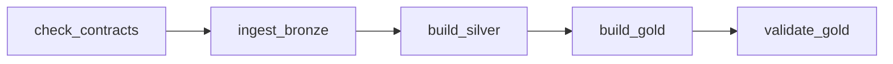

<!-- Describes operating the v2 source DAG, its receipts and the limits not yet checked with Docker. -->
# Airflow — v2 source pipeline

> **Pipeline v2 (order lifecycle) — designed and tested locally; not the pipeline deployed on AWS.** The pipeline running on AWS is v1 (DP1 → DP4 + ML); see [Data Platform evidence](../evidence.md). Mentions of GCP below are an old plan that was never run; the current cloud target is [AWS](../../shared/aws_deploy.md).

The DAG [`dp_order_lifecycle`](../../../dags/dp_order_lifecycle.py) is triggered manually and runs from the fixture to
Gold/labels/features. By default the DAG is paused, `schedule=None`, `catchup=False`,
`max_active_runs=1`, `max_active_tasks=1`. The fixture has no real data release schedule yet.



| Task | Command / application | Failure condition |
|---|---|---|
| `check_contracts` | `python -m spark_jobs.lib.data_contracts check-registry --contracts-dir /opt/contracts` via PythonOperator | Non-zero exit; the receipt keeps stdout/stderr |
| `ingest_bronze` | `bronze/ingest_order_lifecycle.py --root … --run-id … --receipt …` | Walmart manifest/snapshot mismatch, Spark error |
| `build_silver` | `silver/build_order_lifecycle.py --run-id … --as-of … --contracts-dir /opt/contracts --receipt …` | Non-zero reconcile check; the quarantine count alone does not fail it |
| `build_gold` | `gold/build_order_lifecycle.py --cutoff … --run-id … --receipt …` | Silver differs from the cutoff snapshot, an invariant fails, or the label generation already exists |
| `validate_gold` | `gold/validate_order_lifecycle.py --cutoff … --run-id … --receipt …` | Any failed invariant; a non-zero exit fails the DAG |

The four Spark tasks use `PlatformSparkSubmitOperator` (Bronze through a small subclass),
`conn_id=spark_default`, `deploy_mode=client`, packages from a Variable and driver memory
`platform_order_lifecycle_driver_memory` (default 3g; 1g once caused OOM in Gold/warehouse locally). Credentials are looked up at runtime. Bronze gets the group `iceberg, postgres` so that
JDBC uses `platform_postgres`; the other three tasks use `iceberg`. No provider is added.
The contracts CLI uses the standard library and runs from `/opt`, where the `spark_jobs/` package lives.

## Params and Variables

| Airflow Param | Default | Usage |
|---|---|---|
| `source_root` | `null` | Uses `platform_order_lifecycle_source_root`; if passed, it is a fixture directory with a manifest visible inside the container |
| `cutoff` | `null` | Uses `platform_order_lifecycle_cutoff`; a passed value must be an ISO UTC timestamp |
| `walmart_jdbc` | `null` | Reads the bootstrap file; pass `walmart_lifecycle.orders` so the job `spark_jobs/bronze/ingest_order_lifecycle.py` reads the DB instead of the Walmart file |

`source_root` and `cutoff` fall back to Variables at task render time, without calling the
metadata DB at DAG import. Null is a deliberate default; do not nest Jinja
inside a Param. Silver receives **the same cutoff** via `--as-of`, because Gold re-checks the
published Silver against the snapshot at the cutoff before writing.

The v2 Variables are loaded by [`scripts/setup/setup_airflow.sh`](../../../scripts/setup/setup_airflow.sh):

| Variable | Setup value |
|---|---|
| `platform_order_lifecycle_receipt_dir` | `/opt/airflow/receipts/order_lifecycle` |
| `platform_order_lifecycle_source_root` | `/data/order_lifecycle` |
| `platform_order_lifecycle_cutoff` | `2026-06-01T00:00:00.000000Z` |
| `platform_order_lifecycle_driver_memory` | `3g` |
| `platform_order_lifecycle_executor_memory` | `4g` |
| `platform_order_lifecycle_executor_cores` | `2` |

Both DAGs `dp_order_lifecycle` and `dp_order_lifecycle_warehouse` render the three resource Variables
through Jinja at runtime. The subclass in each DAG extends `template_fields`, including
Bronze; this does not depend on whether the provider templates resources. Setup reloads the
default values when rerun; change the Variables after setup if needed. The driver runs inside
Airflow (client mode); run only one Spark DAG at a time and measure real RAM
before increasing the configuration. See the GCP checklist.

The DAG also uses `platform_spark_packages`, already in the setup script. Connections, MinIO,
the warehouse and the REST catalog use the shared runtime configuration, as in [Airflow v1](../pipeline_orchestration.md).

## Preparation and trigger — run by the operator

Compose mounts `${PLATFORM_ORDER_LIFECYCLE_DIR:-./out/order_lifecycle_live}` read-only at
`/data/order_lifecycle` on Airflow, the Spark master and both workers. Export this variable
on the host before calling Compose if using a different fixture. The manifest must be readable
from the driver, and the JSONL must be readable from the executors. `/opt/contracts` is already mounted.
Receipts are bind-mounted with `./out/receipts:/opt/airflow/receipts` to keep them on the host; the Airflow UID
must be able to write to this directory. The runbook creates the directory and grants write permission for the dev environment.
Check that the workers have a Python compatible with the driver if Gold runs Python RDDs; this has not been checked
in the sandbox.

The runbook splits phases on a 14 GB machine: see [Running DataHub v2 for real](datahub_order_lifecycle.md#running-for-real).
`bash scripts/run/run_order_lifecycle_live.sh --phase source`, then `--phase airflow`, starts the
required services, waits for the scheduler/worker, runs setup, unpauses/triggers, polls until the final
state, copies the receipts by `run_id` and then stops the dependencies to free RAM.
After setup the runbook sets `platform_order_lifecycle_executor_memory=2g` for the small fixture to match the default
2g worker; use `PLATFORM_V2_EXECUTOR_MEMORY` and enlarge the workers accordingly if needed.
The shared setup value of 4g in the table above still applies to environments with enough RAM.

If JDBC is enabled, load the data first with `scripts/setup/load_order_lifecycle_walmart.py --root <fixture>`;
the DAG does not create data or load the DB itself. Lakekeeper, MinIO, PostgreSQL, Spark and
Airflow must be ready. The commands below do not start/stop services:

```bash
bash scripts/setup/setup_airflow.sh
# Setup also reloads the existing v1 values; the operator chooses a suitable time.
docker compose --profile airflow exec -T airflow airflow dags list-import-errors --output json
docker compose --profile airflow exec -T airflow airflow dags unpause dp_order_lifecycle
docker compose --profile airflow exec -T airflow airflow dags trigger dp_order_lifecycle \
  --conf '{"source_root":"/data/order_lifecycle","cutoff":"2026-06-01T00:00:00.000000Z","walmart_jdbc":"walmart_lifecycle.orders"}'
```

Use a new `run_id` for each Gold publication. Labels are appended per generation and the same
generation is rejected; clearing/retrying Gold after it has appended may fail because the generation already exists.
`max_active_runs=1` only locks this DAG; it does not protect against a manually run Spark job on the same tables.

A real import inside the image was confirmed by the operator:
**10 DAGs, 0 errors**, including `dp_order_lifecycle`, `dp_order_lifecycle_cdc`,
`dp_order_lifecycle_warehouse` and seven snapshot DAGs that keep their names
(recorded locally; receipt not attached to the repo). This is an import check;
a real DAG run on Compose has not been done. Recheck command, run by the operator:

```bash
docker run --rm --network none --read-only --tmpfs /tmp:rw,size=256m \
  --mount type=bind,src=$PWD/dags,dst=/opt/airflow/dags,readonly \
  --entrypoint python platform-airflow:2.10.5-spark3.5.3 -c \
  "from airflow.models import DagBag; b=DagBag('/opt/airflow/dags', include_examples=False); print(b.import_errors); assert not b.import_errors; print(sorted(b.dag_ids))"
```

## Reading receipts

Each stage uses the directory `{{ var.value.platform_order_lifecycle_receipt_dir }}/{{ ts_nodash }}/`:
`check_contracts.json`, `ingest_bronze.json`, `build_silver.json`, `build_gold.json`,
`validate_gold.json`. Receipts carry the original Airflow `run_id`. The directory follows logical
time, not the attempt; a retry may overwrite the receipt of the same task. Avoid triggering two
runs with the same logical timestamp if the directories need to stay separate.

Contracts records the exit code/stdout/stderr and `completed_at`. Bronze passes
`--receipt <DIRECTORY>/ingest_bronze.json` to the job `spark_jobs/bronze/ingest_order_lifecycle.py`. On success the operator keeps
the Spark receipt as is, with `run_id`, `dataset_version`, `tables`, `rows`,
`completed_at` and `schema_file` pointing to `schemas.json` in the same directory. When Spark
fails, the operator writes a receipt with `status=failed`, the target tables, `checks_available=false`
and the completion time, then re-raises the error; a failure receipt does not confirm the schema
or the Bronze reconciliation metrics. The detailed manifest/boundary remains in the log.

Silver/Gold/Validate use the job's original receipt; no checks are added based on
guesswork. Silver has `checks`, `info`, `quarantine.total/by_reason/by_schema_id`;
only `checks != 0` causes a failure. Gold has the status `failed_before_write`, `failed`
or `passed`; Validate reads the Gold tables back. A failure before the job manages to write a receipt may
leave only the Airflow log; do not infer from a missing receipt that the task succeeded.

Example of the operator copying receipts after a run (the Airflow volume keeps the data):

```bash
mkdir -p out/receipts-v2-run/REPLACE_RUN_ID
docker compose --profile airflow cp \
  airflow:/opt/airflow/receipts/order_lifecycle/REPLACE_TS_NODASH/. out/receipts-v2-run/REPLACE_RUN_ID/
```

Send the metadata with the [v2 publisher](datahub_order_lifecycle.md), keeping `schemas.json` next to the
receipt so the run's actual Bronze/Silver/Gold schema can be read. Older receipts without a schema
can still be read, and the publisher states explicitly that the schema fields are missing. The current
Bronze/Silver/fact/feature tables are replaced per run; many tables have no shared publication
transaction yet. A small fixture does not prove scale or production refresh.

**Not measured yet — measure on GCP:** `bash scripts/run/run_order_lifecycle_live.sh --phase source`
then `bash scripts/run/run_order_lifecycle_live.sh --phase airflow` on a host prepared
following the [runbook](datahub_order_lifecycle.md#running-for-real) and the GCP checklist.
The operator chose to skip the long steps locally; there is no run_id, real DAG-run receipt,
Graph/Grid screenshot or run time yet. The local e2e small result, PASS in 92 s, in
[e2e local](e2e_order_lifecycle_local.md) is a harness run and does not prove the DAG runs successfully.
