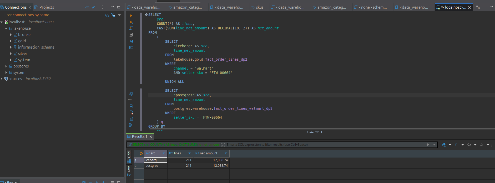

# Federation and CDC — comparison method

Every conclusion is tied to a run, a data scope and an observed result. Deployment configuration lives in the [Data Platform architecture](../../shared/architecture_decisions.md), [Trino](trino.md) and [CDC](cdc.md).

## 1. Trino federation — Gold/warehouse reconciliation has been run

**Idea:** use one SQL session to read Iceberg on MinIO and the PostgreSQL
warehouse. See [the configuration and the SQL that was run](trino.md).

**Comparison question that was run:** for the same Walmart SKU `FTW-00664`, how many Order
Lines and what net total are there in Gold Iceberg and in the PostgreSQL warehouse slice?

| Approach | Operation | Steps | Time | Result |
|---|---|---:|---:|---|
| Trino CLI, two separate queries | One on Gold and one on the warehouse; the two results must be combined | 2 | 1.66 + 1.01 = 2.67 seconds | 211 rows on each side, net 12,038.74 |
| Trino CLI, one federated query | `UNION ALL` over two catalogs, grouped by source in one SQL statement | 1 | 2.16 seconds | Two result rows, 211 rows and net 12,038.74 on each side |

The warehouse is a six-column slice of Walmart Gold from the same write, so both sides use
the same set of Order Lines, the same SKU filter and the same calculation. The seconds are one run on
the existing cache, measuring both the CLI and the connection; this does not show that federated Trino is always faster.
The main evidence is **one SQL statement reading two systems at once** and
reconciling equal data. The current scope is one Walmart SKU, not the monthly multi-Channel
revenue comparison in the original plan.

## 2. Debezium CDC — evidence up to Bronze

Measured from the moment an `UPDATE` commits on PostgreSQL to the moment the record is readable in Bronze, and
the number of records that must be read to find three changes. Compared with batch polling, which scans the whole table;
the 24-hour cycle is the chosen comparison policy, not a technical limit of
batch.

| Approach | Changes to detect | Rows to read | Commit → Bronze |
|---|---:|---:|---:|
| Batch snapshot | 3 | 1,293,525 source rows at the current count | On a 24-hour schedule: waits 0–24 hours until the next read; the runtime of one scan has not been measured |
| Debezium CDC | 3 | 3 new events at offsets 3–5; Bronze grows from 3 to 6, nothing missing or duplicated | To Kafka: 466.6–623.3 ms; to Bronze: at most 31.261–44.380 seconds, including a manual DAG trigger |

The Bronze measurement and Airflow screenshot are in [`cdc.md`](cdc.md). The comparison batch is
configured to read the source table every 24 hours: a change that arrives right after a read waits almost 24
hours, and evenly spread changes wait about 12 hours on average. This is **a consequence of the chosen
schedule**, not the maximum speed of Batch. To reduce Batch's waiting time you
have to rescan the source table more often; CDC reads the committed change itself. The figure
**1,293,525** comes from `SELECT count(*) FROM walmart.orders` after the
second probe finished; the sample rows were deleted. It is the number of records one
full-table snapshot pass has to examine to find three changes, not byte I/O measured from
PostgreSQL.

Data contracts: [Data contract + schema registry and the Silver v2 entry quarantine gate](data_contracts.md).

Iceberg maintenance: [Policy-driven automatic Iceberg maintenance](iceberg_maintenance.md).
