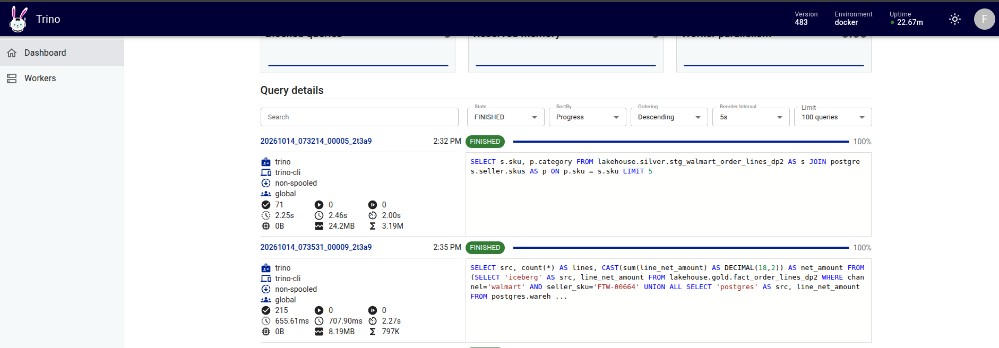
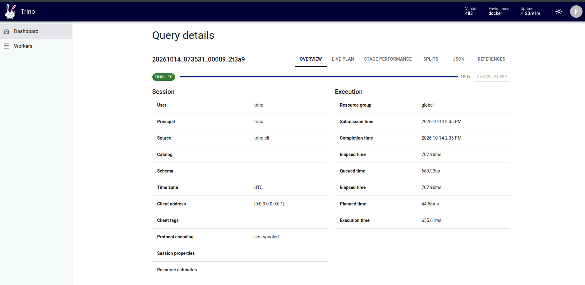
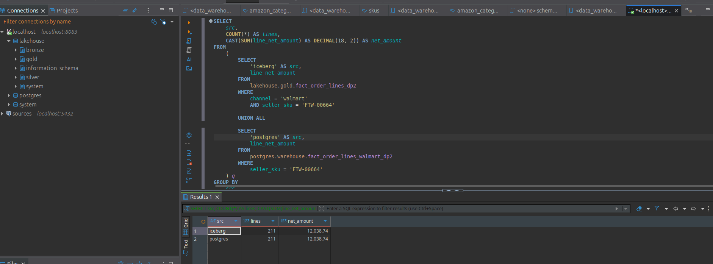

# Trino: querying Iceberg and PostgreSQL in one SQL session

Trino runs in the `query` profile to keep its RAM separate from Spark, Flink and Airflow. The default JDBC
endpoint is `localhost:8083`; DBeaver uses the Trino driver, user `platform`,
with authentication disabled for the local development environment.

## Two catalogs

- `lakehouse`: Iceberg REST through Lakekeeper (`http://lakekeeper:8181/catalog`), with
  Parquet data on MinIO. Trino uses the native S3 client with path-style access.
- `postgres`: the PostgreSQL database `sources`, the Walmart source. The password and the
  MinIO access key come from the Compose environment; the catalog files hold no secrets.

## Startup and checks

```bash
docker compose --env-file .env.example --profile query up -d trino
docker compose --env-file .env.example --profile query exec -T trino trino --execute 'SHOW CATALOGS'
docker compose --env-file .env.example --profile query exec -T trino trino --execute 'SHOW SCHEMAS FROM lakehouse'
docker compose --env-file .env.example --profile query exec -T trino trino --execute 'SHOW SCHEMAS FROM postgres'
```

The Trino 483 run is in state `ACTIVE`. Trino sees
`lakehouse.bronze`, `lakehouse.silver`, `postgres.seller` and `postgres.walmart`.
The following query reads an Iceberg table and a PostgreSQL table **at the same time**:

```sql
SELECT s.sku, p.category
FROM lakehouse.silver.stg_walmart_order_lines_dp2 AS s
JOIN postgres.seller.skus AS p ON p.sku = s.sku
LIMIT 5;
```

Observed result:

| SKU | Category |
|---|---|
| `HOM-01833` | `home` |
| `BEA-01612` | `beauty` |
| `ELE-01033` | `electronics` |
| `ACC-00827` | `accessories` |
| `FTW-00571` | `footwear` |

This is evidence that Trino can query two systems in one SQL statement. Evidence
for the Trino federation comparison still needs a timing comparison on the same question and the same Gold data.

## Reconciling Gold with the warehouse on the same Order Lines

After five-Channel Gold and the Walmart warehouse slice have been
written, one Trino SQL statement reads **both catalogs** for the same SKU:

```sql
SELECT src, count(*) AS lines,
       CAST(sum(line_net_amount) AS DECIMAL(18,2)) AS net_amount
FROM (
  SELECT 'iceberg' AS src, line_net_amount
  FROM lakehouse.gold.fact_order_lines_dp2
  WHERE channel = 'walmart' AND seller_sku = 'FTW-00664'
  UNION ALL
  SELECT 'postgres' AS src, line_net_amount
  FROM postgres.warehouse.fact_order_lines_walmart_dp2
  WHERE seller_sku = 'FTW-00664'
) q
GROUP BY src ORDER BY src;
```

| Source | Order Lines | Net amount (source original currency) |
|---|---:|---:|
| Iceberg Gold | 211 | 12,038.74 |
| PostgreSQL warehouse | 211 | 12,038.74 |

The Trino CLI returns exactly the two rows above. One end-to-end measurement with `/usr/bin/time`
of the federated SQL is **2.16 seconds**. The two corresponding SQL statements run separately through
the Trino CLI take **1.66** and **1.01 seconds** respectively (2.67 seconds in total); this is one
run on the current cache, and no general performance improvement is inferred.
The difference demonstrated is one SQL statement/query instead of two SQL statements
plus a manual step to combine the results. The Trino federation measurement is in
[`data_integration.md`](data_integration.md).

Screenshots of the run:







The Trino UI screenshot shows one `UNION ALL` SQL statement running over both catalogs and ending
`FINISHED`. The DBeaver screenshot shows that same SQL statement together with the result table: `iceberg`
211 rows / 12,038.74 and `postgres` 211 rows / 12,038.74.

## Configuration references

Configured following the official documentation for the
[Iceberg REST catalog](https://trino.io/docs/current/object-storage/metastores.html#rest-catalog),
[S3-compatible storage](https://trino.io/docs/current/object-storage/file-system-s3.html)
and the [PostgreSQL connector](https://trino.io/docs/current/connector/postgresql.html).

## On AWS

Trino 483 runs on EC2 (profile `query`, loopback 8083), catalog [`trino/catalog-aws/lakehouse.properties`](../../../trino/catalog-aws/lakehouse.properties):
`lakehouse` = Iceberg REST (Lakekeeper) + real S3 through the EC2 IAM role (no access key), `postgres` =
PostgreSQL on EC2. One SQL statement reads Gold on S3 and the 30-day warehouse on PostgreSQL at the same time:

```sql
SELECT 'iceberg' AS nguon, count(*) AS dong, sum(line_net_amount) AS tien
FROM lakehouse.gold.fact_order_lines_dp2
WHERE seller_sku = 'APP-00482'
  AND created_at >= TIMESTAMP '2026-05-31 00:00:00 UTC' AND created_at < TIMESTAMP '2026-06-30 00:00:00 UTC'
UNION ALL
SELECT 'postgres', count(*), sum(line_net_amount)
FROM postgres.warehouse.fact_order_lines_30d_dp2
WHERE seller_sku = 'APP-00482'
```

| nguon (source) | dong (rows) | tien (amount) |
|---|---|---|
| iceberg | 4,517 | 49,632,312.55 |
| postgres | 4,517 | 49,632,312.55 |

The two sources match on row count and total amount: this is both a federated query and a cross-check that
`dp4_warehouse` copied exactly 30 days from Gold.

Query `20261029_092844_00002_zfrx9`: FINISHED, 15.50 s (planning 571 ms), 3 stages; stage 1 reads Iceberg
(7.18M rows scanned, 27.3 s scheduled on 1 worker).


The idea is to cross-check Gold on S3 against the PostgreSQL warehouse in one SQL statement, removing the manual step of combining results.
`UNION ALL` keeps each source's result separate; two matching aggregate values do not prove that every row is identical.
The figures 4,517 and 49,632,312.55 come from the [receipt](../../evidence/aws/data-platform-aws-20261027.json)
(`novel_trino_federation`); the UI screenshots show the two-catalog SQL and FINISHED, not the CLI result table.
PostgreSQL catalog: [postgres.properties](../../../trino/catalog-aws/postgres.properties).
