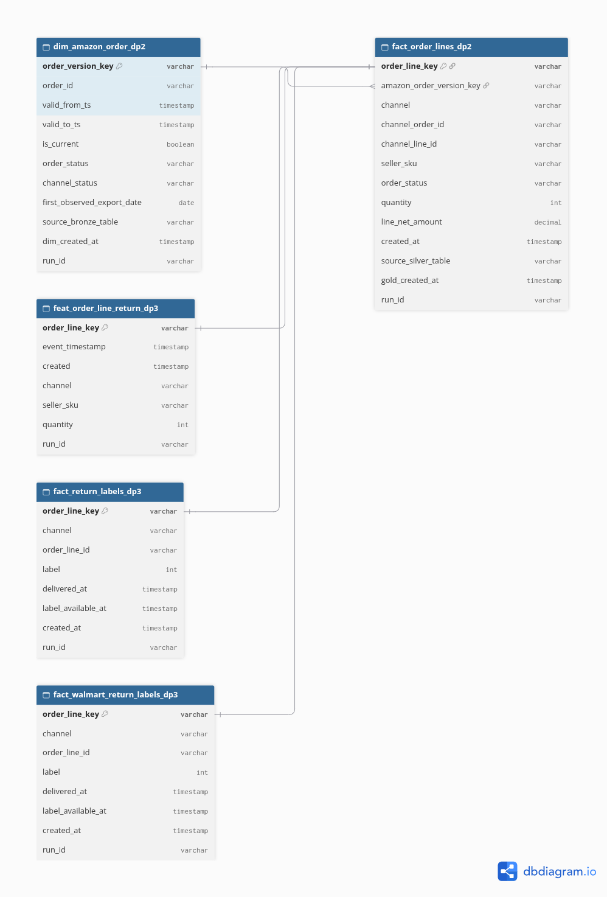
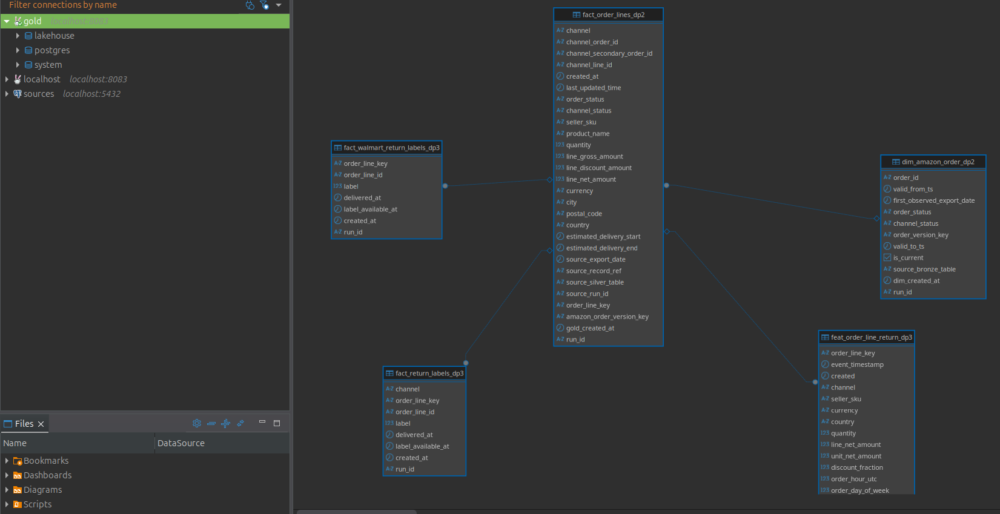

# Schema Design on AWS

This page covers the data zones, SCD2, the feature table, dim–fact relationships and naming conventions.

Code / configuration: [SCD2](../../spark_jobs/gold/build_amazon_order_status_scd2.py), [fact](../../spark_jobs/gold/build_order_snapshot_lines.py).

The results below come from runs on AWS. They prove that those runs happened; they do not mean the services are still running.

## On AWS

The three DAGs DP1, DP2 and DP3 run with Docker Compose on EC2; the Iceberg tables live on S3. Related docs:
- [DataHub AWS](data_governance.md#on-aws) has lineage screenshots, i.e. the path data takes from `raw` tables to `stg`, then to `fact`/`dim`, then to `feat`.
- [Gold AWS](reference/gold.md#on-aws) has the validator logs.
- The [manifest](../evidence/aws/datahub-validation-aws-20261029.json) records table names and run_ids.

A table's name tells its role:

| Prefix | What the table holds |
|---|---|
| `raw_` | raw payload from the source |
| `stg_` | normalized and deduplicated data |
| `fact_` | Order Lines or Return labels |
| `dim_` | the SCD2 versions of an entity |
| `feat_` | features at the time the Order was placed |

SCD2 (Slowly Changing Dimension type 2) is a way of storing history: every time the status changes, a new version row is added with its own validity interval, instead of overwriting.

On AWS, the label table for all five Channels is `gold.fact_return_labels_dp3`. It differs from the Walmart-only bridge table in the local diagram in the reference section below.
Code that builds the relationships: [SCD2](../../spark_jobs/gold/build_amazon_order_status_scd2.py),
[fact](../../spark_jobs/gold/build_order_snapshot_lines.py), [feature](../../spark_jobs/gold/build_order_snapshot_return_features.py).

The actual table list on AWS, read through Trino on EC2. Catalog `lakehouse` holds the Iceberg tables on S3, managed through Lakekeeper (an Iceberg catalog service):


- **Bronze**:
  - `raw_<channel>_orders_dp1` (one table per Channel, 5 in total) holds the source payload plus provenance columns (origin: file, load time, run_id).
  - `raw_walmart_cdc_v2` is the target table of the CDC (Change Data Capture from PostgreSQL) flow through Debezium ([cdc](reference/cdc.md)).
  - `raw_amazon_orders`, `raw_walmart_orders`, `raw_amazon_orders_sample` are manually run tables, kept as evidence for the Spark measurements.
  - `raw__orders` is a leftover broken table (gap #10, not deleted yet).
- **Silver** `stg_<channel>_order_lines_dp2`: each row is one Order Line, with a normalized schema and duplicates removed.
- **Gold**:
  - `dim_amazon_order_dp2`: SCD2 of the Amazon order status.
  - `fact_order_lines_dp2`: Order Lines of all five Channels.
  - `fact_return_labels_dp3` and `fact_walmart_return_labels_dp3`: Return labels.
  - `feat_order_line_return_dp3`: features.
- Schema `runtime_smoke` holds a test table created by Ansible when checking whether Lakekeeper can write. It is not part of the pipeline.


### Dim–fact relationship ERD (Gold)

The zone screenshot above only lists tables; the relationships between dim and fact tables are drawn separately here.
Iceberg has no enforced foreign keys like PostgreSQL, so when DBeaver connects to Trino it only shows unconnected tables.
The connecting lines below are therefore logical relationships. Each line has a validator that checks it in DP2/DP3:
- `validate_amazon_order_dim` checks 5,779,561 versions, with no missing or duplicate keys.
- `validate_return_features` checks that the feature table has exactly the same rows as Gold, with no missing and no extra rows.

dbdiagram version: [`gold-erd.dbml`](../diagrams/gold-erd.dbml) (paste into dbdiagram.io to view).



Diagram drawn from [`gold-erd.dbml`](../diagrams/gold-erd.dbml) with dbdiagram.io (the Gold schema that ran on AWS, not a DBeaver screenshot).

#### Preparing the DBeaver screenshot with connecting lines

**Status:** done. There is a DBeaver ER Diagram screenshot with connecting lines on AWS, along with the DBML file and the dbdiagram image.
The screenshot was taken from Trino 483 on EC2, through the tunnel `localhost:8083`, catalog `lakehouse`, schema `gold`.
The diagram has five tables; all four relationships connect to the central table `fact_order_lines_dp2`:



The connecting lines are logical relationships (virtual foreign keys) declared in DBeaver, not constraints stored in Iceberg. The DBeaver connection name at capture time was `gold` (the AWS Trino connection).
The steps below are kept so others can reproduce this screenshot.

1. Start the Data Platform EC2 instance and the Trino, Lakekeeper and PostgreSQL services backing the catalog; keep S3 read access
   through the EC2 IAM role. T07 does not need EKS, nor a rerun of DP1–DP3 if the Gold tables are still complete.
2. Open a tunnel from the DBeaver machine to the loopback Trino port on EC2 (default `8083`, see
   [Compose AWS](../../docker-compose.aws.yml) and the [AWS runbook](../shared/aws_deploy.md)).
   Check that the tunnel forwards this port; if `8083` is already in use locally, pick another local port.
3. In DBeaver, create a Trino driver connection to `localhost`, the tunnel's local port, user `platform`,
   catalog `lakehouse`, schema `gold`. Name the connection clearly `AWS Trino` to distinguish it from local.
   Check the metadata with these SQL statements:

   ```sql
   SHOW TABLES FROM lakehouse.gold;
   DESCRIBE lakehouse.gold.dim_amazon_order_dp2;
   DESCRIBE lakehouse.gold.fact_order_lines_dp2;
   ```

4. Create a custom ER Diagram in DBeaver (File → New → DBeaver → ER Diagram) and add the two tables
   `dim_amazon_order_dp2` and `fact_order_lines_dp2` from the AWS connection.
   Create a virtual relationship by dragging the source column onto the target column or by using Connection in the Palette,
   then confirm the exact column pair below. Relationships in a custom diagram are virtual foreign keys,
   stored only in DBeaver; no constraint is added to Iceberg.

| Source table | Source column | Referenced table | Target column |
|---|---|---|---|
| `fact_order_lines_dp2` | `amazon_order_version_key` | `dim_amazon_order_dp2` | `order_version_key` |

This is a many-Order-Lines-to-one-Amazon-Order-version relationship; the other four Channels have
`amazon_order_version_key = NULL`. Relationships on `order_line_key` from the feature and label tables
to the fact table can be added following the [DBML](../diagrams/gold-erd.dbml), after confirming the actual tables/columns exist.
How-to guides: [DBeaver custom diagrams](https://github.com/dbeaver/dbeaver/wiki/Custom-Diagrams),
[virtual keys](https://github.com/dbeaver/dbeaver/wiki/Virtual-Keys).

When recapturing, the AWS connection name, both table names, the key columns and the connecting line must be clearly visible; record the capture date and environment.
Save the screenshot at `docs/images/schema/dbeaver-erd-dim-fact-aws-YYYYMMDD.png`, embed it right in this section and
note that the connecting line is a logical relationship declared in DBeaver. The evidence is only considered complete once that screenshot exists.
Local screenshots in the reference section below keep their local label.

**Main columns of SCD2 and features:**
- SCD2: each status version of an `order_id` has `valid_from_ts` (start of validity), `valid_to_ts` (end of validity) and `is_current` (whether it is the current version).
  The version key `order_version_key` is the key the fact table joins on (for the dim–fact relationship see the [ERD above](#dimfact-relationship-erd-gold)).
- Features: `event_timestamp` is the time the Order was placed, used as the point-in-time anchor (only information known at that time is used).
  `created` is when the job wrote the row. These are exactly the two timestamp columns Feast needs.

<details>
<summary>Reference: design, development guide and records from before the AWS deployment</summary>

Local records keep their original environment and do not replace cloud evidence.

## Three-zone schema and Gold relationships

Checked directly with Trino `SHOW TABLES` and `DESCRIBE`. The
diagram below only shows the tables belonging to the DP1/DP2/DP3 runs of the five Channels; Bronze also
has test/smoke tables and `raw_walmart_cdc` for the separate CDC pipeline.


The diagram above is drawn from a [self-contained HTML version](../diagrams/schema-zones.html), based on metadata
read through Trino. Screenshots of the DBeaver UI connected to Trino with the tables are in the section below.


| Zone | Table | Grain and purpose |
|---|---|---|
| Bronze | Five `raw_*_dp1` tables | Unnormalized source payloads or records; keeps the export and provenance |
| Silver | Five `stg_*_order_lines_dp2` tables | One product row per Order, normalized schema and per-Channel dedup |
| Gold | `fact_order_lines_dp2` | One Order Line across the five Channels; key `order_line_key` |
| Gold | `dim_amazon_order_dp2` | One status version per Amazon Order seen in Bronze; key `spark_jobs.lib.order_version_key` |
| Gold | `feat_order_line_return_dp3` | Features at Order time; key `order_line_key`, with `event_timestamp` and `created` |
| Gold | `fact_walmart_return_labels_dp3` | Separate Walmart labels, joined by Order Line once enough time has passed for the answer to be known |

## DBeaver screenshots connected to Trino (runtime)


The first screenshot is DBeaver's Database Navigator connected to Trino (`localhost:8083`), showing
all three zones `bronze`, `silver`, `gold` of catalog `lakehouse` plus the schemas
`warehouse`, `seller`, `walmart` of catalog `postgres`. The second screenshot is the ER
Diagram between `fact_order_lines_dp2` and `dim_amazon_order_dp2`.


## Fact and SCD2 relationship

Trino `DESCRIBE` confirms the fact has `amazon_order_version_key` of type `varchar`,
and the dimension has `spark_jobs.lib.order_version_key` of type `varchar` along with `valid_from_ts`,
`valid_to_ts`, `is_current`. The SCD2 job builds the key from the pair `(order_id,
valid_from_ts)`; the Amazon fact builds the same key from `channel_order_id` and
`last_updated_time`. The other four Channels have this key set to `NULL`. Runtime validation
checked **5,779,561** versions, with no duplicate keys, no invalid validity intervals and no
Amazon fact rows pointing to a nonexistent version. See [Gold](reference/gold.md) and the
[SCD2 decision](reference/gold_design.md).

This is a logical relationship in Iceberg. Iceberg does not declare enforced foreign keys
like PostgreSQL; `validate_amazon_order_dim` checks the keys in every DP2 run.
`feat_order_line_return_dp3` has the two timestamp columns the design uses, confirmed
with `DESCRIBE` after the DP3 run.

## Naming conventions

| Layer/role | Prefix | Example that ran |
|---|---|---|
| Bronze, keeps the original and provenance | `raw_` | `raw_amazon_orders_dp1` |
| Silver, normalized and deduplicated | `stg_` | `stg_amazon_order_lines_dp2` |
| Gold, dimension versions | `dim_` | `dim_amazon_order_dp2` |
| Gold, events or labels | `fact_` | `fact_order_lines_dp2`, `fact_walmart_return_labels_dp3` |
| Gold, offline features | `feat_` | `feat_order_line_return_dp3` |

`obt_` is reserved for single-purpose flat tables; there is no such table yet
in the recorded runs. The suffixes `_dp1`, `_dp2`, `_dp3` distinguish Airflow evidence
tables from benchmark/smoke tables. The catalog is `lakehouse`, the namespaces
are `bronze`, `silver`, `gold`; business concepts are in the
[terminology](../shared/terminology.md).

</details>

[Section index](README.md) · [Main index](../README.md)
