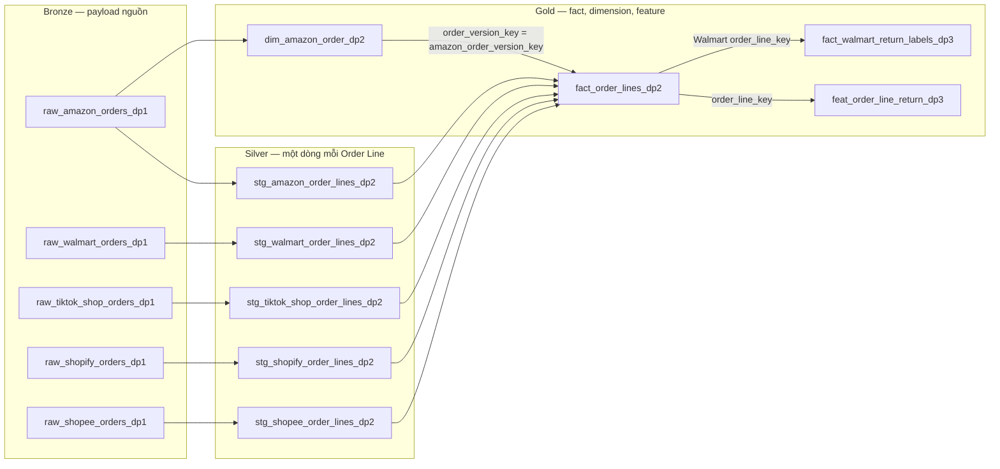

# Schema Design trên AWS

Trang này ứng với EDAI-1, dòng 34–38 của rubric: các zone dữ liệu, SCD2, bảng feature, quan hệ dim–fact và quy ước đặt tên.

Code / cấu hình: [SCD2](../../spark_jobs/gold/build_amazon_order_status_scd2.py), [fact](../../spark_jobs/gold/build_order_snapshot_lines.py).

Các kết quả dưới đây lấy từ các lần chạy trên AWS. Chúng chứng minh lần chạy đó đã diễn ra, không có nghĩa dịch vụ hiện vẫn đang bật.

## Trên AWS

Ba DAG DP1, DP2, DP3 chạy bằng Docker Compose trên EC2; các bảng Iceberg nằm ở S3. Tài liệu liên quan:
- [DataHub AWS](data_governance.md#trên-aws) có ảnh lineage, tức đường đi dữ liệu từ bảng `raw` sang `stg`, rồi sang `fact`/`dim`, rồi tới `feat`.
- [Gold AWS](reference/gold.md#trên-aws) có log của các validator.
- [Manifest](../evidence/aws/datahub-validation-aws-20261029.json) ghi tên bảng và run_id.

Tên bảng cho biết vai trò của nó:

| Tiền tố | Bảng giữ gì |
|---|---|
| `raw_` | payload gốc từ nguồn |
| `stg_` | dữ liệu đã chuẩn hóa và bỏ trùng |
| `fact_` | Order Line hoặc nhãn Return |
| `dim_` | các phiên bản SCD2 của một đối tượng |
| `feat_` | feature tại thời điểm đặt Order |

SCD2 (Slowly Changing Dimension loại 2) là cách lưu lịch sử: mỗi lần trạng thái thay đổi thì thêm một dòng phiên bản mới, có khoảng thời gian hiệu lực riêng, thay vì ghi đè.

Trên AWS, bảng nhãn cho cả năm Channel là `gold.fact_return_labels_dp3`. Bảng này khác bảng bridge chỉ dành cho Walmart trong sơ đồ local ở phần tham khảo bên dưới.
Code tạo các quan hệ: [SCD2](../../spark_jobs/gold/build_amazon_order_status_scd2.py),
[fact](../../spark_jobs/gold/build_order_snapshot_lines.py), [feature](../../spark_jobs/gold/build_order_snapshot_return_features.py).

Danh sách bảng thật trên AWS, đọc qua Trino trên EC2. Catalog `lakehouse` là các bảng Iceberg trên S3, quản lý qua Lakekeeper (dịch vụ catalog Iceberg):


- **Bronze**:
  - `raw_<channel>_orders_dp1` (một bảng cho mỗi Channel, tổng 5) giữ payload nguồn cùng các cột provenance (nguồn gốc: file, thời điểm nạp, run_id).
  - `raw_walmart_cdc_v2` là bảng đích của luồng CDC (Change Data Capture, bắt thay đổi từ PostgreSQL) qua Debezium ([cdc](reference/cdc.md)).
  - `raw_amazon_orders`, `raw_walmart_orders`, `raw_amazon_orders_sample` là các bảng chạy tay, được giữ lại làm bằng chứng cho các số đo Spark.
  - `raw__orders` là một bảng hỏng còn sót lại (gap #10, chưa xoá).
- **Silver** `stg_<channel>_order_lines_dp2`: mỗi dòng là một Order Line, đã chuẩn hoá schema và bỏ trùng.
- **Gold**:
  - `dim_amazon_order_dp2`: SCD2 trạng thái đơn hàng Amazon.
  - `fact_order_lines_dp2`: Order Line của cả năm Channel.
  - `fact_return_labels_dp3` và `fact_walmart_return_labels_dp3`: nhãn Return.
  - `feat_order_line_return_dp3`: feature.
- Schema `runtime_smoke` chứa bảng thử do Ansible tạo khi kiểm Lakekeeper có ghi được hay không. Nó không thuộc pipeline.


### ERD quan hệ dim–fact (Gold)

Ảnh zone ở trên chỉ liệt kê bảng; quan hệ giữa bảng dim và bảng fact được vẽ riêng ở đây.
Iceberg không có foreign key được cưỡng chế như PostgreSQL, nên khi DBeaver nối vào Trino, nó chỉ hiện các bảng rời nhau.
Vì vậy các đường nối dưới đây là quan hệ logic. Mỗi đường nối có một validator kiểm tra trong DP2/DP3:
- `validate_amazon_order_dim` kiểm 5.779.561 phiên bản, không có khóa nào bị thiếu hay trùng.
- `validate_return_features` kiểm bảng feature có đúng các dòng như Gold, không thiếu và không thừa dòng nào.

Bản dbdiagram: [`gold-erd.dbml`](../diagrams/gold-erd.dbml) (dán vào dbdiagram.io để xem).


Ảnh vẽ từ [`gold-erd.dbml`](../diagrams/gold-erd.dbml) bằng dbdiagram.io (schema Gold đã chạy trên AWS, không phải ảnh chụp DBeaver).

#### Chuẩn bị ảnh DBeaver có đường nối

**Trạng thái:** đã xong. Có ảnh DBeaver ER Diagram có đường nối trên AWS, cùng file DBML và ảnh dbdiagram.
Ảnh chụp từ Trino 483 trên EC2, qua tunnel `localhost:8083`, catalog `lakehouse`, schema `gold`.
Sơ đồ có năm bảng; bốn quan hệ đều nối vào bảng trung tâm `fact_order_lines_dp2`:


Các đường nối là quan hệ logic (virtual foreign key, khóa ngoại "ảo") được khai trong DBeaver, không phải ràng buộc lưu trong Iceberg. Tên kết nối trong DBeaver lúc chụp là `gold` (kết nối Trino AWS).
Các bước dưới đây được giữ lại để người khác có thể làm lại ảnh này.

1. Bật EC2 Data Platform và các dịch vụ Trino, Lakekeeper, PostgreSQL phục vụ catalog; giữ quyền đọc S3
   qua IAM role EC2. T07 không cần EKS, cũng không cần chạy lại DP1–DP3 nếu các bảng Gold còn đầy đủ.
2. Mở tunnel từ máy dùng DBeaver tới cổng Trino loopback trên EC2 (mặc định `8083`, xem
   [Compose AWS](../../docker-compose.aws.yml) và [AWS runbook](../shared/aws_deploy.md)).
   Kiểm tra tunnel có forward cổng này; nếu máy local đang dùng `8083`, chọn cổng local khác.
3. Trong DBeaver, tạo kết nối driver Trino tới `localhost`, cổng local của tunnel, user `platform`,
   catalog `lakehouse`, schema `gold`. Đặt tên kết nối rõ `AWS Trino` để phân biệt với local.
   Kiểm tra metadata bằng các câu SQL sau:

   ```sql
   SHOW TABLES FROM lakehouse.gold;
   DESCRIBE lakehouse.gold.dim_amazon_order_dp2;
   DESCRIBE lakehouse.gold.fact_order_lines_dp2;
   ```

4. Tạo custom ER Diagram trong DBeaver (File → New → DBeaver → ER Diagram), thêm hai bảng
   `dim_amazon_order_dp2` và `fact_order_lines_dp2` từ kết nối AWS.
   Tạo quan hệ ảo bằng cách kéo cột nguồn sang cột đích hoặc dùng Connection trong Palette,
   rồi xác nhận đúng cặp cột dưới đây. Quan hệ trong custom diagram là virtual foreign key,
   chỉ lưu trong DBeaver, không thêm constraint vào Iceberg.

| Bảng nguồn | Cột nguồn | Bảng được tham chiếu | Cột đích |
|---|---|---|---|
| `fact_order_lines_dp2` | `amazon_order_version_key` | `dim_amazon_order_dp2` | `order_version_key` |

Đây là quan hệ nhiều Order Line tới một phiên bản Order Amazon; bốn Channel khác có
`amazon_order_version_key = NULL`. Có thể thêm các quan hệ theo `order_line_key` từ feature và bảng nhãn
về fact theo [DBML](../diagrams/gold-erd.dbml), sau khi xác nhận bảng/cột thực tế tồn tại.
Hướng dẫn thao tác: [DBeaver custom diagrams](https://github.com/dbeaver/dbeaver/wiki/Custom-Diagrams),
[virtual keys](https://github.com/dbeaver/dbeaver/wiki/Virtual-Keys).

Khi chụp lại, cần thấy rõ tên kết nối AWS, hai tên bảng, cột khóa và đường nối; ghi ngày chụp cùng môi trường.
Lưu ảnh tại `docs/images/schema/dbeaver-erd-dim-fact-aws-YYYYMMDD.png`, rồi nhúng ngay tại mục này và
ghi chú rằng đường nối là quan hệ logic khai trong DBeaver. Phần bằng chứng chỉ coi là xong khi có ảnh đó.
Ảnh local trong mục tham khảo bên dưới vẫn giữ nhãn local.

**Các cột chính của SCD2 và feature:**
- SCD2: mỗi phiên bản trạng thái của một `order_id` có `valid_from_ts` (bắt đầu hiệu lực), `valid_to_ts` (hết hiệu lực) và `is_current` (có phải bản hiện hành không).
  Khoá phiên bản `order_version_key` là khoá mà bảng fact dùng để nối sang (quan hệ dim–fact xem [ERD ở trên](#erd-quan-hệ-dimfact-gold)).
- Feature: `event_timestamp` là thời điểm đặt Order, dùng làm mốc point-in-time (chỉ lấy thông tin đã biết tại thời điểm đó).
  `created` là lúc job ghi dòng. Đây đúng là hai cột thời gian mà Feast cần.

<details>
<summary>Tham khảo: thiết kế, hướng dẫn phát triển và ghi nhận trước triển khai AWS</summary>

Các ghi nhận local giữ nguyên môi trường, không dùng thay bằng chứng cloud.

## Schema ba zone và quan hệ Gold

Kiểm tra trực tiếp bằng Trino `SHOW TABLES` và `DESCRIBE`. Sơ
đồ dưới đây chỉ vẽ các bảng thuộc run DP1/DP2/DP3 của năm Channel; Bronze còn
có bảng thử/smoke và `raw_walmart_cdc` cho pipeline CDC riêng.


Sơ đồ trên vẽ từ [bản HTML tự chứa](../diagrams/schema-zones.html), dựa trên metadata
đã đọc qua Trino. Ảnh giao diện DBeaver nối Trino cùng các bảng nằm ở mục dưới.



| Zone | Bảng | Độ hạt và nhiệm vụ |
|---|---|---|
| Bronze | Năm bảng `raw_*_dp1` | Payload hoặc bản ghi nguồn chưa chuẩn hóa; giữ export và provenance |
| Silver | Năm bảng `stg_*_order_lines_dp2` | Một dòng sản phẩm/Order, chuẩn schema và dedup riêng Channel |
| Gold | `fact_order_lines_dp2` | Một Order Line xuyên năm Channel; khóa `order_line_key` |
| Gold | `dim_amazon_order_dp2` | Một phiên bản trạng thái/Order Amazon đã thấy ở Bronze; khóa `spark_jobs.lib.order_version_key` |
| Gold | `feat_order_line_return_dp3` | Feature lúc đặt Order; khóa `order_line_key`, có `event_timestamp` và `created` |
| Gold | `fact_walmart_return_labels_dp3` | Nhãn Walmart riêng, nối theo Order Line sau khi đủ thời gian có đáp án |

## Ảnh DBeaver nối Trino (runtime)


Ảnh thứ nhất là Database Navigator của DBeaver nối Trino (`localhost:8083`), thấy
đủ ba zone `bronze`, `silver`, `gold` của catalog `lakehouse` cùng các schema
`warehouse`, `seller`, `walmart` của catalog `postgres`. Ảnh thứ hai là ER
Diagram giữa `fact_order_lines_dp2` và `dim_amazon_order_dp2`.


## Quan hệ fact và SCD2

Trino `DESCRIBE` xác nhận fact có `amazon_order_version_key` kiểu `varchar`,
dimension có `spark_jobs.lib.order_version_key` kiểu `varchar` cùng `valid_from_ts`,
`valid_to_ts`, `is_current`. Job SCD2 tạo khóa từ cặp `(order_id,
valid_from_ts)`; fact Amazon tạo cùng khóa từ `channel_order_id` và
`last_updated_time`. Bốn Channel khác có khóa này bằng `NULL`. Validate runtime
đã kiểm **5.779.561** phiên bản, không có khóa trùng, khoảng hiệu lực sai hoặc
fact Amazon trỏ tới phiên bản không tồn tại. Xem [Gold](reference/gold.md) và
[quyết định SCD2](reference/gold_design.md).

Đây là quan hệ logic trong Iceberg. Iceberg không khai báo foreign key cưỡng
chế như PostgreSQL; `validate_amazon_order_dim` kiểm khóa trong mỗi run DP2.
`feat_order_line_return_dp3` có hai cột thời gian thiết kế sử dụng, được xác nhận
bằng `DESCRIBE` sau lần chạy DP3.

## Quy ước đặt tên

| Tầng/vai trò | Tiền tố | Ví dụ đã chạy |
|---|---|---|
| Bronze, giữ bản gốc và provenance | `raw_` | `raw_amazon_orders_dp1` |
| Silver, chuẩn hóa và dedup | `stg_` | `stg_amazon_order_lines_dp2` |
| Gold, phiên bản chiều | `dim_` | `dim_amazon_order_dp2` |
| Gold, sự kiện hoặc nhãn | `fact_` | `fact_order_lines_dp2`, `fact_walmart_return_labels_dp3` |
| Gold, feature offline | `feat_` | `feat_order_line_return_dp3` |

`obt_` được dành cho bảng phẳng phục vụ một mục đích; hiện chưa có bảng loại
này trong các run được ghi nhận. Hậu tố `_dp1`, `_dp2`, `_dp3` phân biệt bảng bằng
chứng Airflow với các bảng benchmark/smoke. Catalog là `lakehouse`, namespace
là `bronze`, `silver`, `gold`; các khái niệm nghiệp vụ nằm ở
[thuật ngữ](../shared/terminology.md).

</details>

[Mục lục phần này](README.md) · [Mục lục chung](../README.md)
