<!-- Logical ERD of the 22 v2 Iceberg tables, checked against jobs 20/21/23 and the two lakehouse modules. -->
# Schema v2 — Bronze, Silver, Gold

Sources: [`spark_jobs/bronze/ingest_order_lifecycle.py`](../../spark_jobs/bronze/ingest_order_lifecycle.py),
[`spark_jobs/silver/build_order_lifecycle.py`](../../spark_jobs/silver/build_order_lifecycle.py),
[`spark_jobs/gold/build_order_lifecycle.py`](../../spark_jobs/gold/build_order_lifecycle.py),
[`spark_jobs/lib/order_lifecycle_lakehouse.py`](../../spark_jobs/lib/order_lifecycle_lakehouse.py),
[`spark_jobs/lib/order_lifecycle_gold.py`](../../spark_jobs/lib/order_lifecycle_gold.py).
Table names in the diagram omit the catalog prefix `lakehouse.`. The diagram lists only the
key/link columns and some grain columns; it does not replace the field schema measured from the catalog.

`PK`/`FK` are **logical** keys; Iceberg does not enforce constraints. For business Silver
tables, the full source event identity in Bronze is
`(dataset_version, producer, source_epoch, source_event_id)`; after dedup, many
Silver tables keep only `dataset_version, source_event_id, entity_revision` in the
envelope. `producer/source_epoch` are not invented for Silver tables that lack those columns.

```mermaid
erDiagram
    bronze_lifecycle_raw_records {
        string dataset_version
        string producer
        string source_epoch
        string source_event_id
        string record_sha256
        string feed
        string contract_schema_id
        string raw_json
        string source_file
        string run_id
    }
    silver_lifecycle_stg_line_commitments {
        string line_id PK
        string dataset_version
        string channel
        string account_id
        string native_order_id FK
        string native_line_id FK
        string sale_mapping_version FK
        string source_event_id
    }
    silver_lifecycle_stg_allocations {
        string allocation_id PK
        string line_id FK
        string dataset_version
        string bound_pool_id
        string bound_location_id
        string source_event_id
    }
    silver_lifecycle_stg_deliveries {
        string delivery_event_id PK
        string allocation_id FK
        string line_id FK
        string dataset_version
        timestamp actual_delivered_at
    }
    silver_lifecycle_stg_return_events {
        string dataset_version PK
        string source_event_id PK
        string return_id
        string event_type
        string allocation_id FK
        string line_id FK
    }
    silver_lifecycle_stg_refunds {
        string dataset_version PK
        string refund_entity_id PK
        string refund_transaction_id
        int transaction_revision
        string allocation_id FK
        string line_id FK
        string unresolved_scope_ref FK
    }
    silver_lifecycle_stg_listing_versions {
        string dataset_version PK
        string source_event_id PK
        string listing_id
        string mapping_version
        int revision
        boolean is_latest
    }
    silver_lifecycle_stg_stock_operations {
        string dataset_version PK
        string operation_id PK
        string pool_id
        string location_id
        string internal_sku_id
        string line_id FK
        string allocation_id FK
    }
    silver_lifecycle_stg_stock_snapshots {
        string dataset_version PK
        string snapshot_id PK
        string pool_id
        string location_id
        string internal_sku_id
        timestamp effective_at
    }
    silver_lifecycle_stg_inbound_events {
        string dataset_version PK
        string source_event_id PK
        string inbound_line_id
        string event_type
        string pool_id
        string internal_sku_id
    }
    silver_lifecycle_stg_uncertainties {
        string uncertainty_id PK
        int revision
        string resolution_state
    }
    silver_lifecycle_stg_coverage {
        string coverage_id PK
        int revision
        string covered_feed
        string covered_producer
        string status
    }
    silver_lifecycle_stg_coverage_receipts {
        string coverage_id PK
        int coverage_revision PK
        string covered_feed
        string covered_producer
        string receipt_status
    }
    silver_lifecycle_stg_native_order_lines {
        string dataset_version PK
        string channel PK
        string native_order_id PK
        string native_line_id PK
        string seller_sku
    }
    silver_lifecycle_stg_line_lifecycle {
        string dataset_version PK
        string line_id PK
        string channel
        string native_order_id FK
        string native_line_id FK
        string sale_mapping_version FK
    }
    silver_lifecycle_quarantine_records {
        string dataset_version
        string feed
        string producer
        string contract_schema_id
        string record_sha256
        string reason
        string source_file
        string raw_json
    }
    gold_lifecycle_fact_order_lines {
        string dataset_version PK
        string line_id PK
        string seller_sku
        timestamp created_at
        string generation_id
    }
    gold_lifecycle_label_return {
        string dataset_version PK
        string line_id PK
        timestamp cutoff PK
        string generation_id PK
        string label_version
        int label
        string input_json
    }
    gold_lifecycle_feat_sku_return_rate_90d {
        string dataset_version PK
        string line_id PK
        timestamp event_timestamp
        string generation_id
    }
    gold_lifecycle_label_segments {
        string dataset_version PK
        string line_id PK
        timestamp start_exclusive PK
        timestamp end_inclusive
        int label
        date cohort_date
        timestamp decision_observed_at
        string generation_id
    }
    silver_lifecycle_stg_observed_evidence {
        string dataset_version
        string record_sha256
        string feed
        timestamp source_observed_at
        string ev_line_id
        string ev_order_id
        string corrects_source_event_id
        string raw_json
    }
    silver_lifecycle_stg_coverage_validity {
        string dataset_version PK
        string evidence_event_id PK
        string receipt_status
    }
    gold_lifecycle_label_inputs {
        string dataset_version PK
        string line_id PK
        string input_json
        timestamp created_at
    }
    silver_lifecycle_stg_line_commitments ||--o{ silver_lifecycle_stg_allocations : line_id
    silver_lifecycle_stg_allocations ||--o{ silver_lifecycle_stg_deliveries : allocation_id
    silver_lifecycle_stg_allocations |o--o{ silver_lifecycle_stg_return_events : allocation_id
    silver_lifecycle_stg_line_commitments |o--o{ silver_lifecycle_stg_refunds : line_id_nullable
    silver_lifecycle_stg_uncertainties |o--o{ silver_lifecycle_stg_refunds : unresolved_scope_ref
    silver_lifecycle_stg_listing_versions }o--o{ silver_lifecycle_stg_line_commitments : mapping_version_sale_mapping_version
    silver_lifecycle_stg_line_commitments |o--o{ silver_lifecycle_stg_stock_operations : line_id_nullable
    silver_lifecycle_stg_allocations |o--o{ silver_lifecycle_stg_stock_operations : allocation_id_nullable
    silver_lifecycle_stg_coverage ||--o{ silver_lifecycle_stg_coverage_receipts : coverage_id
    silver_lifecycle_stg_line_commitments ||--|| silver_lifecycle_stg_line_lifecycle : line_id
    silver_lifecycle_stg_native_order_lines |o--o| silver_lifecycle_stg_line_lifecycle : dataset_channel_order_line
    silver_lifecycle_stg_line_lifecycle ||--o| gold_lifecycle_fact_order_lines : dataset_line
    gold_lifecycle_fact_order_lines ||--o{ gold_lifecycle_label_return : dataset_line
    gold_lifecycle_fact_order_lines ||--|| gold_lifecycle_feat_sku_return_rate_90d : dataset_line
    gold_lifecycle_fact_order_lines ||--|| gold_lifecycle_label_inputs : dataset_line
    gold_lifecycle_fact_order_lines ||--o{ gold_lifecycle_label_segments : dataset_line
    silver_lifecycle_stg_observed_evidence }o--o{ gold_lifecycle_label_inputs : ev_line_id_or_order
    silver_lifecycle_stg_coverage_validity ||--o{ silver_lifecycle_stg_observed_evidence : evidence_event_id
```

Bronze and quarantine have no PK: source duplicates can share the same hash/id. The
Bronze → Silver step is a parse/dedup/contract gate, not a one-to-one row FK,
so no fake FK edge is drawn. `record_sha256` and `source_file` serve source tracing.
Gold reads only Silver: observation history in `lifecycle_stg_observed_evidence`, coverage check results in `lifecycle_stg_coverage_validity`.

| Full table (without `lakehouse.`) | Grain / logical key and notes |
|---|---|
| `bronze.lifecycle_raw_records` | One JSONL line or one JDBC row; duplicates kept, partitioned by feed, whole table replaced |
| `silver.lifecycle_stg_line_commitments` | One latest line entity revision; reconcile checks that `line_id` is unique in the fixture |
| `silver.lifecycle_stg_allocations` | One latest allocation revision; `allocation_id` links to the line |
| `silver.lifecycle_stg_deliveries` | One latest delivery entity revision; `delivery_event_id`, linked to allocation/line |
| `silver.lifecycle_stg_return_events` | One Return status event, not one Return; a return_id has several statuses; event key within the dataset |
| `silver.lifecycle_stg_refunds` | One latest refund entity revision; line/allocation may be null; allocation_id takes only the first money row in the current code |
| `silver.lifecycle_stg_listing_versions` | One Listing revision event; history kept, revision/latest. `mapping_version` is referenced by lines; it is not assumed that every revision has a unique mapping_version |
| `silver.lifecycle_stg_stock_operations` | One latest operation revision; pool/location/SKU, may reference line/allocation |
| `silver.lifecycle_stg_stock_snapshots` | One latest snapshot entity revision; reconciled on pool/location/SKU and effective_at |
| `silver.lifecycle_stg_inbound_events` | One event of an inbound_line_id; the same inbound can have several event_types |
| `silver.lifecycle_stg_uncertainties` | One uncertainty_id, highest revision; no dataset_version in the current Silver schema |
| `silver.lifecycle_stg_coverage` | One coverage_id, highest revision; covered_feed/producer, no dataset_version in this table |
| `silver.lifecycle_stg_coverage_receipts` | One coverage_id × coverage_revision envelope after checking the set of acknowledged records; not only the last revision |
| `silver.lifecycle_stg_native_order_lines` | Dataset × channel × native_order_id × native_line_id; Silver does not yet dedup every native duplicate itself, Gold checks ambiguity before writing |
| `silver.lifecycle_stg_line_lifecycle` | Dataset × line_id; allocations/deliveries/returns/refunds are aggregated to the line before the join |
| `silver.lifecycle_quarantine_records` | One Bronze row that failed the contract; the hash is not claimed to be unique |
| `silver.lifecycle_stg_observed_evidence` | One observation record (label feed + coverage + uncertainty) that passed the contract gate, EVERY revision, dropping only exact `record_sha256` duplicates; partitioned by days(source_observed_at) |
| `silver.lifecycle_stg_coverage_validity` | Dataset × coverage revision (`coverage_id:revision`); complete/partial checked once |
| `silver.lifecycle_stg_build_info` | One row per Silver build: run_id, as_of; Gold checks as_of = cutoff |
| `gold.lifecycle_fact_order_lines` | Dataset × line_id of the current generation; lifecycle joined to native by dataset/channel/order/line, partitioned by days(created_at) |
| `gold.lifecycle_label_return` | Dataset × line_id × cutoff × generation_id; generations appended immutably |
| `gold.lifecycle_feat_sku_return_rate_90d` | Dataset × target line_id; event_timestamp = created_at; replaced per run, partitioned by days(created_at) |
| `gold.lifecycle_label_segments` | Dataset × line_id × cutoff interval `(start_exclusive, end_inclusive]` during which the line is labeled; PIT features are computed from this table |
| `gold.lifecycle_label_inputs` | Dataset × line_id, normalized input_json and created_at; current generation |

The inventory snapshot/operation edge is a reconciliation on `(pool_id, location_id, internal_sku_id)`
plus a time inequality, not an FK to snapshot_id. Inbound with the same pool/SKU
is not enough to create an FK to a specific operation, so the table stays independent in the ERD.
Coverage applies a feed/producer scope and an event set, with no row-level FK to every table.
The native↔OMS relationship can be missing because of quarantine; the diagram shows logical links and does not
promise that every source is always complete.

This is the ERD of the current fixture code: some Silver joins use only `line_id` or
`allocation_id` without combining source/epoch/dataset; the logical keys in the diagram do not
prove safety when several datasets are mixed together. The mapping version FK is also a business
relationship; the reconcile code currently only checks membership. The real schema has not yet been measured from the
catalog in this package.

Runtime screenshots/schema and actual row counts:
<!-- RUN: filled in by the operator -->
