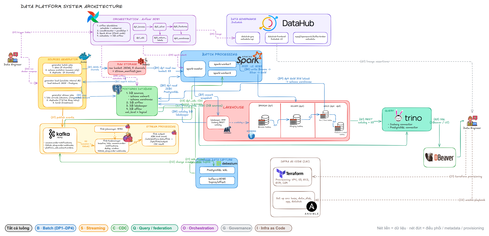

# EDAI-1 — Data Platform trên AWS

Phần này trình bày Data Platform theo từng dòng của rubric, và chỉ dựa trên các lần triển khai thật trên AWS.

Về hạ tầng:
- Data Platform chạy bằng Docker Compose trên một máy EC2, dữ liệu lưu ở S3.
- ML Platform và LLM Platform chạy trên cụm EKS `platform-apps`; MLflow, Jenkins và Vault chạy trên EC2.

Mỗi kết quả ghi rõ chạy ở môi trường nào và còn giới hạn gì. Kết quả chỉ chứng minh lần chạy đó đã diễn ra, không có nghĩa dịch vụ hiện vẫn đang bật.

## Đối chiếu rubric

| Dòng rubric | Tài liệu / bằng chứng | Kết quả và giới hạn |
|---|---|---|
| 3–4 | [Docker / Compose](docker.md) | Đã đo image trên EC2: giảm từ 2,4 GB xuống 698 MB, vẫn đủ 27 package. |
| 5–10 | [Data Generator](data_generator.md) | Có số đo dung lượng, profile sinh dữ liệu batch và manifest (file ghi lại cấu hình và số lượng) của luồng stream trên AWS. |
| 11–19 | [Processing Jobs](processing_jobs.md) | Có luồng stream với tin đến muộn thật. Bốn job Flink chạy liên tục ở trạng thái RUNNING. Spark UI trên AWS cho thấy bước Union (gộp hai schema) và Window dedup (bỏ bản trùng) của tầng Silver. |
| 20–21 | [Data Storage](data_storage.md) | Có số đo khi ghi lại partition và kết quả EXPLAIN. Giới hạn: chạy lại DP1 sẽ đưa bảng về chia partition theo ngày. |
| 22–27 | [Pipeline Orchestration](pipeline_orchestration.md) | Có ảnh graph của DAG, log của các bước ingest/validate và run ID trên AWS. |
| 28–33 | [Data Governance](data_governance.md) | Có lineage (dòng chảy dữ liệu giữa các bảng) và assertion (luật kiểm dữ liệu) trên AWS; lineage được publish từ metadata của pipeline. |
| 34–38 | [Schema Design](schema_design.md) | Có các zone, kết quả DESCRIBE và ERD (sơ đồ quan hệ) giữa bảng dim và fact: một bản vẽ bằng dbdiagram và một ảnh DBeaver có đường nối, chụp trên Trino AWS. |
| 39–40 | [Novel Ideas](novel_ideas.md) | Có truy vấn federation (một câu SQL đọc nhiều nguồn) và thử CDC với cả ba loại thay đổi tạo/sửa/xóa (c/u/d). Chưa đo CDC khi có tải. |

Mỗi trang có code/config, kết quả và ảnh kèm giải thích. Trạng thái từng dòng rubric và những phần còn thiếu bằng chứng AWS nằm ở [kiểm kê rubric](../shared/rubric_cloud_audit.md).

## Triển khai và kiểm chứng

[Cloud setup](../shared/cloud_setup.md) · [AWS runbook](../shared/aws_deploy.md) · [IaC](../edai-2/iac.md).

[Ma trận bằng chứng AWS](evidence.md).

[Tham khảo kỹ thuật](reference/README.md) · [Mục lục chung](../README.md).
