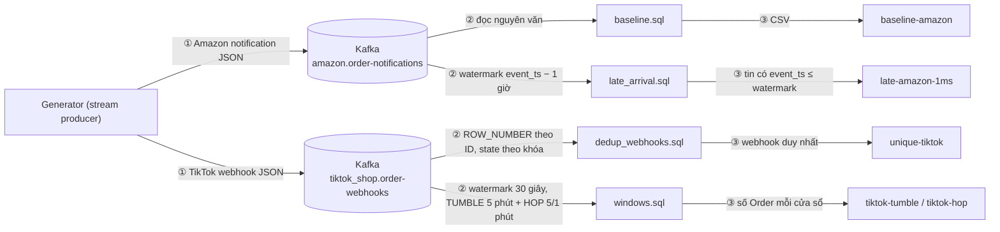

# Processing Jobs trên AWS

EDAI-1, dòng 11–19: Spark xử lý offline và Flink xử lý streaming. Spark/Flink chạy Compose EC2, lakehouse ở S3. Đọc kết quả cùng baseline, cấu hình, đánh đổi và giới hạn ảnh AWS.

## Spark: benchmark trên EC2, 29/10/2026

Đo trên EC2 bằng `PLATFORM_STORAGE=s3 bash scripts/evidence/measure_order_snapshots_bronze.sh
skew_0|skew_b` trên EC2 (driver trong container Airflow, Spark 2 worker × 2 core, đọc raw S3 qua IAM role):
20 ngày mẫu, AQE tắt, 12.627.457 dòng mỗi lần.

| Lần chạy | "XONG sau" | Số file | Cỡ file TB |
|---|---|---|---|
| đối chứng `hash` (lần 1/2/3) | 93,8 / 88,7 / 90,7 s → **TB 91,1 s**, nhiễu 5,1 s (5,6%) | 20 | 47,3 MB |
| **(b)** `distribution-mode=none` | **71,6 s** (−19,5 s = **−21,4%**, ~4× nhiễu) | **309** | **3,1 MB** |

Spark UI (History Server EC2): với `hash`, job ghi có **2 stage** — stage 0 đọc 9,4 GiB / 114 task (44 s) và
xáo 2,2 GiB; stage 1 nhận 2,2 GiB / 200 task (31 s), ghi 945,4 MiB. Summary Metrics stage 1: **median 2 ms /
0 dòng, max 12 s / 2.173.164 dòng** — 180 task rỗng vì chỉ có 20 ngày, task của ngày đông nhất ôm 2,17 tr
dòng . Với `none` chỉ **1 stage** / 114 task (1,0 phút): bỏ hẳn shuffle nên nhanh hơn, đổi lại
mỗi task ghi file riêng cho mọi ngày nó gặp ⇒ 309 file nhỏ.

Quyết định triển khai: **giữ `hash`** — nhanh hơn 21% lúc ghi không bù được
15× số file nhỏ cho mọi lần đọc sau (xem compaction ở [storage.md](data_storage.md)).
Ảnh AWS được nhúng ở [mục AWS](#trên-aws-2026-10-29).

## Spark: tích hợp pipeline và Spark UI

Thí nghiệm skew chạy Compose trên EC2 `r6i.xlarge`, hai Spark worker × hai core, nguồn S3;
20 ngày Amazon, AQE tắt. [Benchmark EC2](#g-đo-lại-trên-aws-2026-10-29-ec2-r6ixlarge-4-vcpu-nguồn-s3a)
và [receipt](../evidence/aws/data-platform-aws-20261027.json) (`spark_skew_aws`) giữ số đo.
Code: [script đo](../../scripts/evidence/measure_order_snapshots_bronze.sh),
[job ingest](../../spark_jobs/bronze/ingest_amazon_order_snapshots.py).

UI baseline `hash` có 314 task ở hai stage. Stage ghi có median 2 ms/0 dòng nhưng max 12 s/2.173.164 dòng:
phần lớn partition hash rỗng, một số task chịu ngày nhiều dữ liệu. Đây là skew theo ngày ghi, không phải bằng chứng
skew SKU trong phép join. Bỏ phân phối hash bằng `write.distribution-mode=none` bỏ shuffle, còn 114 task/một stage.
Thời gian giảm từ trung bình 91,1 xuống 71,6 giây; file tăng 20 → 309. Giữ `hash` để tránh nhiều file nhỏ;
đổi spec cho kênh nhỏ được đo riêng ở [Storage AWS](data_storage.md#trên-aws-2026-10-29).

Tích hợp: [dp1_bronze](../../dags/dp1_bronze.py) submit ingest rồi validate từng nguồn;
[dp2_silver](../../dags/dp2_silver.py) submit chuẩn hóa/dedup rồi Gold/SCD2;
[dp3_features](../../dags/dp3_features.py) submit build/validate feature.
[Airflow AWS](pipeline_orchestration.md#trên-aws-2026-10-27-đến-2026-10-28) nhúng Graph/Gantt/log và giải thích từng component.
Ảnh Master dưới thuộc DP1 ngày 2026-10-27; thí nghiệm skew ngày 29 ở trên chạy riêng bằng script,
không gán run_id của benchmark cho run DAG.

DP2 AWS đã validate Silver/Gold không lỗi ([schema evolution và dedup](#trên-aws-2026-10-28)).
Chưa có ảnh Spark UI AWS thể hiện Union parse schema cũ/mới và Window dedup như yêu cầu chi tiết của rubric;
log PASS không thay thế capture đó cho DE13–14. Ảnh **local** cùng job: [Union và Window dedup, schema details](reference/spark.md#10-proof-silver-schema-evolution-và-dedup-trong-execution-3) (Spark UI, nguồn Amazon).

## Spark: schema evolution và dedup, 28/10/2026

DP2 chạy Spark Compose trên EC2, Bronze/Silver/Gold ở S3;
run `manual__2026-10-27T16:05:58+00:00` trong [receipt](../evidence/aws/data-platform-aws-20261027.json).
[Job Amazon](../../spark_jobs/silver/build_amazon_order_snapshots.py) parse hai schema rồi chuẩn hóa,
Window theo khóa giữ revision mới nhất; [DAG](../../dags/dp2_silver.py) đặt validator sau từng job Silver.

Receipt ghi Silver Amazon 153.849.901, Walmart 15.562.675, TikTok Shop 33.338.110,
Shopify 17.782.786, Shopee 6.666.831 dòng; Gold khớp từng kênh, lỗi và khóa Order Line trùng 0.
Ảnh chứng minh trạng thái DAG và kết quả validator. Chưa có Spark UI AWS mở execution plan Union/schema và Window dedup,
nên chưa thay được proof xử lý chi tiết DE13–14. [Airflow AWS](pipeline_orchestration.md#trên-aws-2026-10-27-đến-2026-10-28).

## Flink: baseline, late arrival, dedup và window, 28/10/2026

Flink 1.20.3 và Kafka chạy Compose trên EC2; đầu ra bounded ở EBS `/mnt/platform-data/flink`.
[Manifest AWS](../evidence/aws/stream-manifest-20261028.json) ghi job_id, số đầu vào/đầu ra và cấu hình generator.
Ảnh Completed Jobs có baseline, late, dedup, state proof và windows đều FINISHED.

### Luồng xử lý stream tổng thể

① Generator phát Amazon (có trễ và đảo thứ tự) và TikTok (có trùng ID) vào hai topic Kafka. ② Mỗi job SQL là một
consumer group riêng trên Flink 1.20.3 (JobManager + TaskManager, Compose EC2), tự giữ watermark/state của mình.
③ Đích là CSV trên EBS `/mnt/platform-data/flink`, đối chiếu với [manifest](../evidence/aws/stream-manifest-20261028.json).
Pipeline stream phục vụ feature store (Kafka → Flink HOP 24h → Redis/S3) là job riêng, xem [Streaming Feature](../edai-2/stream_features.md).

### Late arrival: tin muộn được xử lý thế nào

Amazon gửi notification không theo thứ tự thời gian. [`late_arrival.sql`](../../flink_jobs/order_snapshots/late_arrival.sql)
khai `WATERMARK FOR event_ts AS event_ts - INTERVAL '1' HOUR`: watermark của partition luôn đứng sau event time mới nhất đã thấy
đúng một giờ. Một tin có `event_ts <= CURRENT_WATERMARK(event_ts)` là tin đã bị watermark vượt qua nên được ghi riêng vào
`late-amazon-1ms`, kèm cột `watermark_time` để tự chứng minh. Ví dụ dòng thật trong đầu ra (lần chạy 2026-10-14, local, cùng SQL):

| notification_id | event_time (xảy ra) | publish_time (đến) | watermark_time lúc xử lý | partition | Vì sao là late |
|---|---|---|---|---:|---|
| `qb8vznf1-5f5n-…` | 2026-06-30 01:24:05 | 2026-06-30 02:45:52 | 01:32:34 | 1 | event_time < watermark: tin mới nhất đã tới ≈ 02:32, tin này cũ hơn hơn một giờ |
| `jpf2a4lb-5p3l-…` | 2026-06-30 01:22:09 | 2026-06-30 03:07:25 | 01:48:31 | 1 | event_time < watermark, đến trễ 1 giờ 45 phút |
| `icu0oal9-bifb-…` | 2026-06-30 00:28:23 | 2026-06-30 03:09:07 | 01:48:31 | 1 | event_time < watermark, đến trễ 2 giờ 41 phút |

Cả 9.143 dòng của lần chạy đó đều có `event_time <= watermark_time` (trễ từ vài giây đến khoảng 4,9 giờ so với watermark).
Tin không muộn quá ngưỡng một giờ không vào file này, nên số dòng nhỏ hơn số tin out-of-order của generator (19.729).
Ảnh Completed Jobs/graph bên dưới chỉ chứng minh job chạy; **bằng chứng xử lý là cột `watermark_time` ở trên**.
Lần AWS 28/10 chưa chụp lại các dòng này từ `/mnt/platform-data/flink/late-amazon-1ms`; xem Giới hạn.

**Giới hạn trạng thái job.** Cả bốn job SQL trên đặt `scan.bounded.mode = latest-offset` nên chạy xong rồi `FINISHED`; đây là
cách để đối chiếu số đầu vào/đầu ra, chưa phải job streaming chạy liên tục. Job ở trạng thái `RUNNING` trên AWS hiện là
[`ml-sku-return-24h`](../edai-2/stream_features.md#trên-aws-pipeline-a-2026-10-30) (có ảnh checkpoint). Để bốn job trên cũng `RUNNING`
cần bỏ `scan.bounded.mode`, bật checkpoint cho sink file và chạy lại trên AWS.

| Bước / code | Vấn đề và cách xử lý | Số AWS từ manifest |
|---|---|---|
| [Baseline](../../flink_jobs/order_snapshots/baseline.sql) | Đọc Amazon bounded, chưa tách muộn | 399.410 dòng, job `ffd9de8a94c5bf67179482bfe03d3b59` |
| [Late arrival](../../flink_jobs/order_snapshots/late_arrival.sql) | Watermark event time trễ 1 giờ; lọc `event_ts <= CURRENT_WATERMARK(event_ts)` ra đích riêng | 10.166 dòng, job `b172bcf2510b47e1cbcd532f3078a82d` |
| [Dedup](../../flink_jobs/order_snapshots/dedup_webhooks.sql), [state proof](../../flink_jobs/order_snapshots/dedup_state_proof.sql) | TikTok trùng ID; `ROW_NUMBER` giữ bản đầu, cạnh HASH đưa cùng ID vào keyed Deduplicate | 93.554 vào → 92.157 ra, bỏ 1.397; state-proof job `f5b642f64b133e28ec0f57021f1eab22` |
| [Window SQL](../../flink_jobs/order_snapshots/windows.sql) | Đếm Order mới theo tumbling 5 phút và HOP 5 phút trượt 1 phút | 7.555 / 37.870 cửa sổ, job `dad323a91493cdf365c5a3d3d4dd0adf` |

UI dedup thấy HASH → Deduplicate và 93.554 record nhận, chứng minh keyed operator đã chạy.
Số 92.157 dòng đầu ra lấy từ manifest, không đọc nhầm cột Records Sent của file sink bằng 0 thành mất dữ liệu.
Ảnh Completed Jobs chỉ xác nhận job late FINISHED; chưa có UI AWS mở operator/watermark và ví dụ event muộn. Ảnh **local** cùng job late: [watermark và tin muộn](reference/flink.md#bắt-tin-đến-muộn-bằng-watermark) (UI Flink local, 13–14/10).
10.166 không phải số tất định: watermark phát theo chu kỳ, khác phép đếm out-of-order toàn cục 19.729 của generator.
Window AWS dài hạn 24h trượt 1h có [ảnh operator/checkpoint riêng](../edai-2/stream_features.md#trên-aws-pipeline-a-2026-10-30).

[Mục lục phần này](README.md) · [Mục lục chung](../README.md)
