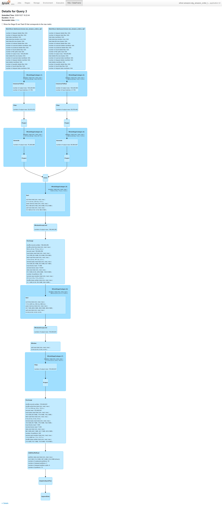
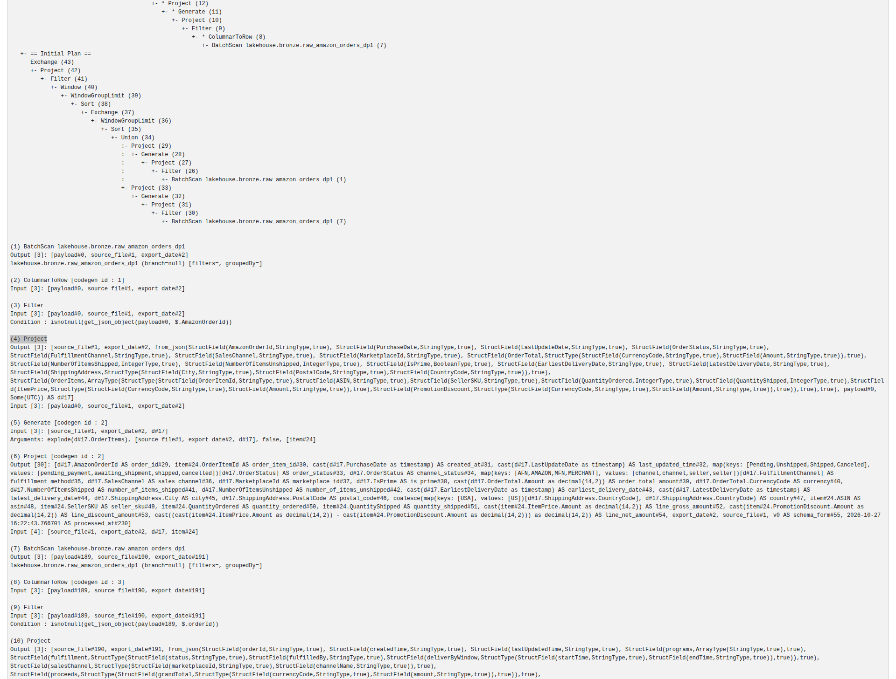
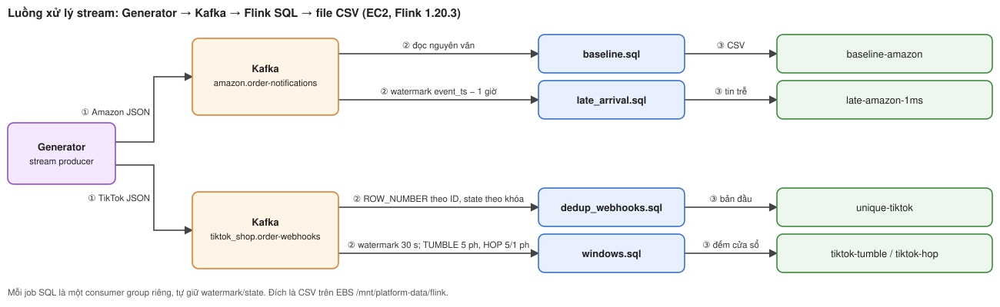
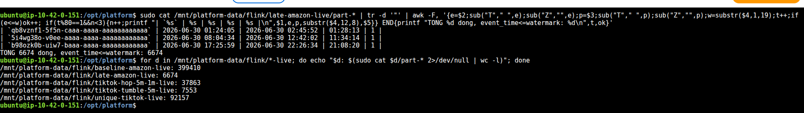
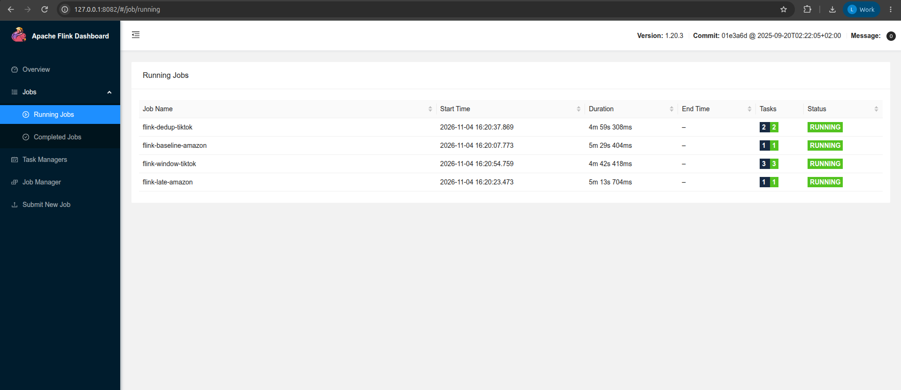
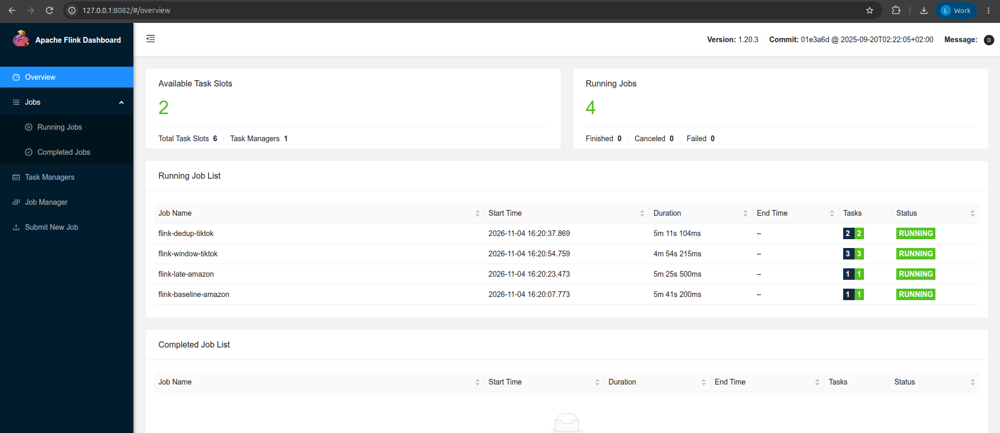

# Processing Jobs trên AWS

Trang này ứng với EDAI-1, dòng 11–19 của rubric. Có hai loại xử lý:
- **Spark** xử lý offline (batch, chạy theo lô).
- **Flink** xử lý streaming (chạy liên tục theo từng tin).

Cả Spark và Flink đều chạy bằng Docker Compose trên EC2; lakehouse (kho bảng Iceberg) nằm ở S3. Mỗi mục dưới đây nêu baseline (lần chạy đối chứng), cấu hình, lựa chọn đánh đổi và giới hạn của ảnh chụp trên AWS.

<a id="g-đo-lại-trên-aws-2026-10-29-ec2-r6ixlarge-4-vcpu-nguồn-s3a"></a>
## Spark: benchmark trên EC2

**Kết luận:** giữ chế độ ghi `hash`. Bỏ `hash` giúp ghi nhanh hơn khoảng 21%, nhưng tạo ra số file nhỏ nhiều gấp 15 lần, làm chậm mọi lần đọc sau đó.

**Đo gì.** Thí nghiệm so hai cách Spark phân phối dữ liệu trước khi ghi vào bảng Iceberg:
- `hash` (đối chứng): Spark xáo dữ liệu (shuffle) để gom các dòng cùng ngày về cùng một task rồi mới ghi.
- `distribution-mode=none` (phương án b): không xáo, mỗi task ghi thẳng phần dữ liệu nó đang giữ.

**Đo thế nào.** Chạy lệnh `PLATFORM_STORAGE=s3 bash scripts/evidence/measure_order_snapshots_bronze.sh
skew_0|skew_b` trên EC2:
- Spark driver chạy trong container Airflow; có 2 Spark worker, mỗi worker 2 core; đọc dữ liệu raw trên S3 bằng IAM role.
- Dữ liệu gồm 20 ngày mẫu, mỗi lần chạy 12.627.457 dòng.
- AQE (Adaptive Query Execution, cơ chế Spark tự chỉnh kế hoạch lúc chạy) được tắt để số đo dễ so.

| Lần chạy | Thời gian ("XONG sau") | Số file | Cỡ file trung bình |
|---|---|---|---|
| đối chứng `hash` | **trung bình 91,1 s** (ba lần: 93,8 / 88,7 / 90,7 s) | 20 | 47,3 MB |
| **(b)** `distribution-mode=none` | **71,6 s** | **309** | **3,1 MB** |

Cách đọc bảng:
- Ba lần chạy `hash` chênh nhau tối đa 5,1 s (5,6%). Đây là mức nhiễu đo.
- Phương án (b) nhanh hơn 19,5 s, tức **−21,4%**, lớn gấp khoảng 4 lần mức nhiễu, nên khác biệt là thật.
- Đổi lại, (b) tạo 309 file thay vì 20.

**Spark UI nói gì** (đọc từ History Server trên EC2):
- Với `hash`, job ghi có **2 stage**. Stage 0 đọc 9,4 GiB bằng 114 task (44 s) và xáo 2,2 GiB. Stage 1 nhận 2,2 GiB đó bằng 200 task (31 s) và ghi ra 945,4 MiB.
- Trong stage 1, task trung vị chỉ chạy **2 ms và ghi 0 dòng**, còn task lâu nhất chạy **12 s và ghi 2.173.164 dòng**. Lý do: dữ liệu chỉ có 20 ngày nên 180 trên 200 task không nhận được ngày nào, còn task giữ ngày đông nhất phải ghi khoảng 2,17 triệu dòng.
- Với `none` chỉ có **1 stage** gồm 114 task (1,0 phút). Không có shuffle nên nhanh hơn. Tuy vậy, mỗi task ghi một file riêng cho mọi ngày mà nó gặp, dẫn tới 309 file nhỏ.

Quyết định triển khai: **giữ `hash`**. Ghi nhanh hơn 21% không bù được việc có
số file nhỏ nhiều gấp 15 lần cho mọi lần đọc sau (xem phần compaction, tức gộp file nhỏ, ở [storage.md](data_storage.md)).
Ảnh AWS được nhúng ở [mục AWS](#trên-aws-2026-10-29).

<a id="trên-aws-2026-10-29"></a>
## Spark: tích hợp pipeline và Spark UI

Thí nghiệm skew (dữ liệu dồn lệch vào vài task) chạy bằng Compose trên EC2 `r6i.xlarge`, với hai Spark worker, mỗi worker hai core, nguồn S3,
20 ngày dữ liệu Amazon và AQE tắt. Số đo nằm ở [mục benchmark EC2](#g-đo-lại-trên-aws-2026-10-29-ec2-r6ixlarge-4-vcpu-nguồn-s3a)
và trong [receipt](../evidence/aws/data-platform-aws-20261027.json) (file JSON ghi kết quả chạy, mục `spark_skew_aws`).
Code: [script đo](../../scripts/evidence/measure_order_snapshots_bronze.sh),
[job ingest](../../spark_jobs/bronze/ingest_amazon_order_snapshots.py).

Tóm tắt những gì Spark UI cho thấy:
- Bản đối chứng `hash` có tổng 314 task trong hai stage.
- Ở stage ghi, task trung vị mất 2 ms và ghi 0 dòng, nhưng task lâu nhất mất 12 s và ghi 2.173.164 dòng. Nghĩa là phần lớn partition hash rỗng, còn vài task phải gánh những ngày nhiều dữ liệu.
- Đây là lệch dữ liệu theo **ngày ghi**. Nó không chứng minh có lệch theo SKU trong phép join.
- Đặt `write.distribution-mode=none` thì bỏ được shuffle, chỉ còn một stage với 114 task. Thời gian giảm từ trung bình 91,1 xuống 71,6 giây, nhưng số file tăng từ 20 lên 309.

Vì vậy dự án giữ `hash` để tránh nhiều file nhỏ. Việc đổi spec cho các kênh nhỏ được đo riêng ở [Storage AWS](data_storage.md#trên-aws).


**Spark được gọi từ pipeline thế nào.** Airflow submit các job Spark theo ba DAG:
- [dp1_bronze](../../dags/dp1_bronze.py): submit job ingest, sau đó validate từng nguồn.
- [dp2_silver](../../dags/dp2_silver.py): submit job chuẩn hóa và bỏ trùng (Silver), sau đó dựng Gold và SCD2.
- [dp3_features](../../dags/dp3_features.py): submit job dựng feature rồi validate feature.

Ảnh Graph, Gantt, log của Airflow và giải thích từng component nằm ở [Airflow AWS](pipeline_orchestration.md#trên-aws).
Ảnh Spark Master dưới đây thuộc lần chạy DP1. Thí nghiệm skew ở trên chạy riêng bằng script,
nên không gán run_id của benchmark cho run của DAG.


DP2 trên AWS đã validate Silver và Gold mà không có lỗi (xem [schema evolution và dedup](#trên-aws-2026-10-28)).
Spark UI trên AWS của job Silver Amazon (bước Union gộp schema cũ/mới và bước Window bỏ trùng) nằm ở [mục Spark: schema evolution và dedup](#trên-aws-2026-10-28).
Ảnh **local** của cùng job: [Union và Window dedup, schema details](reference/spark.md#10-proof-silver-schema-evolution-và-dedup-trong-execution-3) (Spark UI, nguồn Amazon).

<a id="trên-aws-2026-10-28"></a>
## Spark: schema evolution và dedup

**Kết luận:** job Silver Amazon đọc được cả schema cũ lẫn schema 2026 của Amazon, và bỏ đúng 3.098.355 bản trùng (1,974%). Tỷ lệ này khớp mức trùng mà generator cố ý tạo ra.

DP2 chạy Spark bằng Compose trên EC2; dữ liệu Bronze, Silver và Gold nằm ở S3.
Run là `manual__2026-10-27T16:05:58+00:00`, ghi trong [receipt](../evidence/aws/data-platform-aws-20261027.json).
[Job Amazon](../../spark_jobs/silver/build_amazon_order_snapshots.py) parse hai dạng schema rồi chuẩn hóa về một dạng.
Sau đó nó dùng Window theo khóa để chỉ giữ revision (bản cập nhật) mới nhất của mỗi dòng. [DAG](../../dags/dp2_silver.py) đặt một bước validator ngay sau mỗi job Silver.


Số dòng Silver theo receipt:

| Channel | Dòng Silver |
|---|---:|
| Amazon | 153.849.901 |
| Walmart | 15.562.675 |
| TikTok Shop | 33.338.110 |
| Shopify | 17.782.786 |
| Shopee | 6.666.831 |

Gold khớp số của từng kênh. Không có dòng lỗi và không có khóa Order Line nào bị trùng.
Hai ảnh trên chứng minh trạng thái DAG và kết quả của validator. Xem thêm [Airflow AWS](pipeline_orchestration.md#trên-aws).

### Spark UI AWS: Union schema cũ/mới và Window dedup (Silver Amazon)

Ảnh trong mục này lấy từ event log (nhật ký Spark lưu sau khi job chạy) của task Silver Amazon trong DP2 run `manual__2026-10-27T16:05:58+00:00` (xem [receipt](../evidence/aws/data-platform-aws-20261027.json)):
- Application `app-20261027160606-0024`, tên `silver-amazon-stg_amazon_order_lines_dp2`, chạy khoảng 52 phút và đã hoàn tất.
- Event log được mở lại bằng Spark History Server trên EC2 (không chạy lại job) và chụp bằng [`capture_spark_silver_evidence.py`](../../scripts/evidence/capture_spark_silver_evidence.py).
- Execution 3 là phần xử lý dữ liệu chính. Bản [REST](../evidence/aws/silver-amazon-execution-3-aws.json) lưu `status=COMPLETED`, kế hoạch thực thi (plan) và metrics.



Cách đọc plan ở ảnh trên:
1. Hai nhánh cùng đọc bảng Bronze. Mỗi nhánh lọc và parse riêng một dạng schema.
2. `Generate` tách mảng Order Line trong mỗi Order thành từng dòng.
3. `Union` gộp hai nhánh lại.
4. Dữ liệu được sắp xếp và chia theo khóa; `WindowGroupLimit`/`Window` chỉ giữ bản có `row_number = 1` (bản mới nhất).

Phần Details của plan cho thấy cách tách hai schema:
- Nhánh schema cũ lọc theo `get_json_object(payload, $.AmazonOrderId)` và dùng `from_json` với `AmazonOrderId`/`OrderItems`.
- Nhánh schema 2026 lọc theo `$.orderId` và dùng `from_json` với `orderId`/`orderItems`.
- Cả hai nhánh cùng ánh xạ về một bộ cột Silver.



| Số đo execution 3 (AWS) | Số dòng |
|---|---:|
| Order Line từ nhánh schema cũ (`Generate`, node 18) | 76.365.986 |
| Order Line từ nhánh schema 2026 (`Generate`, node 26) | 80.584.967 |
| Trước dedup (`WindowGroupLimit`, node 12) | 156.948.256 |
| Sau dedup (`Filter`, node 6) | 153.849.901 |
| **Bản trùng đã bỏ** | **3.098.355 (1,974%)** |

Số sau dedup (153.849.901) khớp số Silver Amazon trong receipt. Tỷ lệ trùng 1,974% khớp mức trùng offline mà generator tạo ra (1,98%).

<a id="flink-trên-aws-2026-10-28"></a>
## Flink: baseline, late arrival, dedup và window

Flink 1.20.3 và Kafka chạy bằng Compose trên EC2. Lần chạy bounded (có điểm kết thúc, đọc tới offset cuối rồi dừng) ghi đầu ra lên ổ EBS tại `/mnt/platform-data/flink`.
[Manifest AWS](../evidence/aws/stream-manifest-20261028.json) ghi job_id, số tin đầu vào/đầu ra và cấu hình generator.
Ảnh Completed Jobs cho thấy các job baseline, late, dedup, state proof và windows đều ở trạng thái FINISHED.

### Luồng xử lý stream tổng thể



1. Generator phát dữ liệu vào hai topic Kafka: Amazon (có tin đến trễ và sai thứ tự) và TikTok (có tin trùng ID).
2. Mỗi job SQL là một consumer group riêng trên Flink 1.20.3 (JobManager + TaskManager, Compose EC2). Mỗi job tự giữ watermark và state của mình.
3. Đầu ra là file CSV trên EBS `/mnt/platform-data/flink`, được so với [manifest](../evidence/aws/stream-manifest-20261028.json).

Pipeline stream phục vụ feature store (Kafka, qua Flink cửa sổ HOP 24 giờ, tới Redis/S3) là một job riêng; xem [Streaming Feature](../edai-2/stream_features.md).

### Late arrival: tin muộn được xử lý thế nào

**Kết luận:** job late arrival chỉ tách ra những tin thực sự đến sau watermark. Cả 6.674 dòng nó ghi ra đều thỏa điều kiện này.

Amazon gửi notification không theo thứ tự thời gian. Để xử lý, [`late_arrival.sql`](../../flink_jobs/order_snapshots/late_arrival.sql)
khai báo `WATERMARK FOR event_ts AS event_ts - INTERVAL '1' HOUR`.
Watermark là mốc thời gian Flink coi là "đã nhận đủ tin đến trước mốc này". Ở đây, watermark của mỗi partition luôn đứng sau event time mới nhất đã thấy
đúng một giờ.
Một tin có `event_ts <= CURRENT_WATERMARK(event_ts)` là tin đến khi watermark đã vượt qua nó. Tin đó được ghi riêng vào
`late-amazon-1ms`, kèm cột `watermark_time` để chính dòng dữ liệu chứng minh vì sao nó bị coi là muộn.
Ví dụ dòng thật trong đầu ra `late-amazon-live` (AWS EC2, bản chạy liên tục):

| notification_id | event_time (xảy ra) | publish_time (đến) | watermark_time lúc xử lý | partition | Vì sao là late |
|---|---|---|---|---:|---|
| `qb8vznf1-5f5n-…` | 2026-06-30 01:24:05 | 2026-06-30 02:45:52 | 01:28:13 | 1 | event_time < watermark: tin này nằm sau watermark của partition 1 |
| `5i4wg38o-v0ee-…` | 2026-06-30 08:04:34 | 2026-06-30 12:42:02 | 11:34:14 | 1 | event_time < watermark, đến trễ hơn 3 giờ so với watermark |
| `b98ozk0b-uiw7-…` | 2026-06-30 17:25:59 | 2026-06-30 22:26:34 | 21:08:20 | 1 | event_time < watermark, đến trễ hơn 4 giờ so với watermark |

Kiểm tra toàn bộ đầu ra: cả **6.674** dòng của lần chạy này đều có `event_time <= watermark_time` (lệnh kiểm in `TONG 6674 dong, event_time<=watermark: 6674`).
Tin đến trễ nhưng chưa quá ngưỡng một giờ thì không vào file này. Vì thế số dòng ở đây nhỏ hơn số tin sai thứ tự mà generator tạo (19.729).
Ảnh Completed Jobs và graph bên dưới chỉ chứng minh job đã chạy; **bằng chứng job xử lý đúng là cột `watermark_time` ở trên**.
Các dòng trên lấy từ `/mnt/platform-data/flink/late-amazon-live/part-*` trên EC2; xem [output nguyên văn](../evidence/aws/flink-live-output-20261104.txt) và mục Trạng thái job.



Lệnh lấy 3 dòng ví dụ và kiểm tra điều kiện late từ đầu ra (đã chạy trên EC2, kết quả ở bảng trên):

```bash
cat /mnt/platform-data/flink/late-amazon-live/part-* | tr -d '"' | awk -F, '{e=$2;sub("T"," ",e);sub("Z","",e);p=$3;sub("T"," ",p);sub("Z","",p);w=substr($4,1,19);t++;if(e<=w)ok++; if(t%80==1&&n<3){n++;printf "| `%s` | %s | %s | %s | %s |\n",$1,e,p,substr($4,12,8),$5}} END{printf "TONG %d dong, event_time<=watermark: %d\n",t,ok}'
```

**Trạng thái job.** Lần chạy đầu là bản bounded: nó dùng `scan.bounded.mode = latest-offset`, nên cả bốn job SQL đọc tới offset cuối rồi dừng ở trạng thái `FINISHED`.
Các số trong bảng "Bước / code" bên dưới và ảnh Completed Jobs đều lấy từ bản bounded đó.
Sau đó bốn file SQL được sửa để chạy liên tục:
- bỏ `scan.bounded.mode`;
- bật checkpoint (ảnh chụp state định kỳ) ra EBS;
- file CSV đóng lại mỗi 30 s;
- đầu ra chuyển sang các thư mục `*-live`;
- TaskManager nâng lên 6 slot ([`docker-compose.aws-stream.yml`](../../docker-compose.aws-stream.yml)).

Riêng `dedup_state_proof.sql` vẫn để bounded vì chỉ dùng để chụp execution plan.

**Chạy lại bản liên tục trên AWS.** Kafka trên EC2 đã mất hai topic của lần bounded (chỉ còn `ml.sku_return_24h` và `order_snapshots.return_events`), nên dữ liệu được phát lại bằng generator
(`platform-generator:opt`, seed 42, `--speed 0`):
- **399.410** tin Amazon (132.222 + 133.332 + 133.856 qua 3 partition);
- **93.554** tin TikTok (31.375 + 30.918 + 31.261).

Số tin khớp từng tin với [manifest bounded](../evidence/aws/stream-manifest-20261028.json), nên các số trong bảng dưới vẫn so sánh được với lần bounded.
Sau đó bốn file SQL được submit bằng `sql-client.sh`. Khoảng 5 phút sau, cả bốn job ở trạng thái **RUNNING**:
dedup-tiktok 2 task, baseline-amazon 1, window-tiktok 3, late-amazon 1. TaskManager 1 có 6 slot (còn trống 2). Không có job nào Finished, Canceled hay Failed.





Số dòng đầu ra trong các thư mục `*-live` của lần chạy liên tục (đếm bằng `wc -l` trên EC2, [output nguyên văn](../evidence/aws/flink-live-output-20261104.txt)), so với manifest của bản bounded:

| Thư mục | Dòng (liên tục) | Manifest (bounded) | Ghi chú |
|---|---:|---:|---|
| `baseline-amazon-live` | **399.410** | 399.410 | khớp |
| `unique-tiktok-live` | **92.157** | 92.157 | khớp (93.554 tin vào, bỏ 1.397 tin trùng) |
| `tiktok-tumble-5m-live` | 7.553 | 7.555 | thiếu 2 cửa sổ cuối: luồng không kết thúc nên không có watermark cuối để đóng các cửa sổ này |
| `tiktok-hop-5m-1m-live` | 37.863 | 37.870 | thiếu 7 cửa sổ cuối, cùng lý do |
| `late-amazon-live` | 6.674 | 10.166 | không tất định: số này phụ thuộc vào thời điểm mỗi partition phát watermark |

Job ML `ml-sku-return-24h` chưa được submit lại trong buổi này (ảnh lúc nó Running đã có ở [Streaming Feature](../edai-2/stream_features.md#trên-aws-pipeline-a-2026-10-30)).

Bảng dưới tóm tắt từng job của bản bounded, kèm số liệu lấy từ manifest:

| Bước / code | Vấn đề và cách xử lý | Số AWS từ manifest |
|---|---|---|
| [Baseline](../../flink_jobs/order_snapshots/baseline.sql) | Đọc Amazon bản bounded, chưa tách tin muộn | 399.410 dòng, job `ffd9de8a94c5bf67179482bfe03d3b59` |
| [Late arrival](../../flink_jobs/order_snapshots/late_arrival.sql) | Watermark theo event time, trễ 1 giờ; tin thỏa `event_ts <= CURRENT_WATERMARK(event_ts)` được ghi ra đích riêng | 10.166 dòng, job `b172bcf2510b47e1cbcd532f3078a82d` |
| [Dedup](../../flink_jobs/order_snapshots/dedup_webhooks.sql), [state proof](../../flink_jobs/order_snapshots/dedup_state_proof.sql) | TikTok có tin trùng ID. `ROW_NUMBER` giữ bản đầu tiên; cạnh HASH đưa các tin cùng ID về cùng một operator Deduplicate theo khóa | 93.554 vào, 92.157 ra, bỏ 1.397; job state proof `f5b642f64b133e28ec0f57021f1eab22` |
| [Window SQL](../../flink_jobs/order_snapshots/windows.sql) | Đếm Order mới theo cửa sổ tumbling 5 phút (cửa sổ nối tiếp, không chồng nhau) và HOP 5 phút trượt mỗi 1 phút | 7.555 cửa sổ tumbling / 37.870 cửa sổ HOP, job `dad323a91493cdf365c5a3d3d4dd0adf` |


Ghi chú khi đọc các ảnh trên:
- UI của job dedup cho thấy cạnh HASH dẫn tới Deduplicate và 93.554 record được nhận. Điều này chứng minh operator dedup theo khóa đã thực sự chạy.
- Số 92.157 dòng đầu ra lấy từ manifest. Cột Records Sent của file sink trên UI bằng 0, nhưng đó không có nghĩa là mất dữ liệu.
- Ảnh Completed Jobs chỉ xác nhận job late đã FINISHED. Lần chạy liên tục bổ sung ảnh terminal AWS lấy ba tin muộn và kiểm điều kiện `event_time <= watermark` đúng cho 6.674/6.674 dòng ([ảnh](../evidence/aws/flink-late-arrival-live.png)).
- Vẫn chưa có ảnh UI Flink trên AWS mở operator watermark. Ảnh **local** của cùng job late: [watermark và tin muộn](reference/flink.md#bắt-tin-đến-muộn-bằng-watermark) (UI Flink local).
- Con số 10.166 không tất định: watermark được phát theo chu kỳ, nên số này khác với số tin sai thứ tự 19.729 mà generator đếm trên toàn bộ dữ liệu.
- Cửa sổ dài hạn trên AWS (24 giờ, trượt 1 giờ) có [ảnh operator/checkpoint riêng](../edai-2/stream_features.md#trên-aws-pipeline-a-2026-10-30).

[Mục lục phần này](README.md) · [Mục lục chung](../README.md)
