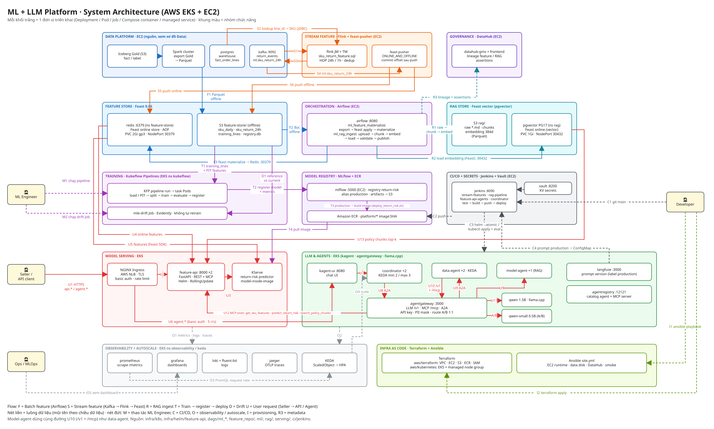

# EDAI-2 — ML và LLM Platform trên AWS

Tài liệu bám theo rubric, tập trung các lần triển khai AWS. Data Platform chạy Compose EC2/S3; ML/LLM chạy EKS `platform-apps`, MLflow/Jenkins/Vault trên EC2. Kết quả ghi rõ môi trường và giới hạn, không xác nhận dịch vụ đang bật.

## Đối chiếu rubric

| Dòng rubric | Tài liệu / bằng chứng | Kết quả và giới hạn |
|---|---|---|
| 3–6 | [LLM Inference Platform](llm_inference_platform.md) | CPU self-host trên EKS, có ảnh triển khai (pod, PVC, log) và llm-d-benchmark (3 mức tải, 42 request, 0 lỗi); chưa fine-tune riêng. |
| 7 | [Global Model Config](global_model_config.md) | Có config và ảnh ba Agent dùng chung model EKS. |
| 8, 21, 26 | [Agent Registry](agent_registry.md) | Có UI EKS: 3 Agent, 1 MCP server. |
| 9–10 | [RAG Pipeline](rag_pipeline.md) | 6/6 task, có publish và lineage DataHub AWS. |
| 11 | [Feature Store](feature_store.md) | Có DAG materialize AWS và dữ liệu Redis. |
| 12 | [Streaming Feature](stream_features.md) | Hai job PyFlink (online → Redis, offline → Parquet S3) trên Flink 2.2, chạy trên AWS; đối chiếu giữa chừng 20.316/20.316 cửa sổ, **chưa có số cuối**. Model đã train chưa dùng feature này. |
| 13–14 | [Training Pipeline / MLflow](training_pipeline.md) | KFP 5/5; có ảnh Tags/Artifacts của run và đối chiếu SHA-256 train/test với tag. |
| 15 | [ML Inference Service](ml_inference_service.md) | Có pod READY và prediction EKS. |
| 16–18 | [Web API / MCP](web_api_mcp.md) | Có deployment/API/probe; MCP server bốn tool tách pod riêng `feature-mcp` (smoke EKS 24/24 sau khi tách); autoscale Feature API và MCP 2→3→2; Helm rolling update và tự rollback khi bản hỏng trên EKS (763/763 request 200). |
| 19–22 | [Data Agent / Model Agent / Sandbox](agents.md) | Data Agent và Model Agent đủ cùng bộ: multi-replica + KEDA 2→3→2, Sandbox gVisor gọi tool, publish registry, gọi MCP qua gateway (smoke 24/24); KServe predict 2→3→2. Eval Data 12/12, predict 12/12, **policy 3/5 (dưới ngưỡng, build đỏ)**. |
| 23–24 | [MCP / A2A Gateway](agent_gateways.md) | Smoke 24/24 kèm bảng allow/deny và ảnh cấu hình ConfigMap; chưa có rate limit riêng cho MCP. |
| 25–26 | [Coordinator](coordinator.md) | Có chat/publish và scale 2 → 3 → 2 trên EKS; cổng CI eval 12/12 (#9) nhưng chỉ chấm định tuyến. |
| 27 | [Warm Up](warm_up.md) | 6 Agent/1 worker; chưa đo cold start. |
| 28–32 | [Validation & Verification](validation_verification.md) | PR tests ở máy phát triển; Locust gọi EKS, 3.004 request/0 lỗi. |
| 33–36 | [CI/CD](cicd.md) | `stream-features` #7 xanh với 2 job PyFlink trên AWS; `feature-api-agents` #13 deploy xanh nhưng **đỏ ở eval RAG 3/5**; Coordinator eval 12/12 (chỉ chấm định tuyến). |
| 37–43 | [External Routing / Gateway](routing_gateway.md) | Có HTTPS/auth; giới hạn gia hạn cert xem tài liệu. |
| 44–45 | [IaC](iac.md) | Có plan No changes và Ansible failed=0 trên AWS. |
| 46–51 | [Observability](observability.md) | Có dashboard metric/log/trace và telemetry EKS. |
| 52–53 | [A/B Testing](ab_testing.md) | Có traffic split, dashboard và kết quả eval AWS. |
| 54 | [Security](security.md) | Có Vault EC2; unseal thủ công sau restart. |
| 56–57 | [Novel Ideas](novel_ideas.md) | Có Agent eval và drift Job AWS; chưa tự retrain. |

Mỗi trang có code/config, kết quả và ảnh có giải thích. Trạng thái và phần thiếu proof AWS: [kiểm kê rubric](../shared/rubric_cloud_audit.md).

## Triển khai và kiểm chứng

[Cloud setup](../shared/cloud_setup.md) · [AWS runbook](../shared/aws_deploy.md) · [IaC](../edai-2/iac.md).

Repository Design (dòng 55): [README dự án](../../README.md), [quy ước code](../shared/code_style.md), mục lục và đối chiếu rubric tại trang này.

[Tham khảo kỹ thuật](reference/README.md) · [Mục lục chung](../README.md).
