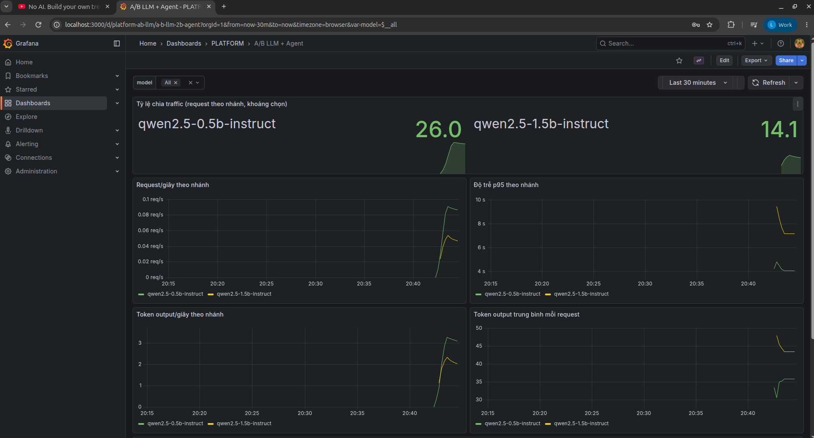
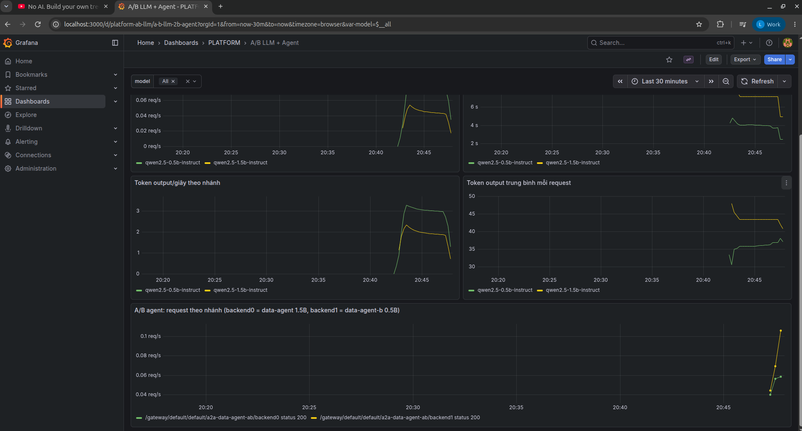

<!-- Mục đích: A/B test LLM và Agent qua agentgateway, theo dõi trên Grafana -->
# A/B test — LLM và Agent

EDAI-2, dòng 52–53: A/B cho Agent và các bản LLM.

Code / cấu hình: bảng thiết kế bên dưới. Kết quả AWS nằm ở mục riêng; số local chỉ giữ để so sánh, không thay cho bằng chứng AWS.

Ý tưởng của A/B test: không thay model cũ ngay, mà chạy song song bản cũ (A) và bản mới (B), chia traffic cho cả hai,
theo dõi số liệu rồi mới quyết định. Dòng 52 là A/B giữa hai Agent dùng model config khác nhau; dòng 53 là A/B giữa hai bản LLM trên inference platform.

**Kết luận:** nhánh B (model 0,5B) nhanh hơn nhưng trả lời sai nhiều hơn hẳn (trên AWS: A đúng 12/12, B đúng 4/12). Vì vậy **giữ A làm mặc định**.
Chi tiết ở mục [Kết luận và quyết định](#kết-luận-và-quyết-định).

## Thiết kế

| Nhánh | LLM | Agent | File |
|---|---|---|---|
| **A** (đang dùng) | `qwen2.5-1.5b-instruct` (llama.cpp, cấu hình đã benchmark) | `data-agent`, `default-model-config` | `infra/k8s/agents/llm.yaml`, `data-agent.yaml` |
| **B** (ứng viên) | `qwen2.5-0.5b-instruct` (cùng image, cùng cờ) | `data-agent-b`, `ab-small-model-config` — cùng prompt, cùng tool | [`ab-llm-small.yaml`](../../infra/k8s/agents/ab-llm-small.yaml), [`ab-data-agent.yaml`](../../infra/k8s/agents/ab-data-agent.yaml) |

Chia traffic ở **agentgateway** ([`agentgateway.yaml`](../../infra/k8s/agents/agentgateway.yaml)):

- **LLM (53)**: gateway khai báo một model ảo tên `platform-chat`, chia `routing.weighted` 1:1 giữa A và B. Client chỉ gọi `platform-chat`;
  gateway chọn model thật cho từng request và ghi tên model đó vào metric/trace ở trường `gen_ai_response_model`.
- **Agent (52)**: route A2A `/a2a/data-agent-ab/` có hai backend, mỗi backend `weight: 1`. Metric `agentgateway_requests_total`
  gắn nhãn `backend0`/`backend1` để phân biệt hai backend.

Theo dõi: dashboard Grafana **Data & AI Platform — A/B LLM + Agent** ([`platform-ab-llm.json`](../../infra/k8s/observability/dashboards/platform-ab-llm.json)).
Dashboard có sáu panel: tỷ lệ chia, request/giây, độ trễ p95, token output/giây, token mỗi request theo nhánh, và request theo backend agent.

## Kết quả trên AWS (EKS `platform-apps`)

Cùng thiết kế ở trên, chạy trên EKS: nhánh A `qwen` (1,5B), nhánh B `qwen-small` (0,5B), chia ở agentgateway.

**LLM (53), lần chạy đầu.** Tải sinh bằng `bench_llm.py --model platform-chat --concurrency 2`, dừng sau 900 s vì LLM chạy bằng CPU nên chậm.
Grafana **Data & AI Platform — A/B LLM + Agent** ghi 9,13 request cho nhánh 1,5B và 8,07 request cho nhánh 0,5B, đúng tỷ lệ 1:1 trong phạm vi một mẫu nhỏ.
Trong khung thời gian của ảnh, p95 khoảng 10 s (1,5B) và 80 s (0,5B).

**Dashboard A/B trên EKS, lần chạy thứ hai.** Tải sinh bằng `bench_llm.py --model platform-chat --concurrency 2 --requests 40 --max-tokens 48`
(gọi model ảo `platform-chat`, gateway chia giữa hai nhánh). Ảnh chụp dashboard **A/B LLM + Agent**, khoảng **Last 30 minutes**, biến `model = All`:

| Panel | Nhánh A `qwen2.5-1.5b-instruct` | Nhánh B `qwen2.5-0.5b-instruct` |
|---|---:|---:|
| Số request trong khoảng chọn | ~14 | ~26 |
| Độ trễ p95 | ~7–9 s | ~4 s |
| Token output/giây | ~2 | ~3 |
| Token output trung bình mỗi request | ~43–45 | ~36 |

Số đo phía client của chính lần chạy này (`bench_llm.py`, 40 request, 2 request đồng thời, gộp cả hai nhánh): `p50 = 3,0 s`, `p95 = 6,19 s`, `0,471 request/giây`,
`18,6 token sinh/giây`, prompt trung bình 508 token.

- Vì gộp cả hai nhánh, p95 phía client nằm giữa p95 ~4 s của nhánh 0,5B và ~7–9 s của nhánh 1,5B trên dashboard.
- Token/giây trên panel Grafana là tốc độ riêng từng nhánh, tính trung bình trong 5 phút (`rate [5m]`). Vì vậy không so trực tiếp được với con số tổng 18,6 token/giây đo trong lúc chạy.

Đọc kết quả:

- Nhánh 0,5B nhanh hơn rõ (p95 chỉ bằng khoảng một nửa) và sinh câu trả lời ngắn hơn ở mỗi request.
- Tỷ lệ chia **26 so 14 (65/35)** không phải 50/50 chính xác. Nhưng mẫu rất nhỏ (40 request, cắt theo thời gian); với trọng số 1:1 và 40 mẫu, lệch cỡ này vẫn có thể xảy ra ngẫu nhiên, nên không thể kết luận gateway chia sai.
- Các giá trị trong bảng được đọc bằng mắt từ đồ thị, không phải số xuất từ Prometheus.

Panel thứ sáu, **A/B agent (backend0 = data-agent 1,5B, backend1 = data-agent-b 0,5B)**, chỉ có dữ liệu khi có request đi qua route `/a2a/data-agent-ab/`.
Lần chụp đầu panel trống (No data) vì chưa có request nào qua route này. Sau đó gửi 60 request lấy agent card (thông tin mô tả Agent, không gọi LLM) qua route A/B.
Panel liền hiện hai đường, mỗi backend một đường, đều `status 200`:

Các request này chỉ lấy agent card, không phải câu hỏi cho Agent. Chúng chỉ chứng minh gateway chia route A/B giữa hai backend và Grafana tách được số liệu theo backend.
Độ chính xác của hai Agent được so ở bảng bên dưới (12/12 và 4/12).

Số đếm Prometheus: [`ab-llm-prometheus-20261031.json`](../evidence/aws/ab-llm-prometheus-20261031.json). Tổng tích luỹ
642 (A) so với 30 (B) **không phải tỷ lệ chia**: B mới được tạo trong ngày nên chỉ nhận tải từ bench, còn A phục vụ thêm cả
data-agent, coordinator và sandbox.

**Agent (52).** Hỏi cả hai Agent về cùng 12 SKU, cùng prompt và tool, rồi chấm bằng bộ chấm ML-N1 ([agent_evaluation.md](agent_evaluation.md)):

| Nhánh | Đạt | Giây/câu (TB) | Kết quả từng câu |
|---|---:|---:|---|
| A `data-agent` (1,5B) | **12/12** | 10,2 | [JSONL](../evidence/aws/agent-eval-data-agent-20261031.jsonl) |
| B `data-agent-b` (0,5B) | **4/12** | 6,0 | [JSONL](../evidence/aws/agent-eval-data-agent-b-20261031.jsonl) |
| Route chia `/a2a/data-agent-ab/` | 2/6 | — | [JSONL](../evidence/aws/agent-eval-data-agent-ab-20261031.jsonl) |

Ảnh trên là bảng dựng lại từ hai file JSONL eval bằng [`render_ab_comparison.py`](../../scripts/evidence/render_ab_comparison.py), **không phải ảnh chụp Grafana**.
Sáu panel Grafana đã có ảnh ở các mục trên: năm panel LLM ở lần chạy thứ hai, và panel A/B agent riêng. Ảnh của lần chạy đầu chỉ có hai panel request và p95.
Các ảnh Grafana này đều từ tải ngắn (40 request), nên chỉ đủ để thấy xu hướng, chưa đủ để so chắc hai cấu hình model.

Giới hạn:

- Bench LLM ngắn (dừng ở 900 s, chỉ khoảng 9 và 8 request theo Grafana) và không tính khoảng tin cậy.
- 12 SKU là tập nhỏ.
- Kết quả của route chia (2/6) là trộn của hai nhánh, không phải thước đo riêng của B.

## Kết quả local (kind) — ghi nhận trước AWS

**LLM**: 40 request, 2 request đồng thời, `max_tokens` 48 ([`ab-llm-20261021.jsonl`](../evidence/ab-llm-20261021.jsonl)):

| Nhánh | Số request | p50 | p95 (Prometheus) | Token output/request |
|---|---|---|---|---|
| A 1.5B | 25 | 2,33 s | 4,16 s | 45,6 |
| B 0.5B | 15 | 1,74 s | 2,47 s | 45,9 |

Số request Prometheus đếm được khớp với phía client (25/15). Với tỷ lệ 1:1, chia 25/15 là dao động lấy mẫu bình thường khi chỉ có 40 request.

**Agent**: 20 câu hỏi A2A dạng "What are the return features of sku-…" ([`ab-agent-20261021.jsonl`](../evidence/ab-agent-20261021.jsonl)).

- Cả 20/20 câu trả HTTP 200, p50 4,5 s.
- Gateway đếm backend0 (A) 18 request, backend1 (B) 14 request; con số này gồm cả 12 request của lượt thử trước.
- Số lượt gọi LLM trong lúc test: 1.5B 28 lượt, 0.5B 12 lượt. Agent A gọi tool rồi mới trả lời (khoảng 2 lượt LLM mỗi câu), còn agent B trả lời sau ít lượt hơn.

## Kết luận và quyết định

**Giữ A làm mặc định.** B nhanh hơn (local nhanh hơn ~25–45%, trên AWS ~40% thời gian mỗi câu agent), nhưng bộ chấm ML-N1 ([`agent_evaluation.md`](agent_evaluation.md)) cho thấy B kém
chính xác hơn: trên AWS **A 12/12, B 4/12** (local: A 12/12, B 11/12). Những câu B trả lời sai là do bịa hoặc chép sai số.

Giả thuyết ban đầu "B bỏ qua bước gọi tool" chỉ đúng một phần: B vẫn gọi tool, nhưng có lúc đọc sai hoặc trộn lẫn các con số.
B chỉ phù hợp với câu hỏi không cần con số chính xác. Cổng CI đặt `--min-accuracy 0.95` sẽ chặn B.

Các nhánh B đã scale về 0 pod. Lệnh bật lại: `kubectl -n llm scale deploy/qwen-small --replicas=1`,
`kubectl -n kagent scale deploy/data-agent-b --replicas=1`.

[Mục lục phần này](README.md) · [Mục lục chung](../README.md)
