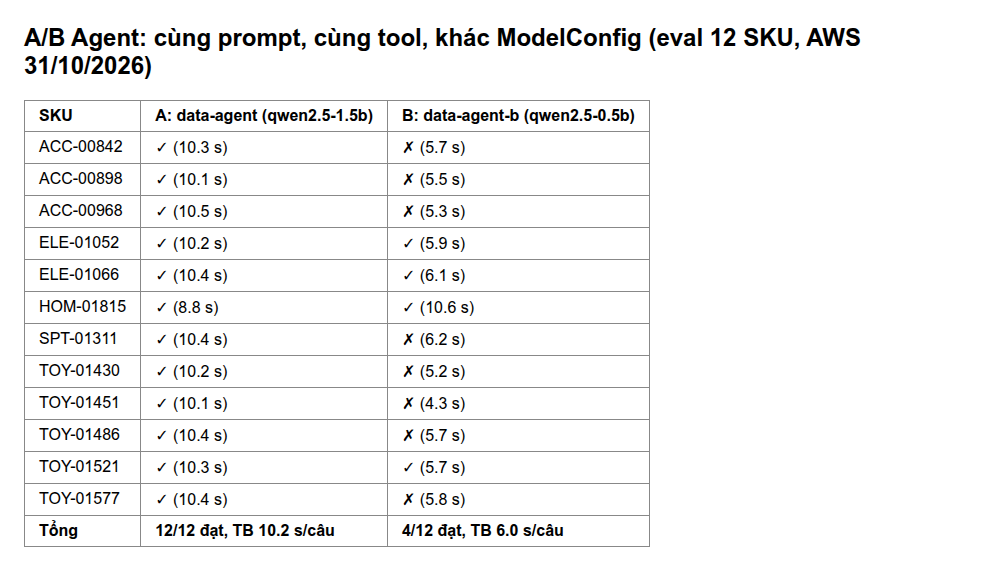

<!-- Mục đích: A/B test LLM và Agent qua agentgateway, theo dõi trên Grafana -->
# A/B test — LLM và Agent

EDAI-2, dòng 52–53: A/B cho Agent và các bản LLM.

Code / cấu hình: bảng thiết kế bên dưới. Kết quả AWS ngày 31/10 ở mục riêng; số local ngày 21/10 giữ để đối chiếu, không thay bằng chứng AWS.

không thay model cũ trực tiếp; chạy song song, chia traffic, theo dõi rồi mới
quyết định. 52 = A/B giữa Agent khác model config; 53 = A/B giữa hai bản LLM trên inference platform.

## Thiết kế

| Nhánh | LLM | Agent | File |
|---|---|---|---|
| **A** (đang dùng) | `qwen2.5-1.5b-instruct` (llama.cpp, cấu hình đã benchmark) | `data-agent`, `default-model-config` | `infra/k8s/agents/llm.yaml`, `data-agent.yaml` |
| **B** (ứng viên) | `qwen2.5-0.5b-instruct` (cùng image, cùng cờ) | `data-agent-b`, `ab-small-model-config` — cùng prompt, cùng tool | [`ab-llm-small.yaml`](../../infra/k8s/agents/ab-llm-small.yaml), [`ab-data-agent.yaml`](../../infra/k8s/agents/ab-data-agent.yaml) |

Chia traffic ở **agentgateway** ([`agentgateway.yaml`](../../infra/k8s/agents/agentgateway.yaml)):

- **LLM (53)**: model ảo `platform-chat`, `routing.weighted` 1:1 giữa A và B. Client gọi `platform-chat`,
  gateway chọn model thật, metric/trace ghi `gen_ai_response_model`.
- **Agent (52)**: route A2A `/a2a/data-agent-ab/`, hai backend `weight: 1`, gắn nhãn `backend0`/`backend1`
  trong `agentgateway_requests_total`.

Theo dõi: dashboard Grafana **Data & AI Platform — A/B LLM + Agent** ([`platform-ab-llm.json`](../../infra/k8s/observability/dashboards/platform-ab-llm.json)):
tỷ lệ chia, request/giây, p95 độ trễ, token output/giây, token/request theo nhánh, request theo backend agent.

## Kết quả trên AWS (2026-10-31, EKS `platform-apps`)

Cùng thiết kế ở trên, chạy trên EKS: nhánh A `qwen` (1,5B), nhánh B `qwen-small` (0,5B), chia ở agentgateway.

**LLM (53)** — `bench_llm.py --model platform-chat --concurrency 2`, cắt ở 900 s vì LLM chạy CPU. Grafana
**Data & AI Platform — A/B LLM + Agent** ghi 9,13 request (1,5B) so 8,07 request (0,5B): đúng tỷ lệ 1:1 ở mẫu nhỏ;
p95 khoảng 10 s (1,5B) so 80 s (0,5B) trong khung thời gian của ảnh.

Số đếm Prometheus: [`ab-llm-prometheus-20261031.json`](../evidence/aws/ab-llm-prometheus-20261031.json). Tổng tích luỹ
642 (A) so 30 (B) **không phải tỷ lệ chia**: B mới tạo trong ngày nên chỉ nhận tải bench, còn A phục vụ thêm
data-agent, coordinator và sandbox.

**Agent (52)** — 12 SKU, cùng prompt/tool, chấm bằng harness ML-N1 ([agent_evaluation.md](agent_evaluation.md)):

| Nhánh | Đạt | Giây/câu (TB) | Kết quả từng câu |
|---|---:|---:|---|
| A `data-agent` (1,5B) | **12/12** | 10,2 | [JSONL](../evidence/aws/agent-eval-data-agent-20261031.jsonl) |
| B `data-agent-b` (0,5B) | **4/12** | 6,0 | [JSONL](../evidence/aws/agent-eval-data-agent-b-20261031.jsonl) |
| Route chia `/a2a/data-agent-ab/` | 2/6 | — | [JSONL](../evidence/aws/agent-eval-data-agent-ab-20261031.jsonl) |

Ảnh trên là bảng dựng lại từ hai file JSONL eval ở trên bằng [`render_ab_comparison.py`](../../scripts/evidence/render_ab_comparison.py), **không phải ảnh chụp Grafana**.
Dashboard Grafana so hai cấu hình model (tỷ lệ chia, p95, token/giây, request theo backend agent) cần chụp đủ cả sáu panel
khi có tải đủ dài; ảnh 31/10 ở trên mới thấy hai panel request và p95.

Giới hạn: bench LLM ngắn (cắt ở 900 s, chỉ khoảng 9 và 8 request theo Grafana), không tính khoảng tin cậy; 12 SKU là tập nhỏ; kết quả route chia
phản ánh trộn hai nhánh, không phải thước đo riêng của B.

## Kết quả local (2026-10-21, kind) — ghi nhận trước AWS

**LLM** — 40 request, 2 đồng thời, `max_tokens` 48 ([`ab-llm-20261021.jsonl`](../evidence/ab-llm-20261021.jsonl)):

| Nhánh | Số request | p50 | p95 (Prometheus) | Token output/request |
|---|---|---|---|---|
| A 1.5B | 25 | 2,33 s | 4,16 s | 45,6 |
| B 0.5B | 15 | 1,74 s | 2,47 s | 45,9 |

Prometheus đếm khớp client (25/15); 25/15 với tỷ lệ 1:1 là dao động lấy mẫu bình thường ở n = 40.

**Agent** — 20 câu hỏi A2A "What are the return features of sku-…" ([`ab-agent-20261021.jsonl`](../evidence/ab-agent-20261021.jsonl)):
20/20 trả 200, p50 4,5 s. Gateway: backend0 (A) 18, backend1 (B) 14 request (gồm 12 request lượt
thử trước). Lượt gọi LLM trong lúc test: 1.5B = 28, 0.5B = 12 — agent A gọi tool rồi mới trả lời
(~2 lượt LLM/câu), agent B trả lời sau ít lượt hơn.

## Kết luận và quyết định

B nhanh hơn (local ~25–45%, AWS ~40% thời gian mỗi câu agent), nhưng eval harness ML-N1 ([`agent_evaluation.md`](agent_evaluation.md)) cho thấy B kém
chính xác hơn: trên AWS **A 12/12, B 4/12** (local: A 12/12, B 11/12); câu B trượt là bịa hoặc chép sai số. (Giả thuyết ban đầu "B bỏ
qua gọi tool" chỉ đúng một phần — B vẫn gọi tool nhưng có lúc đọc sai/trộn số.) **Giữ A làm mặc định**;
B chỉ hợp cho câu không cần con số chính xác. Cổng CI đặt `--min-accuracy 0.95` sẽ chặn B.

Các nhánh B đã scale về 0; bật lại: `kubectl -n llm scale deploy/qwen-small --replicas=1`,
`kubectl -n kagent scale deploy/data-agent-b --replicas=1`.

[Mục lục phần này](../README.md) · [Mục lục chung](../../README.md)
