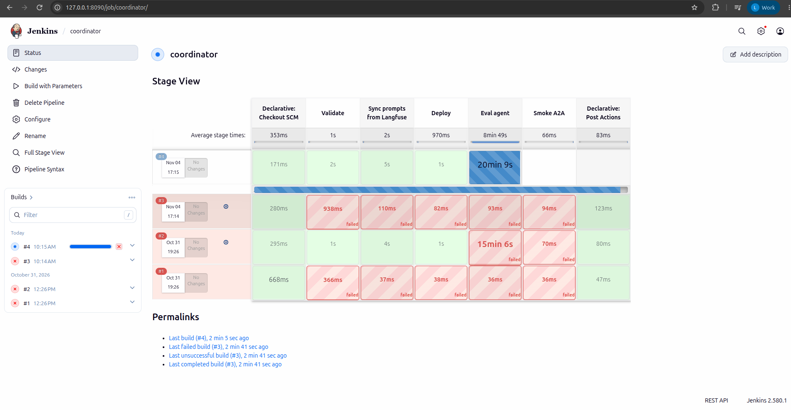
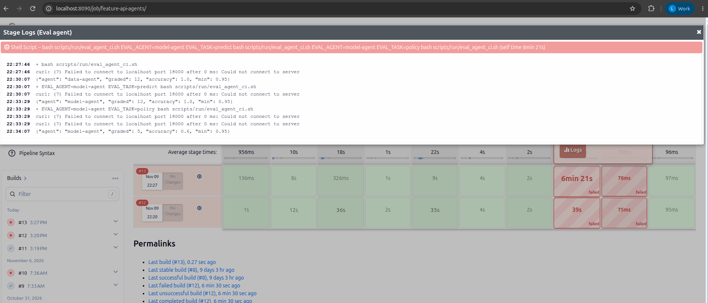

# Agent Evaluation trên AWS

EDAI-2, dòng 56: novel idea — Agent eval harness (bộ công cụ tự hỏi agent một loạt câu cố định rồi chấm đúng/sai).

Code và cấu hình: xem bảng thành phần trong phần "Tham khảo" cuối trang. Kết quả cổng chặn (gate) trên Jenkins và giới hạn của tập SKU được ghi ở dưới, kèm file JSONL kết quả từng câu.

Các kết quả dưới đây là của những lần đã chạy trên AWS. Chúng không có nghĩa là dịch vụ đang bật lúc bạn đọc.

## Trên AWS

**Tóm tắt:** Data Agent qua được cổng eval trên AWS (12/12 câu đúng). Coordinator qua được cổng ở lần chạy sau (xem [Dùng trong CI](#dùng-trong-ci)). Model Agent mới đạt phần dự đoán; phần câu hỏi chính sách còn trượt do model nhỏ.

Jenkins chạy trên EC2 `i-0d657089ba4a4ea7e` (`10.42.0.151`) và gọi `data-agent` trên cụm EKS, context `platform-apps`.
Build `feature-api-agents` **#8 xanh**. Cổng eval đạt **12/12 câu = 1,00**, cao hơn ngưỡng yêu cầu 0,95.
Kết quả từng câu: [agent-eval-data-agent-20261031.jsonl](../evidence/aws/agent-eval-data-agent-20261031.jsonl).
Luồng build, đẩy image lên ECR và deploy: [CI/CD AWS](cicd.md#trên-aws).


**Phát hiện lỗi che PII (PII mask).** Lần chạy đầu chỉ đạt **9/12**.
Nguyên nhân: guardrail `phoneNumber` của gateway (bộ lọc che số điện thoại) che luôn cả số đếm có bảy chữ số.
Ví dụ `6077845` bị thay thành `<PHONE_NUMBER>`. Câu trả lời mất con số đúng nên harness chấm trượt.

Lần đạt 12/12 dùng các SKU có `labeled_count_90d` dưới bảy chữ số. Vì vậy kết quả này chỉ chứng minh cho tập SKU đó.
Nó **không** chứng minh lỗi mask đã được sửa cho mọi số đếm lớn.
Lỗi này khác với lỗi làm tròn tỷ lệ: ở đây một số đếm nguyên bị nhận nhầm thành số điện thoại. Cùng guardrail này trước đó đã che tỉ lệ Return 17 chữ số trong chat Coordinator (xem [Observability](observability.md)).

<a id="coordinator-trên-aws-04112026"></a>
**Coordinator trên AWS, hai lần chạy đầu.** Ở cả hai lần, các bước `Validate`, `Sync prompts` và `Deploy` đều xanh.
Nhưng cổng `Eval agent` (12 SKU, ngưỡng độ chính xác 0,95) **chưa đạt**:

- Một lần báo đỏ sau 15 phút 6 giây.
- Lần còn lại (build #4) chạy hơn **20 phút** vẫn chưa xong, nên không có kết quả `accuracy` để báo cáo (EC2 bị dừng khi build còn đang chạy).



Số đo cùng thời điểm:

- Hỏi tay một câu vào Coordinator mất **40,7 giây** và nhận đúng số (15.306 / 2.599 / 16,98%).
- Khi chạy eval, log của llama.cpp ([llm-slot-timing-during-eval.txt](../evidence/aws/llm-slot-timing-during-eval.txt)) ghi 69 lượt gọi LLM. Trung vị là 6 giây, nhưng có lượt tới **350 giây**, và 6 lượt vượt 100 giây.
- Gateway chỉ nhận khoảng 4 câu hỏi cho Coordinator trong 10 phút, tức khoảng 2,5 phút mỗi câu.

Nguyên nhân chưa xác định. Giả thuyết (chưa kiểm chứng): khi một câu vượt thời gian chờ 180 giây, harness bỏ qua và hỏi câu kế tiếp.
Nhưng Coordinator vẫn tiếp tục xử lý câu đã bị bỏ, nên các lượt gọi LLM chồng lên nhau trên 4 slot CPU (4 luồng xử lý song song của llama.cpp), làm các câu sau cũng chậm theo.

Điều đã biết chắc: một model Qwen 1,5B chạy bằng CPU, dùng chung cho mọi Agent, không đủ nhanh cho chuỗi gọi Coordinator, rồi Agent, rồi tool, rồi quay lại Coordinator trong cổng CI này.

**Agent 2 (model-agent) có cổng eval riêng**, gồm hai loại câu hỏi:

- `ml/agent_eval.py --task predict`: hỏi điểm rủi ro của một đơn hàng mới, rồi so với kết quả `POST /predict` của Feature API. Câu đạt khi lệch không quá 0,005, hoặc khi agent nói "từ chối" trong trường hợp SKU chưa có lịch sử.
- `--task policy`: hỏi 5 câu về cửa sổ và hạn trả hàng trong chính sách, rồi kiểm con số có đúng với tài liệu trong `rag/corpus` không.

`feature-api-agents.Jenkinsfile` chạy cả ba bài (chọn bằng biến `EVAL_AGENT`, `EVAL_TASK` trong `eval_agent_ci.sh`; file kết quả là `out/agent-eval-<agent>-<task>.jsonl`).

Thử ở local (cụm kind, Feature API giả với dữ liệu cố định, chưa phải Redis/pgvector thật, chưa chạy trên AWS): predict đạt 4/4; policy đạt 4/5 sau khi siết prompt (trước đó 3/5).
Câu còn trượt là do Qwen 1,5B viết lệnh gọi tool ra thành văn bản chứ không gọi tool thật (tool không chạy). Vì vậy cổng 0,95 của policy có thể đỏ trên AWS cho tới khi model gọi tool ổn định hơn.

**Kết quả trên EKS** (Jenkins `feature-api-agents` #13, sau khi tách MCP sang pod riêng `feature-mcp`):

| Bài eval | Kết quả |
|---|---|
| Data Agent | **12/12** |
| Model Agent, predict | **12/12** |
| Model Agent, policy | **3/5** |

Policy 3/5 thấp hơn ngưỡng 0,95, nên build đỏ và stage Smoke không được chạy. Chạy riêng `gateway_smoke.py` thì đạt 24/24.

Hai câu trượt (hạn trả hàng của Shopee và Walmart) đều cùng một lỗi: model trả về văn bản `Call search_policy_chunks with the query …` thay vì gọi tool.
Gọi trực tiếp `search_policy_chunks` qua MCP vẫn trả về chunk, tức tool hoạt động bình thường.
Không hạ ngưỡng để pipeline xanh: đây là giới hạn của model 1,5B chạy trên CPU và chưa được khắc phục.



<details>
<summary>Tham khảo: thiết kế, hướng dẫn phát triển và ghi nhận trước triển khai AWS</summary>

Các ghi nhận local giữ nguyên môi trường, không dùng thay bằng chứng cloud.

<!-- Mục đích: eval harness cho agent + cổng hồi quy; proof chạy được trên hai nhánh A/B. -->
## ML-N1: eval harness cho agent + cổng hồi quy

Câu hỏi "agent có trả lời **đúng số thật** không?" không đo được bằng độ trễ hay số token.
Vì vậy harness làm như sau:

1. Hỏi agent một bộ câu cố định qua agentgateway (giao thức A2A).
2. Lấy **đáp án chuẩn từ Feature API**, cũng là nguồn mà agent phải gọi tool để lấy số.
3. Chấm từng câu.
4. Dùng độ chính xác làm cổng chặn trong CI: nếu dưới ngưỡng, harness thoát với mã 1, khiến pipeline đỏ sau bước deploy agent.

| Thành phần | File |
|---|---|
| Harness + chấm điểm | [`ml/agent_eval.py`](../../ml/agent_eval.py), test [`tests/unit/test_agent_eval.py`](../../tests/unit/test_agent_eval.py) |
| Route chấm riêng nhánh B | `a2a-data-agent-b-path` trong [`agentgateway.yaml`](../../infra/k8s/agents/agentgateway.yaml) |
| Kết quả | [`evidence/agent-eval-20261021.jsonl`](../evidence/agent-eval-20261021.jsonl) |

## Luật chấm

Câu "What are the return features of sku-…?" **đạt** khi câu trả lời chứa đủ ba giá trị:

- `labeled_count_90d` và `positive_count_90d`: phải đúng số nguyên.
- `return_or_refund_rate_90d`: lệch không quá 0,005; chấp nhận cả cách viết `0.33` lẫn `33%`.

Mã SKU (ví dụ `sku-00010`) không được tính là một con số.
SKU chưa có lịch sử thì không chấm, để agent không thể "đạt" chỉ bằng cách nói "0".
Nếu agent lỗi HTTP hoặc hết thời gian chờ, câu đó tính là trượt và harness vẫn chạy tiếp.

**Chuẩn bị dữ liệu.** Ảnh chụp dữ liệu online mới nhất có mọi số bằng 0, nên không phân biệt được agent nào lấy số thật.
Vì vậy lúc eval, Redis được nạp lại dữ liệu tới mốc 15/03, rồi khôi phục về mốc ban đầu sau khi chấm.
Trước khi nạp phải `flushall` (xoá sạch Redis), vì Feast không ghi đè giá trị mới bằng giá trị cũ hơn.

## Proof (12 SKU, cùng câu hỏi, cùng tool)

| Agent | Model | Đã đo | p50 |
|---|---|---|---|
| `data-agent` (A) | qwen2.5-1.5b | **12/12 = 100%** | 5,4 s |
| `data-agent-b` (B) | qwen2.5-0.5b | **11/12 = 91,7%** | 3,0 s |

Câu nhánh B trượt (sku-00005): agent nói `labeled_count_90d = 18` (sai), và tỷ lệ 0,085 cũng không khớp với 10/18.
Đây là **bịa số**, loại lỗi mà dashboard độ trễ hay token không bao giờ phát hiện được.

Kiểm tra cổng: chạy nhánh B với `--min-accuracy 0.95` cho `accuracy 0.917`, nên harness trả **exit 1** (bị chặn). Chạy nhánh A với ngưỡng 0,6 thì exit 0.

## Dùng trong CI

Stage **Eval agent** đã được nối vào hai pipeline:

- sau `Deploy Agent` trong `feature-api-agents.Jenkinsfile`;
- sau `Deploy` trong `coordinator.Jenkinsfile` (route `/a2a/coordinator/` nhận cùng câu hỏi về SKU).

Cả hai gọi cùng một wrapper. Lệnh chạy tại workspace Jenkins:

```bash
## Cần VAULT_ADDR/VAULT_TOKEN + KUBECONFIG; Jenkins bind từ credentials.
bash scripts/run/eval_agent_ci.sh
## Coordinator dùng cùng harness qua route A2A riêng:
EVAL_AGENT=coordinator bash scripts/run/eval_agent_ci.sh
```

Với `coordinator`, cổng chỉ chấm việc **định tuyến**, không chấm số. Một câu đạt khi lịch sử hội thoại có lệnh gọi `data_agent` hoặc `model_agent` và có câu trả lời cuối.
Lý do: model 1,5B hay làm rơi chữ số khi chép lại, còn độ đúng của số đã do eval của data-agent và model-agent kiểm.
Giới hạn: cổng này không bắt được trường hợp coordinator chép sai hoặc bịa số.

Đo trên AWS (Jenkins coordinator #9, 12 SKU): **12/12 = 1,00**, đạt ngưỡng 0,95. Có 12 lần gọi `data_agent`; mỗi câu mất 14–48 giây (riêng TOY-01577 mất 165 giây).
ACC-00842 vẫn trả số sai (0 returns) nhưng đã định tuyến đúng nên vẫn tính là đạt; số của data-agent do eval data-agent chấm.

Wrapper làm các bước sau:

1. Đọc key từ `vault_env.sh agentgateway`.
2. Port-forward Feature API `18000:8000` và gateway `18300:3000` (đổi bằng `EVAL_FEATURE_PORT`/`EVAL_GATEWAY_PORT` nếu cần).
3. Gọi `python3 -m ml.agent_eval` với đủ 12 mã từ `sku-00001` đến `sku-00012`, `--min-accuracy 0.95`, `--out out/agent-eval.jsonl`.

HTTP (không mã hoá) chỉ dùng trên loopback qua port-forward, nên không phụ thuộc IP node hay cert local của máy phát triển. Khi gọi HTTPS trực tiếp, harness vẫn kiểm CA như trước.

Jenkins lưu `out/agent-eval.jsonl` và `out/agent-eval-summary.json` bằng `archiveArtifacts`, kể cả khi điểm dưới ngưỡng.
`set -o pipefail` giữ nguyên mã thoát 1 khi đi qua `tee`, nên build vẫn đỏ.
Stage này chặn pipeline sau khi đã deploy, **chưa tự rollback agent** (chưa tự quay về bản cũ).

SKU phải có lịch sử thì mới chấm được. Nếu không có câu nào chấm được, accuracy bằng 0 và build đỏ.
CI không `flushall` hay thay dữ liệu Redis đang dùng; người vận hành tự chuẩn bị fixture (dữ liệu mẫu) có nhãn trước khi chạy.
Bằng chứng A/B ở trên là của lần chạy local. Gate Jenkins đã chạy trên AWS: xem mục [Trên AWS](#trên-aws).

</details>

[Mục lục phần này](README.md) · [Mục lục chung](../README.md)
