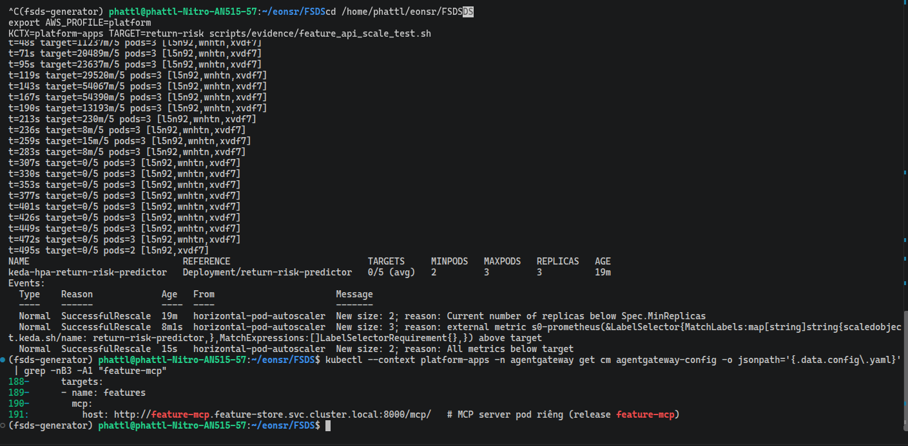
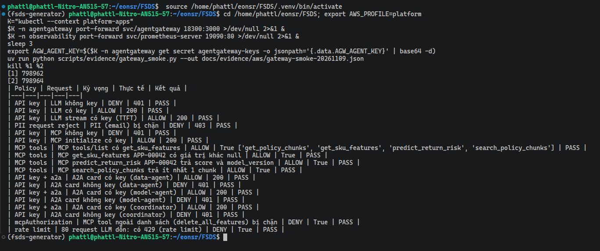

# MCP Gateway và A2A Gateway trên EKS

EDAI-2, dòng 5, 23–24: agentgateway và security/policy.

Mọi lời gọi tới LLM, tới tool (qua MCP) và giữa các Agent (qua A2A) đều đi qua một cổng chung là **agentgateway**.
Gateway kiểm tra khoá, giới hạn tần suất, lọc dữ liệu cá nhân (PII) và chỉ cho gọi những tool được phép.

Code: [agentgateway.yaml](../../infra/k8s/agents/agentgateway.yaml), [kagent proxy](../../infra/k8s/agents/kagent-values.yaml).

| Route | Đích | Chính sách / mục đích |
|---|---|---|
| `/v1/chat/completions` | llama.cpp | API key và rate limit để kiểm soát lượt gọi LLM |
| `/mcp` | MCP server (pod `feature-mcp`) | API key; `mcpAuthorization` giới hạn tool được gọi |
| `x-kagent-host` / `/a2a/<agent>/` | Service của Agent | API key, policy A2A; gọi Agent qua gateway |

## Vì sao chọn các policy

| Policy | Cách áp dụng và lý do chọn |
|---|---|
| API key `strict` | Áp dụng cho LLM, MCP và A2A. Request thiếu hoặc sai key bị từ chối, nhờ đó kiểm soát được client nào gọi dịch vụ qua gateway. Key lấy từ Kubernetes Secret |
| `localRateLimit` cho LLM | Model chạy bằng CPU nên năng lực có hạn. Giới hạn kiểu token bucket: cho dồn tối đa 60 request, sau đó hồi 1 request/giây. Đây là giới hạn số request, không phải số token của LLM |
| `mcpAuthorization` | Chỉ cho gọi `get_sku_features`, `get_policy_chunks`, `search_policy_chunks`, `predict_return_risk`, đủ để tra feature, tìm chính sách và dự đoán. Tool ngoài danh sách bị ẩn khỏi `tools/list` và bị chặn khi gọi. Muốn thêm tool phải cập nhật danh sách cho phép |
| PII request `reject` | Chặn request có nội dung giống email, số thẻ tín dụng hoặc SSN trước khi tới LLM, để giảm dữ liệu cá nhân đi vào xử lý. Không chặn mẫu số điện thoại ở request, vì số lượng, giá và mã SKU dễ bị nhận nhầm |
| PII response `mask` | Che nội dung giống email, số điện thoại hoặc số thẻ trong câu trả lời, để giảm nguy cơ trả dữ liệu cá nhân cho client |
| Policy `a2a` và định tuyến qua gateway | Gom việc xác thực và định tuyến lời gọi Agent về gateway. Agent được chọn theo header `x-kagent-host` hoặc đường dẫn `/a2a/<agent>/`. Policy A2A viết lại URL trong agent card thành địa chỉ gateway, để các lời gọi sau cũng đi qua gateway |

Giới hạn của cấu hình hiện tại:

- Mọi Agent dùng chung một API key; chưa phân quyền riêng cho từng Agent.
- Bộ đếm rate limit nằm trong RAM của từng replica, không chia sẻ giữa các replica.
- Route MCP hiện không đặt rate limit; chưa có bằng chứng giới hạn này có hiệu lực riêng ở MCP.
- PII dựa trên mẫu ký tự nên có thể che nhầm số đếm dài trong câu trả lời: [giới hạn đã ghi nhận](agent_evaluation.md).
  Việc che không bảo đảm số liệu trả ra còn đúng. Các policy trên chỉ mô tả cấu hình hiện có.

## Bằng chứng EKS

[Gateway smoke](../evidence/aws/gateway-smoke-20261030.json) (bài kiểm tra nhanh toàn bộ policy, [script](../../scripts/evidence/gateway_smoke.py)) đạt **17/17** kiểm tra. Grafana ghi nhận lưu lượng trên các route Agent và MCP:

### Cấu hình agentgateway trên EKS

Cấu hình nằm trong ConfigMap `agentgateway-config` (namespace `agentgateway`), sinh từ [`agentgateway.yaml`](../../infra/k8s/agents/agentgateway.yaml).

Phần LLM gồm:

- `apiKey` ở chế độ `strict`;
- `localRateLimit`: dồn tối đa 60 request, hồi 1 request/giây;
- model `qwen2.5-1.5b-instruct`;
- guardrail PII: ở request, email, thẻ tín dụng, SSN bị từ chối với mã 403; ở response, email, số điện thoại, số thẻ bị che.

Trong cấu hình, khoá chỉ xuất hiện dưới dạng biến `$AGW_AGENT_KEY`; giá trị thật nằm trong Secret.

Phần tiếp theo:

- model nhánh B `qwen2.5-0.5b-instruct`;
- model ảo `platform-chat`, chia 50/50 lượt gọi giữa hai nhánh (thử A/B);
- các route A2A: `a2a-data-agent` chọn Agent theo header `x-kagent-host`; `a2a-data-agent-path` và `a2a-data-agent-b-path` cho client ngoài cụm (đường `/a2a/<agent>/`). Các route này cùng dùng `apiKey` và policy `a2a`.

Các route còn lại:

- `a2a-model-agent` và `a2a-coordinator` (chọn theo header `x-kagent-host`);
- `a2a-model-agent-path` và `a2a-coordinator-path` (đường `/a2a/<agent>/`);
- route **`mcp`** (`/mcp`) với `apiKey` và `mcpAuthorization`. Route này chỉ cho gọi bốn tool `get_sku_features`, `get_policy_chunks`, `search_policy_chunks`, `predict_return_risk`; tool ngoài danh sách bị ẩn khỏi `tools/list` và bị chặn khi gọi.

Backend MCP tên là `features`, trỏ tới `http://feature-mcp.feature-store.svc.cluster.local:8000/mcp/` (pod MCP riêng; xem [Web API và MCP](web_api_mcp.md)).
Route MCP không đặt rate limit, vì bản 1.6.0 không áp dụng rate limit cho MCP.

Ảnh chụp trước khi tách pod, lúc backend còn là `feature-api`: [gateway-config-mcp-backend.png](../evidence/aws/gateway-config-mcp-backend.png).

### Allow / deny theo từng policy

[`gateway_smoke.py`](../../scripts/evidence/gateway_smoke.py) in ra một bảng. Mỗi dòng gồm: policy, request đã gửi, kết quả kỳ vọng (ALLOW hoặc DENY) và kết quả thực tế.
Các policy được thử: API key, PII request, rate limit, `mcpAuthorization`, và A2A của từng Agent (`data-agent`, `model-agent`, `coordinator`).

Kết quả trên EKS (`platform-apps`) sau khi tách pod MCP: đạt **24/24** kiểm tra, gồm 18 dòng policy ở bảng dưới và 6 kiểm tra số liệu Prometheus.
Bản ghi kết quả: [gateway-smoke-20261109.json](../evidence/aws/gateway-smoke-20261109.json). Lần chạy trước khi tách đạt 22/22 ([receipt](../evidence/aws/gateway-smoke.json)).

- **API key:** thiếu khoá thì trả `401` ở LLM, MCP và A2A của cả ba Agent; có khoá thì trả `200`.
- **PII request:** prompt chứa email bị chặn với mã `403`.
- **Rate limit:** gửi dồn 80 request LLM thì có request bị trả `429`.
- **`mcpAuthorization`:** `tools/list` chỉ hiện bốn tool trong danh sách (`get_policy_chunks`, `get_sku_features`, `predict_return_risk`, `search_policy_chunks`).
  Gọi tool ngoài danh sách `delete_all_features` bị từ chối với `HTTP 400`, JSON-RPC `-32602 Unknown tool`.
  Lưu ý: tên tool này cũng không tồn tại ở backend, nên riêng phản hồi này chưa phân biệt được gateway chặn hay backend báo không có tool. Tool đã khai trong danh sách thì không bị chặn.
- **Dữ liệu thật qua MCP:** `get_sku_features APP-00042` trả giá trị khác `null`. Dòng kiểm tra này từng `FAIL` khi Redis trống: xem [Feature Store](feature_store.md).

Truy cập từ bên ngoài cụm: [NGINX/HTTPS](routing_gateway.md).

[Mục lục phần này](README.md) · [Mục lục chung](../README.md)
