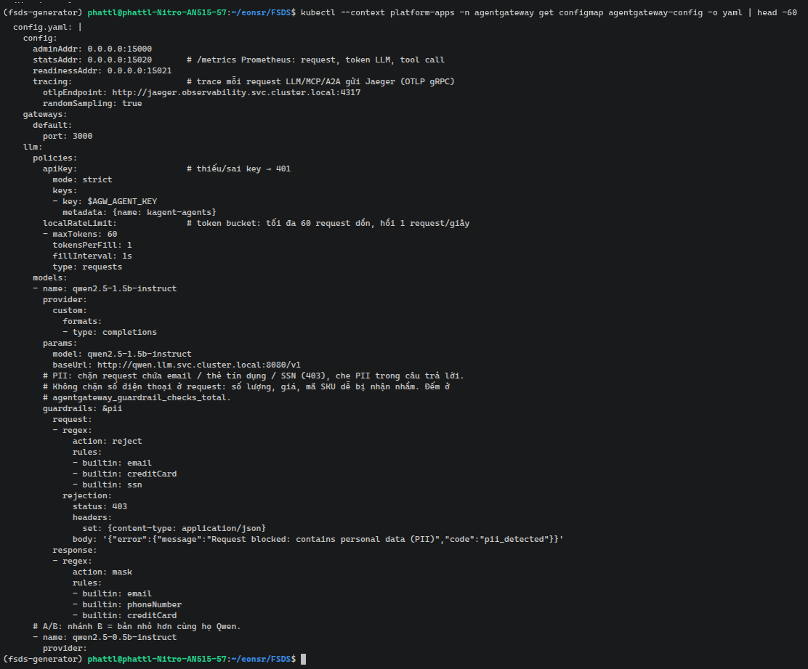
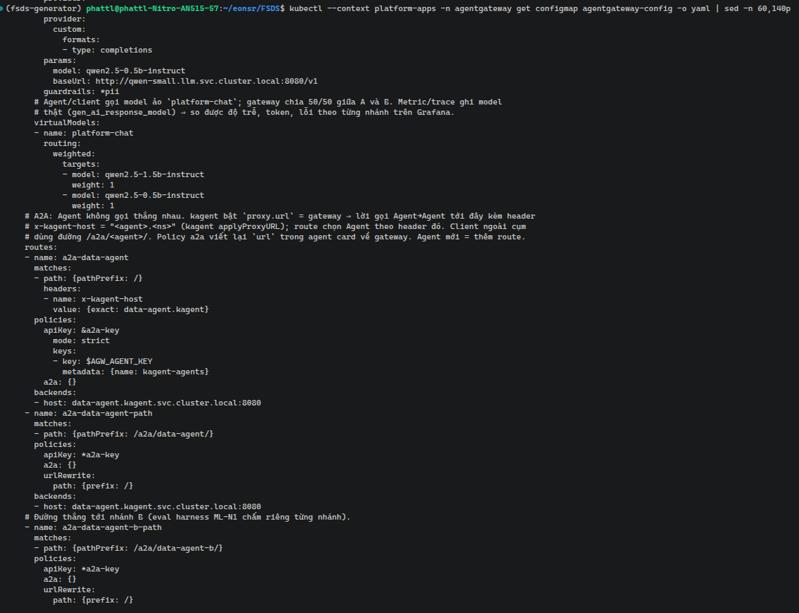
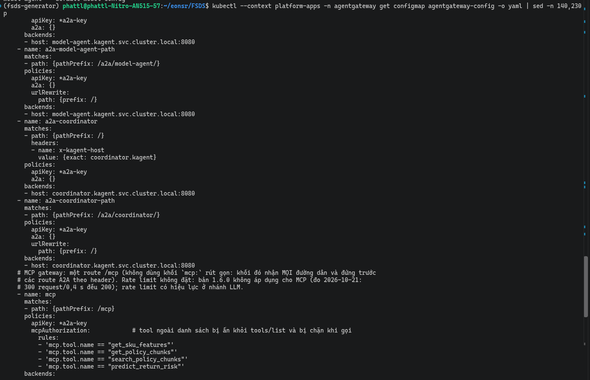
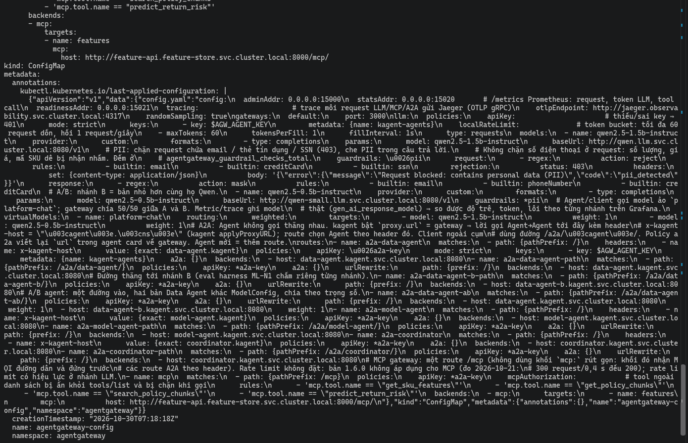

# MCP Gateway và A2A Gateway trên EKS

EDAI-2, dòng 5, 23–24: agentgateway và security/policy.

Code: [agentgateway.yaml](../../infra/k8s/agents/agentgateway.yaml), [kagent proxy](../../infra/k8s/agents/kagent-values.yaml).

| Route | Đích | Chính sách / mục đích |
|---|---|---|
| `/v1/chat/completions` | llama.cpp | API key và rate limit kiểm soát inference |
| `/mcp` | Feature API MCP | API key, `mcpAuthorization` giới hạn tool |
| `x-kagent-host` / `/a2a/<agent>/` | Service Agent | API key, policy A2A; gọi Agent qua gateway |

## Vì sao chọn các policy

| Policy | Cách áp dụng và lý do chọn |
|---|---|
| API key `strict` | Áp dụng cho LLM, MCP và A2A; từ chối request thiếu hoặc sai key để kiểm soát client được gọi các dịch vụ qua gateway. Key lấy từ Kubernetes Secret |
| `localRateLimit` cho LLM | Model chạy CPU có năng lực xử lý hữu hạn; giới hạn gọi dồn bằng token bucket cho phép burst 60 request, hồi 1 request/giây. Đây là giới hạn số request, không phải số token của LLM |
| `mcpAuthorization` | Chỉ cho gọi `get_sku_features`, `get_policy_chunks`, `search_policy_chunks`, `predict_return_risk`, đủ cho tra feature, tìm chính sách và dự đoán. Tool ngoài danh sách bị ẩn khỏi `tools/list` và bị chặn khi gọi; thêm tool cần cập nhật danh sách cho phép |
| PII request `reject` | Chặn request khớp mẫu email, thẻ tín dụng hoặc SSN trước khi gửi vào LLM, giảm dữ liệu cá nhân đi vào xử lý. Không chặn mẫu số điện thoại ở request vì số lượng, giá và mã SKU dễ bị nhận nhầm |
| PII response `mask` | Che nội dung khớp mẫu email, số điện thoại hoặc thẻ tín dụng trong câu trả lời, giảm nguy cơ trả dữ liệu cá nhân cho client |
| Policy `a2a` và định tuyến qua gateway | Gom xác thực và định tuyến lời gọi Agent tại gateway; chọn Agent theo `x-kagent-host` hoặc `/a2a/<agent>/`. Policy A2A viết lại URL trong agent card về gateway để các lời gọi tiếp theo tiếp tục đi qua đây |

Các giới hạn của cấu hình hiện hành:

- API key dùng chung cho các Agent, chưa phân quyền riêng từng Agent.
- Bộ đếm rate limit nằm trong RAM của từng replica, không chia sẻ giữa replica. Route MCP hiện không đặt rate limit;
  chưa có bằng chứng giới hạn này có hiệu lực riêng ở MCP.
- PII dựa trên mẫu có thể che nhầm số đếm dài trong câu trả lời: [giới hạn đã ghi nhận](agent_evaluation.md).
  Việc mask không bảo đảm số liệu đầu ra còn đúng; các policy trên mô tả cấu hình hiện có.

## Bằng chứng EKS

[Gateway smoke](../evidence/aws/gateway-smoke-20261030.json) đạt **17/17** kiểm tra; [script](../../scripts/evidence/gateway_smoke.py). Grafana ghi nhận route Agent/MCP:

### Cấu hình agentgateway trên EKS

Cấu hình nằm trong ConfigMap `agentgateway-config` (namespace `agentgateway`), lấy từ [`agentgateway.yaml`](../../infra/k8s/agents/agentgateway.yaml).
Phần LLM: `apiKey` chế độ `strict`, `localRateLimit` (tối đa 60 request dồn, hồi 1 request/giây), model `qwen2.5-1.5b-instruct`,
guardrail PII (request: email, thẻ tín dụng, SSN bị từ chối 403; response: che email, số điện thoại, thẻ). Khóa chỉ là biến `$AGW_AGENT_KEY`,
giá trị thật nằm trong Secret.

Phần tiếp theo: model nhánh B `qwen2.5-0.5b-instruct`, model ảo `platform-chat` chia 50/50 giữa hai nhánh (A/B), rồi các route A2A: `a2a-data-agent`
chọn Agent theo header `x-kagent-host`, `a2a-data-agent-path` và `a2a-data-agent-b-path` cho client ngoài cụm (`/a2a/<agent>/`), cùng `apiKey` và policy `a2a`.

Các route còn lại: `a2a-model-agent` và `a2a-coordinator` (theo header `x-kagent-host`), `a2a-model-agent-path` và `a2a-coordinator-path`
(đường `/a2a/<agent>/`), rồi route **`mcp`** (`/mcp`) với `apiKey` và `mcpAuthorization`: chỉ cho gọi bốn tool `get_sku_features`, `get_policy_chunks`,
`search_policy_chunks`, `predict_return_risk`; tool ngoài danh sách bị ẩn khỏi `tools/list` và bị chặn khi gọi. Backend MCP là `features`
(`http://feature-api.feature-store.svc.cluster.local:8000/mcp/`). Route MCP không đặt rate limit (bản 1.6.0 không áp dụng cho MCP).

### Allow / deny theo từng policy

[`gateway_smoke.py`](../../scripts/evidence/gateway_smoke.py) in bảng policy → request → ALLOW/DENY kỳ vọng và thực tế
(API key, PII request, rate limit, `mcpAuthorization`, A2A của từng Agent: `data-agent`, `model-agent`, `coordinator`).
Kết quả trên EKS (`platform-apps`): **22/22** kiểm tra đạt (16 dòng policy ở bảng dưới và 6 kiểm số liệu Prometheus), receipt
[gateway-smoke.json](../evidence/aws/gateway-smoke.json).

- **API key:** thiếu khóa trả `401` ở LLM, MCP và A2A của cả ba Agent; có khóa trả `200`.
- **PII request:** email trong prompt bị chặn `403`.
- **Rate limit:** 80 request LLM dồn có `429`.
- **`mcpAuthorization`:** `tools/list` chỉ thấy bốn tool trong danh sách (`get_policy_chunks`, `get_sku_features`, `predict_return_risk`, `search_policy_chunks`); gọi tool ngoài danh sách
  `delete_all_features` bị từ chối với `HTTP 400`, JSON-RPC `-32602 Unknown tool`. Lưu ý: vì tên này cũng không tồn tại ở backend nên phản hồi không tự nó phân biệt được
  gateway chặn hay backend báo không có tool; tool đã khai trong danh sách thì không bị chặn.
- **Dữ liệu thật qua MCP:** `get_sku_features APP-00042` trả giá trị khác `null` (dòng này từng `FAIL` khi Redis trống: xem [Feature Store](feature_store.md)).

Truy cập bên ngoài: [NGINX/HTTPS](routing_gateway.md).

[Mục lục phần này](README.md) · [Mục lục chung](../README.md)
