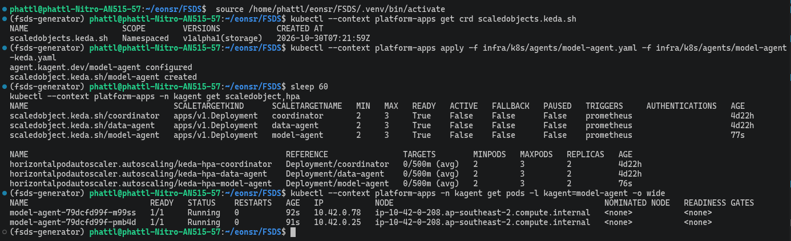
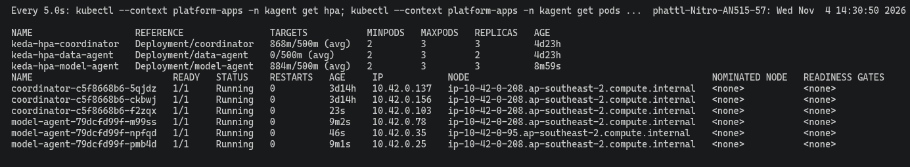
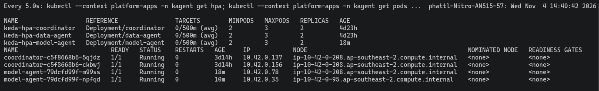
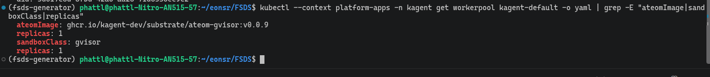
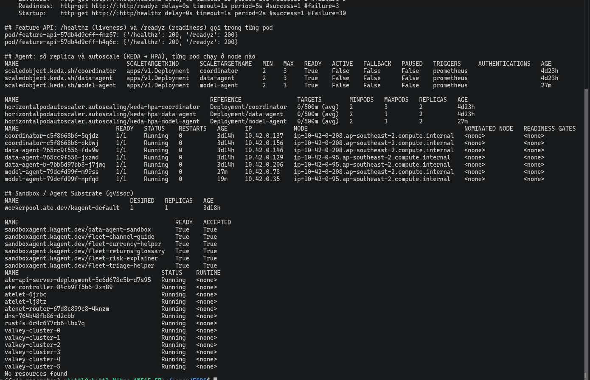
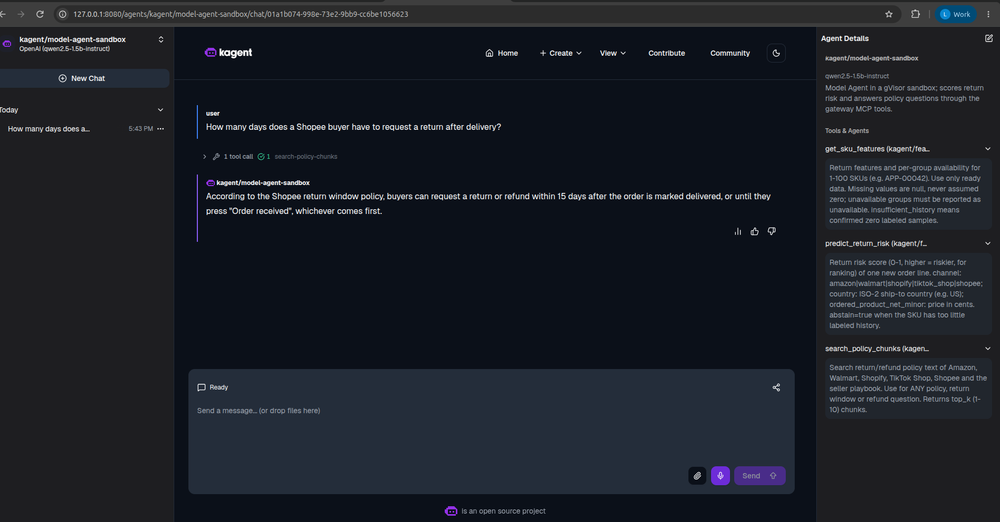

# Data Agent và Model Agent trên EKS

EDAI-2, dòng 19–22: MCP, multi-replica, autoscale, Sandbox và publish.

Data Agent lấy feature SKU qua MCP. Model Agent dùng online feature, gọi KServe để dự đoán và RAG để tìm chính sách trả hàng. Các lời gọi đi qua [Agent Gateways](agent_gateways.md), cùng [Model Config](global_model_config.md).

Code: [Data Agent](../../infra/k8s/agents/data-agent.yaml), [Model Agent](../../infra/k8s/agents/model-agent.yaml), [KEDA Data Agent](../../infra/k8s/agents/data-agent-keda.yaml), [KEDA Model Agent](../../infra/k8s/agents/model-agent-keda.yaml).

## Model Agent đủ bộ như Data Agent

Rubric: Agent 2 (online feature + predict + RAG) phải có tài liệu **tương tự** Agent 1. Cùng từng hạng mục, cho cả hai Agent:

| Hạng mục | Data Agent (Agent 1) | Model Agent (Agent 2) |
|---|---|---|
| Tool | `get_sku_features`, `get_policy_chunks` | `get_sku_features` (online feature), `predict_return_risk` (KServe), `search_policy_chunks` (RAG) — [manifest](../../infra/k8s/agents/model-agent.yaml) |
| Chat gọi tool trên EKS | [ảnh](../evidence/aws/kagent-ui-coordinator-data-agent-20261030.png) | predict: [ảnh](../evidence/aws/kagent-ui-model-agent-tool-20261030.png), RAG: [ảnh](../evidence/aws/rag-model-agent-answer-20261030.png) (30/10) |
| Multi-replica + KEDA | 2 → 3 → 2 ([log](../evidence/aws/keda-data-agent-20261030.txt)) | min 2 max 3, 2 → 3 → 2: [ảnh apply](../evidence/aws/keda-model-agent-apply.png), [lúc tải](../evidence/aws/keda-scale-up-model-agent-coordinator.png), [sau tải](../evidence/aws/keda-scale-down-model-agent-coordinator.png) (04/11), [log theo pod](../evidence/aws/keda-model-agent.txt) (06/11) |
| Sandbox gVisor | `data-agent-sandbox` gọi tool ([ảnh](../evidence/aws/substrate-sandbox-agent-ui-20261031.png), 31/10) | `model-agent-sandbox` READY, gọi `search_policy_chunks`, trả lời 15 ngày ([ảnh](../evidence/aws/model-agent-sandbox-chat-20261106.png), 06/11) — [manifest](../../infra/k8s/agents/sandbox/model-agent-sandbox.yaml) |
| Publish registry | [entry](../../infra/k8s/agents/registry/data-agent.yaml) | [entry](../../infra/k8s/agents/registry/model-agent.yaml); UI registry có cả 3 Agent ([ảnh](../evidence/aws/agent-registry-ui-20261030.png)) |
| Gọi MCP qua gateway | `tools/list`, `get_sku_features` | cả hai tool riêng của Model Agent, smoke EKS 06/11 ([JSON](../evidence/aws/gateway-smoke-20261106.json), bảng dưới) |
| Backend multi-replica + autoscale | MCP `feature-mcp` | KServe `return-risk` + MCP `feature-mcp`: manifest min 2 max 3 + KEDA ([KServe](../../infra/k8s/ml/return-risk.yaml), [Helm](../../infra/helm/feature-api/values-mcp.yaml)); **chưa chụp trên EKS** |

Các check MCP của Model Agent trong smoke 06/11 (`recorded 2026-11-06T10:23:46Z`, tổng 24/24 PASS):

| Check | Kết quả |
|---|---|
| MCP không key | 401 (bị chặn) ✅ |
| MCP `initialize` có key | 200 ✅ |
| `tools/list` | đủ `get_policy_chunks`, `get_sku_features`, `predict_return_risk`, `search_policy_chunks` ✅ |
| `get_sku_features` HOM-01815 | có giá trị khác null ✅ |
| `predict_return_risk` HOM-01815 | có `score` và `model_version` ✅ |
| `search_policy_chunks` | ≥ 1 chunk ✅ |
| A2A agent card `model-agent` có key / không key | 200 / 401 ✅ |
| Tool ngoài danh sách (`delete_all_features`) | bị chặn ✅ |

## Bằng chứng EKS, 30–31/10/2026

APP-00042 có 15.306 dòng gắn nhãn, 2.599 Return, tỉ lệ 0,1698. Model Agent gọi prediction tool, score 0,1661; số khớp API trực tiếp.

KEDA Data Agent: 3 request/giây vào agent card trong 150 giây, pod **2 → 3 → 2**. Script [`keda_scale_test.sh`](../../scripts/evidence/keda_scale_test.sh) ghi thêm tên từng pod ở mỗi mốc, và [`eks_runtime_proof.sh`](../../scripts/evidence/eks_runtime_proof.sh) in ScaledObject/HPA, từng pod Agent chạy ở node nào, WorkerPool và SandboxAgent (04/11/2026, [output](../evidence/aws/eks-runtime-proof-part2.png)). Đây là tải route A2A, không phải tải inference LLM. [Log EKS](../evidence/aws/keda-data-agent-20261030.txt).

### KEDA Model Agent, 04/11 và 06/11/2026 (EKS `platform-apps`)

[ScaledObject](../../infra/k8s/agents/model-agent-keda.yaml) min 2, max 3, ngưỡng 0,5 request/giây mỗi pod theo route `a2a-model-agent`.
Chạy [`keda_scale_test.sh`](../../scripts/evidence/keda_scale_test.sh) (3 request/giây lấy agent card, 150 giây); mỗi mốc ghi **tên đuôi từng pod**.
Log [keda-model-agent.txt](../evidence/aws/keda-model-agent.txt) là lần **06/11**: pod **2 → 3 → 2**; lên 3 sau 54 giây khi `target=792m/500m` (pod mới `smvxc`),
về 2 sau 468 giây khi tải đã dừng (pod `gljwt` bị bỏ, `bqckg` và `smvxc` ở lại). Lần 04/11 (ảnh bên dưới) cho kết quả tương tự (lên 3 sau khoảng 27 giây, về 2 sau khoảng 8 phút do HPA chờ ổn định).
Tải là A2A lấy agent card, không phải tải inference LLM. Phần Events của HPA có vài dòng `FailedGetExternalMetric` rải rác trong 45 giờ: thời gian cluster tắt nên Prometheus không trả lời.

Vị trí pod: `podAntiAffinity` chỉ là ưu tiên. Hai pod đầu của Model Agent cùng nằm trên một node vì node kia đã đặt gần hết CPU;
pod thứ ba lên node còn lại, và lúc về 2 HPA giữ lại hai pod ở hai node khác nhau.

Sandbox dùng Agent Substrate/gVisor; Agent gọi được `get-sku-features`. Model CPU 1,5B chép `830847` thành `83,084`; ảnh chứng minh đường gọi tool trong Sandbox.

Trạng thái trên EKS (04/11/2026): `workerpool kagent-default` DESIRED 1, REPLICAS 1; sáu SandboxAgent (`data-agent-sandbox` và năm `fleet-*`) đều `READY True`, `ACCEPTED True`;
các pod Substrate trong `ate-system` (api server, controller, hai `atelet`, `atenet-router`, DNS, rustfs, sáu `valkey-cluster`) đều Running.
Kubernetes không có RuntimeClass nào (`No resources found`): gVisor do Substrate áp dụng qua `sandboxClass` của WorkerPool và image `ateom-gvisor`, không qua RuntimeClass.

Code Sandbox: [deploy_substrate.sh](../../scripts/setup/deploy_substrate.sh), [manifest](../../infra/k8s/agents/sandbox/fleet-agents.yaml).

## Bằng chứng bổ sung cho Model Agent, 06/11/2026 (EKS `platform-apps`)

- **Probe và health:** [eks-runtime-proof-20261106.txt](../evidence/aws/eks-runtime-proof-20261106.txt). Feature API có Liveness `/healthz`, Readiness `/readyz` và Startup;
  gọi `/healthz` và `/readyz` trong từng pod đều trả 200. Ba Deployment Agent chỉ khai **Readiness** `/.well-known/agent-card.json` (không có Liveness/Startup).
- **MCP trực tiếp qua gateway:** [gateway-smoke-20261106.json](../evidence/aws/gateway-smoke-20261106.json), **24/24 PASS**, gồm `predict_return_risk` (có `score`, `model_version`)
  và `search_policy_chunks` (≥ 1 chunk), tool ngoài danh sách bị chặn, 401/403/429.
- **SandboxAgent:** `model-agent-sandbox` `READY True`, `ACCEPTED True` trên WorkerPool `kagent-default` (`sandboxClass: gvisor`).
  Trước đó phải dựng lại cụm valkey của Substrate (giữ IP pod cũ sau khi thay node, khiến `ate-api` và `kagent-controller` crash).
  Chat qua kagent UI: câu hỏi hạn trả hàng của Shopee, Agent gọi `search_policy_chunks` (1 tool call thành công) và trả lời 15 ngày, đúng tài liệu `rag/corpus/shopee-returns.md`.

## Giới hạn

Ảnh Swagger gộp (danh sách endpoint, `/healthz`, `/readyz`) của Feature API nằm ở [Web API và MCP](web_api_mcp.md). Ba Agent chỉ khai probe Readiness (agent card), không có Liveness/Startup. Các SandboxAgent cũ (`data-agent-sandbox`, `fleet-*`) vẫn báo `ACCEPTED False` (lỗi `WorkerPool kagent-default not found` ghi lúc chúng được reconcile trước khi WorkerPool tồn tại; thêm annotation không kích hoạt reconcile lại), không ảnh hưởng `model-agent-sandbox`.

Khi câu hỏi thiếu giá/số lượng, model nhỏ có thể tự điền tham số sai. [Registry](agent_registry.md) có proof publish; [Agent Evaluation](agent_evaluation.md) ghi giới hạn PII và kết quả chấm.

[Mục lục phần này](README.md) · [Mục lục chung](../README.md)
