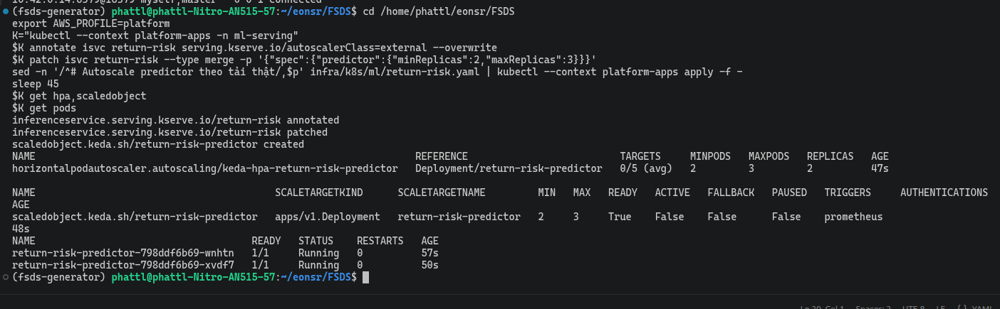
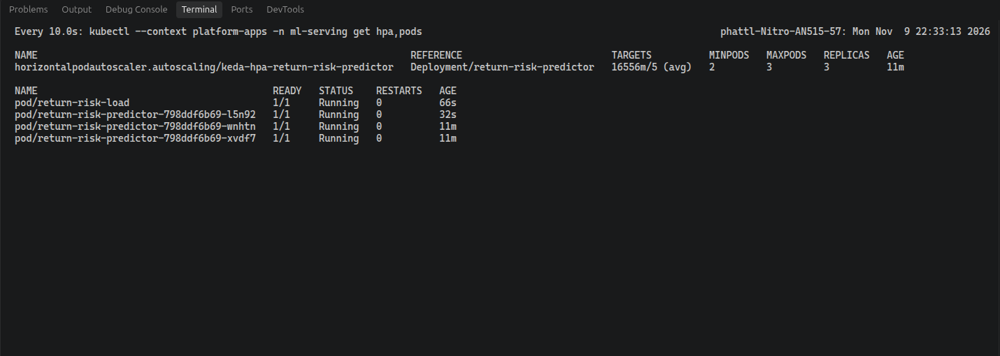
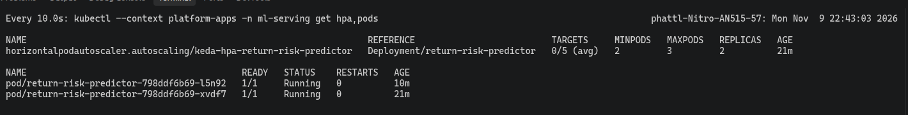

# Data Agent và Model Agent trên EKS

EDAI-2, dòng 19–22: MCP, multi-replica, autoscale, Sandbox và publish.

Hệ thống có hai Agent:

- **Data Agent** lấy feature của SKU qua MCP (giao thức để Agent gọi tool).
- **Model Agent** dùng online feature, gọi KServe để dự đoán rủi ro trả hàng, và dùng RAG (tìm đoạn tài liệu liên quan) để tra chính sách trả hàng.

Mọi lời gọi đều đi qua [Agent Gateways](agent_gateways.md). Cấu hình model dùng chung: [Model Config](global_model_config.md).

Code: [Data Agent](../../infra/k8s/agents/data-agent.yaml), [Model Agent](../../infra/k8s/agents/model-agent.yaml), [KEDA Data Agent](../../infra/k8s/agents/data-agent-keda.yaml), [KEDA Model Agent](../../infra/k8s/agents/model-agent-keda.yaml).

Trong trang này, "pod 2 → 3 → 2" nghĩa là: lúc đầu có 2 pod, khi có tải thì autoscale (tự tăng giảm số pod) lên 3, hết tải thì về lại 2.

## Model Agent đủ bộ như Data Agent

Rubric yêu cầu Agent 2 (online feature + predict + RAG) phải có tài liệu **tương tự** Agent 1. Bảng dưới so từng hạng mục cho cả hai Agent:

| Hạng mục | Data Agent (Agent 1) | Model Agent (Agent 2) |
|---|---|---|
| Tool | `get_sku_features`, `get_policy_chunks` | `get_sku_features` (online feature), `predict_return_risk` (KServe), `search_policy_chunks` (RAG) — [manifest](../../infra/k8s/agents/model-agent.yaml) |
| Chat có gọi tool trên EKS | [ảnh](../evidence/aws/kagent-ui-coordinator-data-agent-20261030.png) | predict: [ảnh](../evidence/aws/kagent-ui-model-agent-tool-20261030.png), RAG: [ảnh](../evidence/aws/rag-model-agent-answer-20261030.png) |
| Nhiều replica + KEDA | 2 → 3 → 2 ([log](../evidence/aws/keda-data-agent-20261030.txt)) | min 2, max 3, 2 → 3 → 2: [ảnh apply](../evidence/aws/keda-model-agent-apply.png), [lúc tải](../evidence/aws/keda-scale-up-model-agent-coordinator.png), [sau tải](../evidence/aws/keda-scale-down-model-agent-coordinator.png), [log theo pod](../evidence/aws/keda-model-agent.txt) |
| Sandbox gVisor | `data-agent-sandbox` gọi được tool ([ảnh](../evidence/aws/substrate-sandbox-agent-ui-20261031.png)) | `model-agent-sandbox` READY, gọi `search_policy_chunks`, trả lời 15 ngày ([ảnh](../evidence/aws/model-agent-sandbox-chat-20261106.png)) — [manifest](../../infra/k8s/agents/sandbox/model-agent-sandbox.yaml) |
| Publish lên registry | [entry](../../infra/k8s/agents/registry/data-agent.yaml) | [entry](../../infra/k8s/agents/registry/model-agent.yaml); UI registry có cả 3 Agent ([ảnh](../evidence/aws/agent-registry-ui-20261030.png)) |
| Gọi MCP qua gateway | `tools/list`, `get_sku_features` | cả hai tool riêng của Model Agent, trong bài smoke trên EKS ([JSON](../evidence/aws/gateway-smoke-20261106.json), bảng dưới) |
| Backend nhiều replica + autoscale | MCP `feature-mcp` 2 → 3 → 2 ([log](../evidence/aws/feature-mcp-autoscale.txt)) | KServe `return-risk` 2 → 3 → 2 ([ảnh lúc tải](../evidence/aws/return-risk-scale-up-20261109.png), [sau tải](../evidence/aws/return-risk-scale-down-20261109.png), [log](../evidence/aws/return-risk-autoscale.txt)); MCP `feature-mcp` giống cột trái ([Web API và MCP](web_api_mcp.md)) |

Eval Model Agent trên EKS (Jenkins #13, [chi tiết](agent_evaluation.md)): predict đạt **12/12**, policy đạt **3/5**.
Policy thấp hơn ngưỡng 0,95 nên build đỏ. Lý do: Qwen 1,5B đôi khi viết lệnh gọi tool ra thành văn bản thay vì gọi tool thật.
Bài smoke (kiểm tra nhanh toàn tuyến) chạy lại sau khi tách `feature-mcp`: [24/24 PASS](../evidence/aws/gateway-smoke-20261109.json).

Các kiểm tra MCP của Model Agent trong bài smoke (`recorded 2026-11-06T10:23:46Z`, tổng 24/24 PASS):

| Check | Kết quả |
|---|---|
| MCP không key | 401 (bị chặn) ✅ |
| MCP `initialize` có key | 200 ✅ |
| `tools/list` | đủ `get_policy_chunks`, `get_sku_features`, `predict_return_risk`, `search_policy_chunks` ✅ |
| `get_sku_features` HOM-01815 | có giá trị khác null ✅ |
| `predict_return_risk` HOM-01815 | có `score` và `model_version` ✅ |
| `search_policy_chunks` | ≥ 1 chunk ✅ |
| A2A agent card `model-agent` có key / không key | 200 / 401 ✅ |
| Tool ngoài danh sách (`delete_all_features`) | bị chặn ✅ |

**KServe `return-risk`** (backend trả điểm dự đoán cho Model Agent):

- KEDA scale theo metric `return_risk_predictions_total`, tối thiểu 2 pod, tối đa 3.
- Gửi tải vào `:predict` trong 150 giây: sau khoảng 48 giây lên 3 pod (chỉ số HPA lúc đó `11237m/5`, tức khoảng 11,2 so với ngưỡng 5). Khoảng 495 giây sau thì về 2.
- Chỉ còn một HPA (bộ autoscale của Kubernetes), là HPA do KEDA tạo.

## Bằng chứng EKS

Ví dụ với SKU APP-00042: có 15.306 dòng gắn nhãn, 2.599 lần Return, tỉ lệ 0,1698. Model Agent gọi tool dự đoán và nhận điểm 0,1661. Các số này khớp với khi gọi API trực tiếp.

**KEDA Data Agent.** Gửi 3 request/giây vào agent card trong 150 giây; số pod đi **2 → 3 → 2**.
Script [`keda_scale_test.sh`](../../scripts/evidence/keda_scale_test.sh) ghi thêm tên từng pod ở mỗi mốc thời gian.
Script [`eks_runtime_proof.sh`](../../scripts/evidence/eks_runtime_proof.sh) in ra ScaledObject/HPA, node mà từng pod Agent đang chạy, WorkerPool và SandboxAgent ([output](../evidence/aws/eks-runtime-proof-part2.png)).
Lưu ý: đây là tải vào route A2A, không phải tải bắt LLM suy luận. [Log EKS](../evidence/aws/keda-data-agent-20261030.txt).

### KEDA Model Agent (EKS `platform-apps`)

Cấu hình [ScaledObject](../../infra/k8s/agents/model-agent-keda.yaml): tối thiểu 2 pod, tối đa 3; thêm pod khi mỗi pod nhận quá 0,5 request/giây trên route `a2a-model-agent`.

Cách thử: chạy [`keda_scale_test.sh`](../../scripts/evidence/keda_scale_test.sh), gửi 3 request/giây lấy agent card trong 150 giây. Ở mỗi mốc, script ghi **tên đuôi của từng pod**.

Kết quả trong log [keda-model-agent.txt](../evidence/aws/keda-model-agent.txt), số pod đi **2 → 3 → 2**:

- Lên 3 sau 54 giây, khi chỉ số đạt `target=792m/500m` (0,792 so với ngưỡng 0,5). Pod mới là `smvxc`.
- Về 2 sau 468 giây, khi tải đã dừng. Pod `gljwt` bị bỏ; `bqckg` và `smvxc` ở lại.

Lần chạy trong ảnh bên dưới cho kết quả tương tự: lên 3 sau khoảng 27 giây, về 2 sau khoảng 8 phút (HPA chờ ổn định rồi mới giảm).
Tải ở đây là A2A lấy agent card, không phải tải bắt LLM suy luận.
Phần Events của HPA có vài dòng `FailedGetExternalMetric` rải rác trong 45 giờ. Đó là khoảng thời gian cluster tắt nên Prometheus không trả lời.

Vị trí pod: `podAntiAffinity` (quy tắc tách pod ra các node khác nhau) ở đây chỉ là ưu tiên, không bắt buộc.
Hai pod đầu của Model Agent nằm cùng một node, vì node kia đã gần hết CPU.
Pod thứ ba lên node còn lại. Khi về 2 pod, HPA giữ lại hai pod nằm ở hai node khác nhau.

**Sandbox.** Sandbox dùng Agent Substrate với gVisor (lớp cách ly chạy container). Agent trong Sandbox gọi được `get-sku-features`.
Model CPU 1,5B chép sai `830847` thành `83,084`; ảnh dưới chỉ dùng để chứng minh đường gọi tool trong Sandbox chạy được, không chứng minh con số đúng.

Trạng thái trên EKS ở lần chụp đầu ([eks-runtime-proof.txt](../evidence/aws/eks-runtime-proof.txt), WorkerPool đã chạy 3d18h):

- `workerpool kagent-default`: DESIRED 1, REPLICAS 1.
- Sáu SandboxAgent (`data-agent-sandbox` và năm `fleet-*`) đều `READY True`, `ACCEPTED True`. Sau khi dựng lại cụm, trạng thái này đổi (xem Giới hạn).
- Các pod Substrate trong `ate-system` đều Running: api server, controller, hai `atelet`, `atenet-router`, DNS, rustfs, sáu `valkey-cluster`.

Kubernetes không có RuntimeClass nào (`No resources found`). gVisor được Substrate áp dụng qua `sandboxClass` của WorkerPool và image `ateom-gvisor`, không qua RuntimeClass.

Code Sandbox: [deploy_substrate.sh](../../scripts/setup/deploy_substrate.sh), [manifest](../../infra/k8s/agents/sandbox/fleet-agents.yaml).

## Bằng chứng bổ sung cho Model Agent (EKS `platform-apps`)

- **Probe và health** (Kubernetes tự kiểm tra pod còn sống / sẵn sàng): [eks-runtime-proof-20261106.txt](../evidence/aws/eks-runtime-proof-20261106.txt).
  Feature API có đủ Liveness `/healthz`, Readiness `/readyz` và Startup; gọi `/healthz` và `/readyz` trong từng pod đều trả 200.
  Ba Deployment Agent chỉ khai **Readiness** `/.well-known/agent-card.json`, không có Liveness hay Startup.
- **Gọi MCP trực tiếp qua gateway:** [gateway-smoke-20261106.json](../evidence/aws/gateway-smoke-20261106.json), **24/24 PASS**. Gồm `predict_return_risk` (có `score`, `model_version`),
  `search_policy_chunks` (≥ 1 chunk), tool ngoài danh sách bị chặn, và các mã 401/403/429.
- **SandboxAgent:** `model-agent-sandbox` ở trạng thái `READY True`, `ACCEPTED True` trên WorkerPool `kagent-default` (`sandboxClass: gvisor`).
  Để tới được trạng thái này phải dựng lại cụm valkey của Substrate: sau khi thay node, cụm vẫn giữ IP pod cũ, làm `ate-api` và `kagent-controller` bị crash.
  Chat thử qua kagent UI: hỏi hạn trả hàng của Shopee. Agent gọi `search_policy_chunks` (1 lần, thành công) và trả lời 15 ngày, đúng với tài liệu `rag/corpus/shopee-returns.md`.

## Giới hạn

- Ảnh Swagger gộp của Feature API (danh sách endpoint, `/healthz`, `/readyz`) nằm ở [Web API và MCP](web_api_mcp.md).
- Ba Agent chỉ khai probe Readiness (agent card), không có Liveness hay Startup.
- Ở lần chụp sau khi dựng lại WorkerPool ([eks-runtime-proof-20261106.txt](../evidence/aws/eks-runtime-proof-20261106.txt)), các SandboxAgent cũ báo `ACCEPTED False`: năm `fleet-*` có `READY True`, còn `data-agent-sandbox` có `READY Unknown`. Lỗi là `WorkerPool kagent-default not found`, được ghi lúc chúng được reconcile (đồng bộ trạng thái) trước khi WorkerPool mới tồn tại; thêm annotation không làm chúng reconcile lại. Việc này không ảnh hưởng `model-agent-sandbox`.
- Khi câu hỏi thiếu giá hoặc số lượng, model nhỏ có thể tự điền tham số sai.

[Registry](agent_registry.md) có bằng chứng publish. [Agent Evaluation](agent_evaluation.md) ghi giới hạn PII và kết quả chấm.

[Mục lục phần này](README.md) · [Mục lục chung](../README.md)
