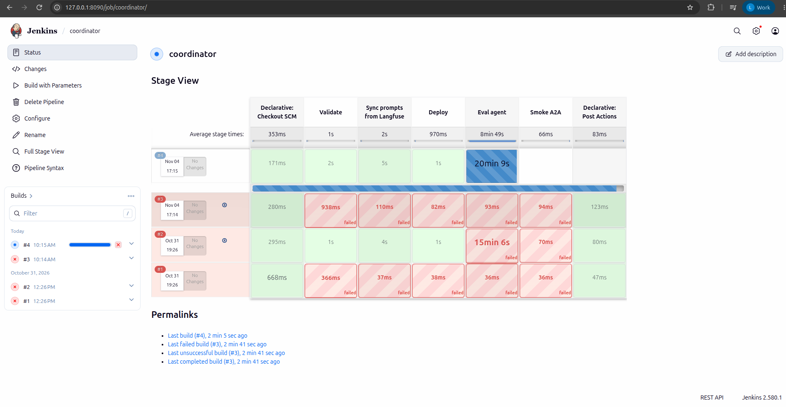

# CI/CD trên AWS

EDAI-2, dòng 33–36: CI/CD (tự động test, build và deploy) cho RAG pipeline, MCP server/Agent, Coordinator và stream feature.

Code / cấu hình: [RAG Jenkinsfile](../../ci/jenkins/rag-pipeline.Jenkinsfile), [Agent Jenkinsfile](../../ci/jenkins/feature-api-agents.Jenkinsfile).

Các kết quả dưới đây là của những lần chạy trên AWS; tài liệu không khẳng định dịch vụ hiện vẫn đang bật.

## Trên AWS

**Kết luận:** các pipeline Jenkins đã chạy trên AWS và đi hết các bước deploy. Các build không đạt đều dừng ở bước eval (chấm Agent),
không phải ở bước build hay deploy: `feature-api-agents` #13 (phần policy 3/5), `coordinator` #2 (đỏ) và #4 (chạy quá lâu). Build `coordinator` #9 đạt 12/12.

Môi trường chạy:

- Jenkins chạy trên EC2 `i-0d657089ba4a4ea7e` (IP riêng `10.42.0.151`). Giao diện web chỉ nghe ở `127.0.0.1:8090`, không mở ra ngoài.
- Jenkins lấy code từ một git bundle (file đóng gói repo), build image rồi đẩy lên ECR
  `665116832975.dkr.ecr.ap-southeast-2.amazonaws.com/platform`.
- Các bước deploy Kubernetes dùng context `platform-apps` (hai node `r6i.xlarge`). RAG và stream feature được deploy bằng Docker Compose trên EC2.

Mỗi dòng trong bảng là một lần build. Cột "Các stage" liệt kê các bước theo đúng thứ tự chạy.

| Pipeline / code | Các stage | Kết quả |
|---|---|---|
| [feature-api-agents](../../ci/jenkins/feature-api-agents.Jenkinsfile) #8 | Test, Build, Push ECR, Deploy MCP server, Sync prompts từ Langfuse, Deploy Agent, Eval agent, Smoke | Xanh. Cổng eval đạt **12/12 = 1,00 ≥ 0,95**. Xem [JSONL và giới hạn PII](agent_evaluation.md#trên-aws). |
| [rag-pipeline](../../ci/jenkins/rag-pipeline.Jenkinsfile) #2 | Test, Build, Push, Release config, Deploy, DAG import, Run DAG | Xanh. Ảnh lineage DataHub trên AWS nằm ở [RAG Pipeline](rag_pipeline.md). |
| [feature-api-agents](../../ci/jenkins/feature-api-agents.Jenkinsfile) #13 | Chạy sau khi tách MCP sang pod riêng: Test, Build, Push, Deploy MCP server (2 release và gateway), Sync prompts, Deploy Agent, Eval agent | Các bước tới Deploy Agent xanh. **Eval agent đỏ**: Data 12/12, predict 12/12, policy 3/5 ([chi tiết](agent_evaluation.md)). |
| [stream-features](../../ci/jenkins/stream-features.Jenkinsfile) #7 | Bản 2 job PyFlink: Test, Build (image có thư mục `tests/flink`), Push, Release config, Deploy, Verify | Xanh. Bước Verify kiểm tra có đúng 2 job ở trạng thái RUNNING ([ảnh](../evidence/aws/jenkins-stream-features-7-20261109.png)). |
| [stream-features](../../ci/jenkins/stream-features.Jenkinsfile) #2 (bản Flink SQL) | Test, Build, Push, Release config, Deploy, Verify | Xanh. |
| [coordinator](../../ci/jenkins/coordinator.Jenkinsfile) | Validate, Sync, Deploy, Eval agent | #2: ba bước đầu xanh, **Eval agent đỏ** sau 15 phút 6 giây. #4: ba bước đầu xanh, **Eval agent chạy hơn 20 phút chưa xong** nên không qua cổng. #9: Eval agent đạt 12/12, nhưng cổng chỉ chấm việc định tuyến. Chi tiết và số liệu LLM: [Agent Evaluation](agent_evaluation.md#coordinator-trên-aws-04112026). |





Các lỗi gặp phải khi chạy lần đầu và cách đã xử lý:

- Role IAM của EC2 thiếu quyền `eks:DescribeCluster` nên Jenkins không tạo được kubeconfig. Đã bổ sung quyền này.
- Muốn checkout từ bundle nằm trên máy thì phải bật `ALLOW_LOCAL_CHECKOUT`; remote của bundle khai bằng đường dẫn thư mục thường.
  JCasC (cấu hình Jenkins bằng code) tự thay biến trong `scriptPath`, nên đường dẫn Jenkinsfile phải ghép chuỗi thay vì dùng biến.
- Key của agentgateway được chép vào Vault thông qua container Jenkins. Giá trị key không được ghi vào tài liệu.
- Redis mất dữ liệu khi node scale về 0. Vì vậy trước khi eval phải chạy `ml_feature_materialize` với `full_reload` để nạp lại feature.

Ảnh Stage View của Jenkins chỉ cho biết từng bước xanh hay đỏ. Kết quả chấm từng câu hỏi nằm trong file JSONL của ML-N1 (bộ chấm Agent).
Hiện cổng eval chỉ chặn pipeline sau khi đã deploy; khi eval thất bại, Agent vừa deploy chưa được tự động rollback.

<details>
<summary>Tham khảo: thiết kế, hướng dẫn phát triển và ghi nhận trước triển khai AWS</summary>

Các ghi nhận local giữ nguyên môi trường, không dùng thay bằng chứng cloud.

<!-- Mục đích: Jenkins CI/CD local cho phần ML Platform / LLM Platform: dựng, cấu hình, job, secret. -->
## CI/CD — Jenkins

CI/CD (test, build và tự động deploy) cho RAG pipeline, MCP server cùng agent,
coordinator và stream feature job. Secret phải nằm trong Jenkins hoặc công cụ tương tự, không nằm trong code.

## Dựng

| Thành phần | File |
|---|---|
| Image Jenkins 2.580.1 LTS + plugin cố định + docker/compose/kubectl/helm/kind/uv | [`docker/Dockerfile.jenkins`](../../docker/Dockerfile.jenkins) |
| Cấu hình bằng code (JCasC): user, credential, 4 job | [`infra/jenkins/jenkins.yaml`](../../infra/jenkins/jenkins.yaml) |
| Khởi động (lấy secret từ Vault) | [`scripts/setup/setup_jenkins.sh`](../../scripts/setup/setup_jenkins.sh), service `jenkins` (profile `ci`) |
| Pipeline | [`ci/jenkins/`](../../ci/jenkins/stream-features.Jenkinsfile): `stream-features`, `feature-api-agents`, `coordinator`, `rag-pipeline` |

```bash
scripts/setup/setup_vault.sh      # trước: Vault + token chỉ-đọc
scripts/setup/setup_jenkins.sh    # UI http://localhost:8090, user admin, mật khẩu ở Vault secret/platform/jenkins
```

## Quyết định

- **Secret**: Jenkins chỉ giữ 2 credential — `vault-ci-token` (token Vault chỉ-đọc) và
  `kind-kubeconfig`. Mật khẩu DB/MinIO lấy từ Vault lúc build (`scripts/setup/vault_env.sh`).
  Mật khẩu admin Jenkins sinh ngẫu nhiên, cất ở Vault, nạp qua biến môi trường mỗi lần khởi động.
- **Job lấy code từ git `main`** (`file:///repo`): CI chạy đúng code đã commit, không phải bản đang sửa trong
  working tree. Vì vậy phải commit các file `ci/jenkins/*` trước khi build lần đầu.
- **Dùng `network_mode: host` và đặt JENKINS_HOME cùng đường dẫn với máy host**: build gọi `docker compose` qua
  Docker socket của host, nên mọi bind mount tương đối trong workspace phải tồn tại trên host ở đúng đường dẫn đó.
- Build chạy ngay trên controller (1 executor). Như vậy đủ cho local; trên GKE thì tách ra agent riêng.

## Bằng chứng

- Container Jenkins ở trạng thái `Up`, trang `/login` trả 200. API của Jenkins liệt kê đủ các job `coordinator`,
  `feature-api-agents`, `rag-pipeline`, `stream-features` và hai credential `vault-ci-token`, `kind-kubeconfig`; tất cả đều do JCasC tạo ra.
- Đổi mật khẩu admin: xoá `secret/platform/jenkins` rồi chạy lại `setup_jenkins.sh` (đã làm một lần, login
  bằng mật khẩu mới OK).
- **Chưa build** (ghi nhận local): các Jenkinsfile chưa được commit lên `main`. Trạng thái này đã được thay thế bởi kết quả AWS ở mục dưới.

## Phát hành image qua registry local

```text
Jenkins (network host)
  Test → Build image:<SHA> → Push localhost:5001/image:<SHA>
                                      │ host port 5001
                                registry:2.8.3 + volume registry-data
                                      │ network Docker kind, registry:5000
  Deploy Helm / KServe / KFP ───→ kubelet/containerd pull image:<SHA>
  Deploy Agent → Eval agent (accuracy ≥ 0.95) → artifacts JSONL/JSON
```

Registry Docker ở đây (nơi chứa image) khác với MLflow model registry và agent registry. Registry chỉ nghe ở `127.0.0.1:5001`,
không mở HTTP registry ra ngoài. Cấu hình theo [kind local registry](https://kind.sigs.k8s.io/docs/user/local-registry/):
`localhost:5001` trong image được containerd của mỗi node ánh xạ sang `http://registry:5000`.
Script kiểm `config_path` đã bật, ghi `hosts.toml` và ConfigMap `kube-public/local-registry-hosting`.
Không tạo lại cụm, không restart node. Khi thiếu `config_path`, script dừng và báo node cần được cấu hình registry.

```bash
## Cụm platform hiện có; setup không xoá dữ liệu. up_ml_base.sh cũng gọi bước này.
scripts/setup/setup_kind_registry.sh
curl -fsS http://localhost:5001/v2/_catalog

## Feature API: build → tag/push → helm upgrade --atomic, IfNotPresent.
REGISTRY=localhost:5001 scripts/setup/deploy_kind_feature_api.sh "$(git rev-parse HEAD)"
## KFP: script tự build/push train image cùng TAG trước khi compile/submit.
REGISTRY=localhost:5001 scripts/run/run_training_pipeline.sh
## KServe: lấy model production, build/push image tag version+git SHA+băm nội dung, rồi apply.
REGISTRY=localhost:5001 scripts/run/deploy_return_risk.sh
```

`REGISTRY` mặc định `localhost:5001`; chuyển ECR/Artifact Registry bằng biến này và đăng nhập
Docker cùng cấu hình credential pull của cụm đích. Script chung `scripts/run/push_images.sh`
nhận danh sách image có tag nguồn; nếu có `TAG`, retag sang SHA đó. Không phát hành `latest`.
Tên cũ `push_images_gke.sh` chỉ là wrapper tương thích `REGISTRY_URL`, cũng cần danh sách image.

Mọi Jenkinsfile có build image đều có stage **Push** trước bước deploy, để deploy dùng đúng image vừa đẩy lên:

- Feature API deploy với `SKIP_BUILD_PUSH=1`, nên không build lại image sau bước Push.
- RAG và stream publish image với tag là git SHA, đồng thời sinh file Compose override `out/ci-compose-images.yaml`.
  Bước deploy chạy `--no-build --pull always` với cùng SHA đó, kể cả Flink taskmanager. Các stage kiểm tra phía sau cũng dùng chính file override này.

Tag theo SHA chỉ đúng khi working tree sạch. Nếu chạy tay với code chưa commit, hãy đặt một `TAG` riêng và không dùng lại tag đó.

Stage **Eval agent** đã được nối vào pipeline Feature API và coordinator, xem [cổng eval](agent_evaluation.md#dùng-trong-ci).
Nếu điểm dưới ngưỡng hoặc không có dữ liệu để chấm thì build đỏ; cổng này chưa tự rollback agent đã apply.
Ghi nhận local: **chưa có bằng chứng Jenkins chạy thật** cho thay đổi registry/cổng eval mới.
Trạng thái này đã được thay thế bởi kết quả AWS dưới đây.

</details>

[Mục lục phần này](README.md) · [Mục lục chung](../README.md)
