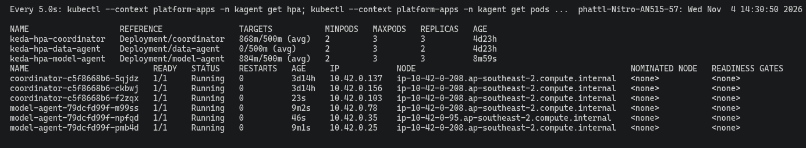
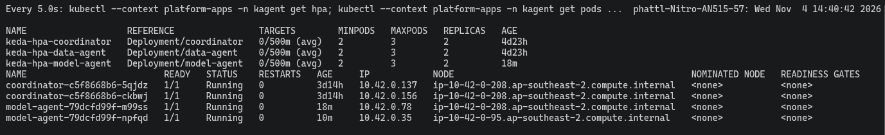

# Coordinator Agent trên EKS

EDAI-2, dòng 25–26: điều phối hai Agent, multi-replica, autoscale và publish.

Coordinator là Agent điều phối. Nó nhận câu hỏi, gọi Data Agent và Model Agent qua A2A gateway, rồi gộp feature và kết quả dự đoán thành một câu trả lời.
Code: [coordinator.yaml](../../infra/k8s/agents/coordinator.yaml), [KEDA](../../infra/k8s/agents/coordinator-keda.yaml).

## Bằng chứng EKS

Câu hỏi thử: SKU APP-00042, kênh Amazon US, 1 sản phẩm giá 25 USD.
Coordinator trả tỉ lệ Return **0,1698** và điểm rủi ro **0,1661**, khớp với số khi gọi API trực tiếp.

Coordinator đã được publish trong [Registry](agent_registry.md).
Prompt của nó tên `platform-coordinator`, nhãn `production`, được quản lý trên Langfuse. Khi CI deploy, prompt được đồng bộ vào ConfigMap.

## Autoscale trên EKS

Cấu hình [KEDA Coordinator](../../infra/k8s/agents/coordinator-keda.yaml): tối thiểu 2 pod, tối đa 3; thêm pod khi mỗi pod nhận quá 0,5 request/giây trên route `a2a-coordinator`.

Chạy [`keda_scale_test.sh`](../../scripts/evidence/keda_scale_test.sh). Log [keda-coordinator.txt](../evidence/aws/keda-coordinator.txt) cho thấy số pod đi **2 → 3 → 2**:
lên 3 sau khoảng 55 giây, và về 2 sau khoảng 8 phút.
Bài này chạy cùng lúc với Model Agent; ảnh từng pod ở [Agents](agents.md#keda-model-agent-eks-platform-apps).

Phần `Events` trong log có một cảnh báo `FailedGetExternalMetric` cũ (lặp hàng chục nghìn lần trong 2 ngày).
Lúc đó node EKS đang scale về 0, nên API metric của KEDA không trả lời.
Cảnh báo này không xuất hiện trong lần scale được ghi ở đây; các sự kiện `SuccessfulRescale` bên dưới là của lần chạy này.

## Giới hạn

Cổng `Eval agent` đạt 12/12 (Jenkins #9), nhưng chỉ chấm việc định tuyến tới đúng Agent, không chấm con số trong câu trả lời.
Hai lần chạy đầu báo đỏ hoặc chưa chạy xong, vì LLM chạy CPU bị chậm khi nhiều lượt gọi chồng lên nhau.
Xem thêm: [CI/CD](cicd.md), [Agent Evaluation](agent_evaluation.md#coordinator-trên-aws-04112026).

[Mục lục phần này](README.md) · [Mục lục chung](../README.md)
