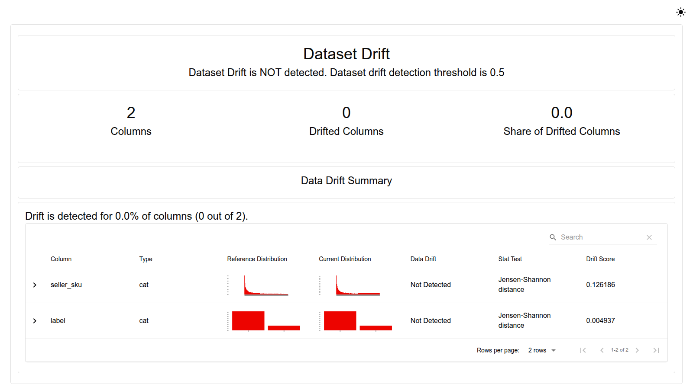
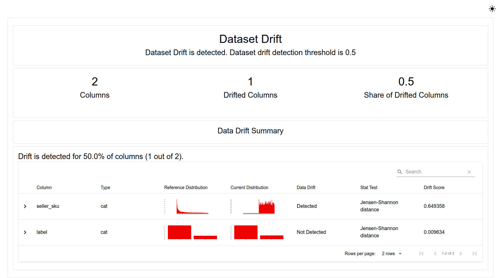
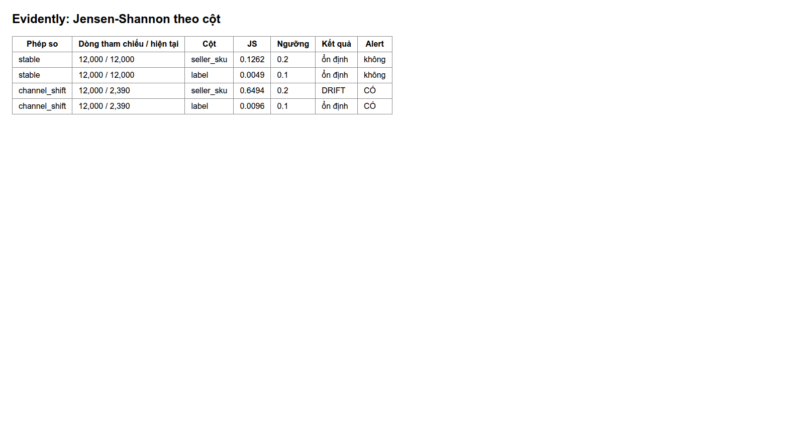

# Drift Monitoring trên AWS

EDAI-2, dòng 57: novel idea — drift theo Channel.

Code / cấu hình: Job Evidently chạy EKS; kết quả là kiểm chứng theo yêu cầu, chưa tự động retrain.

Các kết quả dưới đây thuộc các lần chạy AWS được ghi ngày, không xác nhận dịch vụ đang bật.

<a id="trên-aws-pipeline-a--2026-10-31"></a>
## Drift trên EKS, 31/10/2026

- Dữ liệu: `training_lines` trên S3 của môi trường AWS (`s3://platform-665116832975-lakehouse/feature-store/training_lines`, mẫu 2‰).
- Hai phép so: `stable` (30 ngày đầu vs phần sau) và `channel_shift` (30 ngày đầu vs phần sau **chỉ kênh Shopee**:
  cơ cấu đơn dồn về một sàn). Lô Sale cũ thuộc dữ liệu tham khảo, không dùng cho phép đo AWS này.
- Chạy: Job [`infra/k8s/ml/drift-job.yaml`](../../infra/k8s/ml/drift-job.yaml) trên EKS, ns `kubeflow`, SA `pipeline-runner`
  (Pod Identity chỉ đọc `feature-store/*`), tên Job `mle-drift`, context `platform-apps`.
- Runtime: **Evidently 0.7.23 + pandas 2.3.3**. pandas 3 làm hỏng import; lần chạy này dùng pandas 2.3.3.

Kết quả: [mle-drift-20261031.json](../evidence/aws/mle-drift-20261031.json).

| Phép so | Dòng tham chiếu / hiện tại | JS `seller_sku` (ngưỡng 0,2) | JS `label` (ngưỡng 0,1) | Alert |
|---|---:|---:|---:|---|
| `stable` | 72.109 / 287.348 | 0,0664 | 0,0008 | không |
| `channel_shift` | 72.109 / 8.320 | **0,2028 > 0,2** | 0,0298 | **có: seller_sku** |

Lô ổn định không báo; lô chỉ giữ Shopee làm đổi cơ cấu SKU và vượt ngưỡng. Đây là kết quả đo trên đầu vào S3
đã dùng trên AWS; không dùng số lô Sale local thay cho lần AWS.

### Từng bước và ảnh

Quy trình có bốn bước; ảnh dưới đây chạy **local trên dữ liệu mô phỏng** (60 ngày, 400 dòng/ngày, kênh Shopee dồn về nửa sau danh mục SKU),
để chứng minh quy trình chạy được trước khi chạy EKS. Số JS ở đây **không phải** số đo AWS ở bảng trên.

1. **Dữ liệu tham chiếu và hiện tại:** `training_lines`, 30 ngày đầu làm tham chiếu; `stable` là phần sau, `channel_shift` là phần sau chỉ của Shopee.
2. **Báo cáo `stable`:** Evidently so từng cột bằng Jensen-Shannon; lô cùng phân phối không vượt ngưỡng.

   

3. **Báo cáo `channel_shift`:** `seller_sku` vượt ngưỡng 0,2, `label` không.

   

4. **Bảng kết quả và alert** (cùng cấu trúc với `mle-drift-20261031.json`):

   

Ảnh EKS: Job `mle-drift` giữ pod 15 phút sau khi chạy xong; lấy HTML bằng `kubectl -n kubeflow cp <pod>:/tmp/drift ./drift-eks`,
rồi `capture_drift_evidence.py --html-dir drift-eks --summary <summary.json> --tag aws-<ngày>`
([script](../../scripts/evidence/capture_drift_evidence.py)). **Chưa chạy trên EKS**, nên chưa có ảnh báo cáo Evidently từ AWS;
bằng chứng AWS hiện có chỉ là JSON ở trên.

<details>
<summary>Tham khảo: thiết kế, hướng dẫn phát triển và ghi nhận trước triển khai AWS</summary>

Các ghi nhận local giữ nguyên ngày và môi trường, không dùng thay bằng chứng cloud.

<!-- Mục đích: theo dõi data drift đầu vào model bằng Evidently, có proof chạy được. -->
## ML-N2: theo dõi data drift (Evidently)

Evidently so phân phối đầu
vào của một lô mới với lô tham chiếu (giai đoạn train) và cảnh báo khi lệch — tín hiệu để kiểm lại
model **trước** khi tin score, ví dụ khi có đợt Sale làm đổi cơ cấu SKU.

| Thành phần | File |
|---|---|
| Kiểm drift + tóm tắt | [`ml/drift.py`](../../ml/drift.py), test [`tests/unit/test_drift.py`](../../tests/unit/test_drift.py) |
| Lô "đợt Sale" | `generator.generate_order_lifecycle --sku-zipf-s 0.3` (SKU khuyến mãi dàn đều) |
| Kết quả | [`evidence/mle-drift-summary-20261021.json`](../evidence/mle-drift-summary-20261021.json), HTML ở `out/drift/` |

## Cách đo

- Cột: `seller_sku`, `label`, đều là cột phân loại. Phương pháp: khoảng cách **Jensen-Shannon**.
- Ngưỡng: `seller_sku` 0,2 (≈100 giá trị, nhiễu lấy mẫu của ~1.000 dòng đã đo được 0,14);
  `label` 0,1 (mặc định).
- `alert` = có ít nhất một cột drift.

**Bẫy đã gặp:** trên 1.000 dòng Evidently tự đổi từ chi-square (p-value, **nhỏ** = drift) sang
Jensen-Shannon (khoảng cách, **lớn** = drift). Bản đầu đọc mọi số như p-value ⇒ kết luận ngược hẳn
(báo `label` drift, bỏ sót `seller_sku`). Đã đối chiếu bằng scipy chi-square rồi sửa: chiều so lấy
theo tên phương pháp trong metric; test phủ cả hai chiều và biên ngưỡng.

## Proof (2026-10-21)

| Lô so với tham chiếu (30 ngày đầu, 2.307 line) | `seller_sku` | `label` | alert |
|---|---|---|---|
| 15 ngày sau, cùng phân phối (1.165 line) | 0,136 | 0,005 | **không** |
| Đợt Sale 5 ngày, zipf 0,3 (1.228 line) | **0,436** | 0,001 | **có** |

Đối chiếu tay: SKU đứng đầu chiếm 27,9% lô tham chiếu, chỉ 3,3% trong đợt Sale; tỷ lệ trả gần như
giữ nguyên (0,299 / 0,306 / 0,300) — khớp việc chỉ `seller_sku` drift.

## Chạy

```bash
uv run --no-project --with evidently==0.7.23 --with s3fs==2026.9.0 --with pyarrow \
  env PYTHONPATH=. AWS_ENDPOINT_URL_S3=http://localhost:9000 AWS_ACCESS_KEY_ID=... AWS_SECRET_ACCESS_KEY=... \
  python -m ml.drift --reference s3://platform/feature-store/training_lines \
    --sale-truth out/order_lifecycle_sale/_truth/lines.jsonl --out out/drift
```

</details>

[Mục lục phần này](../README.md) · [Mục lục chung](../../README.md)
