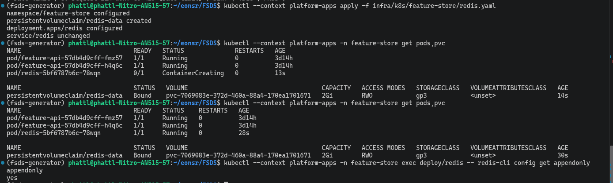
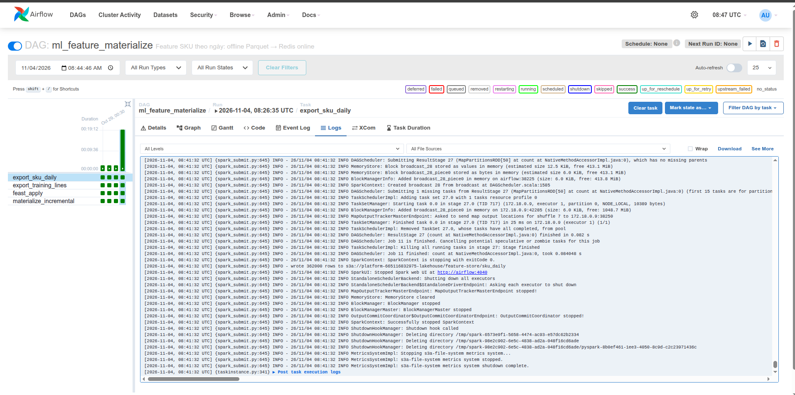
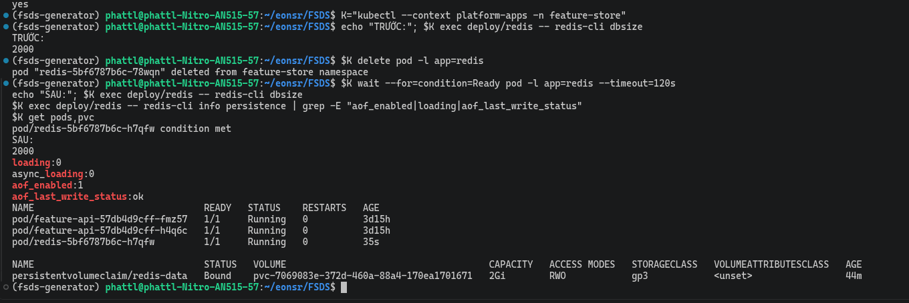

# Feature Store trên AWS

EDAI-2, dòng 11: incremental materialize offline → online.

Code / cấu hình: [DAG](../../dags/ml_feature_materialize.py), [Feast](../../feature_repo/feature_store.yaml).

Các kết quả dưới đây thuộc các lần chạy AWS, không xác nhận dịch vụ đang bật.

### Trên AWS

DAG `ml_feature_materialize` trên Airflow EC2 hỏng ở `feast_apply`: `feast apply` import mọi `.py` trong
`feature_repo/`, kể cả `replay_return_events.py` (dùng `datetime.UTC`, chỉ có từ Python 3.11) trong venv Feast
Python 3.10 của Airflow.


Sửa: [`feature_repo/.feastignore`](../../feature_repo/.feastignore) loại hai script không phải định nghĩa feature,
test `test_feast_apply_skips_helper_scripts`. Chạy lại: bốn task xanh, Redis `DBSIZE` 2000.


## Trên AWS

Airflow/Spark chạy Compose EC2, offline Parquet và registry ở S3; online Redis ở EKS qua NodePort 30379.
Run `manual__2026-10-29T00:30:43+00:00` của [DAG ml_feature_materialize](../../dags/ml_feature_materialize.py)
hoàn tất 4/4 task theo [receipt](../evidence/aws/data-platform-aws-20261027.json) (`airflow_ml_feature_materialize`).

`export_sku_daily` gọi [export feature SKU](../../spark_jobs/gold/export_sku_daily_features.py);
`export_training_lines` gọi [export tập train](../../spark_jobs/gold/export_training_lines.py), chỉ giữ nhãn có trước cutoff 2026-06-30.
`feast_apply` đăng ký [feature repo](../../feature_repo/feature_store.yaml); `materialize_incremental` nạp phần thời gian mới
của `sku_return_daily` vào Redis. Log apply thấy credentials lấy từ IAM role EC2.


Receipt ghi hai lỗi đã sửa: cột run_id trùng khi export training lines, thiếu mount feature_repo khi feast_apply.
Gantt còn dấu attempt lỗi; Graph ghi trạng thái cuối success. Tại mốc này `sku_return_24h` offline rỗng;
apply thành công không chứng minh stream pusher đã ghi dữ liệu. Lần chạy stream có proof riêng: [Streaming Feature](stream_features.md).

<details>
<summary>Tham khảo: thiết kế, hướng dẫn phát triển và ghi nhận trước triển khai AWS</summary>

Các ghi nhận local giữ nguyên môi trường, không dùng thay bằng chứng cloud.

### Công bố batch A/B (thiết kế đã code, chưa chạy trên AWS)

Mục này mô tả code và test đã có trong repo; chưa có lần chạy AWS nào, nên không dùng làm bằng chứng cloud.

Redis standalone dùng DB0 cho stream, DB1/DB2 luân phiên cho batch. A/B là hai bộ feature
của cùng các SKU. Các DB dùng chung RAM/CPU/AOF; đây không phải hai Redis có khả năng
chịu lỗi độc lập. Manifest có `maxmemory-policy noeviction` để việc nạp không tự đẩy dữ liệu
cũ ra khỏi RAM. Cần đo RAM cho cả hai bản trước khi bật cloud; giới hạn hiện vẫn là 256 MB.

Task `publish_batch` cuối DAG gọi `feature_repo/publish_batch.py`:

1. Giữ khóa writer trong Redis DB0; đọc con trỏ active trên S3.
2. Nếu bản active đã mất sạch nhưng registry nhớ mốc, fail. `full_reload=true` là yêu cầu
   chủ động cho phép phục hồi; bootstrap chưa có active thì được nạp.
3. Chọn DB không active, chặn reader generation cũ; nếu còn lượt đọc có hiệu lực thì fail
   trước khi xóa/nạp. Con trỏ cache cũ bị từ chối ở Redis sẽ refresh, không đọc slot mới nhầm thành bản cũ.
4. Copy Parquet nguồn sang prefix riêng `publications/releases/<release_id>/sku_daily`
   bằng ETag; registry riêng ở cùng prefix. Bản nguồn này không bị lần export kế tiếp ghi đè.
5. Chỉ xóa DB candidate đã được fence, apply/materialize **toàn bộ** snapshot đến `end`.
   Đối soát từng SKU, count/rate và provenance với snapshot, kiểm tổng key; lỗi thì dọn candidate.
6. Ghi phiếu `validation=passed` bất biến lên S3, rồi đổi `publications/active.json` bằng
   conditional write theo ETag cũ. Nạp/đối soát lỗi không đổi con trỏ, bản cũ tiếp tục được phục vụ.

Publisher không materialize incremental vào slot candidate: slot đó có trạng thái/mốc riêng
và phải được dựng đầy đủ trước công bố. Helper guard incremental cũ còn được dùng để kiểm
bản active, không tự xóa registry hay tự chữa lỗi. DB1/2 chỉ chứa batch; tuyệt đối không flush DB0.

Reader chung `feature_repo/publication.py` được dùng bởi Feature API và KServe:

- Cache con trỏ S3 5 giây. Mỗi lần đọc batch ghim một manifest/registry/DB.
- Reader giữ lease Redis tối đa 30 giây; chỉ được trả kết quả nếu lease còn hợp lệ khi đọc xong.
  Lua dùng đồng hồ Redis, đồng thời kiểm generation để ngăn đọc slot đã được dùng lại.
- Request đang đọc A tiếp tục A khi B công bố; chỉ reader hết hạn/đã kết thúc mới cho dùng lại slot A.
  Lease quá hạn thì bỏ kết quả. Chỉ stream không cần con trỏ batch.
- Cache hết hạn mà S3 lỗi thì batch báo unavailable, không giữ con trỏ cũ vô hạn; stream vẫn có thể hoạt động.
- API trả `batch_status`, `stream_status`, `batch_release`, `batch_cutoff`. Thiếu SKU đã nằm trong phiếu
  là unavailable; SKU ngoài snapshot là not_available, không tự kết luận SKU mới. Count=0 được xác nhận
  là insufficient_history. Chỉ các nhóm có dữ liệu hợp lệ được sử dụng.
- Predictor thiếu count hoặc không chọn/đọc được bản batch thì không chấm, trả `score=null`,
  `abstain=true`, `reason=feature_data_unavailable`; có kèm bản/cutoff khi đọc thành công.

Khóa writer **không tự hết hạn**: nếu tiến trình chết, phải xác minh run/Feast con đã dừng
trước khi người vận hành mở khóa. Không tự xóa khóa để chạy chồng hai writer. Phiếu/offline
release cũ giữ trên S3 để truy vết; chính sách dọn S3 và ngưỡng độ cũ dữ liệu còn cần chốt.


<!-- Mục đích: cách dựng và chạy kho feature (Feast) cho phần ML Platform, -->
## Kho feature (Feast) — ML Platform bước 2

Pipeline Airflow tạo feature OFFLINE, nạp một bản batch ONLINE riêng, đối soát rồi công bố.
Phần bằng chứng bên dưới ghi lại luồng incremental cũ, có trước publication A/B (code, chưa chạy trên AWS).

## Đường đi của dữ liệu

```
Iceberg Gold (lifecycle_fact_order_lines + lifecycle_label_segments)
   │ ① Spark: export_sku_daily_features.py — ảnh chụp mỗi SKU lúc 00:00 UTC mỗi ngày
   ▼
Parquet  s3://platform/feature-store/sku_daily/          ← kho OFFLINE (MinIO local; AWS: S3)
   │ ② feast apply — ghi định nghĩa vào registry s3://platform/feature-store/registry.db
   │ ③ feast materialize-incremental <end> — chỉ nạp ảnh chụp trong (lần trước, end]
   ▼
Redis trong cụm kind platform, NodePort 30379          ← kho ONLINE
```

DAG: [`dags/ml_feature_materialize.py`](../../dags/ml_feature_materialize.py) = ① → xuất tập train
(`export_training_lines.py`, đầu vào của KFP) → ② → ③.

| Thành phần | File |
|---|---|
| Định nghĩa feature (entity `sku`, view `sku_return_daily`) | [`feature_repo/features.py`](../../feature_repo/features.py) |
| Cấu hình Feast (đọc biến môi trường) | [`feature_repo/feature_store.yaml`](../../feature_repo/feature_store.yaml) |
| Hàm tính ảnh chụp theo ngày | `sku_daily_features` trong [`spark_jobs/lib/order_lifecycle_gold.py`](../../spark_jobs/lib/order_lifecycle_gold.py) |
| Job Spark xuất Parquet | [`spark_jobs/gold/export_sku_daily_features.py`](../../spark_jobs/gold/export_sku_daily_features.py) |
| Cụm kind + Redis | [`infra/k8s/kind-config.yaml`](../../infra/k8s/kind-config.yaml), [`infra/k8s/feature-store/redis.yaml`](../../infra/k8s/feature-store/redis.yaml) |
| Kiểm tra | [`tests/spark/check_sku_daily_features.py`](../../tests/spark/check_sku_daily_features.py) |

## Vì sao chụp theo ngày, khoá theo SKU

Feature cũ `feat_sku_return_rate_90d` tính **cho từng Order Line** lúc đặt. Đơn mới đến thì
không có dòng nào sẵn. Ảnh chụp theo ngày dùng **cùng** cửa sổ và cùng phép quét (`_sweep`)
với feature cũ, nên:

- Train: Feast PIT join lấy ảnh chụp gần nhất **trước** giờ đặt đơn.
- Serve: Redis giữ ảnh chụp mới nhất.

Kiểm tra chứng minh hai điều: khớp phép đếm Python thuần, và line đặt đúng 00:00 nhận đúng
số của ảnh chụp ngày đó (train và serve cùng định nghĩa). Trễ tối đa 1 ngày; nhãn vốn chờ
30 ngày nên không đáng kể.

## Redis giữ dữ liệu khi thay Pod

Manifest Redis dùng một PVC `redis-data` 2 GiB, gắn tại `/data`; Redis ghi AOF vào
chính thư mục đó với `appendonly yes`, `appendfsync everysec`. PVC dùng StorageClass
mặc định của cụm (AWS hiện dùng gp3). Pod thay thế dùng lại PVC, đọc AOF để phục hồi RAM.
### Kiểm chứng trên EKS

Redis trên EKS từng chạy bản manifest cũ (`--save "" --appendonly no`, không PVC, chỉ lưu trong RAM). Khi node EKS được đưa về 0 rồi bật lại, pod Redis mất sạch dữ liệu
(`dbsize = 0`) và smoke của gateway báo `FAIL` đúng một dòng: `get_sku_features APP-00042` trả toàn `null`. Cách xử lý:

1. Áp dụng manifest hiện hành (PVC `redis-data` 2 GiB gp3, AOF `appendonly yes`, `Recreate`): PVC `Bound`, pod `Running`, `appendonly yes`.

   

2. Nạp lại batch bằng DAG `ml_feature_materialize` với `full_reload=true` (sau khi sửa `PLATFORM_FEAST_REDIS` sang IP node EKS hiện tại): bốn task đều xanh, Redis có **2.000 key** (số SKU), AOF ghi bình thường.

   

3. Thay pod Redis (`kubectl delete pod -l app=redis`): pod mới `Ready`, `dbsize` **2000 trước và 2000 sau**, `loading 0`, `aof_enabled 1`, `aof_last_write_status ok`, PVC `redis-data` vẫn `Bound`.

   

**Thử thêm: tắt cả node rồi bật lại (19:53).** Node group EKS được đưa về 0 (17:43) rồi bật lại 2 node mới (19:49; IP node khác hẳn lần trước). Sau khi cụm khởi động lại, pod Redis được tạo lại trên node mới,
gắn lại **cùng PVC** `redis-data` (`pvc-7069083e…`, `Bound`), và `dbsize` vẫn là **2000**, `aof_enabled 1`, `loading 0`, `aof_last_write_status ok`
([output](../evidence/aws/redis-after-node-restart.txt)). Không phải nạp lại từ Airflow như lần đầu.

Giới hạn: phép thử chứng minh dữ liệu sống sót khi thay pod và khi tắt cả node (PVC giữ nguyên); không phải backup nếu PVC bị xóa. Lần nạp lại chỉ phục hồi feature batch; các feature stream
(ví dụ `approved_returns_24h`) cần job PyFlink online chạy lại để có giá trị. PVC và AOF không thay thế backup.

Deployment dùng `Recreate`: dừng Pod cũ trước khi tạo Pod mới, chấp nhận gián đoạn
trong lúc cập nhật và khôi phục. Xóa PVC hoặc xóa cả cụm local vẫn có thể mất dữ liệu;
PVC/AOF không thay thế backup. Chính sách đồng bộ mỗi giây có thể mất khoảng một giây
thay đổi khi máy chết đột ngột; xem [Redis persistence](https://redis.io/docs/latest/operate/oss_and_stack/management/persistence/).

Kiểm chứng sau triển khai: ghi nhận một feature đã biết và `DBSIZE`, thay Pod (giữ PVC),
rồi tra lại cùng feature và kiểm tra AOF đã được tải. Việc này phải thử trước khi đóng D3.
Nếu Redis đã trống từ trước, PVC mới không tự phục hồi dữ liệu cũ: cần `full_reload`
để nạp lại batch từ Parquet; feature stream cần phục hồi qua đường riêng.
### Thứ tự chuyển sang luồng mới

Learner chạy mọi thao tác cloud. Xử lý Vault S1 và endpoint D4 trước khi bật pipeline.

1. Đưa code DAG/feature_repo lên EC2; chạy DAG để tạo publication đầu tiên, kiểm phiếu và dữ liệu.
2. Build/push image Feature API và predictor có module publication; script deploy truyền
   `FEAST_PUBLICATION_ROOT=s3://<bucket>/feature-store/publications` cho cả hai reader.
3. Kiểm request hiển thị đúng release/cutoff; thử nạp B lỗi vẫn đọc A, B đạt mới chuyển;
   thử đọc A còn chạy thì không được tái dùng DB A. Khi chưa có pointer, reader bật chế độ mới
   phải báo batch chưa sẵn sàng, không tự đọc DB0 làm fallback.
4. DB0 có thể còn feature batch legacy trong giai đoạn chuyển; không xóa cả DB0 vì stream dùng chung.
   Đo dung lượng trước khi quyết định dọn dữ liệu legacy. Reader chưa có biến opt-in vẫn chạy luồng cũ.

Kiểm tra local: unit publication/API, integration Redis 7.4 + Feast 0.66 và mutation.
Các kiểm tra này chưa thay thế kiểm chứng S3/IAM, rollout và phục hồi trên AWS.

## Chạy local

RAM: chỉ bật phần cần. Không chạy cùng DataHub.

```bash
## 1. Cần Gold order_lifecycle trong catalog. Chưa có thì chạy pipeline Data Platform (~5 phút với fixture):
bash scripts/run/run_order_lifecycle_live.sh --phase source
bash scripts/run/run_order_lifecycle_live.sh --phase airflow     # chạy xong tự dừng stack

## 2. Cụm kind + Redis, nối vào mạng Compose
scripts/setup/setup_kind_feature_store.sh

## 3. Bật lại stack, nạp Variable (gồm platform_feast_root / platform_feast_redis)
docker compose --profile airflow --profile spark up -d minio-init
docker compose --profile airflow --profile spark up -d --wait airflow spark-master spark-worker-1 spark-worker-2
scripts/setup/setup_airflow.sh

## 4. Chạy DAG hai lần với mốc giả lập khác nhau (hoặc UI http://localhost:8081 → Trigger w/ config)
docker compose --profile airflow exec airflow airflow dags trigger ml_feature_materialize \
  --conf '{"end": "2026-05-01T00:00:00Z"}'
docker compose --profile airflow exec airflow airflow dags trigger ml_feature_materialize \
  --conf '{"end": "2026-06-01T00:00:00Z"}'

## 5. Redis có dữ liệu (số key = số SKU)
kubectl --context kind-platform -n feature-store exec deploy/redis -- redis-cli dbsize
```

Log task `materialize_incremental` lần hai bắt đầu từ mốc lần một, không nạp lại từ đầu:
đó là bằng chứng "tăng dần".

Feast nhớ mốc đã nạp trong registry. Muốn chụp lại bằng chứng từ đầu thì xoá registry
trước bước 4 (Redis cũng nên xoá bằng `kind delete cluster` rồi chạy lại bước 2):

```bash
docker compose run --rm --entrypoint sh minio-init -c \
  'mc alias set local http://minio:9000 $MINIO_ROOT_USER $MINIO_ROOT_PASSWORD && mc rm local/platform/feature-store/registry.db'
```

`end` là thời gian **giả lập**. Lần đầu Feast chỉ quét từ 1 năm trước giờ thật (ttl = 0), nên
dữ liệu giả lập phải nằm trong khoảng đó.

## Tắt

```bash
kind delete cluster --name platform        # Redis không giữ dữ liệu; materialize lại là có
docker compose --profile spark --profile airflow down
```

## Bằng chứng

Lần chạy local (fixture 15 đơn / 2 SKU, cutoff 2026-06-01):

| Run | `end` | Log `materialize_incremental` | Kết quả |
|---|---|---|---|
| mat_4 | 2026-05-01 | `sku_return_daily from 2025-10-22 … to 2026-05-01` | success |
| mat_5 | 2026-06-01 | `sku_return_daily from 2026-05-01 … to 2026-06-01` | success |

- `export_sku_daily`: `wrote 304 rows` (2 SKU × 152 ngày).
- Redis `dbsize` = 2; `get_online_features` trả đúng ảnh chụp 2026-06-01 của Parquet.
- Feature = 0 ở fixture này là đúng: chưa line nào có nhãn đủ 30 ngày trong 90 ngày trước cutoff.
  Dữ liệu cỡ lớn (bước train) mới có số > 0.

</details>

[Mục lục phần này](../README.md) · [Mục lục chung](../../README.md)
