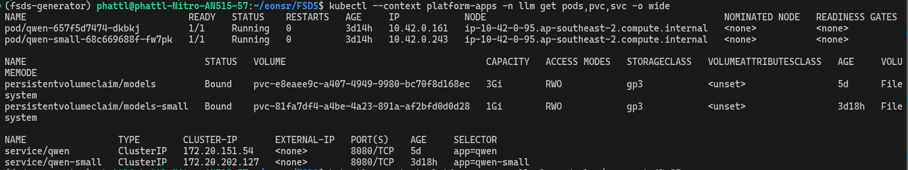
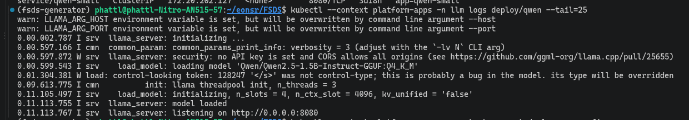

# LLM Inference Platform trên EKS

EDAI-2, dòng 3–6: inference, custom model, agentgateway và benchmark.

llama.cpp trên EKS `platform-apps` tự host Qwen2.5-1.5B-Instruct GGUF Q4_K_M trên CPU, lưu model trên PVC. Đây là model có sẵn tự host, chưa có bằng chứng fine-tuning riêng. Agent gọi API OpenAI-compatible qua agentgateway.

Code: [`llm.yaml`](../../infra/k8s/agents/llm.yaml), [gateway](../../infra/k8s/agents/agentgateway.yaml), [benchmark](../../scripts/evidence/bench_llm.py).

## Cách setup trên EKS

Các lệnh dưới đây chạy từ gốc repo, khi EKS `platform-apps` đã có worker, kubeconfig và EBS CSI.
Chuẩn bị StorageClass `gp3` mặc định theo [Cloud setup](../shared/cloud_setup.md#3-kubernetes-cho-ml-platform--llm-platform);
PVC trong `llm.yaml` dùng StorageClass mặc định của cụm.

### 1. Dựng PVC và llama.cpp

```bash
export KCTX=platform-apps
kubectl --context "$KCTX" get nodes
kubectl --context "$KCTX" get storageclass
kubectl --context "$KCTX" apply -f infra/k8s/agents/llm.yaml
kubectl --context "$KCTX" -n llm rollout status deployment/qwen --timeout=15m
kubectl --context "$KCTX" -n llm get pvc models
kubectl --context "$KCTX" -n llm logs deployment/qwen --tail=50
```

Manifest tạo namespace `llm`, PVC `models` **3 GiB**, Deployment và Service `qwen` cổng 8080.
PVC dùng `ReadWriteOnce`; Deployment chọn `Recreate` để pod cũ nhả volume trước khi pod mới dùng.
Với `gp3` dùng `WaitForFirstConsumer`, PVC chờ có pod sử dụng rồi mới bind.

Container llama.cpp được cố định bằng image digest. Tham số
`-hf Qwen/Qwen2.5-1.5B-Instruct-GGUF:Q4_K_M` tự tải model GGUF có sẵn từ Hugging Face ở lần chạy đầu;
`LLAMA_CACHE=/models` đặt cache trên PVC để dùng lại sau khi thay pod. Cần kết nối ra registry và nơi tải model.
Startup probe cho phép tối đa khoảng 10 phút để tải và nạp model; readiness probe kiểm `/health` trước khi Service chuyển request.

| Cấu hình hiện hành | Mục đích |
|---|---|
| `--threads 3`, `--parallel 4` | Dùng 3 luồng CPU và 4 slot xử lý đồng thời; lựa chọn dựa trên benchmark EKS bên dưới |
| `--ctx-size 16384` | Context tổng 16.384 token, tương ứng 4.096 token mỗi slot với cấu hình 4 slot |
| `--flash-attn on`, KV cache `q8_0` | Giảm bộ nhớ KV cache so với cấu hình mặc định để phục vụ context đã chọn |
| `--jinja`, `--alias qwen2.5-1.5b-instruct` | Bật chat template hỗ trợ tool calling và đặt tên model cho client/gateway |
| `--metrics` | Mở `/metrics` cho Prometheus; pod có annotation scrape cổng 8080 |

### 2. Kiểm tra API của LLM

Mở port-forward trong một terminal:

```bash
kubectl --context "$KCTX" -n llm port-forward svc/qwen 18080:8080
```

Trong terminal khác, kiểm tra health và gửi một câu chat:

```bash
curl --fail-with-body http://127.0.0.1:18080/health
curl --fail-with-body http://127.0.0.1:18080/v1/chat/completions \
  -H 'Content-Type: application/json' \
  -d '{"model":"qwen2.5-1.5b-instruct","messages":[{"role":"user","content":"Reply with OK."}],"max_tokens":16,"temperature":0}'
```

Kết quả mong đợi: health trả HTTP 200; chat trả JSON có `choices` và nội dung trả lời.

### 3. Nối agentgateway

[`agentgateway.yaml`](../../infra/k8s/agents/agentgateway.yaml) khai báo model `qwen2.5-1.5b-instruct`
với `baseUrl: http://qwen.llm.svc.cluster.local:8080/v1`. Gateway nhận API key qua Secret
`agentgateway-keys`, trường `AGW_AGENT_KEY`. Khi dựng mới, tạo key một lần; nếu Secret đã có thì giữ nguyên:

```bash
kubectl --context "$KCTX" apply -f infra/k8s/agents/agentgateway.yaml
if ! kubectl --context "$KCTX" -n agentgateway get secret agentgateway-keys >/dev/null; then
  agw_key="agw_$(openssl rand -hex 16)"
  kubectl --context "$KCTX" -n agentgateway create secret generic agentgateway-keys \
    --from-literal=AGW_AGENT_KEY="$agw_key"
  unset agw_key
fi
kubectl --context "$KCTX" -n agentgateway rollout restart deployment/agentgateway
kubectl --context "$KCTX" -n agentgateway rollout status deployment/agentgateway --timeout=180s
```

Agent gọi gateway tại `http://agentgateway.agentgateway.svc.cluster.local:3000/v1`, dùng cùng API key
và tên model trên. Cấu hình gateway còn có route MCP, A2A và model nhỏ phục vụ A/B; các nhánh đó cần workload
tương ứng. Bước setup này dựng đường gọi Qwen 1,5B; kiểm chứng policy xem [Gateway](agent_gateways.md).

Để kiểm tra đường gọi qua gateway, mở port-forward trong một terminal:

```bash
kubectl --context "$KCTX" -n agentgateway port-forward svc/agentgateway 13000:3000
```

Trong terminal khác, đặt `KCTX=platform-apps`, đọc key từ Secret và gọi đúng model 1,5B:

```bash
agw_key=$(kubectl --context "$KCTX" -n agentgateway get secret agentgateway-keys \
  -o jsonpath='{.data.AGW_AGENT_KEY}' | base64 -d)
curl --fail-with-body http://127.0.0.1:13000/v1/chat/completions \
  -H "Authorization: Bearer $agw_key" -H 'Content-Type: application/json' \
  -d '{"model":"qwen2.5-1.5b-instruct","messages":[{"role":"user","content":"Reply with OK."}],"max_tokens":16,"temperature":0}'
unset agw_key
```

Các bước trên là hướng dẫn tái lập từ cấu hình repo. Số liệu đã đo trên AWS nằm ở phần dưới.

## Kiểm tra triển khai trên EKS, 04/11/2026

Namespace `llm` trên cluster `platform-apps`: Deployment `qwen` (1,5B) và `qwen-small` (0,5B, nhánh B của A/B), mỗi pod `1/1 Running`,
PVC `models` 3 GiB và `models-small` 1 GiB `Bound` (gp3, model nằm trên PVC nên pod khởi động lại không phải tải lại), Service `ClusterIP` cổng 8080.



Log khởi động của llama.cpp: tải `Qwen2.5-1.5B-Instruct-GGUF:Q4_K_M`, `n_threads = 3`, `n_slots = 4`, rồi `model loaded` và `listening on 0.0.0.0:8080`.
Dòng cảnh báo `no API key is set` là của llama.cpp: server này không tự kiểm khóa, chỉ truy cập được trong cụm qua Service `ClusterIP`; khóa API do
[agentgateway](agent_gateways.md) kiểm.



## Benchmark bằng llm-d-benchmark

[llm-d-benchmark](https://github.com/llm-d/llm-d-benchmark) có chế độ `run` (run-only): benchmark một endpoint **đã chạy sẵn**,
không dựng lại stack. Harness `inference-perf` chạy thành pod trong namespace `llm-bench` và gọi `/v1/completions`
(streaming, nên có TTFT) vào Service `qwen.llm:8080`; llama.cpp server nói cùng giao thức OpenAI.
Workload: [`llmd-inference-perf-qwen-cpu.yaml`](../../infra/k8s/benchmark/llmd-inference-perf-qwen-cpu.yaml), lấy từ `sanity_random`
của llm-d-benchmark, giảm cỡ cho CPU: ba mức 0,1 / 0,2 / 0,4 request/giây, mỗi mức 60 s, prompt ~128 token, sinh ~32 token.
Lệnh chạy và cách cài (Python 3.14, commit cố định): [`run_llmd_benchmark.sh`](../../scripts/evidence/run_llmd_benchmark.sh).

**Kiểm tương thích với llama.cpp (04/11/2026, local, trước khi chạy EKS).** Tài liệu llm-d-benchmark và inference-perf không nêu llama.cpp là
engine được hỗ trợ (chỉ ghi vLLM, SGLang, TGI), nên đã thử thật: chạy container llama.cpp cùng image đã ghim như EKS
(Qwen2.5-0.5B Q4_K_M thay cho 1,5B vì máy local, `--alias qwen2.5-1.5b-instruct`), rồi chạy `inference-perf` (harness lõi mà
llm-d-benchmark triển khai) với workload của repo, một mức 0,5 request/giây trong 20 s.

| Điểm kiểm | Kết quả |
|---|---|
| `GET /v1/models` | `id` = `qwen2.5-1.5b-instruct` (alias); llm-d-benchmark đối chiếu model theo id này ở bước verify |
| `POST /v1/completions`, streaming, `stream_options.include_usage` | chunk `text_completion`, `choices[0].text`, 24 chunk cho `max_tokens=24`, chunk cuối có `usage` (24 token) |
| `ignore_eos` | `false` dừng ở 3 token, `true` sinh đủ 60 token: llama.cpp nhận tham số này |
| Trường `model` sai tên | vẫn trả kết quả, không bị từ chối |
| Chạy `inference-perf` | 10/10 thành công, 0 lỗi; TTFT TB 0,51 s, TPOT TB 26 ms, request TB 1,32 s; token đầu ra đếm phía client 31,7 so với phía server 32,7 |

Kết quả đầy đủ: [`llmd-inference-perf-llamacpp-local-20261104.json`](../evidence/llmd-inference-perf-llamacpp-local-20261104.json).
Số này đo trên model 0,5B ở máy local, **không phải số EKS** và không dùng để so với bảng đo bên dưới.

**Chạy thật trên EKS bằng llm-d-benchmark, 04/11/2026.** Chế độ run-only trỏ vào Service `qwen.llm:8080` (llama.cpp, Qwen2.5-1.5B), harness `inference-perf`, workload
[`llmd-inference-perf-qwen-cpu.yaml`](../../infra/k8s/benchmark/llmd-inference-perf-qwen-cpu.yaml), chạy từ máy quản trị bằng
[`run_llmd_benchmark.sh`](../../scripts/evidence/run_llmd_benchmark.sh). Công cụ tạo pod kiểm tra model (`smoketest`, đọc `/v1/models` thành công) rồi pod harness; pod tải tokenizer từ Hugging Face,
chạy ba mức tải và kết thúc với `harness_rc: 0` (3 phút 52 giây). Kết quả đầy đủ trong [llmd-benchmark/](../evidence/aws/llmd-benchmark/summary_lifecycle_metrics.json)
(`run_metadata.yaml`, báo cáo từng mức, `stdout.log`).

| Mức tải (yêu cầu/giây, 60 s) | Thành công / lỗi | TTFT trung vị / p90 | TPOT trung vị | Request p50 / p90 | Đạt được (yêu cầu/giây) | Token sinh/giây |
|---|---:|---:|---:|---:|---:|---:|
| 0,1 | 6 / 0 | 1,88 s / 2,86 s | 85 ms | 5,49 s / 6,30 s | 0,092 | 2,95 |
| 0,2 | 12 / 0 | 1,96 s / 4,23 s | 135 ms | 7,22 s / 9,97 s | 0,232 | 7,08 |
| 0,4 | 24 / 0 | 5,62 s / 15,0 s | 255 ms | 13,6 s / 20,6 s | 0,340 | 10,2 |

Đọc kết quả: 42 request, không lỗi. Mức 0,1 và 0,2 request/giây được phục vụ ổn; ở mức 0,4 hệ **bão hòa**: TTFT trung vị tăng gần ba lần (1,96 → 5,62 s), p90 chạm 15 s, và
chỉ đạt 0,34 request/giây so với yêu cầu 0,4. Với CPU 3 luồng và prompt ~128 token, giới hạn thực tế nằm quanh 0,3 request/giây mỗi pod LLM, khớp với việc chuỗi Agent nhiều lượt LLM bị chậm
khi tải chồng ([Agent Evaluation](agent_evaluation.md#coordinator-trên-aws-04112026)). Số này là một lần chạy ngắn trên EKS, không có khoảng tin cậy.

Hai điều chỉnh bắt buộc để llm-d-benchmark chạy trên EKS này (đã đưa vào script): (1) dùng `--no-pvc`, vì công cụ tạo PVC `ReadWriteMany` 20 GiB còn EBS `gp3` chỉ hỗ trợ `ReadWriteOnce`
(`Volume capabilities not supported`); (2) hạ tài nguyên pod harness từ mặc định 16 CPU / 32 GiB xuống 1 CPU / 2 GiB, nếu không pod kẹt `Pending` (`Insufficient cpu/memory`) trên node 4 vCPU.
Số trong bảng đo ở mục dưới do [`bench_llm.py`](../../scripts/evidence/bench_llm.py) tạo ra, đo trên cấu hình khác (số luồng, mức đồng thời), không so trực tiếp.

## Đo lại trên EKS, 2026-10-30

Node `r6i.xlarge` chỉ có 4 vCPU, nhưng cấu hình B đặt 6 luồng (theo laptop 6 nhân). Cùng script, gọi qua
`kubectl port-forward svc/qwen`, chỉ đổi `--threads`:

| Luồng | Đồng thời | p50 (s) | p95 (s) | request/s | token ra/s |
|---|---:|---:|---:|---:|---:|
| 6 (cũ) | 1 | 5,66 | 6,25 | 0,188 | 9,9 |
| | 2 | 8,63 | 14,70 | 0,204 | 10,6 |
| | 4 | 11,02 | 12,60 | 0,342 | 17,7 |
| **3** | 1 | 5,38 | 5,62 | 0,204 | 10,7 |
| | 2 | 7,70 | 14,97 | 0,214 | 11,3 |
| | 4 | **10,96** | **12,44** | **0,345** | **17,8** |
| 4 | 1 | **4,74** | 5,19 | 0,229 | 12,0 |
| | 2 | 7,60 | 13,93 | 0,225 | 11,8 |
| | 4 | 12,57 | 19,14 | 0,269 | 14,0 |

- 6 luồng > 4 vCPU: các luồng tranh nhau CPU, thua hoặc hoà ở mọi mức.
- 4 luồng nhanh nhất khi 1 request, nhưng ở 4 request p95 tăng lên 19,1 s và token/s giảm 21% so với 3 luồng:
  llama.cpp chiếm hết 4 vCPU, tranh với Agent, KEDA, exporter trên cùng node.
- Chọn **3 luồng**: Coordinator gọi 2 Agent song song nên tải thật là 2–4 request; chừa 1 vCPU cho pod khác.
- 8 request mỗi mức ⇒ chênh dưới ~10% coi như hoà. Số liệu: [`evidence/aws/bench-llm-eks-t6-20261030.json`](../evidence/aws/bench-llm-eks-t6-20261030.json),
  [`t3`](../evidence/aws/bench-llm-eks-t3-20261030.json), [`t4`](../evidence/aws/bench-llm-eks-t4-20261030.json).


[Policy và proof Gateway](agent_gateways.md).

[Mục lục phần này](README.md) · [Mục lục chung](../README.md)
