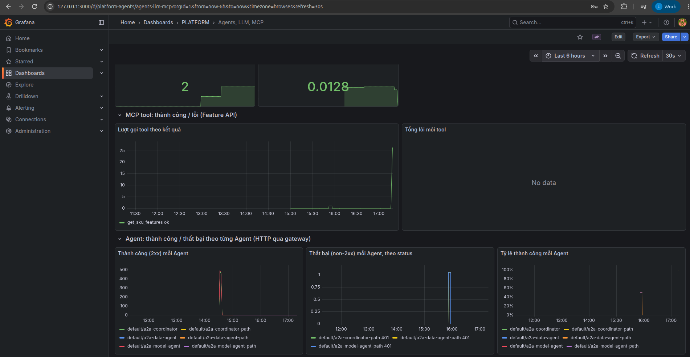

# Observability trên AWS

EDAI-2, dòng 46–51: API, hạ tầng, log, trace, LLM và Agent telemetry.

Code và cấu hình: các dashboard và metric được dẫn kèm ảnh EKS bên dưới.

Các kết quả dưới đây là của những lần đã chạy trên AWS. Chúng không có nghĩa là dịch vụ đang bật lúc bạn đọc.

## Trên EKS

Hệ thống quan sát gồm ba loại dữ liệu: metric (số đo, xem trên Grafana qua Prometheus), log (xem trên Grafana qua Loki) và trace (đường đi của một request qua các service, xem trên Jaeger).

Grafana mở tại `https://grafana.<ip>.sslip.io`. Đăng nhập hai lớp: basic auth `ops` của NGINX, rồi tài khoản admin Grafana.
Các ảnh dưới là dashboard "Agents, LLM, MCP" trong khung 3 giờ. Trong khung đó có: benchmark Qwen, một lần chạy [`gateway_smoke`](../evidence/aws/gateway-smoke-20261030.json) (đạt 17/17),
chat với Coordinator và đợt tải thử KEDA.

Panel guardrail có mục "Response Mask". Mục này ghi lại chính lần gateway che nhầm tỉ lệ Return 17 chữ số (`0.16980269175486737`) thành `<PHONE_NUMBER>`
(cùng guardrail `phoneNumber` sau đó còn che số đếm bảy chữ số trong eval, xem [Agent Evaluation](agent_evaluation.md); chi tiết lần đầu ở [LLM và agent](reference/llm_platform_agents.md#trên-eks)).

Jaeger nhận trace của agentgateway theo chuẩn OTLP. Ví dụ dưới là một trace của lệnh MCP `tools/list`; trace có một span con (một bước xử lý) đi tới backend `features`:

**Log.** Fluent Bit chạy dạng DaemonSet (mỗi node một pod). Nó đọc log của các container, gắn nhãn `namespace`, `pod`, `app`, rồi đẩy vào Loki
([`fluent-bit-values.yaml`](../../infra/k8s/observability/fluent-bit-values.yaml)).
Ảnh dưới: trong Grafana mở Explore, chọn Loki, truy vấn `{namespace="feature-store"}`, khung 1 giờ:

Hai cột cao (khoảng 1,5 nghìn và 1 nghìn dòng log) trùng với đợt [load test trên EKS](web_api_mcp.md#load-test-trên-eks)
(3.004 request trong 60 giây).

**Số đo tài nguyên của EC2.** node-exporter chạy trên EC2 ở cổng `:9100`; Prometheus trong EKS lấy số đo (scrape) qua IP nội bộ của máy.
Trong Grafana Explore có 4 truy vấn:

- CPU %: tính từ thời gian rảnh trong `node_cpu_seconds_total`;
- RAM %: từ `MemAvailable/MemTotal`;
- disk % cho `/` và `/mnt/platform-data` (ổ EBS chứa dữ liệu);
- network: số byte nhận mỗi giây, bỏ qua các card mạng `lo`, veth, docker, bridge.

Ảnh trên là khung 15 phút, nhưng đồ thị chỉ có số từ 00:01. Lý do: trước đó Prometheus vẫn lấy số từ IP của EC2 **cũ** (`10.42.0.12`, máy đã bị thay),
dù ConfigMap đã đổi sang `10.42.0.151`. Sidecar có nhiệm vụ nạp lại config đang bị tắt, và pod Prometheus đã chạy 13 giờ không khởi động lại, nên config mới chưa được nạp.
Cách sửa: bật `configmapReload` trong [`prometheus-values.yaml`](../../infra/k8s/observability/prometheus-values.yaml); test kiểm tra là
`test_prometheus_reloads_config_when_targets_change`.

### Telemetry LLM và Agent theo từng request

**Token mỗi request.** kagent (ADK) ghi một span OpenTelemetry tên `generate_content` cho mỗi lượt gọi LLM, và gửi về Jaeger qua
OTLP. Ví dụ: gửi một câu hỏi về chính sách cho coordinator thì Jaeger ghi được một trace 13 span đi qua 3 service, theo thứ tự:

1. coordinator gọi LLM;
2. coordinator gọi tool A2A `kagent__NS__model_agent` qua agentgateway;
3. model_agent gọi LLM rồi trả lời.

Mở phần tag của span `generate_content` (của model_agent) sẽ thấy:

- `gen_ai.usage.input_tokens` = 1536 (token gửi vào LLM);
- `gen_ai.usage.output_tokens` = 31 (token LLM sinh ra);
- `gen_ai.request.model` = `qwen2.5-1.5b-instruct`;
- `finish_reasons` = STOP (LLM tự kết thúc câu trả lời).

Tổng token của request này = input + output = 1567.

Để có số trung bình cho mọi request, dùng metric của agentgateway. `agentgateway_gen_ai_client_token_usage` là histogram, ghi một mẫu cho mỗi
request, nên lấy `_sum / _count` sẽ ra số token trung bình mỗi request. Trong 30 phút: input trung bình **947**, output **43,9**, và phần input đọc từ
cache là **728**:

**Số lần gọi và số lỗi theo từng MCP tool.** Feature API đếm bằng metric `mcp_tool_calls_total{tool, outcome}`. `outcome` là `error`
khi tool trả về `isError`, kể cả khi mã HTTP vẫn là 200.

Để có lỗi thật mà đếm, gọi MCP trực tiếp với 5 input sai: danh sách SKU rỗng, SKU sai định dạng, `top_k=50` (vượt giới hạn 10), channel `ebay`, `chunk_id` sai.
Kết quả là 5 lỗi kiểm tra đầu vào (validate):

Số lượt gọi mỗi Agent (A2A theo route) và mỗi tool qua gateway: ảnh dashboard ở mục trên.

**Thành công / thất bại theo từng Agent.** Dashboard [`platform-agents.json`](../../infra/k8s/observability/dashboards/platform-agents.json)
có thêm ba panel, tách theo `route` của từng Agent (`a2a-data-agent`, `a2a-model-agent`, `a2a-coordinator`):

- số request thành công (mã 2xx);
- số request thất bại, tách theo `status`;
- tỷ lệ thành công.

Lưu ý: đây là mã HTTP đi qua gateway (401 thiếu key, 429, 5xx…), không phải trạng thái task A2A bên trong Agent.
Tải được sinh bằng `gateway_smoke.py` (mỗi Agent một cặp request có key và không key) và bài tải KEDA.
Dashboard đã được áp dụng vào ConfigMap `grafana-dashboards-platform` trên EKS. Ảnh dưới chụp khung **Last 6 hours**, theo múi giờ của trình duyệt (UTC+7):

- **Thành công (2xx):** đỉnh khoảng 500 request trong cửa sổ 5 phút lúc ~14:30 (bài tải KEDA 3 request/giây, 150 giây) cho `a2a-coordinator`, `a2a-data-agent`, `a2a-model-agent`, mỗi route một đường màu riêng.
- **Thất bại (non-2xx):** các mã `401` trên `a2a-coordinator-path`, `a2a-data-agent-path`, `a2a-model-agent-path` lúc ~16:00 (đợt `gateway_smoke.py`: request không kèm khóa tới từng Agent), tách theo route và theo status.
- **Tỷ lệ thành công:** gần 100% cho từng Agent, tụt xuống mức thấp tại đúng thời điểm có 401 của đợt smoke.

Tham khảo: thiết kế, hướng dẫn phát triển và ghi nhận trước triển khai AWS

Các ghi nhận local giữ nguyên môi trường, không dùng thay bằng chứng cloud.

<!-- Mục đích: bộ quan sát (metrics, logs, traces, LLM/agent telemetry) trong kind, -->
## Observability — ML Platform / LLM Platform

Dựng bằng lệnh `bash scripts/setup/deploy_kind_observability.sh` (namespace `observability`). Xem qua HTTPS + basic auth
(ingress của [`docs/edai-2/cicd.md`](cicd.md)) tại các host `grafana.`, `traces.`, `metrics.` trên `172-25-0-2.sslip.io:30443`.

| Thành phần | Chart / bản | Vai trò | File |
|---|---|---|---|
| Prometheus | prometheus-community/prometheus 29.36.2 | số đo, giữ 6 giờ; lấy pod có annotation `prometheus.io/scrape` | [`prometheus-values.yaml`](../../infra/k8s/observability/prometheus-values.yaml) |
| Loki | grafana/loki 7.3.0 (SingleBinary) | log, PVC 1 Gi, giữ 24 giờ | [`loki-values.yaml`](../../infra/k8s/observability/loki-values.yaml) |
| Fluent Bit | fluent/fluent-bit 0.58.3 | đọc log container trên node, gắn nhãn namespace/pod/app, đẩy Loki | [`fluent-bit-values.yaml`](../../infra/k8s/observability/fluent-bit-values.yaml) |
| Jaeger | jaegertracing/jaeger 4.16.1, image **2.10.0** | trace (OTLP :4317), lưu RAM | [`jaeger-values.yaml`](../../infra/k8s/observability/jaeger-values.yaml) |
| Grafana | grafana/grafana 10.5.15 | xem cả ba; dashboard Data & AI Platform | [`grafana-values.yaml`](../../infra/k8s/observability/grafana-values.yaml), [`dashboards/`](../../infra/k8s/observability/dashboards/platform-agents.json) |

Nguồn dữ liệu:
- **Web API** (Feature API, từ v7): `/metrics` với `http_requests_total{method,handler,status}` và
  `http_request_duration_seconds{handler}` (prometheus_client, middleware trong [`serving/app.py`](../../serving/app.py));
  request MCP gom về `handler="/mcp"`.
- **agentgateway**: `agentgateway_requests_total{route,status}`, `agentgateway_mcp_requests_total{method,resource}`
  (số lần gọi từng tool), `agentgateway_gen_ai_client_token_usage{gen_ai_token_type=input|output}` (token mỗi request),
  `agentgateway_gen_ai_server_request_duration` (thời gian 1 lượt LLM); trace OTLP gửi Jaeger.
- **TTFT và PII (agentgateway)**: `agentgateway_gen_ai_server_time_to_first_token` (chỉ request streaming),
  `agentgateway_gen_ai_server_time_per_output_token`; guardrail regex trên cả 2 model chặn request chứa email / thẻ
  tín dụng / SSN (HTTP 403 `pii_detected`) và che email/điện thoại/thẻ trong câu trả lời, đếm ở
  `agentgateway_guardrail_checks_total{phase,action}`. Không chặn số điện thoại ở request (số lượng, giá, mã SKU dễ
  bị nhận nhầm).
- **Lỗi mỗi MCP tool** (Feature API v8): `mcp_tool_calls_total{tool,outcome=ok|error}` — lỗi MCP trả HTTP 200 kèm
  `isError` nên không thấy được qua `http_requests_total`.
- **llama.cpp**: `llamacpp:predicted_tokens_seconds`, `llamacpp:requests_processing`.
- **kagent**: trace controller + Agent (Helm `otel.tracing`).
- **Log**: log của mọi pod được Fluent Bit chuyển vào Loki; xem ở Grafana Explore (Loki không có UI riêng).

## Dashboard "Data & AI Platform — Agents, LLM, MCP"

| Nhóm | Panel |
|---|---|
| LLM | tổng request; token input / output trung bình mỗi request; tổng token; token/giây theo loại; thời gian 1 lượt p50/p95; llama.cpp token/giây |
| Agent & MCP | số lần gọi mỗi Agent (A2A qua gateway); số lần gọi mỗi MCP tool; tổng lần gọi Agent / tool |
| LLM: TTFT, PII | TTFT p50/p95; thời gian mỗi token ra; guardrail theo phase/action; tổng request bị chặn PII; tỷ lệ chặn |
| MCP tool | lượt gọi theo tool + kết quả; tổng lỗi mỗi tool |
| Gateway / Web API | request/giây theo route; request lỗi theo status; Feature API request/giây + 5xx; độ trễ p95 theo handler |

## Kiểm

- Prometheus: sau 60 request thử, `http_requests_total` của Feature API ghi `/features 200 = 30`, `/features 422 = 30`.
- Loki: `count_over_time({job="fluent-bit"}[10m])` có log của mọi namespace (agentgateway, feature-store, kagent…).
- Jaeger: `/api/services` có `agentgateway` sau khi bật tracing.
- Grafana: datasource Prometheus/Loki/Jaeger đều `OK`. Vào qua ingress theo thứ tự: basic auth `ops`, rồi form đăng nhập Grafana, rồi tới
  dashboard.

Lỗi đã gặp và cách xử lý:
- Jaeger 2.22 (bản mặc định của chart) chỉ trả API v3 ở `/api/v3/...`, trong khi Grafana gọi `/api/services` nên nhận 404. Cách xử lý: ghim Jaeger ở bản 2.10.0.
- Ingress có basic auth nên request tới Grafana mang header `Authorization: Basic`. Grafana tưởng đó là tài khoản của chính nó và trả 401.
  Cách xử lý: đặt `grafana.ini: auth.basic.enabled=false`.
- Panel "pod data-agent" cần kube-state-metrics (đã tắt cho nhẹ), nên bỏ panel này.

Kiểm PII và TTFT (thời gian tới token đầu tiên), bằng cách gọi `/v1/chat/completions` qua gateway:

| Request | Kết quả |
|---|---|
| "Email the refund to jane.doe@example.com" | 403 `pii_detected` |
| "My card is 4111 1111 1111 1111" | 403 |
| "Return risk of 2 units of sku-00003 for 4500 cents?" | 200 |
| request có `stream: true` | có `time_to_first_token` |

Bộ đếm `guardrail_checks_total` sau đó: Request/Allow 2, Request/Reject 2, Response/Allow 1.

Kiểm lỗi tool: gọi `get_sku_features` qua gateway khi MinIO đang tắt, thì `mcp_tool_calls_total{outcome="error"}`
tăng đúng bằng số lượt lỗi.

[Mục lục phần này](README.md) · [Mục lục chung](../README.md)
