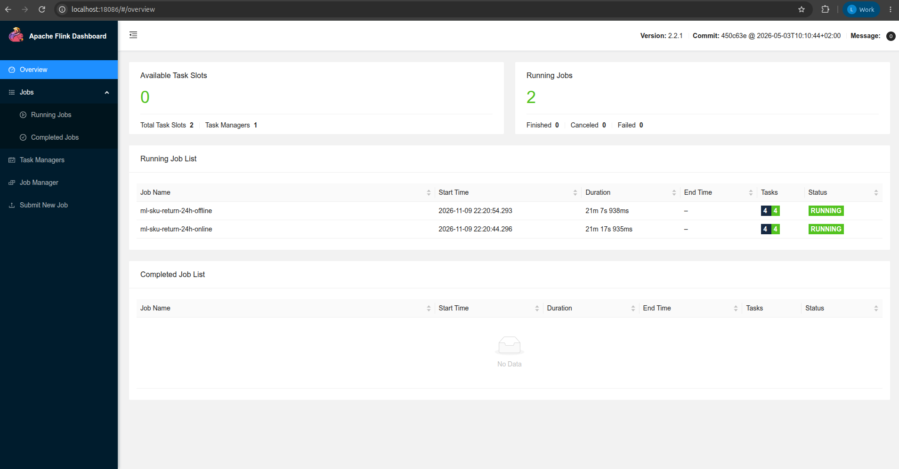
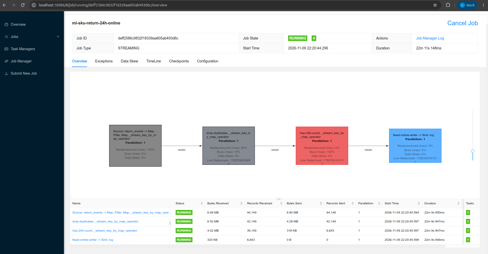
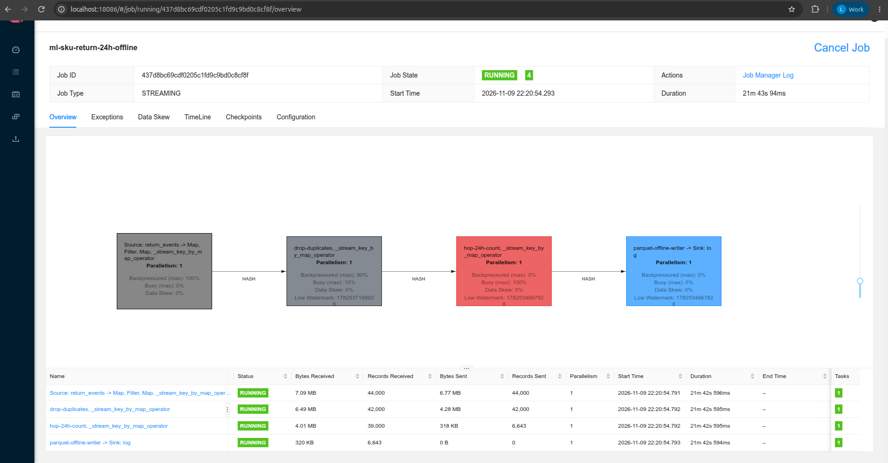
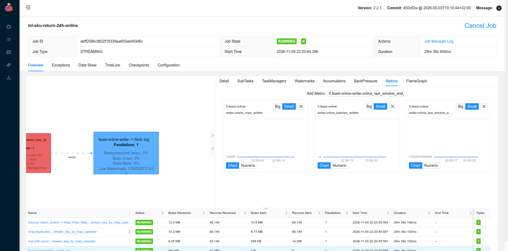
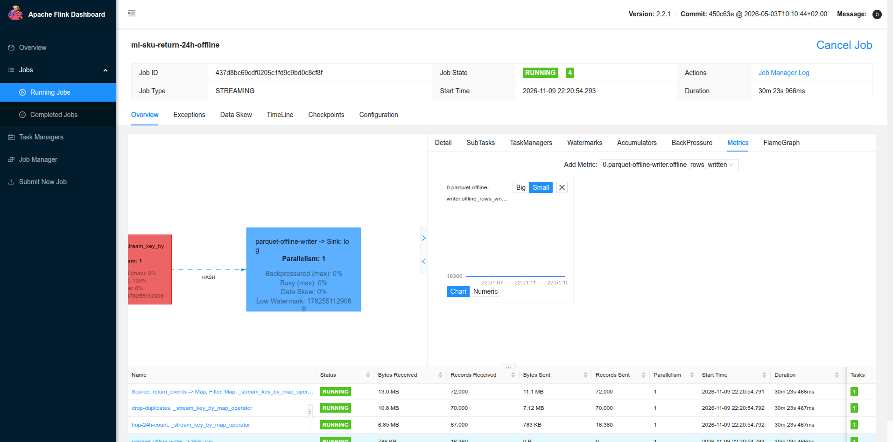
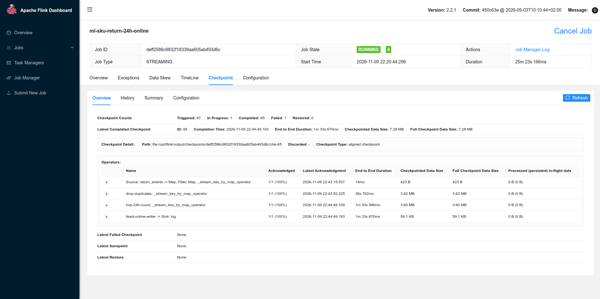
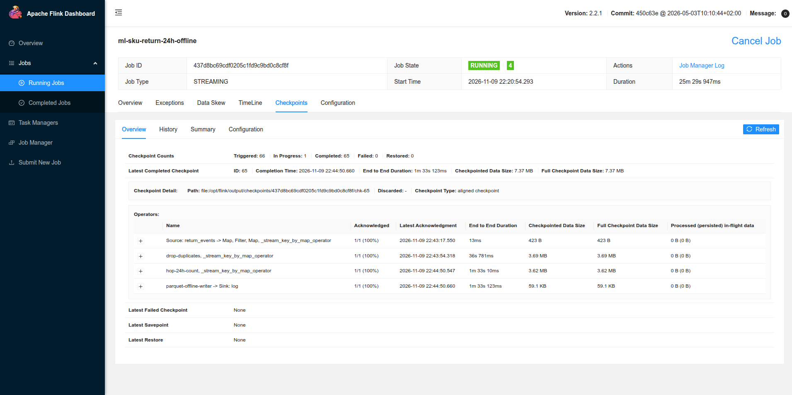
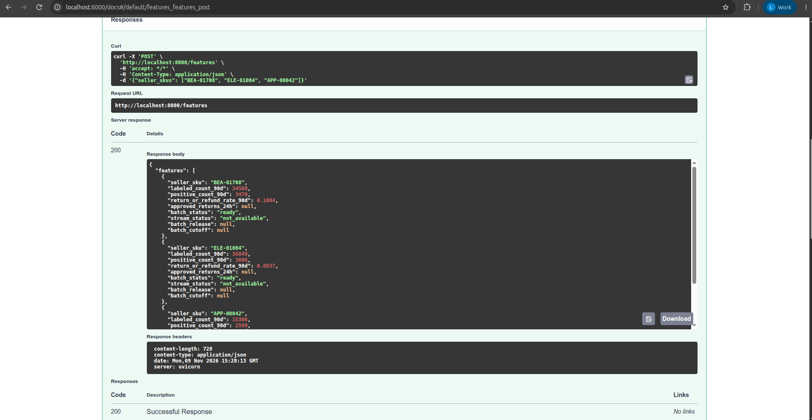
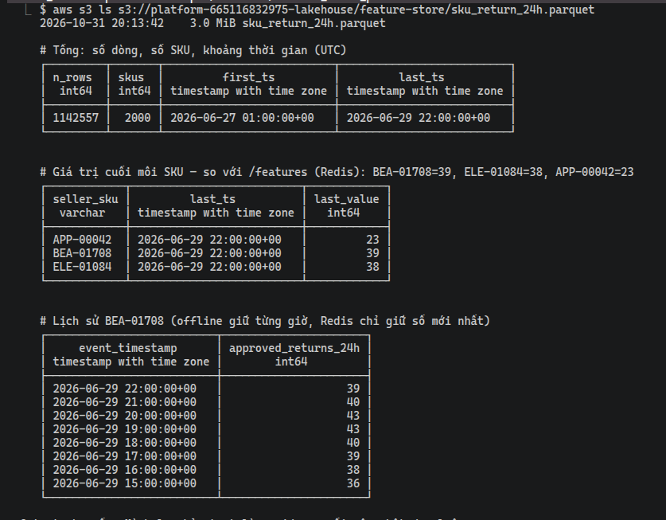

# Streaming Feature trên AWS

EDAI-2, dòng 12: push streaming feature vào offline và online store.

Code / cấu hình: [job PyFlink](../../flink_jobs/ml/sku_return_feature.py), [submit 2 job](../../scripts/run/run_stream_feature_jobs.sh),
[image Flink ML](../../docker/Dockerfile.flink-ml), [CI](../../ci/jenkins/stream-features.Jenkinsfile).

Các kết quả dưới đây thuộc các lần chạy AWS được ghi ngày, không xác nhận dịch vụ đang bật.

## Hai job PyFlink: online và offline (bản hiện tại, 07/11/2026)

Thay cho Flink SQL + `feast-pusher` (bản 30–31/10 bên dưới). Một file PyFlink DataStream submit **hai job**, mỗi job đọc
Kafka bằng consumer group riêng và tự ghi vào kho của mình:

```text
Kafka order_snapshots.return_events
  ├─► job ml-sku-return-24h-online : parse → bỏ trùng (KeyedProcessFunction, key record_sha256)
  │     → HOP 24h trượt 1h theo event time (watermark trễ 1h) → lô 2 s → Feast push ONLINE → Redis EKS
  └─► job ml-sku-return-24h-offline: cùng phép tính → lô 60 s → một file part Parquet mới
        → s3://…/feature-store/sku_return_24h/ (Feast FileSource đọc cả thư mục, train dùng PIT join)
```

| Thành phần | Chi tiết |
|---|---|
| Job | [`sku_return_feature.py`](../../flink_jobs/ml/sku_return_feature.py), cờ `--sink online\|offline` |
| Cluster | Flink **2.2.1** riêng (`flink-ml-jobmanager`/`taskmanager`, UI cổng 8086), tách khỏi cluster 1.20 của EDAI-1: PyFlink 1.20 kéo apache-beam < 2.49 (numpy < 1.25), không cài chung được với Feast 0.66 (numpy ≥ 2) |
| Online | Feast `push(..., PushMode.ONLINE)`: Redis đúng định dạng Feast mà Feature API đọc qua `get_online_features` |
| Offline | Parquet `part-<min>-<max>-<n>.parquet`, schema `seller_sku`, `event_timestamp` (UTC), `approved_returns_24h` |
| Monitor | Ngoài số đo sẵn của Flink (bản ghi vào/ra, checkpoint, backpressure), mỗi job có metric riêng hiện trên Flink UI: `duplicates_dropped`, `<sink>_rows_written`, `<sink>_batches_written`, `<sink>_last_window_end_ms` |
| Event time | Timestamp bản ghi Kafka = `effective_at`; watermark theo từng partition ở source, trễ tối đa 1 giờ; topic `retention.ms=-1` vì bản ghi mang thời gian quá khứ |
| Đảm bảo | Lô nằm trong state của cửa sổ thời gian xử lý ⇒ vào checkpoint; khôi phục có thể ghi lại một lô (at-least-once, dòng trùng cùng giá trị, PIT join không đổi) |
| Test | [`tests/flink/test_sku_return_feature.py`](../../tests/flink/test_sku_return_feature.py) chạy job trên mini cluster trong image: cửa sổ khớp phép đếm độc lập (có tin trùng, tin trễ, tin không phải approved); Feast đọc thư mục part và PIT join đúng; CLI từ chối cấu hình sai |

Chạy trên EC2 (overlay AWS đã đặt trong `COMPOSE_FILE`):

```bash
# Laptop: đồng bộ code mới lên /opt/platform (compose đổi ⇒ chạy cả playbook, không chỉ --tags code)
#   ansible-playbook -i inventory.ini site.yml --ask-vault-pass        (thư mục infra/aws/ansible)
# Trong phiên EC2, cd /opt/platform:
sudo install -d -o 9999 -g 9999 /mnt/platform-data/flink-ml
# Registry trỏ offline sang thư mục part (chỉ task feast_apply, không chạy Spark export):
docker compose --profile airflow exec airflow airflow tasks test ml_feature_materialize feast_apply "$(date -u +%F)"
docker compose --profile stream --profile flink-ml up -d --wait kafka flink-ml-jobmanager flink-ml-taskmanager
# Xoá topic cũ: tin của lần chạy 30–31/10 mang timestamp thời điểm phát, làm watermark nhảy sai.
docker compose --profile stream exec -T kafka /opt/kafka/bin/kafka-topics.sh --bootstrap-server localhost:9092 \
  --delete --if-exists --topic order_snapshots.return_events
scripts/run/run_stream_feature_jobs.sh                       # submit 2 job
# Mount script mới: script nằm sẵn trong image platform-feast, image cũ phát lại tin KHÔNG có event time.
docker compose --profile stream --profile ml-stream run --rm -T --no-deps \
  -v "$PWD/feature_repo/replay_return_events.py:/opt/feature_repo/replay_return_events.py:ro" feast-pusher \
  python replay_return_events.py < ~/return_events.jsonl     # phát lại 401.129 Return
# Kiểm: CreateTime phải là 06/2026 (1782…), không phải thời điểm chạy.
docker compose --profile stream exec -T kafka /opt/kafka/bin/kafka-console-consumer.sh --bootstrap-server localhost:9092 \
  --topic order_snapshots.return_events --from-beginning --max-messages 1 --property print.timestamp=true | cut -c1-40
```

**Smoke local 07/11** (cluster Flink 2.2.1 + Kafka thật trong Compose, `flink run -py`): job `ml-sku-return-24h-offline`
RUNNING, 5 tin vào (có 1 bản trùng) ⇒ file part 51 cửa sổ, **51/51 khớp** phép đếm độc lập cho các cửa sổ đã đóng theo
watermark; REST/UI hiện `duplicates_dropped`, `offline_rows_written`, `offline_batches_written`, `offline_last_window_end_ms`.
Lỗi gặp khi chạy thật (đã sửa): PyFlink 2.2 cửa sổ/TTL nhận `Time` chứ không nhận `Duration`.

**Diễn tập đúng quy mô, 09/11** (401.129 tin, 2.000 SKU, 3 partition, Redis thật, S3 API giả lập bằng moto): bản đầu sinh watermark
sau khi gộp partition ⇒ partition đọc nhanh làm watermark vượt partition chậm, tin bị coi là trễ và **rớt âm thầm trong khi job vẫn
RUNNING** (mới đóng tới một phần đã thiếu 1.193 cửa sổ, sai số 37.284 cửa sổ). Sửa: event time là timestamp bản ghi Kafka do
[`replay_return_events.py`](../../feature_repo/replay_return_events.py) đặt, watermark sinh ở source theo từng partition, có idleness.

### Trên AWS, 09/11/2026

Jenkins `stream-features` (commit `4cc4502`, `DATA_STORAGE=s3`) dựng cluster Flink ML trên EC2 và submit 2 job. Phát lại **401.129** Return vào 3 partition
(151.254 + 117.583 + 132.292), bản ghi đầu `CreateTime:1782518400289` là event time tháng 6/2026.







Monitor: metric riêng của từng job (`duplicates_dropped` chỉ xuất hiện từ tin trùng đầu tiên; bản phát lại này khoá theo Order Line nên không có tin trùng).









**Trước khi phát lại**, Feature API trả `approved_returns_24h: null`, `stream_status: not_available` (Redis chưa có feature stream), nên giá trị xuất hiện sau đó là do job online ghi.



**Đối chiếu độc lập khi replay còn chạy** ([`stream_feature_reconcile.py`](../../scripts/evidence/stream_feature_reconcile.py), không dùng Flink, [output](../evidence/aws/stream-reconcile-midrun-20261109.txt)):
tới cửa sổ 06-27 11:00, **20.316/20.316 cửa sổ** trên S3 đúng, **1.981/1.981 SKU** trên Redis đúng; BEA-01708 = 15, ELE-01084 = 10, APP-00042 = 15 ở cả hai kho.

**Chưa có số cuối: replay trên AWS đang chạy.**

<a id="trên-aws-pipeline-a-2026-10-30"></a>
## Bản trước: Flink SQL + pusher trên AWS, 30–31/10/2026

Stream đơn hàng đã triển khai (thông báo Amazon, webhook TikTok) không có sự kiện Return, chỉ có trạng thái đơn.
Nên trên AWS phát **lại** Return đã duyệt từ Gold vào Kafka, theo đúng thứ tự thời điểm biết Return (giới hạn:
feature tới Redis/Parquet thật, nhưng model `return-risk` v1 train khi feature này còn rỗng nên chưa dùng nó).

```text
Trino (EC2) ──① Gold: fact_return_labels_dp3 ⋈ fact_order_lines_dp2, label=1, 3 ngày trước 2026-06-30
   │            sql/ml/return_events_replay.sql → ~/return_events.jsonl (401.129 dòng)
   ▼
replay_return_events.py ──② Kafka order_snapshots.return_events (3 partition, tổng offset 401.129)
   ▼
Flink ml-sku-return-24h ──③ bỏ trùng theo Order Line, HOP 24h trượt 1h → Kafka ml.sku_return_24h
   │                       flink_jobs/ml/sku_return_feature_a.sql 
   ▼
feast-pusher ──④ push ONLINE_AND_OFFLINE: Redis EKS (NodePort) + S3 sku_return_24h.parquet
   ▼
Feature API EKS ──⑤ /features trả approved_returns_24h
```

Ba lỗi khi chạy lần đầu (đã sửa):

1. `docker compose` thiếu overlay AWS ⇒ Trino lấy catalog MinIO local. Runbook đặt
   `COMPOSE_FILE=docker-compose.yml:docker-compose.aws.yml:docker-compose.aws-stream.yml` một lần.
2. Replay `run feast-pusher` chỉ bật profile `ml-stream` ⇒ "depends on undefined service kafka"; thêm
   `--profile stream --no-deps`. Job Flink `RESTARTING` vì topic nguồn chưa có là bình thường: Kafka tự tạo topic
   khi có tin đầu, Flink tự thử lại.
3. Job `RESTARTING` mãi, mọi checkpoint hỏng. Nghi đầu tiên là thiếu RAM (log có `OutOfMemoryError: Java heap space`)
   ⇒ cho taskmanager AWS 4 GB ([`docker-compose.aws-stream.yml`](../../docker-compose.aws-stream.yml)) nhưng vẫn hỏng.
   Log taskmanager mới chỉ ra gốc: `Size of the state is larger than the maximum permitted memory-backed state.
   Size=72467011, maxSize=5242880` — chưa khai nơi lưu checkpoint nên Flink giữ ở bộ nhớ JobManager (tối đa 5 MB),
   state bỏ trùng + HOP ~80 MB. Sửa: [`sku_return_feature_a.sql`](../../flink_jobs/ml/sku_return_feature_a.sql) 
   `SET 'state.checkpoints.dir' = 'file:///opt/flink/output/checkpoints'` (thư mục mount EBS cả JobManager lẫn
   taskmanager); test `test_stream_feature_checkpoints_go_to_disk_not_jobmanager_memory`. Trước khi sửa, feature đã
   tới API nhưng chỉ tới cửa sổ 2026-06-27 09:00.

Sau khi sửa, job mới chạy hết 3 ngày phát lại: 401.129 sự kiện vào, 76/76 checkpoint thành công (~79 MB mỗi lần,
`file:/opt/flink/output/checkpoints/…`), 0 lỗi.


**Đối chiếu độc lập** (script đếm lại trên EC2, không dùng Flink): đọc lại `~/return_events.jsonl`, bỏ trùng theo
`order_line_key`, đếm Return trong `[window_end − 24h, window_end)` cho từng tin Flink ghi ở `ml.sku_return_24h`
(gồm cả tin của job hỏng trước đó) ⇒ **1.004.354 / 1.004.354 cửa sổ khớp, 0 lệch**, 2.000 SKU. Cửa sổ cuối
2026-06-29 22:00 khớp số Feature API trả qua Redis:

| SKU | Flink cửa sổ cuối | Feature API `/features` |
|---|---:|---:|
| BEA-01708 | 39 | 39 |
| ELE-01084 | 38 | 38 |
| APP-00042 | 23 | 23 |


**Online và offline từ cùng một lần push.** Pusher gọi `store.push(..., to=PushMode.ONLINE_AND_OFFLINE)` một lần cho mỗi lô:
Feast ghi giá trị mới nhất vào **Redis** (ảnh `/features` ở trên) và nối lịch sử vào **Parquet trên S3**
(`feature-store/sku_return_24h.parquet`). Bản này một job Flink SQL, online và offline đi chung một lần push; bản hiện tại tách thành hai job PyFlink ở mục trên.
Đọc lại file offline trên S3 ngày 07/11 bằng [`offline_store_proof.sh`](../../scripts/evidence/offline_store_proof.sh)
(file ghi lúc 31/10 20:13, 3,0 MiB): **1.142.557 dòng, 2.000 SKU**, từ 06-27 01:00 tới 06-29 22:00 UTC; giá trị cuối
BEA-01708 = 39, ELE-01084 = 38, APP-00042 = 23, **khớp Redis**. Offline giữ từng giờ (BEA-01708: 36 → 38 → 39 → 40 → 43 → 43 → 40 → 39)
để train lấy đúng giá trị tại thời điểm đặt đơn (point-in-time join). Số dòng lớn hơn số cửa sổ đối chiếu vì pusher là
at-least-once và có tin của job hỏng trước đó; các dòng trùng cùng giá trị nên PIT join không đổi. Output: [stream-offline-parquet-s3-20261107.txt](../evidence/aws/stream-offline-parquet-s3-20261107.txt).



Cửa sổ cuối dừng ở 06-29 22:00 (không tới 06-30 00:00) vì watermark trễ 1 giờ sau sự kiện cuối, luồng không tự kết
thúc . Code job: [`sku_return_feature_a.sql`](../../flink_jobs/ml/sku_return_feature_a.sql),
phát lại: [`replay_return_events.py`](../../feature_repo/replay_return_events.py),
[`return_events_replay.sql`](../../sql/ml/return_events_replay.sql), pusher:
[`push_stream_features.py`](../../feature_repo/push_stream_features.py).

<details>
<summary>Tham khảo: thiết kế, hướng dẫn phát triển và ghi nhận trước triển khai AWS</summary>

Các ghi nhận local giữ nguyên ngày và môi trường, không dùng thay bằng chứng cloud.

<!-- Mục đích: job đẩy stream feature vào kho OFFLINE và ONLINE của Feast, -->
## Stream feature vào Feast — ML Platform bước 3

deploy các job đẩy **streaming feature** vào kho OFFLINE và ONLINE.

## Đường đi của dữ liệu

```
Kafka order_lifecycle.seller_postsales.return_events     (publisher của Data Platform)
   │ ① Flink SQL sku_return_feature.sql (chạy liên tục)
   │    - bỏ bản retry trùng theo record_sha256
   │    - tra line_id → seller_sku ở PostgreSQL warehouse_lifecycle.fact_order_lines (lookup join, cache)
   │    - HOP 24h trượt 1h theo event time, đếm Return "approved"
   ▼
Kafka ml.sku_return_24h        {seller_sku, event_timestamp = window_end, approved_returns_24h}
   │ ② feast-pusher (push_stream_features.py, service Compose)
   │    store.push(..., to=ONLINE_AND_OFFLINE), commit offset SAU khi push
   ├──► Redis trong kind (ONLINE)          feature view sku_return_24h
   └──► s3://platform/feature-store/sku_return_24h.parquet (OFFLINE, train dùng PIT join)
```

| Thành phần | File |
|---|---|
| Job Flink | [`flink_jobs/ml/sku_return_feature.sql`](../../flink_jobs/ml/sku_return_feature.sql) |
| Submit job (điền credential từ `.env`) | [`scripts/run/run_sku_return_feature.sh`](../../scripts/run/run_sku_return_feature.sh) |
| Jar JDBC + PostgreSQL cho Flink | [`docker/Dockerfile.flink`](../../docker/Dockerfile.flink) |
| Pusher | [`feature_repo/push_stream_features.py`](../../feature_repo/push_stream_features.py), image [`docker/Dockerfile.feast`](../../docker/Dockerfile.feast), service `feast-pusher` |
| Feature view | `sku_return_24h` trong [`feature_repo/features.py`](../../feature_repo/features.py) |

## Vì sao làm vậy

- **Event Return không có SKU**, chỉ có `line_id`. Flink tra SKU từ warehouse PostgreSQL thay vì
  chở cả đơn hàng vào Kafka. Cache 1h vì một line không đổi SKU.
- **Không cho Flink ghi thẳng Redis**: làm vậy bỏ qua Feast, kho offline không có dữ liệu và train
  không PIT join được.
- **At-least-once**: pusher commit offset sau khi push. Chết giữa chừng thì đọc lại, có thể ghi
  trùng dòng offline — cùng giá trị nên PIT join không đổi.

**Giới hạn (đã đánh dấu `Giới hạn:` trong SQL):** HOP chỉ phát cửa sổ có tin. SKU hết Return thì
Redis giữ số cũ tới khi có tin mới. Push offline đọc + ghi lại cả file mỗi lần — ổn ở cỡ demo.

## Chạy local

```bash
## 0. Đã có Gold (docs/edai-2/feature_store.md bước 1) và Redis trong kind (setup_kind_feature_store.sh)

## 1. Bảng tra line → SKU: publish warehouse từ Gold hiện tại (run_id = generation_id của Gold).
##    Máy chật RAM thì chạy thẳng job export_order_lifecycle.py bằng Spark local[2] (driver 1g) thay vì DAG.
docker compose --profile airflow --profile spark up -d --wait airflow spark-master spark-worker-1 spark-worker-2
docker compose --profile airflow exec airflow airflow dags unpause dp_order_lifecycle_warehouse
docker compose --profile airflow exec airflow airflow dags trigger dp_order_lifecycle_warehouse \
  --conf '{"run_id": "<generation_id>", "cutoff": "2026-06-01T00:00:00.000000Z"}'
docker compose --profile airflow --profile spark stop airflow spark-master spark-worker-1 spark-worker-2

## 2. Kafka + Flink + pusher
docker compose --profile stream --profile flink --profile ml-stream up -d kafka flink-jobmanager flink-taskmanager feast-pusher

## 3. Phát event vận hành vào Kafka
.venv/bin/python -m generator.publish_order_lifecycle_events --source out/order_lifecycle_live \
  --bootstrap localhost:9094 --epoch 1 --manifest out/stream-ml-1.json

## Lần đầu (làm TRƯỚC bước 3): tạo topic và đăng ký view với Feast
for t in carrier.delivery_events seller_postsales.return_events seller_postsales.refund_events seller_wms.stock_operations; do
  docker compose exec kafka /opt/kafka/bin/kafka-topics.sh --bootstrap-server localhost:9092 \
    --create --if-not-exists --topic order_lifecycle.$t --partitions 3 --replication-factor 1
done
docker compose exec kafka /opt/kafka/bin/kafka-topics.sh --bootstrap-server localhost:9092 \
  --create --if-not-exists --topic ml.sku_return_24h --partitions 1 --replication-factor 1
docker compose --profile ml-stream run --rm --no-deps feast-pusher feast apply

## 4. Submit job Flink (UI: http://localhost:8082)
scripts/run/run_sku_return_feature.sh

## 5. Kiểm
docker compose --profile ml-stream logs feast-pusher | grep pushed
kubectl --context kind-platform -n feature-store exec deploy/redis -- redis-cli dbsize
```

## CI/CD

[`ci/jenkins/stream-features.Jenkinsfile`](../../ci/jenkins/stream-features.Jenkinsfile): **Test** (ruff, test docstring +
renderer stream, test Spark `check_sku_daily_features.py`) → **Build** (image Flink có jar JDBC, image
Feast) → **Deploy** (Kafka + Flink, `feast apply`, recreate pusher, huỷ job Flink cùng tên rồi submit lại)
→ **Verify** (đúng 1 job `ml-sku-return-24h` RUNNING, pusher running).

Secret không nằm trong repo: Jenkins credential `platform-postgres` và `platform-minio` (username/password),
truyền vào bằng `withCredentials`; [`run_sku_return_feature.sh`](../../scripts/run/run_sku_return_feature.sh)
chỉ đọc `.env` khi chạy tay. Pipeline này đã chạy trên Jenkins EC2 ngày 31/10 (`stream-features` #2 xanh), xem [CI/CD](cicd.md#trên-aws-2026-10-31).

## Bằng chứng

Lần chạy local 2026-10-21 (fixture 15 đơn / 2 SKU):

- Warehouse: 30 line `line_id → sku-A/sku-B` trong `warehouse_lifecycle.fact_order_lines`.
- Flink job `ml-sku-return-24h`: **RUNNING** (streaming, không tự dừng).
- Pusher: `pushed 72 rows, last 2026-02-05 10:00:00+00:00`; consumer group `feast-pusher` lag = 0.
- Offline: `sku_return_24h.parquet` 72 dòng. Online: `sku-A = 5`, `sku-B = None` (sku-B không có
  Return approved nào — đúng).
- **Đối chiếu độc lập**: đếm lại từ file JSONL nguồn (bỏ trùng theo `source_event_id`, tra SKU từ
  PostgreSQL, cửa sổ `[end−24h, end)`) → 72/72 cửa sổ khớp, 0 sai lệch.
- Cửa sổ cuối dừng ở 02-05 10:00 vì watermark chỉ tiến khi có tin mới (luồng không tự kết thúc).

</details>

[Mục lục phần này](../README.md) · [Mục lục chung](../../README.md)
