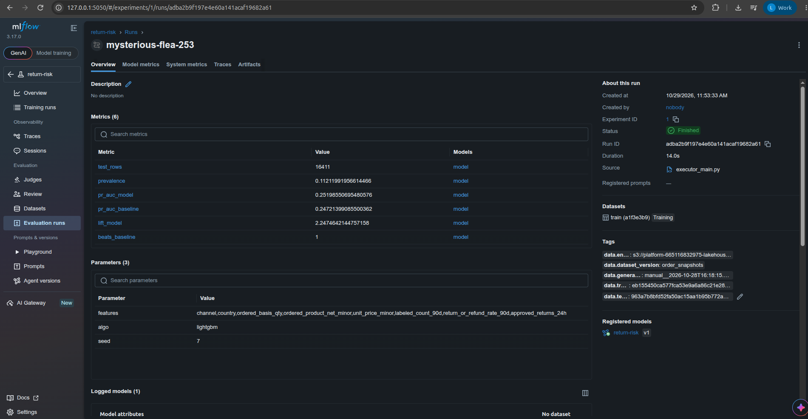
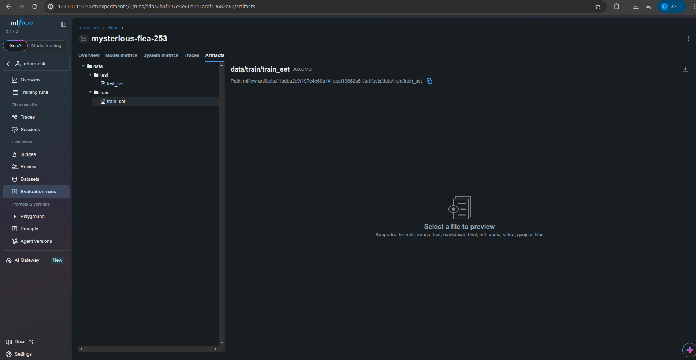
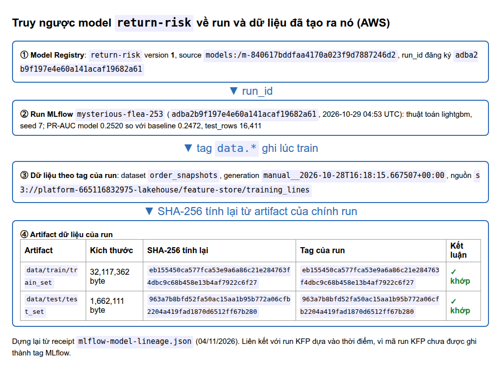

# Training Pipeline và MLflow trên AWS

EDAI-2, dòng 13–14: training ≥4 bước, version model/data và tag.

Code / cấu hình: [Pipeline](../../ml/training_pipeline.py), [train logic](../../ml/train_lib.py).

Các kết quả dưới đây thuộc các lần chạy AWS, không xác nhận dịch vụ đang bật.

## Trên AWS

Kubeflow Pipelines (KFP) 2.17.2 chạy trên EKS. MLflow 3.17.0 chạy trên EC2, artifacts lưu ở S3.

Run KFP `train-aws-3` (ID `0485ebd9-d74f-4db9-9b70-aaac07e5cb24`) chạy thành công (SUCCEEDED) cả 5 bước trong 10 phút 42 giây.
[Receipt AWS](../evidence/aws/data-platform-aws-20261027.json) (mục `ml_eks`) ghi image đã dùng và cỡ mẫu: lấy mẫu 2‰ (hai phần nghìn), được 359.457 dòng.
[Pipeline code](../../ml/training_pipeline.py), [train logic](../../ml/train_lib.py), [Dockerfile](../../docker/Dockerfile.train).

| Bước trong graph | Công việc |
|---|---|
| `load-features` | Đọc training_lines từ S3 offline store, gọi Feast historical features theo event time; Pod Identity `kubeflow/pipeline-runner` cho quyền S3 |
| `split` | Tách train/test theo ngày đặt Order; xuất train_set và test_set |
| `train` | LightGBM trên train_set, xuất model |
| `evaluate` | So PR-AUC model với baseline trên cùng test_set |
| `register` | Ghi model, metrics, metadata và dataset vào MLflow; chỉ đặt production nếu thắng baseline |


MLflow run `mysterious-flea-253` gắn với model `return-risk` v1 và dataset `train (a1f3e3b9)`. Metric trên giao diện:
- PR-AUC của model và của baseline đều hiển thị làm tròn thành 0,25. Không suy ra khoảng cách chính xác giữa hai số
  từ biểu đồ đã làm tròn này (số chính xác ở bảng bên dưới).
- `beats_baseline=1` (model thắng baseline), lift 2,25, prevalence (tỷ lệ nhãn dương) 0,11, tập test 16.411 dòng.

Registry gắn cho v1 các tag `latest=true`, `production=true` và alias `production`.


**Version dữ liệu.** Bước `register` ghi lại dữ liệu đã dùng để train theo ba cách:
- Tag: `data.dataset_version`, `data.generation_id`, `data.train_sha256`, `data.test_sha256`, `data.entity_path`.
- Artifact: `data/train`, `data/test`.
- Dataset input `train`.

Kiểm tra trên AWS (MLflow 3.17.0 trên EC2) bằng [`mlflow_run_data_proof.py`](../../scripts/evidence/mlflow_run_data_proof.py), script kết thúc với mã thoát 0:
1. Gọi REST API của MLflow, tìm run `mysterious-flea-253` (`run_id adba2b9f197e4e60a141acaf19682a61`).
2. Tải hai artifact train và test.
3. Tính lại SHA-256 (mã băm của file) rồi so với tag của chính run đó.

Kết quả đầy đủ: [mlflow-run-data-proof.json](../evidence/aws/mlflow-run-data-proof.json).

| Tập | Artifact | Kích thước | SHA-256 tính lại = tag |
|---|---|---:|---|
| train | `data/train/train_set` | 32.117.362 byte | `eb155450…922c6f27`, **khớp** |
| test | `data/test/test_set` | 1.662.111 byte | `963a7b8b…ff67b280`, **khớp** |

Giá trị ghi trong run:
- Tag: `data.dataset_version = order_snapshots`, `data.entity_path = s3://platform-665116832975-lakehouse/feature-store/training_lines`,
  `data.generation_id = manual__2026-10-28T16:18:15.667507+00:00`, cùng `data.train_sha256` và `data.test_sha256`.
- Tham số: `algo = lightgbm`, `seed = 7`.
- Metric: `test_rows = 16411`, `pr_auc_model = 0,2520` so với `pr_auc_baseline = 0,2472`, `lift_model = 2,247`, `beats_baseline = 1`.

Giao diện MLflow của chính run này (ảnh dưới) hiện các Tags (`data.dataset_version`, `data.generation_id`, `data.train_sha256`, `data.test_sha256`, `data.entity_path`), dataset input `train (a1f3e3b9)` và model đã đăng ký `return-risk v1`.

### Kiểm tra thống kê của kết quả (notebook)

Notebook [`05_retrain_and_bootstrap`](../../notebooks/05_retrain_and_bootstrap.ipynb) huấn luyện lại bằng đúng `ml/train_lib.py` trên tập train/test của run (SHA-256 khớp tag MLflow):

| Kiểm tra | Kết quả |
|---|---|
| Tái lập số MLflow | PR-AUC model 0,2520 và baseline 0,2472 khớp tuyệt đối (chênh 0) |
| Chênh model − baseline | +0,0048. Bootstrap 1.000 lần (lấy mẫu lại có hoàn lại): khoảng tin cậy 95% là `[-0,0003; +0,0099]`; model hơn baseline ở khoảng 96% số mẫu |
| 5 seed (7–11) | model 0,2512–0,2532 (độ lệch chuẩn 0,0008), cả 5 đều hơn baseline |
| Tầm quan trọng | ~85% ở `return_or_refund_rate_90d`, cột mà baseline cũng dùng |

Kết luận: kết quả tái lập được, và model có xu hướng hơn baseline. Nhưng khoảng tin cậy chạm 0, nên **chưa khẳng định** được model tốt hơn một rule đơn giản. Ngoài ra bootstrap coi các dòng là độc lập với nhau, nên khoảng tin cậy thật có thể còn rộng hơn.



Tab Artifacts có hai thư mục `data/train` và `data/test` (`train_set` 30,63 MiB = 32.117.362 byte, đúng kích thước script đo).



**Truy ngược từ model về dữ liệu và lần train.** Cùng script đó, nhưng xuất phát từ model đang phục vụ:
`python3 scripts/evidence/mlflow_run_data_proof.py --model return-risk --version 1`. Script làm ba bước:
1. Lấy model version `return-risk` v1 từ registry.
2. Đi tới run đã đăng ký version đó (`run_id`, tên run, thời điểm, tham số, metric).
3. So tag SHA-256 với artifact `data/train`, `data/test` của chính run đó.

Kết quả là một chuỗi liên kết: model v1, tới run, tới mã băm dữ liệu, tới file dữ liệu. Riêng liên kết giữa run MLflow
và run KFP thì dựa vào ảnh KFP cùng ngày ([`kfp-runs-20261029.png`](../evidence/aws/kfp-runs-20261029.png)) và thời
điểm chạy, vì code `register` chưa ghi mã run KFP thành tag MLflow.

Kết quả trên AWS ([mlflow-model-lineage.json](../evidence/aws/mlflow-model-lineage.json)):

| Bước truy ngược | Giá trị |
|---|---|
| Model trong registry | `return-risk` **v1**, `source = models:/m-840617bddfaa4170a023f9d7887246d2` |
| Run đã đăng ký model | `mysterious-flea-253`, `run_id adba2b9f197e4e60a141acaf19682a61` (khớp run đã chụp ở trên) |
| Dữ liệu train/test của run | `data/train/train_set`, `data/test/test_set`, SHA-256 tính lại **khớp** hai tag `data.train_sha256`, `data.test_sha256` |

Vậy từ model `return-risk` v1 đi ngược tới đúng run đã train ra nó và đúng hai tập dữ liệu (theo mã băm) mà run đó dùng. Mã run KFP không có trong MLflow
nên liên kết run MLflow ↔ run KFP vẫn dựa vào ảnh KFP và thời điểm run.


Ảnh trên **dựng lại từ receipt** [mlflow-model-lineage.json](../evidence/aws/mlflow-model-lineage.json) bằng [`render_model_lineage.py`](../../scripts/evidence/render_model_lineage.py), không phải ảnh chụp giao diện MLflow;
các ảnh giao diện của cùng run (Tags, Artifacts, Registry) nằm ở các mục trên. Mốc 04:53 UTC (11:53 giờ Việt Nam) của run khớp thời điểm đăng ký version 1 trong ảnh Registry (11:53:47). Giới hạn: chưa có ảnh chụp trang
**Model Version 1** hiển thị liên kết *Source run*; trang đó nên được chụp ở lần bật MLflow tiếp theo.

Receipt ghi các lần chạy lỗi trước đó, nguyên nhân là "OOM/đọc file store" (OOM = hết bộ nhớ) và port-forward. Ở lần chạy thành công này, cache của KFP được tắt.

<details>
<summary>Tham khảo: thiết kế, hướng dẫn phát triển và ghi nhận trước triển khai AWS</summary>

Các ghi nhận local giữ nguyên môi trường, không dùng thay bằng chứng cloud.

<!-- Mục đích: pipeline train model return-risk trên Kubeflow + version ở MLflow -->
## Train model return-risk — Kubeflow Pipelines + MLflow

Pipeline Kubeflow gồm các bước: load từ offline feature store, split, train, evaluate.
Mỗi run lưu model, dữ liệu và metadata lên MLflow, rồi tự gắn tag `latest` / `production`.

## Đường đi

```
s3://platform/feature-store/training_lines   (Spark export_training_lines.py: line có nhãn + thuộc tính lúc đặt)
   │ ① load_features: Feast get_historical_features — PIT join sku_return_daily + sku_return_24h
   ▼ ② split: test = `test_days` ngày đặt đơn cuối (không chia ngẫu nhiên)
   ▼ ③ train: LightGBM, seed cố định
   ▼ ④ evaluate: PR-AUC model vs baseline (tỷ lệ trả 90 ngày của SKU) trên CÙNG tập test
   ▼ ⑤ register: MLflow run (param, metric, model, file train/test + sha256, dataset_version)
        → model "return-risk" version mới: tag latest=true; alias + tag production CHỈ khi thắng baseline
```

| Thành phần | File |
|---|---|
| Logic thuần (test được không cần KFP) | [`ml/train_lib.py`](../../ml/train_lib.py), test [`tests/unit/test_train_lib.py`](../../tests/unit/test_train_lib.py) |
| Pipeline KFP 5 bước | [`ml/training_pipeline.py`](../../ml/training_pipeline.py) |
| Image các bước | [`docker/Dockerfile.train`](../../docker/Dockerfile.train) (dựng trên `platform-feast`) |
| Xuất tập train | [`spark_jobs/gold/export_training_lines.py`](../../spark_jobs/gold/export_training_lines.py), task `export_training_lines` của DAG `ml_feature_materialize` |
| MLflow server | service `mlflow` (profile `ml`), [`docker/Dockerfile.mlflow`](../../docker/Dockerfile.mlflow) |
| Submit | [`scripts/run/run_training_pipeline.sh`](../../scripts/run/run_training_pipeline.sh) |

## Quyết định

- **Chỉ dùng feature biết được lúc đặt đơn**: lấy từ `fact_order_lines` (kênh, account, số lượng, tiền, đơn giá),
  cộng feature SKU từ Feast. Bỏ mọi cột chỉ biết sau khi đặt (giao, hủy, trả, hoàn), vì dùng chúng là leakage
  (lộ đáp án vào dữ liệu train).
- **Cổng vào production**: model phải thắng baseline về PR-AUC. Nếu thua, version vẫn được lưu (tag `latest`) nhưng
  không được deploy. MLflow cấm đặt alias tên `latest` (vì `models:/return-risk/latest` đã mang sẵn nghĩa đó), nên
  `latest` là **tag**; còn `production` vừa là alias (dùng để deploy) vừa là tag.
- **Tắt job execution của MLflow** (`MLFLOW_SERVER_ENABLE_JOB_EXECUTION=false`): tính năng này chạy 7 tiến trình huey
  tốn khoảng 1 GB RAM và từng làm container bị OOM-kill. Tracking và registry không cần tới nó.

## Phát hiện: dữ liệu v2 mặc định không có tín hiệu

Run đầu (bộ `small`, 3.325 line, test 757 line) cho PR-AUC model **0,287**, baseline **0,291**, prevalence **0,291**.
PR-AUC bằng prevalence nghĩa là cả model lẫn baseline chỉ ngang đoán mò.

Nguyên nhân: `generator/generate_order_lifecycle.py` chọn kịch bản trả/hoàn **độc lập** với SKU, kênh và giá (mọi line
cùng giá, cùng số lượng), nên dữ liệu không có gì để học. Cổng production đã chặn đúng model này.

Cách sửa: thêm tuỳ chọn `--sku-return-skew S`.
- Mặc định S = 0 cho dữ liệu y như cũ; đã kiểm 3.631/3.631 line không đổi nội dung.
- S > 0: mỗi SKU có hệ số `exp(S·z)`, với `z ~ N(0,1)` cố định theo SKU, nhân thêm hệ số theo kênh. Có test
  `test_sku_return_skew_creates_learnable_signal`.
- Bộ small với S = 1,0: tỷ lệ trả theo SKU dao động từ 7% đến 54%, tổng vẫn khoảng 29%.

## Chạy local

```bash
docker compose --profile ml up -d mlflow                     # UI http://localhost:5050
kubectl --context kind-platform apply -k "github.com/kubeflow/pipelines/manifests/kustomize/cluster-scoped-resources?ref=2.17.2"
kubectl --context kind-platform apply -k "github.com/kubeflow/pipelines/manifests/kustomize/env/platform-agnostic?ref=2.17.2"
## Script submit tự build/push platform-train:<git-SHA> rồi biên dịch KFP với cùng image.
scripts/setup/setup_kind_registry.sh
scripts/run/run_training_pipeline.sh train-N                 # UI KFP: kubectl port-forward svc/ml-pipeline-ui 8888:80
```

## Bằng chứng

Run `train-3` (KFP 2.17.2 trong kind): **SUCCEEDED** cả 5 bước.

| Mục | Giá trị |
|---|---|
| Tập train / test | 2.568 / 757 line (test = 10 ngày cuối), prevalence test 0,291 |
| PR-AUC model / baseline | 0,287 / 0,291, nên `beats_baseline = false` |
| MLflow | model `return-risk` **v2**: tag `latest=true`, `production=false`, không alias production |
| Version dữ liệu (tag run) | `data.dataset_version`, `data.generation_id`, `data.train_sha256`, `data.test_sha256`, `data.entity_path`; artifact `data/train`, `data/test`; dataset input `train` |

Đây là dữ liệu **không có tín hiệu** (xem mục trên), nên cổng production từ chối là đúng. Muốn có version
`production` cho KServe thì chạy lại trên bộ dữ liệu sinh với `--sku-return-skew`.

</details>

[Mục lục phần này](README.md) · [Mục lục chung](../README.md)
