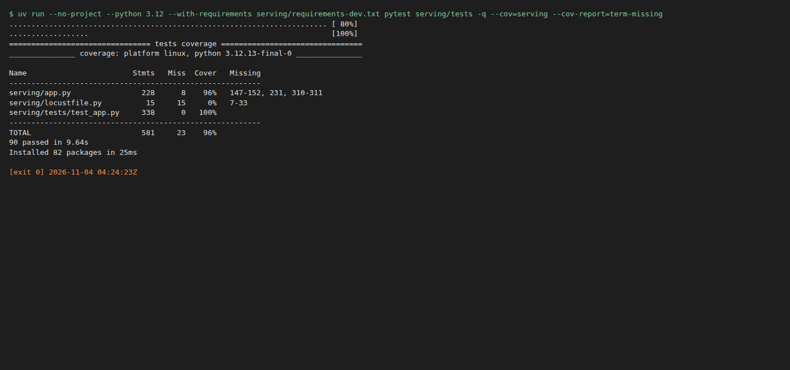
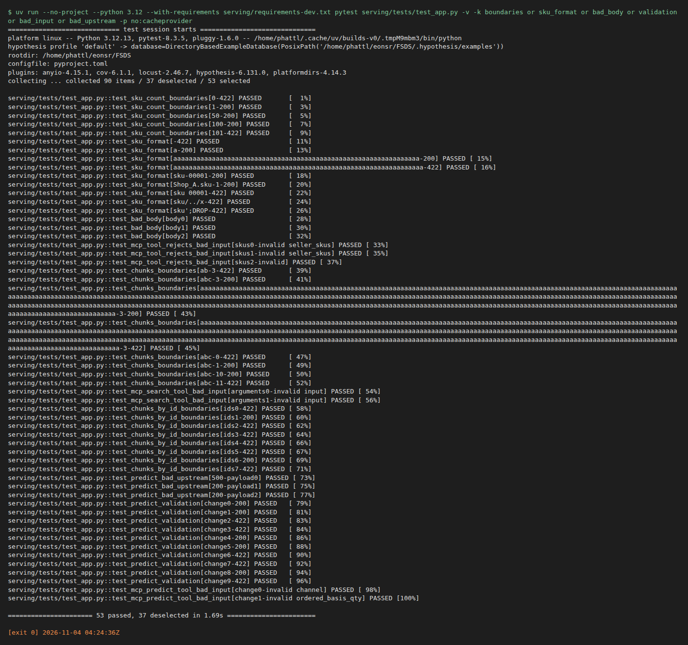
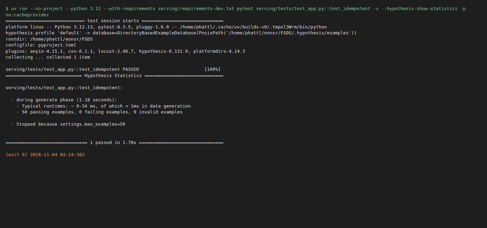
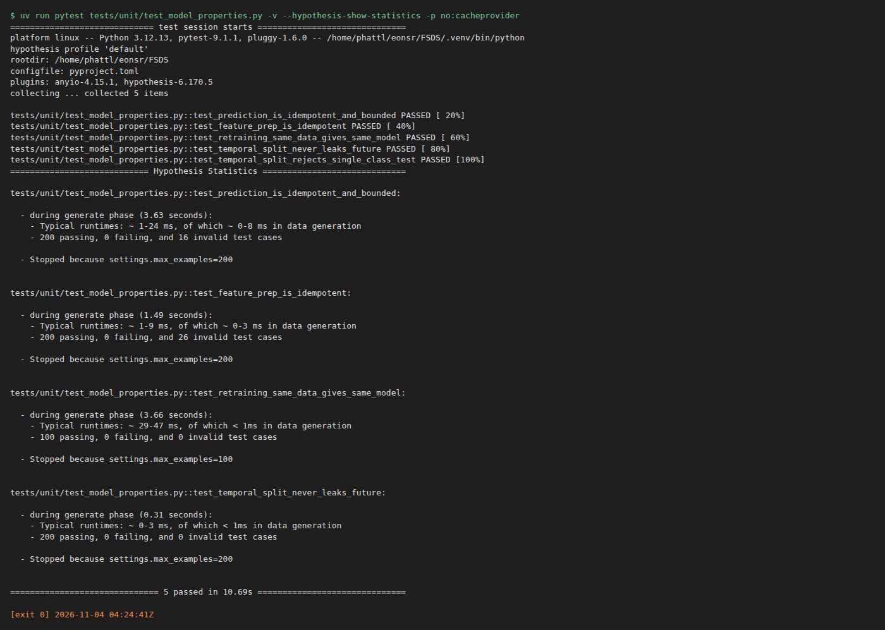

# Validation và Verification

EDAI-2, dòng 28–32: coverage >90%, EP/BVA, mutation >80%, property-based và Locust.

## Kiểm chứng code, 31/10/2026

PR testing chạy trên máy phát triển, không gắn nhãn test chạy AWS. `serving/app.py` đạt **98%**, tổng **96%**, 86 test pass. [Test API](../../serving/tests/test_app.py) dùng fixture, MagicMock/AsyncMock và httpx MockTransport. EP/BVA kiểm số SKU 0/1/50/100/101 và độ dài 0/1/64/65; Hypothesis kiểm idempotency khi gọi lại request hoặc gửi SKU lặp. [Model properties](../../tests/unit/test_model_properties.py) kiểm prediction/training nhất quán và split theo thời gian.


### Ảnh từng loại kiểm thử, 04/11/2026

Các ảnh dưới là **output terminal thật** của lần chạy ngày 04/11 trên máy phát triển, do
[`capture_testing_evidence.py`](../../scripts/evidence/capture_testing_evidence.py) chạy rồi chụp (kèm file `.txt` cùng tên). Sau 31/10 test và code đã đổi
nên số khác ảnh coverage 31/10 ở trên: **90 test pass, `serving/app.py` 96%, tổng 96%** (vẫn trên ngưỡng 90%).

**Coverage** (`pytest --cov=serving`): [`testing-coverage-20261104.txt`](../evidence/testing-coverage-20261104.txt)



**EP/BVA** — 53 test theo lớp tương đương và biên (số SKU 0/1/100/101, định dạng SKU, body sai kiểu, `top_k`, trường dự đoán thiếu hoặc sai):



**Property-based (hypothesis)** — API (`test_idempotent`) và model (bất biến dự đoán, tách thời gian không rò rỉ tương lai, huấn luyện lại cùng dữ liệu ra cùng model):





Mutation (mutmut) có ảnh ở mục dưới; **Locust** chạy trên EKS nên ảnh Locust lấy từ lần chạy EKS (chưa chụp thêm ảnh terminal/Locust UI cho lần đó).

## Mutation testing (mutmut)

### Kết quả lịch sử 31/10: toàn bộ file

Cấu hình [`[tool.mutmut]`](../../pyproject.toml) chọn `serving/app.py`, dùng bộ test
[`serving/tests/test_app.py`](../../serving/tests/test_app.py) và sao chép `rag` để test các nhánh RAG.
Chạy offline với dependency đã cache (mutmut 3.3.1):

```bash
UV_OFFLINE=1 uv run --offline --no-project --python 3.12 --with-requirements serving/requirements-dev.txt mutmut run --max-children 2
UV_OFFLINE=1 uv run --offline --no-project --python 3.12 --with-requirements serving/requirements-dev.txt mutmut results
```

Lần chạy 2026-10-31 (laptop, 4 tiến trình, ~2,5 phút): **171 mutant** trên `serving/app.py`.

| Kết quả | Số | Nghĩa |
|---|---:|---|
| killed | 138 | test fail khi code bị đổi ⇒ test bắt được |
| timeout | 19 | test chạy quá giới hạn thời gian của mutmut (code bị đổi làm request treo) — coi là bắt được |
| no tests | 9 | `load_store` nạp Feast thật; test thay bằng `store_factory` giả nên không chạy hàm này (cố ý) |
| survived | 5 | cả 5 là **mutant tương đương** (dưới) |

**Mutation score** = (killed + timeout) / (171 − no tests) = 157/162 = **96,9%** (chỉ tính killed: 138/162 = 85,2%).

5 mutant sống, xem bằng `mutmut show <tên>`:
- `x_fetch_features__mutmut_29/32/33`: `zip(VIEWS.values(), results, strict=True)` → `strict=None`/`False`/bỏ.
  `results` sinh từ `asyncio.gather` trên chính `VIEWS` nên hai dãy luôn dài bằng nhau; `strict` không bao giờ đổi
  hành vi ⇒ tương đương, không viết được test giết nó.
- `x_create_app__mutmut_17/25`: `host="0.0.0.0"` của MCP → `None` / `"XX0.0.0.0XX"`. SDK MCP chỉ bật chặn
  DNS-rebinding khi host là `localhost`/`127.0.0.1`; mọi giá trị khác cho cùng hành vi ⇒ tương đương.


Ảnh dựng từ [output thật](../evidence/mutmut-serving-20261031.txt) (giữ đủ danh sách timeout/no tests); bỏ dòng
timeout/no tests trong ảnh cho gọn. Lần chạy đầu trong sandbox của công cụ AI bị treo vì sandbox chặn socket nội bộ
(`TestClient` cần), không phải lỗi test.

Lần 31/10 mutate toàn bộ `serving/app.py`; chưa có bước chọn file từ Git diff. Kết quả đó giữ nguyên
là bằng chứng lịch sử, không dùng để chứng minh chỉ mutate code thay đổi.

### Chọn file thay đổi theo Git

[`run_changed_mutation.py`](../../scripts/evidence/run_changed_mutation.py) nhận hai mốc Git `--base` và
`--head`, resolve thành commit SHA đầy đủ rồi lấy file Python thêm/sửa bằng `git diff --no-renames
--diff-filter=AM --name-only`. Đổi tên được xét như xóa file cũ và thêm file mới; file bị xóa không mutate.
Script loại test, lấy giao với `paths_to_mutate` của cấu hình Web API (hiện là `serving/app.py`), rồi ghi
toàn bộ danh sách đã chọn và bị loại vào manifest. Các module DAG, ML và feature publication ngoài scope
Web API không được tính là đã kiểm chứng bằng lần chạy này.

Script xuất code và test **đúng tại head** sang thư mục tạm, tạo cấu hình mutmut riêng chỉ chứa các file
được chọn. Working tree và cấu hình gốc không bị sửa; thay đổi chưa commit không nằm trong snapshot.
`also_copy` gồm `rag` và `feature_repo` để import dependency nội bộ của API, các module này không bị mutate.
Đây là chọn theo **file thay đổi**, vẫn mutate toàn bộ file; không giới hạn từng dòng đổi.

Chạy từ gốc repo với Python 3.12 và dependency trong `serving/requirements-dev.txt`:

```bash
# Xem trước phạm vi, chưa chạy mutation.
uv run --no-project --python 3.12 --with-requirements serving/requirements-dev.txt \
  python scripts/evidence/run_changed_mutation.py \
  --base '89cd44e^' --head 89cd44e --dry-run --output out/mutation-plan

# Chạy thật trên cùng hai mốc; output phải là thư mục mới.
uv run --no-project --python 3.12 --with-requirements serving/requirements-dev.txt \
  python scripts/evidence/run_changed_mutation.py \
  --base '89cd44e^' --head 89cd44e --max-children 2 --output out/mutation-changed
```

Khi kiểm thay đổi khác, thay hai ref bằng base/head cần đánh giá; script so trực tiếp hai cây commit,
không tự tìm merge-base. Không có file phù hợp thì manifest ghi `skipped`, không ghi `passed`.
`--dry-run` có file phù hợp ghi `planned`. Log `run.txt`, kết quả từng mutant `results.txt`, cấu hình
`mutation-config.toml` và `manifest.json` được giữ ở output; manifest có SHA code, SHA cấu hình và phiên bản mutmut.

Ngưỡng pass của script là **killed / tổng mutant >80%**, tính cả `no tests` trong mẫu số và không gộp timeout
vào killed. Manifest ghi thêm hai cách tính có loại `no tests` để đối chiếu với báo cáo lịch sử.
Mutant chưa kiểm, lỗi chạy, kết quả rỗng hoặc score không đạt làm script trả lỗi; skip không phải kết quả đạt rubric.

### Kết quả local 03/11/2026: file được chọn từ Git diff

So base `3cd3fcd` (`89cd44e^`) với head `89cd44e`: có 11 file Python thêm/sửa trong toàn commit,
nhưng giao với scope Web API chỉ chọn **`serving/app.py`**. Test API và các module ngoài scope được liệt kê
ở `excluded_files`, không được tính là đã mutation-test trong lần này.
Mutmut 3.3.1 chạy 2 tiến trình, hoàn tất trong khoảng 3 phút 31 giây, exit code 0.

| Kết quả | Số mutant |
|---|---:|
| Killed | 219 |
| Survived | 12 |
| No tests | 14 |
| Timeout | 0 |
| Tổng | 245 |

**Score bảo thủ = 219/245 = 89,4% >80%**, tính cả `no tests` trong mẫu số.
Nếu loại `no tests`, score = 219/231 = **94,8%**. Chưa kết luận 12 mutant sống là tương đương;
14 mutant không có test vẫn là giới hạn của bộ test. Các trạng thái còn lại bằng 0, không có mutant chưa kiểm.

Bằng chứng: [manifest và SHA code](../evidence/mutation-changed-serving-20261103.json),
[log chạy](../evidence/mutation-changed-serving-20261103.txt),
[kết quả từng mutant](../evidence/mutation-changed-serving-results-20261103.txt),
[cấu hình thực chạy](../evidence/mutation-changed-serving-config-20261103.toml).
Đây là kiểm chứng local, giới hạn theo file thay đổi trong scope Web API, không phải theo dòng và không phải run Jenkins/AWS.

#### Load test trên EKS

Locust chạy trên laptop (Việt Nam), đi qua `kubectl port-forward svc/feature-api` tới cụm ở Sydney
(ap-southeast-2); 20 user, 60 s, cùng [`serving/locustfile.py`](../../serving/locustfile.py), SKU thật
`APP-00042,APP-00482,ELE-01103`. Đi port-forward để tránh rate limit 50 r/s của ingress.

| Request | Số | Lỗi | p50 | p95 | p99 | req/s |
|---|---:|---:|---:|---:|---:|---:|
| `POST /features` | 1.999 | 0 | 250 ms | 270 ms | 290 ms | 33,6 |
| `POST /features [batch]` | 530 | 0 | 250 ms | 270 ms | 280 ms | 8,9 |
| `GET /healthz` | 475 | 0 | 250 ms | 270 ms | 280 ms | 8,0 |
| **Tổng** | **3.004** | **0** | 250 ms | 270 ms | 290 ms | **50,5** |

Báo cáo HTML: [`evidence/aws/load-test-feature-api-20261030.html`](../evidence/aws/load-test-feature-api-20261030.html).

Đọc số: `/healthz` không làm gì cũng mất ~250 ms ⇒ gần hết là đường mạng laptop → Sydney, không phải API.
Phía server (`http_request_duration_seconds` của pod nhận tải): `/features` trung bình **1,8 ms**
(4,57 s / 2.536 request). Port-forward dồn hết vào 1 pod; req/s bị chặn bởi 20 user × ~250 ms mạng, không phải
bởi API. 0 lỗi.

[Mục lục phần này](README.md) · [Mục lục chung](../README.md)
