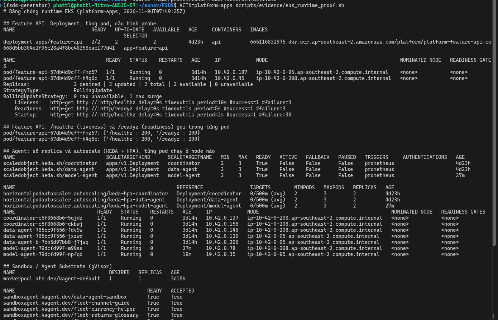
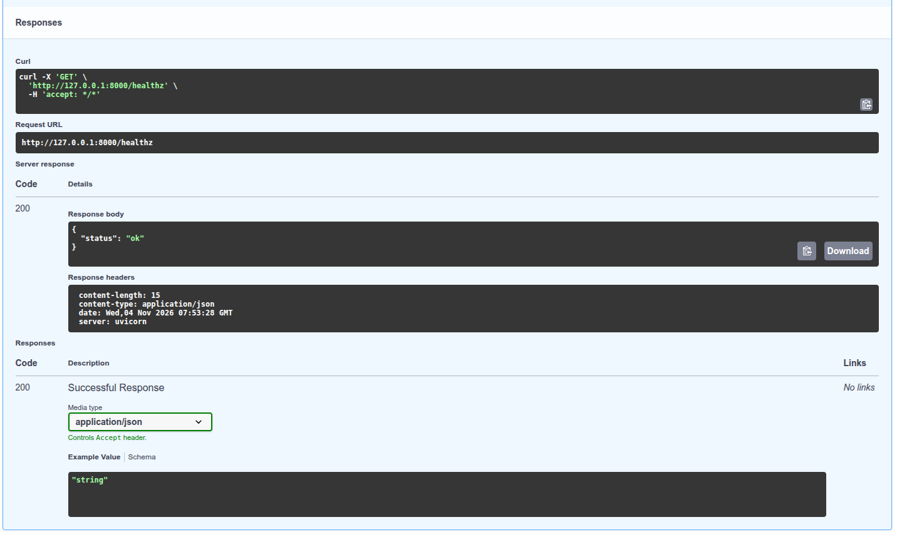
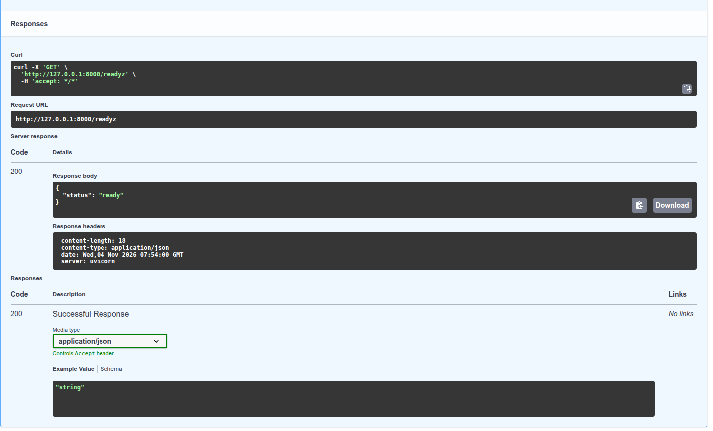
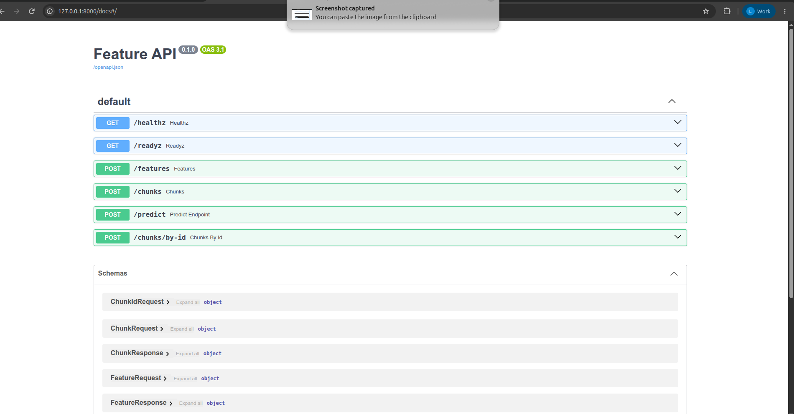
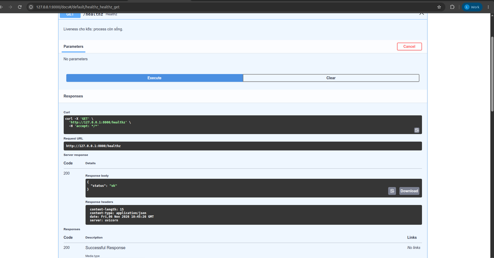
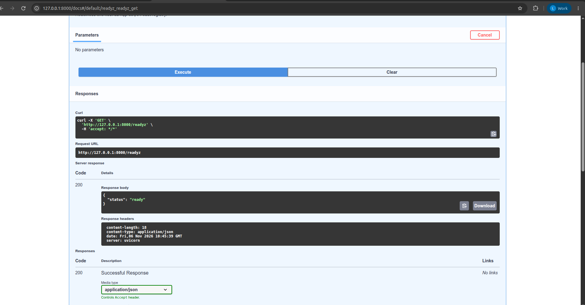
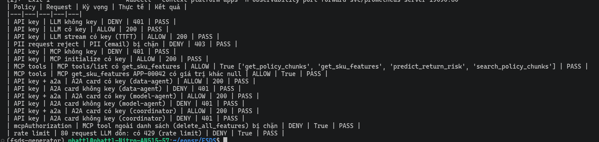

# Web API và MCP trên EKS

EDAI-2, dòng 16–18: FastAPI/Pydantic, healthcheck, async, MCP và Helm rolling/fallback.

Code / cấu hình: [API](../../serving/app.py), [Helm values](../../infra/helm/feature-api/values.yaml). [Kiểm thử API và tải EKS](validation_verification.md).

Các kết quả dưới đây thuộc các lần chạy AWS được ghi ngày, không xác nhận dịch vụ đang bật.

### Trên EKS, 2026-10-30

Feature API (helm, 2 replica) sau ingress HTTPS `https://api.<ip>.sslip.io` (cert Let's Encrypt). `helm upgrade` lên
image `813627b-pii1` (làm tròn số, xem [LLM và agent](reference/llm_platform_agents.md#trên-eks-2026-10-30)) là revision 2,
rolling không gián đoạn.


Ảnh Swagger ở trên chỉ thấy `/features` và `/predict`; probe và health có bằng chứng riêng (04/11/2026, cluster `platform-apps`).

**Probe cấu hình trong Deployment** (output [`eks_runtime_proof.sh`](../../scripts/evidence/eks_runtime_proof.sh), file [eks-runtime-proof.txt](../evidence/aws/eks-runtime-proof.txt)):
Deployment `feature-api` 2/2 pod chạy ở hai node khác nhau, `RollingUpdate` với `0 max unavailable, 1 max surge`;
`Liveness` gọi `/healthz` (chu kỳ 10 s, ngưỡng lỗi 3), `Readiness` gọi `/readyz` (5 s, ngưỡng lỗi 3), `Startup` gọi `/healthz` (2 s, tối đa 30 lần).
Lệnh gọi `/healthz` và `/readyz` **trong từng pod** đều trả `200`.



**Gọi qua Swagger** (port-forward `svc/feature-api`, `http://127.0.0.1:8000/docs`): `GET /healthz` trả `200 {"status": "ok"}` và `GET /readyz` trả `200 {"status": "ready"}`.





**Swagger 06/11/2026 (EKS, port-forward `svc/feature-api`):** ảnh tổng quan liệt kê sáu endpoint (`/healthz`, `/readyz`, `/features`, `/chunks`, `/predict`, `/chunks/by-id`);
`/metrics` cố ý ẩn khỏi schema (`include_in_schema=False`), Prometheus lấy số đo ở đó. Hai ảnh sau gọi trực tiếp từ Swagger.







#### MCP server trên EKS

MCP server (thư viện `mcp`, chế độ stateless + JSON, đường dẫn `/mcp/`) chạy **pod riêng**, tách khỏi pod REST:

```text
agentgateway /mcp ──► Service feature-mcp ──► pod feature-mcp-*  (API_SURFACE=mcp: /mcp/, /healthz, /readyz, /metrics)
Ingress api.…     ──► Service feature-api ──► pod feature-api-*  (API_SURFACE=rest: /features, /predict, /chunks, …)
                                  cả hai ──► Feast/Redis, KServe return-risk, pgvector
```

Hai release Helm (`feature-api`, `feature-mcp`) dùng chung chart [`infra/helm/feature-api`](../../infra/helm/feature-api/), chung image và code
[`serving/app.py`](../../serving/app.py) (`create_app(surface=…)`); [`values-mcp.yaml`](../../infra/helm/feature-api/values-mcp.yaml) đặt `surface: mcp`, Service ClusterIP.
Mỗi release có Deployment, probe, Helm `--atomic` và ScaledObject riêng ⇒ MCP scale và rollback độc lập với REST.
Test: `test_surface_splits_rest_and_mcp_pods` (pod REST trả 404 ở `/mcp/`, pod MCP trả 404 ở `/features`).

Ghi chú: smoke và các ảnh dưới đây (30/10–06/11) chụp **trước khi tách**, lúc MCP còn mount trong pod Feature API; tool, route gateway và kết quả không đổi.

Bốn tool dùng chung code với REST:

| Tool | Làm gì | REST tương ứng |
|---|---|---|
| `get_sku_features(seller_skus)` | feature online từ Feast/Redis | `POST /features` |
| `predict_return_risk(...)` | gọi KServe `return-risk` | `POST /predict` |
| `search_policy_chunks(query, top_k)` | tìm chính sách trả hàng (RAG, pgvector) | `POST /chunks` |
| `get_policy_chunks(chunk_ids)` | lấy chunk theo id | `POST /chunks/by-id` |

Agent không gọi thẳng pod mà đi qua route `/mcp` của [agentgateway](agent_gateways.md) (API key, chỉ cho phép bốn tool trên).
Smoke trên EKS ngày 06/11 ([gateway-smoke-20261106.json](../evidence/aws/gateway-smoke-20261106.json), **24/24 PASS**):
MCP không key → 401; `initialize` có key → 200; `tools/list` trả đủ bốn tool;
`get_sku_features` có giá trị, `predict_return_risk` có `score` và `model_version`, `search_policy_chunks` trả ≥ 1 chunk; tool ngoài danh sách bị chặn.



MCP server đã đăng ký trong Agent Registry, và Grafana đếm từng lượt gọi tool theo kết quả (`mcp_tool_calls_total{tool,outcome}` do Feature API xuất ra):


Agent dùng các tool này: [Data Agent / Model Agent](agents.md), cấu hình route và backend MCP: [Agent Gateways](agent_gateways.md).

Tại ảnh API ngày 30/10, `approved_returns_24h` còn `null`. Lần chạy stream AWS sau đó đã có dữ liệu: [Streaming Feature](stream_features.md).

#### Helm rolling update và tự rollback trên EKS, 04/11/2026

Chạy [`helm_rollout_fallback_test.sh`](../../scripts/evidence/helm_rollout_fallback_test.sh) trên cluster `platform-apps` (release `feature-api`, namespace `feature-store`): một pod probe **trong cluster** gửi `POST /features`
mỗi 0,2 giây suốt hai lần `helm upgrade --atomic`. Log đầy đủ: [feature-api-helm-rollout.txt](../evidence/aws/feature-api-helm-rollout.txt).

| Bước | Kết quả |
|---|---|
| 1. Rolling update tốt (đổi `envChecksum`, `--timeout 4m`) | revision **13** `deployed`; rolling update `maxUnavailable 0, maxSurge 1` |
| 2. Bản hỏng (`envSecret=does-not-exist`, `--timeout 90s`) | pod mới `CreateContainerConfigError: secret "does-not-exist" not found`; revision **14** `failed` (`context deadline exceeded`) |
| 3. Tự rollback (`--atomic`) | Helm tạo revision **15** `deployed`, mô tả `Rollback to 13`; hai pod cũ chạy suốt, không bị thay |
| Tải liên tục trong cả hai lần upgrade | **763 request, 763 trả 200**, không có lỗi |

`helm history` sau cùng: 13 `superseded`, 14 `failed`, 15 `deployed` (`Rollback to 13`). Đây là bằng chứng cho cả hai yêu cầu: rolling update không gián đoạn và tự fallback khi bản mới không khởi động được.
Ghi nhận cũ của lần chạy local ngày 21/10 (583/583 request, rollback revision 12 → 13) vẫn ở mục tham khảo bên dưới.

#### Load test trên EKS

Locust chạy trên laptop (Việt Nam), đi qua `kubectl port-forward svc/feature-api` tới cụm ở Sydney
(ap-southeast-2); 20 user, 60 s, cùng [`serving/locustfile.py`](../../serving/locustfile.py), SKU thật
`APP-00042,APP-00482,ELE-01103`. Đi port-forward để tránh rate limit 50 r/s của ingress.

| Request | Số | Lỗi | p50 | p95 | p99 | req/s |
|---|---:|---:|---:|---:|---:|---:|
| `POST /features` | 1.999 | 0 | 250 ms | 270 ms | 290 ms | 33,6 |
| `POST /features [batch]` | 530 | 0 | 250 ms | 270 ms | 280 ms | 8,9 |
| `GET /healthz` | 475 | 0 | 250 ms | 270 ms | 280 ms | 8,0 |
| **Tổng** | **3.004** | **0** | 250 ms | 270 ms | 290 ms | **50,5** |

Báo cáo HTML: [`evidence/aws/load-test-feature-api-20261030.html`](../evidence/aws/load-test-feature-api-20261030.html).

Đọc số: `/healthz` không làm gì cũng mất ~250 ms ⇒ gần hết là đường mạng laptop → Sydney, không phải API.
Phía server (`http_request_duration_seconds` của pod nhận tải): `/features` trung bình **1,8 ms**
(4,57 s / 2.536 request). Port-forward dồn hết vào 1 pod; req/s bị chặn bởi 20 user × ~250 ms mạng, không phải
bởi API. 0 lỗi.

<details>
<summary>Tham khảo: thiết kế, hướng dẫn phát triển và ghi nhận trước triển khai AWS</summary>

Các ghi nhận local giữ nguyên ngày và môi trường, không dùng thay bằng chứng cloud.

<!-- Mục đích: Web API kéo feature SKU từ kho ONLINE, -->
## Web API kéo feature — ML Platform / LLM Platform

FastAPI + pydantic + healthcheck cho k8s, dùng async.

```
Agent / client ──POST /features {"seller_skus": [...]}──► serving/app.py
                                                            │ await get_online_features_async
                                                            ▼
                                             Feast registry (MinIO) + Redis (kind platform)
```

| Endpoint | Việc |
|---|---|
| `GET /healthz` | liveness: process còn sống |
| `GET /readyz` | readiness: đã nạp Feast registry, chưa nạp → 503 |
| `POST /features` | 1–100 SKU (`^[A-Za-z0-9_.-]{1,64}$`), trả 4 feature mỗi SKU |

Mỗi feature view được tra riêng và song song (`asyncio.gather`). SKU chưa có trong Redis,
hoặc một view lỗi/chưa đăng ký → feature của view đó là `null`. Chỉ khi **mọi** view lỗi mới trả 503.

Feature trả về: `labeled_count_90d`, `positive_count_90d`, `return_or_refund_rate_90d`
(view `sku_return_daily`), `approved_returns_24h` (view `sku_return_24h`).
SKU trùng trong request chỉ tra một lần, kết quả giữ thứ tự lần xuất hiện đầu.

`POST /chunks` `{"query": "...", "top_k": 3}` (query 3–500 ký tự, top_k 1–10) tìm đoạn chính sách trả hàng
trong Feast RAG (pgvector); chỉ bật khi pod có `FEAST_RAG_REGISTRY`, nếu không trả 503. Pipeline nạp chunk:
[`docs/edai-2/rag_pipeline.md`](rag_pipeline.md).

Code: [`serving/app.py`](../../serving/app.py). Test: [`serving/tests/test_app.py`](../../serving/tests/test_app.py).

## Test

```bash
uv run --no-project --python 3.12 --with-requirements serving/requirements-dev.txt \
  pytest serving/tests -o pythonpath=. --cov=serving --cov-report=term-missing
```

Kết quả 2026-10-21: 84 pass, coverage `serving/app.py` 98% (chỉ thiếu `load_store`, phần nạp Feast thật).

| Kỹ thuật | Ở đâu |
|---|---|
| fixture + mock | `store` (MagicMock + AsyncMock giả `get_online_features_async`), `client` |
| Equivalence partitioning + boundary value | `test_sku_count_boundaries` (0 / 1 / 50 / 100 / 101 SKU), `test_sku_format` (độ dài 0 / 1 / 64 / 65, ký tự lạ) |
| Property-based (idempotency) | `test_idempotent` (Hypothesis): gọi 2 lần và gửi lặp SKU ra cùng kết quả |

## Mutation testing (mutmut)

Cấu hình [`[tool.mutmut]`](../../pyproject.toml) chọn `serving/app.py`, dùng bộ test
[`serving/tests/test_app.py`](../../serving/tests/test_app.py) và sao chép `rag` để test các nhánh RAG.
Chạy offline với dependency đã cache (mutmut 3.3.1):

```bash
UV_OFFLINE=1 uv run --offline --no-project --python 3.12 --with-requirements serving/requirements-dev.txt mutmut run --max-children 2
UV_OFFLINE=1 uv run --offline --no-project --python 3.12 --with-requirements serving/requirements-dev.txt mutmut results
```

Lần chạy 2026-10-31 (laptop, 4 tiến trình, ~2,5 phút): **171 mutant** trên `serving/app.py`.

| Kết quả | Số | Nghĩa |
|---|---:|---|
| killed | 138 | test fail khi code bị đổi ⇒ test bắt được |
| timeout | 19 | test chạy quá giới hạn thời gian của mutmut (code bị đổi làm request treo) — coi là bắt được |
| no tests | 9 | `load_store` nạp Feast thật; test thay bằng `store_factory` giả nên không chạy hàm này (cố ý) |
| survived | 5 | cả 5 là **mutant tương đương** (dưới) |

**Mutation score** = (killed + timeout) / (171 − no tests) = 157/162 = **96,9%** (chỉ tính killed: 138/162 = 85,2%).

5 mutant sống, xem bằng `mutmut show <tên>`:
- `x_fetch_features__mutmut_29/32/33`: `zip(VIEWS.values(), results, strict=True)` → `strict=None`/`False`/bỏ.
  `results` sinh từ `asyncio.gather` trên chính `VIEWS` nên hai dãy luôn dài bằng nhau; `strict` không bao giờ đổi
  hành vi ⇒ tương đương, không viết được test giết nó.
- `x_create_app__mutmut_17/25`: `host="0.0.0.0"` của MCP → `None` / `"XX0.0.0.0XX"`. SDK MCP chỉ bật chặn
  DNS-rebinding khi host là `localhost`/`127.0.0.1`; mọi giá trị khác cho cùng hành vi ⇒ tương đương.


Ảnh dựng từ [output thật](../evidence/mutmut-serving-20261031.txt) (giữ đủ danh sách timeout/no tests); bỏ dòng
timeout/no tests trong ảnh cho gọn. Lần chạy đầu trong sandbox của công cụ AI bị treo vì sandbox chặn socket nội bộ
(`TestClient` cần), không phải lỗi test.

Mutmut 3.3.1 có bộ chọn tên mutant ở `mutmut run [MUTANT_NAMES]...`, không có tùy chọn chọn dòng
theo Git diff trong `mutmut run --help`. Lần này mutate **toàn bộ `serving/app.py`**, file thay đổi nhiều
của Web API, theo cấu hình trên; không khẳng định chỉ mutate các dòng đổi. Để giới hạn theo file ở lần
sau, dùng `git diff --name-only <base> -- '*.py'` lấy danh sách file đổi, đối chiếu và cập nhật
`paths_to_mutate` tương ứng trước khi chạy; cách này vẫn không giới hạn từng dòng trong file.

## Load test (locust)

Chạy API thật (uvicorn, 1 worker) nối Feast registry trên MinIO + Redis trong kind, trong image `platform-feast:0.66.0`;
20 user, 60 s, tỷ lệ 4 : 1 : 1 = một SKU / lô 10 SKU / `healthz`. File: [`serving/locustfile.py`](../../serving/locustfile.py).

| Request | Số | Lỗi | p50 | p95 | p99 | req/s |
|---|---:|---:|---:|---:|---:|---:|
| `POST /features` | 5.811 | 0 | 6 ms | 19 ms | 34 ms | 97,6 |
| `POST /features [batch]` | 1.495 | 0 | 7 ms | 20 ms | 32 ms | 25,1 |
| `GET /healthz` | 1.402 | 0 | 3 ms | 10 ms | 16 ms | 23,6 |
| **Tổng** | **8.708** | **0** | 6 ms | 18 ms | 31 ms | **146,3** |

Báo cáo HTML: [`evidence/load-test-feature-api-20261021.html`](../evidence/load-test-feature-api-20261021.html).
Giới hạn: locust chạy cùng container với API (cùng máy 14 GB), lúc đó view `sku_return_24h` chưa đăng ký
nên mỗi request chỉ thật sự đọc Redis một lần; số này là mức sàn local, chưa phải GKE.

## MCP tool

Cùng app phơi thêm MCP server (thư viện `mcp` 2.3.0) tại `/mcp/`. Bản đầu (21/10) có một tool `get_sku_features(seller_skus)`
dùng chung `fetch_features` với REST; bản hiện tại có bốn tool, xem [MCP server trên EKS](#mcp-server-trên-eks). Chế độ **stateless + JSON**: request MCP nào tới replica nào cũng được,
không cần sticky session, nên scale nhiều replica như API thường. Input sai hoặc Redis lỗi → `isError: true`
kèm lời nhắn rõ (`ToolError`) để LLM tự sửa lại lời gọi. Test: `test_mcp_*` trong
[`serving/tests/test_app.py`](../../serving/tests/test_app.py).

```bash
curl -s -X POST http://platform-control-plane:30800/mcp/ -H 'Content-Type: application/json' \
  -H 'Accept: application/json, text/event-stream' \
  -d '{"jsonrpc":"2.0","id":1,"method":"tools/call","params":{"name":"get_sku_features","arguments":{"seller_skus":["sku-A"]}}}'
```

## Chạy trong k8s bằng helm (kind `platform`)

```bash
bash scripts/setup/deploy_kind_feature_api.sh [tag]
```

| Phần | File |
|---|---|
| Image (dựng trên `platform-feast:0.66.0`, 1,02 GB, phần lớn là layer Feast dùng chung) | [`docker/Dockerfile.serving`](../../docker/Dockerfile.serving) |
| Helm chart: Deployment 2 replica + Service NodePort 30800 | [`infra/helm/feature-api/`](../../infra/helm/feature-api/Chart.yaml) |
| Build → `kind load` → Secret từ `.env` → `helm upgrade --install --atomic` | [`scripts/setup/deploy_kind_feature_api.sh`](../../scripts/setup/deploy_kind_feature_api.sh) |

- **Rolling update**: `maxUnavailable: 0, maxSurge: 1` — thêm 1 pod mới, chỉ bỏ pod cũ khi pod mới Ready.
  `preStop: sleep 5s` để kube-proxy gỡ pod cũ khỏi Service trước khi nó tắt (thiếu cái này, lần đo đầu rớt
  1/366 request đúng lúc pod cũ tắt).
- **Auto fallback**: `helm upgrade --atomic --timeout`: pod mới không Ready trong hạn ⇒ helm tự rollback về
  revision trước.
- Probe: `startupProbe` + `livenessProbe` gọi `/healthz`, `readinessProbe` gọi `/readyz`.
- Secret `feature-api-env` (khóa MinIO, registry, Redis) tạo lúc chạy script từ `.env`, không nằm trong Git.
- Pod phân giải được `minio` (172.23.0.3) vì node kind nối vào mạng `platform_default` (kiểm 2026-10-21).
  Redis gọi qua Service trong cụm `redis.feature-store.svc.cluster.local:6379`.
- Request: 50m CPU / 128Mi RAM, limit 384Mi.

### Kiểm 2026-10-21

Một container gửi `POST /features` mỗi 0,2 s suốt lúc chạy: 3 lần rolling update (v1 → v2 → v1 → v2), rồi một
bản cố tình hỏng (`envSecret=does-not-exist` ⇒ pod mới không khởi động được, `--timeout 45s`).

| Kết quả | |
|---|---|
| Request | **583 / 583 trả 200**, 0 lỗi |
| Bản hỏng | revision 12 `failed` → helm tự tạo revision 13 `Rollback to 11`; 2 pod cũ phục vụ suốt |

Log: [`evidence/feature-api-helm-rollout-20261021.txt`](../evidence/feature-api-helm-rollout-20261021.txt).
Giá trị feature lúc đó là `null` vì Redis vừa khởi động lại, chưa materialize.

### Bản v3 (2026-10-21): thêm tìm chunk RAG

Image v3 có thêm `feast[postgres]`, `fastembed` và model `BAAI/bge-small-en-v1.5` nằm sẵn trong image
(`RAG_MODEL_CACHE=/opt/models`); Secret thêm `FEAST_RAG_REGISTRY`, `RAG_PG_*`. Helm revision 14, 1 replica
(`REPLICAS=1`, máy local chật RAM; rolling update/rollback đã chứng minh ở trên với 2 replica).

| Thử | Kết quả |
|---|---|
| `POST /chunks` "How long does a Walmart buyer have to return?" | `walmart-returns / Return window` đứng đầu, distance 0,127 |
| MCP qua agentgateway `tools/call search_policy_chunks` "Can a TikTok buyer get a refund without returning the item?" | `tiktok-shop-returns / Refund only` |

Agent dùng tool: [`docs/edai-2/reference/llm_platform_agents.md`](reference/llm_platform_agents.md).

</details>

[Mục lục phần này](../README.md) · [Mục lục chung](../../README.md)
