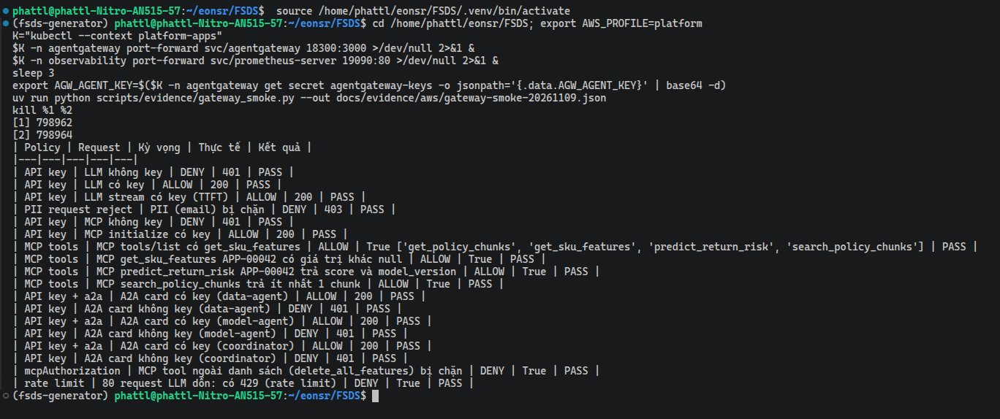
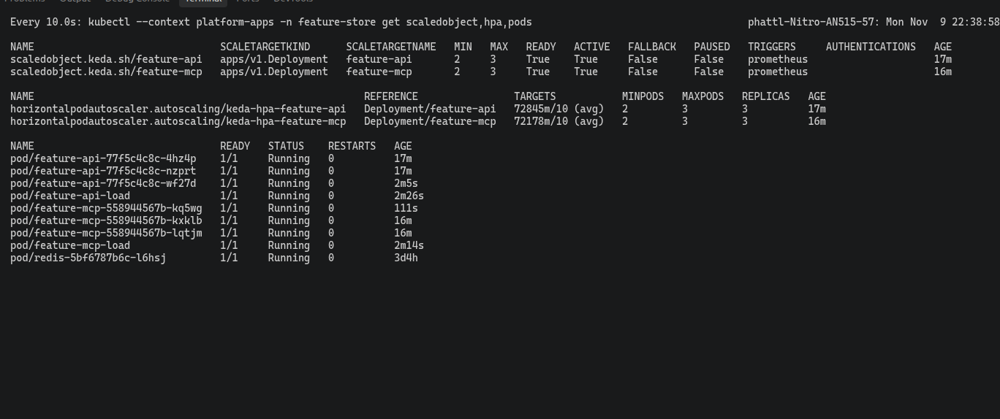
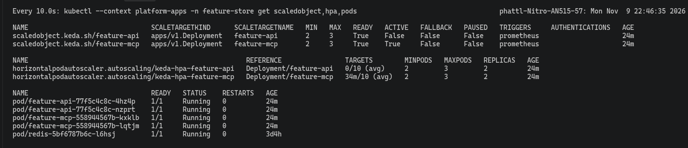

# Web API và MCP trên EKS

EDAI-2, dòng 16–18: FastAPI/Pydantic, healthcheck, async, MCP và Helm rolling/fallback.

Code / cấu hình: [API](../../serving/app.py), [Helm values](../../infra/helm/feature-api/values.yaml). [Kiểm thử API và tải EKS](validation_verification.md).

Các kết quả dưới đây thuộc các lần chạy AWS, không xác nhận dịch vụ đang bật.

### Trên EKS

Feature API được cài bằng Helm, KEDA giữ tối thiểu 2 pod. API nằm sau ingress HTTPS `https://api.<ip>.sslip.io`
(chứng chỉ Let's Encrypt). Lần `helm upgrade` lên image `813627b-pii1` (bản làm tròn số, xem
[LLM và agent](reference/llm_platform_agents.md#trên-eks)) tạo revision 2, cập nhật cuốn chiếu (rolling) không gián đoạn.


Ảnh Swagger ở trên chỉ thấy `/features` và `/predict`; probe và health có bằng chứng riêng (cluster `platform-apps`).

**Probe cấu hình trong Deployment** (output [`eks_runtime_proof.sh`](../../scripts/evidence/eks_runtime_proof.sh), file [eks-runtime-proof.txt](../evidence/aws/eks-runtime-proof.txt)):
- Deployment `feature-api` có 2/2 pod, chạy trên hai node khác nhau.
- Chiến lược `RollingUpdate` với `0 max unavailable, 1 max surge`: luôn giữ đủ pod cũ, chỉ thêm tối đa 1 pod mới mỗi lần.
- Ba probe Kubernetes:
  - `Liveness` (pod còn sống không) gọi `/healthz`, chu kỳ 10 s, lỗi 3 lần liên tiếp thì restart.
  - `Readiness` (pod sẵn sàng nhận request chưa) gọi `/readyz`, chu kỳ 5 s, ngưỡng lỗi 3.
  - `Startup` (pod đã khởi động xong chưa) gọi `/healthz`, chu kỳ 2 s, tối đa 30 lần.
- Gọi `/healthz` và `/readyz` **bên trong từng pod** đều trả `200`.


**Gọi qua Swagger** (port-forward `svc/feature-api`, `http://127.0.0.1:8000/docs`): `GET /healthz` trả `200 {"status": "ok"}` và `GET /readyz` trả `200 {"status": "ready"}`.


**Swagger (EKS, port-forward `svc/feature-api`):** ảnh tổng quan liệt kê sáu endpoint (`/healthz`, `/readyz`, `/features`, `/chunks`, `/predict`, `/chunks/by-id`).
Endpoint `/metrics` cố ý được ẩn khỏi schema (`include_in_schema=False`); Prometheus lấy số đo ở đó. Hai ảnh sau là lời gọi trực tiếp từ Swagger.


#### MCP server trên EKS

MCP (Model Context Protocol) là giao thức để Agent gọi tool. MCP server dùng thư viện `mcp`, chế độ stateless + JSON
(không giữ phiên giữa các request), đường dẫn `/mcp/`. Server này chạy ở **pod riêng**, tách khỏi pod REST:

```text
agentgateway /mcp ──► Service feature-mcp ──► pod feature-mcp-*  (API_SURFACE=mcp: /mcp/, /healthz, /readyz, /metrics)
Ingress api.…     ──► Service feature-api ──► pod feature-api-*  (API_SURFACE=rest: /features, /predict, /chunks, …)
                                  cả hai ──► Feast/Redis, KServe return-risk, pgvector
```

Cách tách:
- Hai release Helm (`feature-api`, `feature-mcp`) dùng chung chart [`infra/helm/feature-api`](../../infra/helm/feature-api/Chart.yaml), chung image và chung code
  [`serving/app.py`](../../serving/app.py) (`create_app(surface=…)` chọn phần nào được bật).
- [`values-mcp.yaml`](../../infra/helm/feature-api/values-mcp.yaml) đặt `surface: mcp` và Service kiểu ClusterIP (chỉ truy cập trong cụm).
- Mỗi release có Deployment, probe, Helm `--atomic` và ScaledObject riêng, nên MCP scale và rollback độc lập với REST.
- Test `test_surface_splits_rest_and_mcp_pods`: pod REST trả 404 ở `/mcp/`, pod MCP trả 404 ở `/features`.

Chạy thật trên EKS sau khi tách:
- `feature-api` trả 200 ở `/features` và 404 ở `/mcp/`; `feature-mcp` thì ngược lại.
- `helm list` có hai release, cùng image `4cc4502`.
- Gateway trỏ tới `feature-mcp`.

Ảnh Registry và Grafana bên dưới được chụp trước khi tách.

Bốn tool dùng chung code với REST:

| Tool | Làm gì | REST tương ứng |
|---|---|---|
| `get_sku_features(seller_skus)` | feature online từ Feast/Redis | `POST /features` |
| `predict_return_risk(...)` | gọi KServe `return-risk` | `POST /predict` |
| `search_policy_chunks(query, top_k)` | tìm chính sách trả hàng (RAG, pgvector) | `POST /chunks` |
| `get_policy_chunks(chunk_ids)` | lấy chunk theo id | `POST /chunks/by-id` |

Agent không gọi thẳng pod mà đi qua route `/mcp` của [agentgateway](agent_gateways.md) (API key, chỉ cho phép bốn tool trên).
Smoke test trên EKS sau khi tách đạt **24/24 PASS** ([gateway-smoke-20261109.json](../evidence/aws/gateway-smoke-20261109.json)). Một số kiểm tra trong đó:
- Gọi MCP không có key bị từ chối với 401; `initialize` có key trả 200.
- `tools/list` trả đủ bốn tool.
- `get_sku_features` có giá trị; `predict_return_risk` có `score` và `model_version`; `search_policy_chunks` trả ít nhất 1 chunk.
- Tool ngoài danh sách bị chặn.



MCP server đã đăng ký trong Agent Registry, và Grafana đếm từng lượt gọi tool theo kết quả (`mcp_tool_calls_total{tool,outcome}` do Feature API xuất ra):


Agent dùng các tool này: [Data Agent / Model Agent](agents.md), cấu hình route và backend MCP: [Agent Gateways](agent_gateways.md).

Tại ảnh API, `approved_returns_24h` còn `null`. Lần chạy stream AWS sau đó đã có dữ liệu: [Streaming Feature](stream_features.md).

#### Helm rolling update và tự rollback trên EKS

Kết luận trước: cả hai lần upgrade, kể cả lần cố tình hỏng, đều không làm rớt request nào (763/763 trả 200).

Cách thử: chạy [`helm_rollout_fallback_test.sh`](../../scripts/evidence/helm_rollout_fallback_test.sh) trên cluster `platform-apps` (release `feature-api`, namespace `feature-store`).
Trong lúc chạy hai lần `helm upgrade --atomic`, một pod probe **trong cluster** gửi `POST /features` liên tục, mỗi 0,2 giây một lần.
Với `--atomic`, nếu bản mới không lên được trong thời hạn thì Helm tự rollback về bản trước. Log đầy đủ: [feature-api-helm-rollout.txt](../evidence/aws/feature-api-helm-rollout.txt).

| Bước | Kết quả |
|---|---|
| 1. Rolling update tốt (đổi `envChecksum`, `--timeout 4m`) | revision **13** `deployed`; rolling update `maxUnavailable 0, maxSurge 1` |
| 2. Bản hỏng (`envSecret=does-not-exist`, `--timeout 90s`) | pod mới `CreateContainerConfigError: secret "does-not-exist" not found`; revision **14** `failed` (`context deadline exceeded`) |
| 3. Tự rollback (`--atomic`) | Helm tạo revision **15** `deployed`, mô tả `Rollback to 13`; hai pod cũ chạy suốt, không bị thay |
| Tải liên tục trong cả hai lần upgrade | **763 request, 763 trả 200**, không có lỗi |

`helm history` sau cùng: 13 `superseded`, 14 `failed`, 15 `deployed` (`Rollback to 13`). Đây là bằng chứng cho cả hai yêu cầu: rolling update không gián đoạn và tự fallback khi bản mới không khởi động được.
Ghi nhận cũ của lần chạy local (583/583 request, rollback revision 12 → 13) vẫn ở mục tham khảo bên dưới.

#### Autoscale Feature API và MCP server (KEDA)

Mỗi release Helm có [ScaledObject](../../infra/helm/feature-api/templates/scaledobject.yaml) (cấu hình scale của KEDA)
riêng, bật trong [`values-aws.yaml`](../../infra/helm/feature-api/values-aws.yaml):
- Tối thiểu 2 pod, tối đa 3 pod.
- Scale theo số request/giây trong 1 phút gần nhất:
  `sum(rate(http_requests_total{pod=~"<release>-.*", handler!~"/healthz|/readyz|/metrics"}[1m]))`, ngưỡng 10 request/giây mỗi pod.
- Công thức bỏ qua request của probe và `/metrics` (giống cách làm với Agent), nên khi không có tải thật thì số pod về 2.
- Release `feature-api` (REST) và `feature-mcp` (MCP) scale độc lập với nhau.

Cách đo: [`feature_api_scale_test.sh`](../../scripts/evidence/feature_api_scale_test.sh) tạo tải `POST /features` từ một
pod trong cluster, rồi ghi lại giá trị target và số pod theo thời gian, tới khi số pod về lại 2.

**Trên EKS** (4 luồng `curl` trong cluster, 150 giây, chạy song song hai release):

| Release | Tải vào | Lên 3 pod | Về 2 pod | Log |
|---|---|---:|---:|---|
| `feature-api` | `POST /features` | ~47 s, `60538m/10` | ~489 s | [feature-api-autoscale.txt](../evidence/aws/feature-api-autoscale.txt) |
| `feature-mcp` | `POST /mcp/` `tools/list` | ~46 s, `59296m/10` | ~490 s | [feature-mcp-autoscale.txt](../evidence/aws/feature-mcp-autoscale.txt) |

Cột "Lên 3 pod" ghi thời điểm và giá trị target lúc đó: `m` là đơn vị phần nghìn của Kubernetes, nên `60538m/10` là trung bình khoảng 60,5 request/giây mỗi pod so với ngưỡng 10 (HPA ghi `(avg)`, file evidence ghi "ngưỡng 10/giây mỗi pod").
Mốc thời gian chỉ chính xác theo chu kỳ lấy mẫu 15–25 giây của script. Events của HPA ghi `New size: 3` và `New size: 2`.
Việc về 2 pod mất lâu là do HPA chờ ổn định 5 phút trước khi giảm. Tải ở đây là các request ngắn trong cluster, không phải tải production.





#### Load test trên EKS

Locust (công cụ bắn tải) chạy trên laptop ở Việt Nam, đi qua `kubectl port-forward svc/feature-api` tới cụm ở Sydney
(ap-southeast-2). Cấu hình: 20 user, 60 s, cùng file [`serving/locustfile.py`](../../serving/locustfile.py), SKU thật
`APP-00042,APP-00482,ELE-01103`. Đi qua port-forward để tránh rate limit 50 request/giây của ingress.

| Request | Số | Lỗi | p50 | p95 | p99 | req/s |
|---|---:|---:|---:|---:|---:|---:|
| `POST /features` | 1.999 | 0 | 250 ms | 270 ms | 290 ms | 33,6 |
| `POST /features [batch]` | 530 | 0 | 250 ms | 270 ms | 280 ms | 8,9 |
| `GET /healthz` | 475 | 0 | 250 ms | 270 ms | 280 ms | 8,0 |
| **Tổng** | **3.004** | **0** | 250 ms | 270 ms | 290 ms | **50,5** |

Báo cáo HTML: [`evidence/aws/load-test-feature-api-20261030.html`](../evidence/aws/load-test-feature-api-20261030.html).

Cách đọc số:
- `/healthz` gần như không làm gì mà vẫn mất khoảng 250 ms. Vậy gần hết thời gian là đường mạng từ laptop tới Sydney, không phải do API.
- Đo phía server (`http_request_duration_seconds` của pod nhận tải): `/features` trung bình chỉ **1,8 ms**
  (4,57 s chia cho 2.536 request).
- Port-forward dồn toàn bộ tải vào 1 pod. Số req/s bị giới hạn bởi 20 user, mỗi lượt chờ khoảng 250 ms mạng, chứ
  không phải bởi API.
- Không có lỗi nào.

<details>
<summary>Tham khảo: thiết kế, hướng dẫn phát triển và ghi nhận trước triển khai AWS</summary>

Các ghi nhận local giữ nguyên môi trường, không dùng thay bằng chứng cloud.

<!-- Mục đích: Web API kéo feature SKU từ kho ONLINE, -->
## Web API kéo feature — ML Platform / LLM Platform

FastAPI + pydantic + healthcheck cho k8s, dùng async.

```
Agent / client ──POST /features {"seller_skus": [...]}──► serving/app.py
                                                            │ await get_online_features_async
                                                            ▼
                                             Feast registry (MinIO) + Redis (kind platform)
```

| Endpoint | Việc |
|---|---|
| `GET /healthz` | liveness: process còn sống |
| `GET /readyz` | readiness: đã nạp Feast registry chưa; chưa nạp thì trả 503 |
| `POST /features` | 1–100 SKU (`^[A-Za-z0-9_.-]{1,64}$`), trả 4 feature mỗi SKU |

Mỗi feature view (nhóm feature) được tra riêng và song song (`asyncio.gather`). Nếu SKU chưa có trong Redis, hoặc
một view bị lỗi hay chưa đăng ký, thì các feature của view đó trả `null`. Chỉ khi **mọi** view đều lỗi mới trả 503.

Feature trả về: `labeled_count_90d`, `positive_count_90d`, `return_or_refund_rate_90d`
(view `sku_return_daily`), `approved_returns_24h` (view `sku_return_24h`).
SKU trùng trong request chỉ tra một lần, kết quả giữ thứ tự lần xuất hiện đầu.

`POST /chunks` `{"query": "...", "top_k": 3}` (query 3–500 ký tự, top_k 1–10) tìm đoạn chính sách trả hàng
trong Feast RAG (pgvector). Endpoint này chỉ bật khi pod có biến `FEAST_RAG_REGISTRY`; nếu không có thì trả 503. Pipeline nạp chunk:
[`docs/edai-2/rag_pipeline.md`](rag_pipeline.md).

Code: [`serving/app.py`](../../serving/app.py). Test: [`serving/tests/test_app.py`](../../serving/tests/test_app.py).

## Test

```bash
uv run --no-project --python 3.12 --with-requirements serving/requirements-dev.txt \
  pytest serving/tests -o pythonpath=. --cov=serving --cov-report=term-missing
```

Kết quả 84 pass, coverage `serving/app.py` 98% (chỉ thiếu `load_store`, phần nạp Feast thật).

| Kỹ thuật | Ở đâu |
|---|---|
| fixture + mock | `store` (MagicMock + AsyncMock giả `get_online_features_async`), `client` |
| Equivalence partitioning + boundary value | `test_sku_count_boundaries` (0 / 1 / 50 / 100 / 101 SKU), `test_sku_format` (độ dài 0 / 1 / 64 / 65, ký tự lạ) |
| Property-based (idempotency) | `test_idempotent` (Hypothesis): gọi 2 lần và gửi lặp SKU ra cùng kết quả |

## Mutation testing (mutmut)

Cấu hình [`[tool.mutmut]`](../../pyproject.toml) chọn `serving/app.py`, dùng bộ test
[`serving/tests/test_app.py`](../../serving/tests/test_app.py) và sao chép `rag` để test các nhánh RAG.
Chạy offline với dependency đã cache (mutmut 3.3.1):

```bash
UV_OFFLINE=1 uv run --offline --no-project --python 3.12 --with-requirements serving/requirements-dev.txt mutmut run --max-children 2
UV_OFFLINE=1 uv run --offline --no-project --python 3.12 --with-requirements serving/requirements-dev.txt mutmut results
```

Mutation testing kiểm chất lượng bộ test: công cụ tự sửa nhỏ code (mỗi bản sửa gọi là một mutant), rồi xem bộ test
có fail không. Test fail nghĩa là test đã "giết" được mutant đó.

Lần chạy (laptop, 4 tiến trình, khoảng 2,5 phút): **171 mutant** trên `serving/app.py`.

| Kết quả | Số | Nghĩa |
|---|---:|---|
| killed | 138 | test fail khi code bị đổi, tức test bắt được lỗi |
| timeout | 19 | test chạy quá giới hạn thời gian của mutmut (code bị đổi làm request treo) — coi là bắt được |
| no tests | 9 | `load_store` nạp Feast thật; test thay bằng `store_factory` giả nên không chạy hàm này (cố ý) |
| survived | 5 | cả 5 là **mutant tương đương** (dưới) |

**Mutation score** = (killed + timeout) / (171 − no tests) = 157/162 = **96,9%** (chỉ tính killed: 138/162 = 85,2%).

5 mutant sống, xem bằng `mutmut show <tên>`:
"Mutant tương đương" là bản sửa không làm đổi hành vi của chương trình, nên không test nào giết được nó.
- `x_fetch_features__mutmut_29/32/33`: đổi `zip(VIEWS.values(), results, strict=True)` thành `strict=None`, `False`,
  hoặc bỏ hẳn `strict`. Vì `results` sinh từ `asyncio.gather` trên chính `VIEWS`, hai dãy luôn dài bằng nhau, nên
  `strict` không bao giờ làm đổi hành vi. Đây là mutant tương đương, không viết được test giết nó.
- `x_create_app__mutmut_17/25`: đổi `host="0.0.0.0"` của MCP thành `None` hoặc `"XX0.0.0.0XX"`. SDK MCP chỉ bật chặn
  DNS-rebinding khi host là `localhost`/`127.0.0.1`; mọi giá trị khác cho cùng hành vi, nên cũng là mutant tương đương.


Ảnh được dựng từ [output thật](../evidence/mutmut-serving-20261031.txt). File output giữ đủ danh sách timeout/no tests;
ảnh bỏ các dòng đó cho gọn. Lần chạy đầu trong sandbox của công cụ AI bị treo vì sandbox chặn socket nội bộ (mà
`TestClient` cần), không phải do lỗi test.

Phạm vi mutate: mutmut 3.3.1 chỉ cho chọn mutant theo tên (`mutmut run [MUTANT_NAMES]...`); `mutmut run --help` không
có tùy chọn chọn dòng theo Git diff. Lần này mutate **toàn bộ `serving/app.py`** (file thay đổi nhiều nhất của Web API)
theo cấu hình trên, nên không khẳng định là chỉ mutate các dòng đã đổi. Ở lần sau, muốn giới hạn theo file thì dùng
`git diff --name-only <base> -- '*.py'` lấy danh sách file đổi, rồi cập nhật `paths_to_mutate` tương ứng trước khi
chạy. Cách này vẫn không giới hạn được tới từng dòng trong file.

## Load test (locust)

Chạy API thật (uvicorn, 1 worker) trong image `platform-feast:0.66.0`, nối tới Feast registry trên MinIO và Redis trong kind.
Tải: 20 user, 60 s, chia theo tỷ lệ 4 : 1 : 1 giữa ba loại request (một SKU / lô 10 SKU / `healthz`). File: [`serving/locustfile.py`](../../serving/locustfile.py).

| Request | Số | Lỗi | p50 | p95 | p99 | req/s |
|---|---:|---:|---:|---:|---:|---:|
| `POST /features` | 5.811 | 0 | 6 ms | 19 ms | 34 ms | 97,6 |
| `POST /features [batch]` | 1.495 | 0 | 7 ms | 20 ms | 32 ms | 25,1 |
| `GET /healthz` | 1.402 | 0 | 3 ms | 10 ms | 16 ms | 23,6 |
| **Tổng** | **8.708** | **0** | 6 ms | 18 ms | 31 ms | **146,3** |

Báo cáo HTML: [`evidence/load-test-feature-api-20261021.html`](../evidence/load-test-feature-api-20261021.html).
Giới hạn:
- Locust chạy cùng container với API (cùng máy 14 GB).
- Lúc đó view `sku_return_24h` chưa được đăng ký, nên mỗi request chỉ thật sự đọc Redis một lần.
- Số này là mức sàn ở local, chưa phải số trên GKE.

## MCP tool

Cùng app mở thêm MCP server (thư viện `mcp` 2.3.0) tại `/mcp/`. Bản đầu chỉ có một tool `get_sku_features(seller_skus)`,
dùng chung hàm `fetch_features` với REST; bản hiện tại có bốn tool, xem [MCP server trên EKS](#mcp-server-trên-eks).
- Chế độ **stateless + JSON**: request MCP tới replica nào cũng xử lý được, không cần sticky session (gắn client với
  một replica cố định), nên scale nhiều replica như API thường.
- Input sai hoặc Redis lỗi thì trả `isError: true` kèm lời nhắn rõ (`ToolError`), để LLM tự sửa lại lời gọi.
- Test: `test_mcp_*` trong [`serving/tests/test_app.py`](../../serving/tests/test_app.py).

```bash
curl -s -X POST http://platform-control-plane:30800/mcp/ -H 'Content-Type: application/json' \
  -H 'Accept: application/json, text/event-stream' \
  -d '{"jsonrpc":"2.0","id":1,"method":"tools/call","params":{"name":"get_sku_features","arguments":{"seller_skus":["sku-A"]}}}'
```

## Chạy trong k8s bằng helm (kind `platform`)

```bash
bash scripts/setup/deploy_kind_feature_api.sh [tag]
```

| Phần | File |
|---|---|
| Image (dựng trên `platform-feast:0.66.0`, 1,02 GB, phần lớn là layer Feast dùng chung) | [`docker/Dockerfile.serving`](../../docker/Dockerfile.serving) |
| Helm chart: Deployment 2 replica + Service NodePort 30800 | [`infra/helm/feature-api/`](../../infra/helm/feature-api/Chart.yaml) |
| Build → `kind load` → Secret từ `.env` → `helm upgrade --install --atomic` | [`scripts/setup/deploy_kind_feature_api.sh`](../../scripts/setup/deploy_kind_feature_api.sh) |

- **Rolling update**: `maxUnavailable: 0, maxSurge: 1`, tức thêm 1 pod mới và chỉ bỏ pod cũ khi pod mới đã Ready.
  Thêm `preStop: sleep 5s` để kube-proxy kịp gỡ pod cũ khỏi Service trước khi pod đó tắt. Thiếu bước này, lần đo
  đầu tiên rớt 1/366 request đúng lúc pod cũ tắt.
- **Tự fallback**: dùng `helm upgrade --atomic --timeout`. Nếu pod mới không Ready trong thời hạn, Helm tự rollback về
  revision trước.
- Probe: `startupProbe` + `livenessProbe` gọi `/healthz`, `readinessProbe` gọi `/readyz`.
- Secret `feature-api-env` (khóa MinIO, registry, Redis) tạo lúc chạy script từ `.env`, không nằm trong Git.
- Pod phân giải được `minio` (172.23.0.3) vì node kind nối vào mạng `platform_default`.
  Redis gọi qua Service trong cụm `redis.feature-store.svc.cluster.local:6379`.
- Request: 50m CPU / 128Mi RAM, limit 384Mi.

### Kiểm

Trong suốt lúc thử, một container gửi `POST /features` mỗi 0,2 s. Các bước thử:
1. 3 lần rolling update (v1 → v2 → v1 → v2).
2. Một bản cố tình hỏng: `envSecret=does-not-exist` làm pod mới không khởi động được, với `--timeout 45s`.

| Kết quả | |
|---|---|
| Request | **583 / 583 trả 200**, 0 lỗi |
| Bản hỏng | revision 12 `failed`, sau đó Helm tự tạo revision 13 `Rollback to 11`; 2 pod cũ phục vụ suốt |

Log: [`evidence/feature-api-helm-rollout-20261021.txt`](../evidence/feature-api-helm-rollout-20261021.txt).
Giá trị feature lúc đó là `null` vì Redis vừa khởi động lại, chưa materialize.

### Bản v3: thêm tìm chunk RAG

Image v3 có thêm `feast[postgres]`, `fastembed` và model `BAAI/bge-small-en-v1.5` nằm sẵn trong image
(`RAG_MODEL_CACHE=/opt/models`); Secret thêm `FEAST_RAG_REGISTRY`, `RAG_PG_*`. Helm revision 14, 1 replica
(`REPLICAS=1`, máy local chật RAM; rolling update/rollback đã chứng minh ở trên với 2 replica).

| Thử | Kết quả |
|---|---|
| `POST /chunks` "How long does a Walmart buyer have to return?" | `walmart-returns / Return window` đứng đầu, distance 0,127 |
| MCP qua agentgateway `tools/call search_policy_chunks` "Can a TikTok buyer get a refund without returning the item?" | `tiktok-shop-returns / Refund only` |

Agent dùng tool: [`docs/edai-2/reference/llm_platform_agents.md`](reference/llm_platform_agents.md).

</details>

[Mục lục phần này](README.md) · [Mục lục chung](../README.md)
