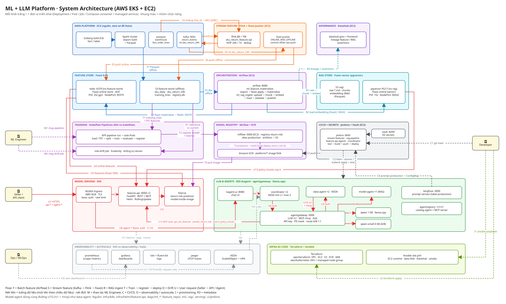

# ML and LLM Platform on AWS

This documentation set covers the ML and LLM Platform component by component and focuses on the AWS deployments.
The infrastructure has two parts:

- **Data Platform** runs with Docker Compose on a single EC2 instance, with data on S3.
- **ML/LLM Platform** runs on the EKS Kubernetes cluster `platform-apps`; MLflow, Jenkins and Vault run on EC2.

Each result states which environment it ran in and what limitations remain. The docs only record runs that happened; they do not claim the services are still up.

## Component index

The last column summarizes what has been demonstrated and what is still missing.

| Doc / evidence | Results and limitations |
|---|---|
| [LLM Inference Platform](llm_inference_platform.md) | Self-hosted LLM running on CPU on EKS. Deployment screenshots (pod, PVC, logs) and llm-d-benchmark results comparing baseline with optimized: 3 load levels per configuration, 42 requests, no errors; at high load, optimized cuts TTFT p50 by 46%. No custom fine-tuned model yet. |
| [Global Model Config](global_model_config.md) | Config file and screenshot showing three Agents sharing one model on EKS. |
| [Agent Registry](agent_registry.md) | UI on EKS, with 3 Agents and 1 MCP server registered. |
| [RAG Pipeline](rag_pipeline.md) | DAG succeeded on all 6/6 tasks, including the publish step to DataHub; lineage screenshot on DataHub on AWS. |
| [Feature Store](feature_store.md) | Materialize DAG (loads features into the online store) on AWS, with real data in Redis. |
| [Streaming Feature](stream_features.md) | Two PyFlink jobs on Flink 2.2 running on AWS: one writes online to Redis, one writes offline to Parquet on S3. A separate counting script matched 56,231/56,231 time windows and 2,000/2,000 SKUs up to the last closed time mark; **no numbers for the final mark yet**. The trained model does not use these features yet. |
| [Training Pipeline / MLflow](training_pipeline.md) | KFP pipeline ran all 5/5 steps. Screenshots of the run's Tags/Artifacts tabs, and the SHA-256 hashes of the train/test sets match the values recorded in the tags. |
| [ML Inference Service](ml_inference_service.md) | Pod in READY state and prediction results on EKS. |
| [Web API / MCP](web_api_mcp.md) | Deployment, API and probes. The MCP server (four tools) has been split into its own pod `feature-mcp`; the smoke test on EKS after the split passed 24/24. Feature API and MCP autoscale 2→3→2 pods. Helm rolling update rolls back automatically on a broken release on EKS (763/763 requests returned 200). |
| [Data Agent / Model Agent / Sandbox](agents.md) | Data Agent and Model Agent have the same full set: multiple replicas, KEDA scaling 2→3→2, tool calls in a gVisor Sandbox, registry entries, MCP calls through the gateway (smoke 24/24). KServe predict scales 2→3→2. Eval: Data 12/12, predict 12/12, **policy 3/5 (below threshold, so the build is red)**. |
| [MCP / A2A Gateway](agent_gateways.md) | Smoke test 24/24, with an allow/deny table and a screenshot of the ConfigMap. No dedicated rate limit for MCP yet. |
| [Coordinator](coordinator.md) | Chat and publish, scaling 2 → 3 → 2 on EKS. The CI eval gate passed 12/12 (build #9), but it only scores question routing. |
| [Agent Fleet / Warm Pool](agent_fleet_warm_pool.md) | 6 Agents on 1 worker; cold start time not measured yet. |
| [Validation & Verification](validation_verification.md) | PR tests run on the development machine. Locust load test against EKS: 3,004 requests, no errors. |
| [CI/CD](cicd.md) | `stream-features` build #7 green, deploys 2 PyFlink jobs on AWS. `feature-api-agents` build #13 deploys green but **is red at the RAG eval step (3/5)**. Coordinator eval 12/12 (routing only). |
| [External Routing / Gateway](routing_gateway.md) | HTTPS and authentication; see the doc for the certificate renewal limitation. |
| [IaC](iac.md) | `terraform plan` reports No changes and Ansible ran with `failed=0` on AWS. |
| [Observability](observability.md) | Metric/log/trace dashboards and telemetry from EKS. |
| [A/B Testing](ab_testing.md) | Traffic split, dashboard and eval results on AWS. |
| [Security](security.md) | Vault on EC2; it must be unsealed by hand after every restart. |
| [Agent Evaluation and Drift Monitoring](agent_eval_and_drift.md) | Agent eval harness and drift Job on AWS; no automatic model retraining yet. |

Each page has code/config, results and screenshots with explanations. Per-capability status and the parts still missing AWS evidence: see [AWS validation status](../shared/aws_validation.md).

## Deployment and verification

[Cloud setup](../shared/cloud_setup.md) · [AWS runbook](../shared/aws_deploy.md) · [IaC](../ml-llm-platform/iac.md).

Repository layout: [project README](../../README.md), [code style](../shared/code_style.md), and the index on this page.

[Technical reference](reference/README.md) · [Main index](../README.md).
