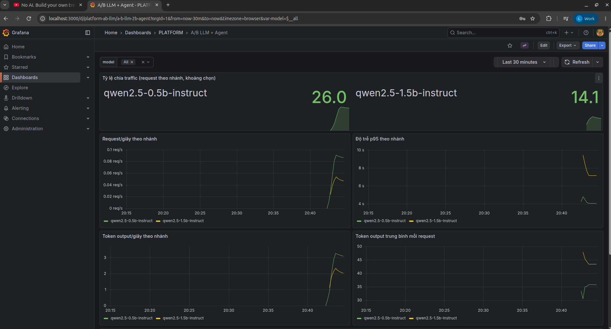
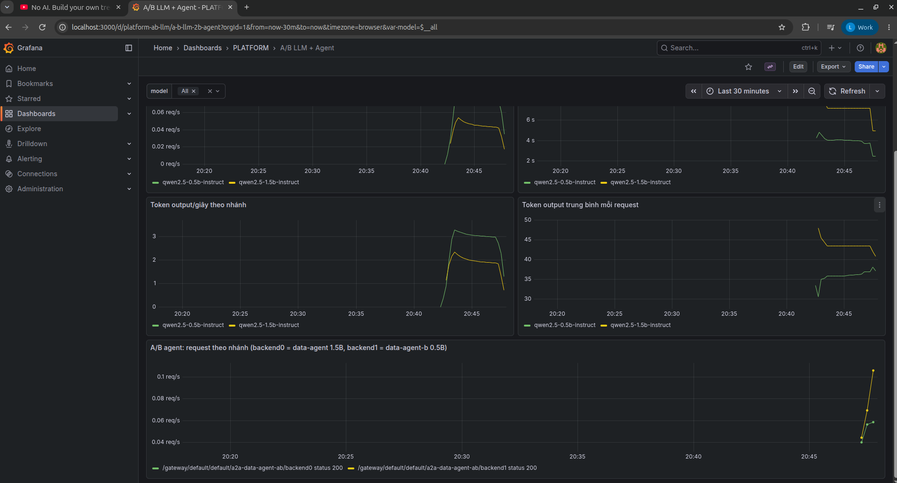
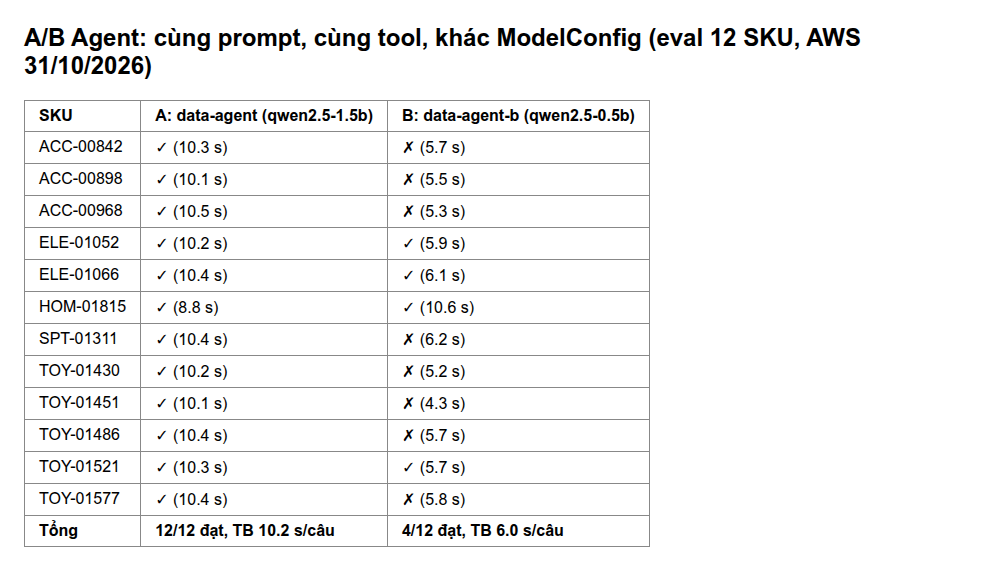

<!-- Purpose: A/B testing of LLMs and Agents through agentgateway, monitored in Grafana -->
# A/B test — LLM and Agent

A/B testing for Agents and LLM variants.

Code / config: the design table below. AWS results have their own section; local numbers are kept only for comparison and do not replace the AWS evidence.

The idea of an A/B test: instead of replacing the old model right away, run the old version (A) and the new version (B) side by side, split traffic between them,
watch the metrics, and only then decide. There are two tests: A/B between two Agents using different model configs, and A/B between two LLM variants on the inference platform.

**Conclusion:** branch B (0.5B model) is faster but answers wrong far more often (on AWS: A correct 12/12, B correct 4/12). So **A stays the default**.
Details in [Conclusion and decision](#conclusion-and-decision).

## Design

| Branch | LLM | Agent | File |
|---|---|---|---|
| **A** (in use) | `qwen2.5-1.5b-instruct` (llama.cpp, benchmarked configuration) | `data-agent`, `default-model-config` | `infra/k8s/agents/llm.yaml`, `data-agent.yaml` |
| **B** (candidate) | `qwen2.5-0.5b-instruct` (same image, same flags) | `data-agent-b`, `ab-small-model-config` — same prompt, same tools | [`ab-llm-small.yaml`](../../infra/k8s/agents/ab-llm-small.yaml), [`ab-data-agent.yaml`](../../infra/k8s/agents/ab-data-agent.yaml) |

Traffic is split at **agentgateway** ([`agentgateway.yaml`](../../infra/k8s/agents/agentgateway.yaml)):

- **LLM**: the gateway declares a virtual model named `platform-chat`, split `routing.weighted` 1:1 between A and B. Clients only call `platform-chat`;
  the gateway picks the real model for each request and records that model's name in metrics/traces in the `gen_ai_response_model` field.
- **Agent**: the A2A route `/a2a/data-agent-ab/` has two backends, each `weight: 1`. The metric `agentgateway_requests_total`
  carries the labels `backend0`/`backend1` to tell the two backends apart.

Monitoring: Grafana dashboard **Data & AI Platform — A/B LLM + Agent** ([`platform-ab-llm.json`](../../infra/k8s/observability/dashboards/platform-ab-llm.json)).
The dashboard has six panels: split ratio, requests/second, p95 latency, output tokens/second, tokens per request by branch, and requests by agent backend.

## Results on AWS (EKS `platform-apps`)

Same design as above, run on EKS: branch A `qwen` (1.5B), branch B `qwen-small` (0.5B), split at agentgateway.

**LLM, first run.** Load generated with `bench_llm.py --model platform-chat --concurrency 2`, stopped after 900 s because the CPU-hosted LLM is slow.
Grafana **Data & AI Platform — A/B LLM + Agent** recorded 9.13 requests for the 1.5B branch and 8.07 requests for the 0.5B branch, consistent with a 1:1 ratio given the small sample.
Within the screenshot's time window, p95 was about 10 s (1.5B) and 80 s (0.5B).

**A/B dashboard on EKS, second run.** Load generated with `bench_llm.py --model platform-chat --concurrency 2 --requests 40 --max-tokens 48`
(calling the virtual model `platform-chat`, with the gateway splitting between the two branches). Screenshot of the **A/B LLM + Agent** dashboard, range **Last 30 minutes**, variable `model = All`:

| Panel | Branch A `qwen2.5-1.5b-instruct` | Branch B `qwen2.5-0.5b-instruct` |
|---|---:|---:|
| Requests in the selected range | ~14 | ~26 |
| p95 latency | ~7–9 s | ~4 s |
| Output tokens/second | ~2 | ~3 |
| Mean output tokens per request | ~43–45 | ~36 |

Client-side numbers from this same run (`bench_llm.py`, 40 requests, 2 concurrent, both branches combined): `p50 = 3.0 s`, `p95 = 6.19 s`, `0.471 requests/second`,
`18.6 generated tokens/second`, mean prompt 508 tokens.

- Because both branches are combined, the client-side p95 falls between the 0.5B branch's p95 of ~4 s and the 1.5B branch's ~7–9 s on the dashboard.
- Tokens/second in the Grafana panel is the per-branch rate averaged over 5 minutes (`rate [5m]`). So it cannot be compared directly with the total of 18.6 tokens/second measured during the run.

Reading the results:

- The 0.5B branch is clearly faster (p95 only about half) and generates shorter answers per request.
- The split of **26 vs 14 (65/35)** is not exactly 50/50. But the sample is very small (40 requests, cut by time); with 1:1 weights and 40 samples, a deviation this size can happen by chance, so it cannot be concluded that the gateway splits incorrectly.
- The values in the table were read by eye from the charts, not exported from Prometheus.

The sixth panel, **A/B agent (backend0 = data-agent 1.5B, backend1 = data-agent-b 0.5B)**, only has data when requests go through the route `/a2a/data-agent-ab/`.
In the first capture the panel was empty (No data) because no request had gone through this route yet. Then 60 agent-card requests (Agent description, no LLM call) were sent through the A/B route.
The panel then showed two lines, one per backend, both `status 200`:

These requests only fetch the agent card; they are not questions for the Agent. They only show that the gateway splits the A/B route between the two backends and that Grafana can separate the metrics by backend.
The accuracy of the two Agents is compared in the table below (12/12 and 4/12).

Prometheus counts: [`ab-llm-prometheus-20261031.json`](../evidence/aws/ab-llm-prometheus-20261031.json). The cumulative totals
642 (A) vs 30 (B) **are not the split ratio**: B had been created that same day so it only received the bench load, while A also served
data-agent, coordinator and sandbox.

**Agent.** Both Agents were asked about the same 12 SKUs, with the same prompt and tools, then scored with the Agent eval harness ([agent_evaluation.md](agent_evaluation.md)):

| Branch | Passed | Seconds/question (mean) | Per-question results |
|---|---:|---:|---|
| A `data-agent` (1.5B) | **12/12** | 10.2 | [JSONL](../evidence/aws/agent-eval-data-agent-20261031.jsonl) |
| B `data-agent-b` (0.5B) | **4/12** | 6.0 | [JSONL](../evidence/aws/agent-eval-data-agent-b-20261031.jsonl) |
| Split route `/a2a/data-agent-ab/` | 2/6 | — | [JSONL](../evidence/aws/agent-eval-data-agent-ab-20261031.jsonl) |

The image above is a table rebuilt from the two eval JSONL files with [`render_ab_comparison.py`](../../scripts/evidence/render_ab_comparison.py), **not a Grafana screenshot**.
All six Grafana panels have screenshots in the sections above: five LLM panels from the second run, and the A/B agent panel on its own. The first run's screenshot only has the request and p95 panels.
These Grafana screenshots all come from short loads (40 requests), so they are only enough to see a trend, not enough to compare the two model configurations with confidence.

Limitations:

- The LLM bench was short (stopped at 900 s, only about 9 and 8 requests per Grafana) and no confidence interval was computed.
- 12 SKUs is a small set.
- The split route's result (2/6) is a mix of the two branches, not a separate measure of B.

## Local results (kind) — recorded before AWS

**LLM**: 40 requests, 2 concurrent, `max_tokens` 48 ([`ab-llm-20261021.jsonl`](../evidence/ab-llm-20261021.jsonl)):

| Branch | Requests | p50 | p95 (Prometheus) | Output tokens/request |
|---|---|---|---|---|
| A 1.5B | 25 | 2.33 s | 4.16 s | 45.6 |
| B 0.5B | 15 | 1.74 s | 2.47 s | 45.9 |

The request counts from Prometheus match the client side (25/15). With a 1:1 ratio, a 25/15 split is normal sampling variation with only 40 requests.

**Agent**: 20 A2A questions of the form "What are the return features of sku-…" ([`ab-agent-20261021.jsonl`](../evidence/ab-agent-20261021.jsonl)).

- All 20/20 questions returned HTTP 200, p50 4.5 s.
- The gateway counted 18 requests for backend0 (A) and 14 for backend1 (B); these counts include 12 requests from an earlier test round.
- LLM calls during the test: 1.5B 28 calls, 0.5B 12 calls. Agent A calls a tool before answering (about 2 LLM calls per question), while agent B answers after fewer calls.

## Conclusion and decision

**Keep A as the default.** B is faster (~25–45% faster locally, ~40% of the time per agent question on AWS), but the Agent eval harness ([`agent_evaluation.md`](agent_evaluation.md)) shows B is less
accurate: on AWS **A 12/12, B 4/12** (local: A 12/12, B 11/12). The questions B got wrong were due to fabricated or miscopied numbers.

The initial hypothesis "B skips the tool call" is only partly right: B still calls the tool, but sometimes misreads or mixes up the numbers.
B is only suitable for questions that do not need exact numbers. A CI gate set to `--min-accuracy 0.95` would block B.

The B branches have been scaled to 0 pods. Commands to bring them back: `kubectl -n llm scale deploy/qwen-small --replicas=1`,
`kubectl -n kagent scale deploy/data-agent-b --replicas=1`.

[Section index](README.md) · [Main index](../README.md)
