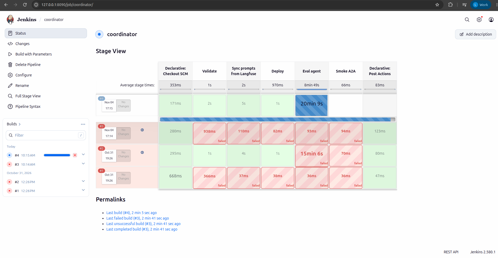
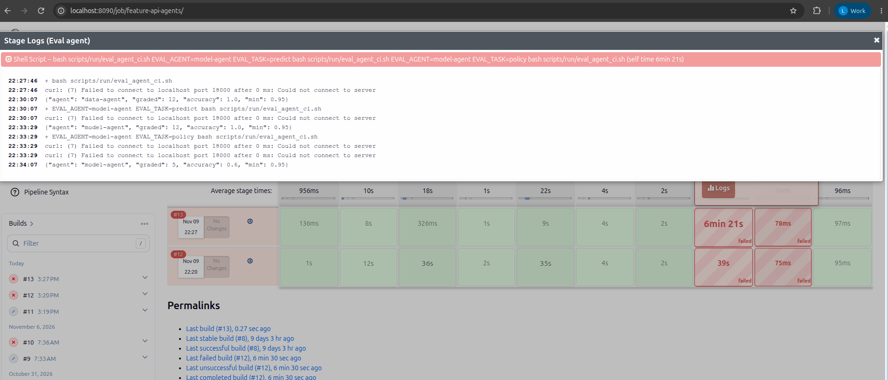

# Agent Evaluation on AWS

Agent eval harness: a tool that asks an agent a fixed set of questions and scores each answer right or wrong.

Code and configuration: see the component table in the "Reference" section at the end of the page. The Jenkins gate results and the limitations of the SKU set are recorded below, along with the JSONL file of per-question results.

The results below come from runs on AWS. They do not mean the service is up while you read this.

## On AWS

**Summary:** Data Agent passed the eval gate on AWS (12/12 questions correct). The Coordinator passed the gate on a later run (see [Use in CI](#use-in-ci)). Model Agent only passes the prediction part so far; the policy questions still fail because of the small model.

Jenkins runs on EC2 `i-0d657089ba4a4ea7e` (`10.42.0.151`) and calls `data-agent` on the EKS cluster, context `platform-apps`.
Build `feature-api-agents` **#8 green**. The eval gate reached **12/12 questions = 1.00**, above the required threshold of 0.95.
Per-question results: [agent-eval-data-agent-20261031.jsonl](../evidence/aws/agent-eval-data-agent-20261031.jsonl).
Build flow, pushing the image to ECR and deploying: [CI/CD on AWS](cicd.md#on-aws).


**PII mask bug found.** The first run only reached **9/12**.
Cause: the gateway's `phoneNumber` guardrail (a filter that masks phone numbers) also masked seven-digit counts.
For example `6077845` was replaced with `<PHONE_NUMBER>`. The answer lost the correct number, so the harness marked it as failed.

The 12/12 run used SKUs whose `labeled_count_90d` has fewer than seven digits. So this result only holds for that SKU set.
It does **not** prove the mask bug is fixed for every large count.
This bug is different from the rate rounding bug: here an integer count is mistaken for a phone number. The same guardrail had earlier masked a 17-digit Return rate in a Coordinator chat (see [Observability](observability.md)).

<a id="coordinator-on-aws-2026-11-04"></a>
**Coordinator on AWS, first two runs.** In both runs, the `Validate`, `Sync prompts` and `Deploy` steps were green.
But the `Eval agent` gate (12 SKUs, accuracy threshold 0.95) **did not pass**:

- One run went red after 15 minutes 6 seconds.
- The other (build #4) ran for more than **20 minutes** without finishing, so there is no `accuracy` result to report (the EC2 instance was stopped while the build was still running).



Measurements from the same time:

- Asking the Coordinator one question by hand took **40.7 seconds** and returned the correct numbers (15,306 / 2,599 / 16.98%).
- During the eval, the llama.cpp log ([llm-slot-timing-during-eval.txt](../evidence/aws/llm-slot-timing-during-eval.txt)) recorded 69 LLM calls. The median was 6 seconds, but one call took up to **350 seconds**, and 6 calls exceeded 100 seconds.
- The gateway received only about 4 questions for the Coordinator in 10 minutes, i.e. about 2.5 minutes per question.

The cause has not been determined. Hypothesis (not verified): when a question exceeds the 180-second timeout, the harness skips it and asks the next one.
But the Coordinator keeps processing the skipped question, so LLM calls pile up on the 4 CPU slots (llama.cpp's 4 parallel processing slots), slowing down the following questions too.

What is known for certain: one Qwen 1.5B model running on CPU, shared by every Agent, is not fast enough for the Coordinator → Agent → tool → back to Coordinator chain in this CI gate.

**Agent 2 (model-agent) has its own eval gate**, with two kinds of questions:

- `ml/agent_eval.py --task predict`: asks for the risk score of a new order, then compares it with the result of the Feature API's `POST /predict`. A question passes when the difference is at most 0.005, or when the agent says "abstain" for a SKU without history.
- `--task policy`: asks 5 questions about return windows and deadlines in the policy, then checks whether the numbers match the documents in `rag/corpus`.

`feature-api-agents.Jenkinsfile` runs all three tests (selected with the `EVAL_AGENT`, `EVAL_TASK` variables in `eval_agent_ci.sh`; the result file is `out/agent-eval-<agent>-<task>.jsonl`).

Tried locally (kind cluster, a fake Feature API with fixed data, not real Redis/pgvector, not run on AWS): predict passed 4/4; policy passed 4/5 after tightening the prompt (3/5 before).
The remaining failure is because Qwen 1.5B writes the tool call out as text instead of actually calling the tool (the tool does not run). So the 0.95 policy gate may be red on AWS until the model calls tools more reliably.

**Results on EKS** (Jenkins `feature-api-agents` #13, after splitting MCP into its own pod `feature-mcp`):

| Eval | Result |
|---|---|
| Data Agent | **12/12** |
| Model Agent, predict | **12/12** |
| Model Agent, policy | **3/5** |

Policy 3/5 is below the 0.95 threshold, so the build is red and the Smoke stage did not run. Running `gateway_smoke.py` on its own passed 24/24.

The two failing questions (Shopee's and Walmart's return deadlines) share the same error: the model returns the text `Call search_policy_chunks with the query …` instead of calling the tool.
Calling `search_policy_chunks` directly through MCP still returns chunks, so the tool works normally.
The threshold was not lowered to make the pipeline green: this is a limitation of the 1.5B model on CPU and has not been fixed.



<details>
<summary>Reference: design, development guide and records from before the AWS deployment</summary>

Local records keep their original environment and are not a substitute for cloud evidence.

<!-- Purpose: eval harness for agents + regression gate; proof that it runs on both A/B branches. -->
## Agent eval harness and regression gate

The question "does the agent answer with the **real numbers**?" cannot be measured by latency or token counts.
So the harness works as follows:

1. Ask the agent a fixed set of questions through agentgateway (A2A protocol).
2. Take the **reference answer from the Feature API**, which is also the source the agent must call a tool to get numbers from.
3. Score each question.
4. Use accuracy as a CI gate: below the threshold, the harness exits with code 1, turning the pipeline red after the agent deploy step.

| Component | File |
|---|---|
| Harness + scoring | [`ml/agent_eval.py`](../../ml/agent_eval.py), test [`tests/unit/test_agent_eval.py`](../../tests/unit/test_agent_eval.py) |
| Dedicated route for scoring branch B | `a2a-data-agent-b-path` in [`agentgateway.yaml`](../../infra/k8s/agents/agentgateway.yaml) |
| Results | [`evidence/agent-eval-20261021.jsonl`](../evidence/agent-eval-20261021.jsonl) |

## Scoring rules

The question "What are the return features of sku-…?" **passes** when the answer contains all three values:

- `labeled_count_90d` and `positive_count_90d`: must be the exact integers.
- `return_or_refund_rate_90d`: off by at most 0.005; both `0.33` and `33%` are accepted.

The SKU code (e.g. `sku-00010`) does not count as a number.
SKUs without history are not scored, so an agent cannot "pass" just by saying "0".
If the agent returns an HTTP error or times out, that question counts as failed and the harness keeps going.

**Preparing the data.** The latest online data snapshot has every number at 0, so it cannot tell which agent fetched the real numbers.
So during the eval, Redis is reloaded with data up to Mar 15, then restored to the original point after scoring.
Before loading, run `flushall` (wipe Redis), because Feast does not overwrite a newer value with an older one.

## Proof (12 SKUs, same question, same tool)

| Agent | Model | Measured | p50 |
|---|---|---|---|
| `data-agent` (A) | qwen2.5-1.5b | **12/12 = 100%** | 5.4 s |
| `data-agent-b` (B) | qwen2.5-0.5b | **11/12 = 91.7%** | 3.0 s |

The failed question on branch B (sku-00005): the agent said `labeled_count_90d = 18` (wrong), and the rate 0.085 also does not match 10/18.
This is a **fabricated number**, the kind of error a latency or token dashboard can never detect.

Gate check: running branch B with `--min-accuracy 0.95` gives `accuracy 0.917`, so the harness returns **exit 1** (blocked). Running branch A with threshold 0.6 gives exit 0.

## Use in CI

The **Eval agent** stage has been wired into two pipelines:

- after `Deploy Agent` in `feature-api-agents.Jenkinsfile`;
- after `Deploy` in `coordinator.Jenkinsfile` (route `/a2a/coordinator/` receives the same SKU questions).

Both call the same wrapper. Command run in the Jenkins workspace:

```bash
## Needs VAULT_ADDR/VAULT_TOKEN + KUBECONFIG; Jenkins binds them from credentials.
bash scripts/run/eval_agent_ci.sh
## The Coordinator uses the same harness through its own A2A route:
EVAL_AGENT=coordinator bash scripts/run/eval_agent_ci.sh
```

For `coordinator`, the gate only scores **routing**, not numbers. A question passes when the conversation history contains a call to `data_agent` or `model_agent` and a final answer.
Reason: the 1.5B model often drops digits when copying numbers, and number accuracy is already checked by the data-agent and model-agent evals.
Limitation: this gate does not catch the coordinator copying numbers wrongly or making them up.

Measured on AWS (Jenkins coordinator #9, 12 SKUs): **12/12 = 1.00**, meeting the 0.95 threshold. There were 12 calls to `data_agent`; each question took 14–48 seconds (except TOY-01577, which took 165 seconds).
ACC-00842 still returned a wrong number (0 returns) but was routed correctly, so it still counts as passed; the data-agent's numbers are scored by the data-agent eval.

The wrapper does the following:

1. Read the key from `vault_env.sh agentgateway`.
2. Port-forward the Feature API `18000:8000` and the gateway `18300:3000` (change with `EVAL_FEATURE_PORT`/`EVAL_GATEWAY_PORT` if needed).
3. Call `python3 -m ml.agent_eval` with all 12 codes from `sku-00001` to `sku-00012`, `--min-accuracy 0.95`, `--out out/agent-eval.jsonl`.

HTTP (unencrypted) is only used on loopback through port-forward, so it does not depend on the node IP or the development machine's local cert. When calling HTTPS directly, the harness still verifies the CA as before.

Jenkins keeps `out/agent-eval.jsonl` and `out/agent-eval-summary.json` with `archiveArtifacts`, even when the score is below the threshold.
`set -o pipefail` preserves exit code 1 through `tee`, so the build stays red.
This stage blocks the pipeline after the deploy, and **does not roll back the agent automatically** yet (no automatic return to the previous version).

A SKU must have history to be scored. If no question can be scored, accuracy is 0 and the build is red.
CI does not `flushall` or replace the Redis data in use; the operator prepares a labeled fixture (sample data) before running.
The A/B evidence above comes from the local run. The Jenkins gate has run on AWS: see the [On AWS](#on-aws) section.

</details>

[Section index](README.md) · [Main index](../README.md)
