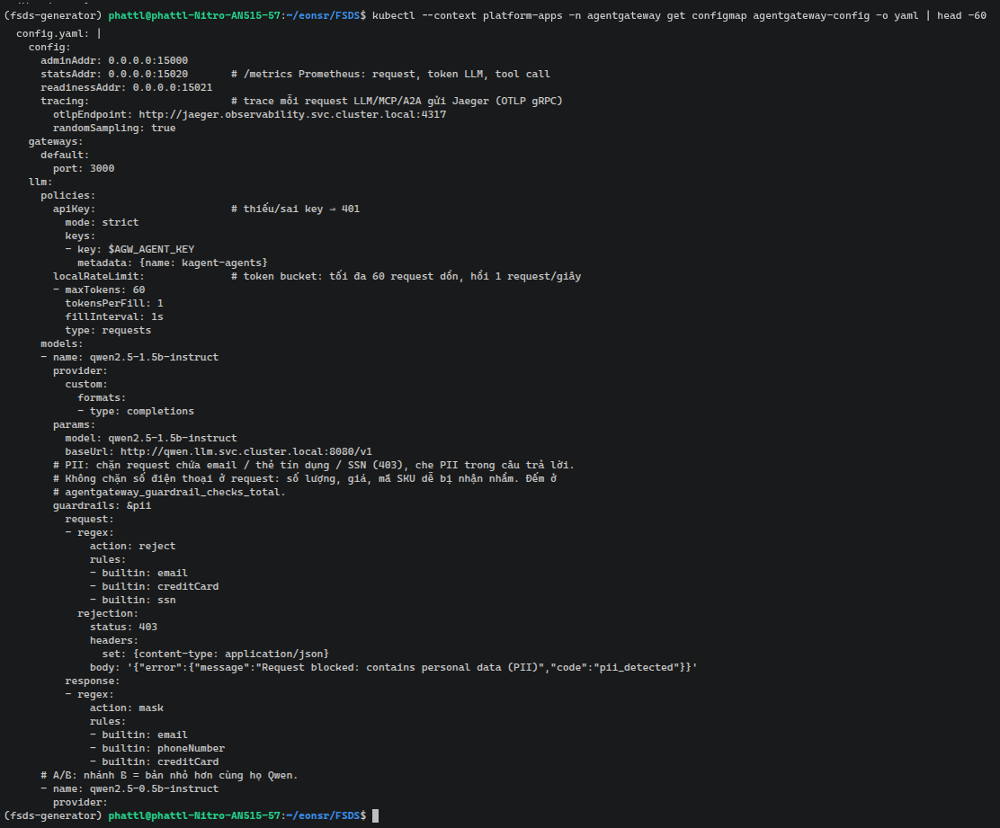
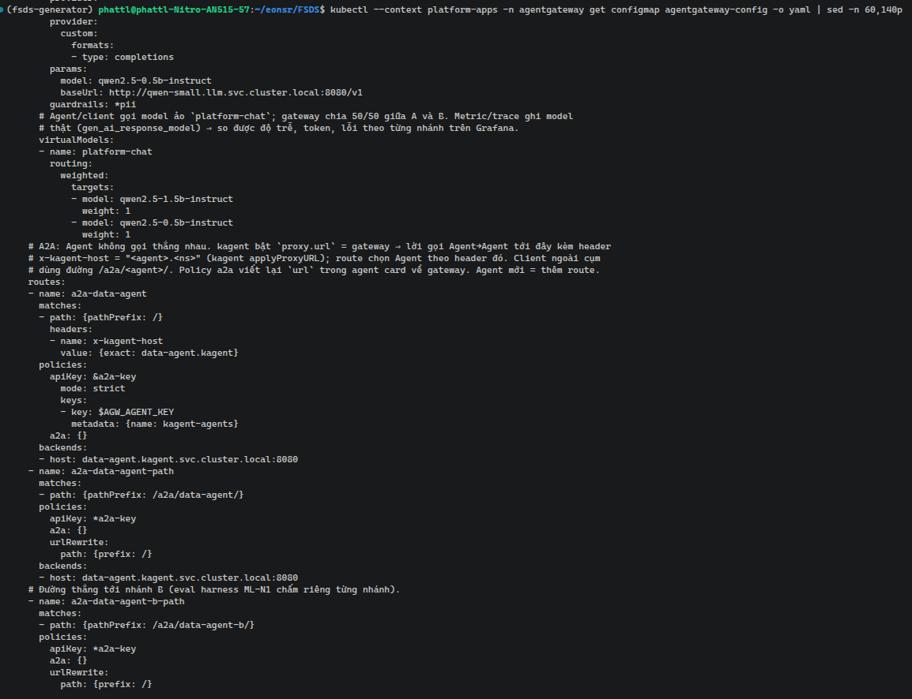
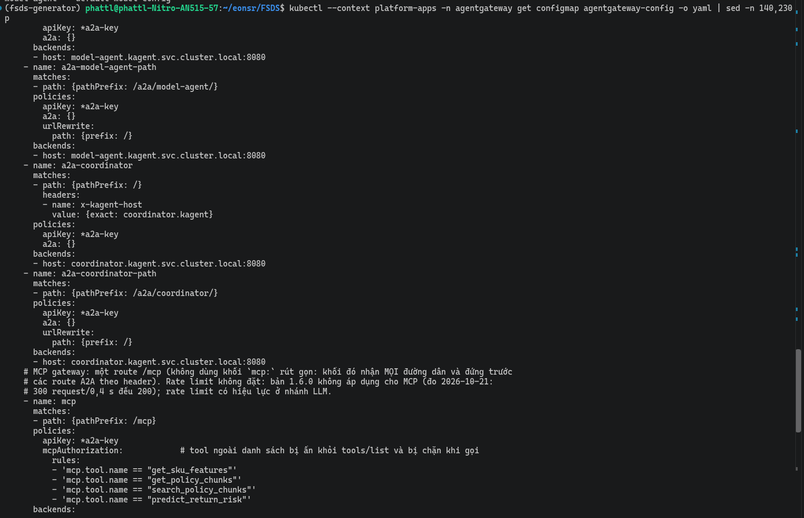
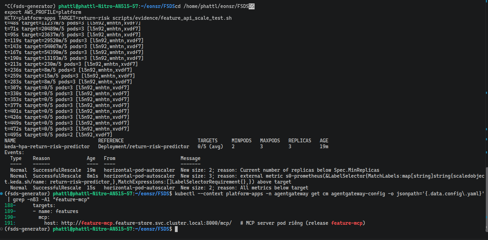
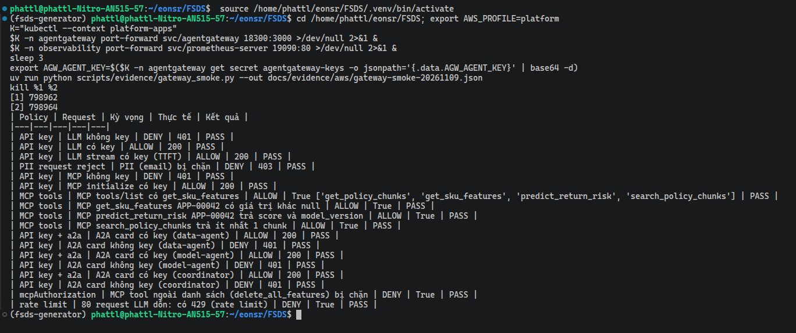

# MCP Gateway and A2A Gateway on EKS

agentgateway and its security policies.

Every call to the LLM, to tools (through MCP) and between Agents (through A2A) goes through one shared gateway: **agentgateway**.
The gateway checks keys, limits call rates, filters personal data (PII) and only allows calls to permitted tools.

Code: [agentgateway.yaml](../../infra/k8s/agents/agentgateway.yaml), [kagent proxy](../../infra/k8s/agents/kagent-values.yaml).

| Route | Target | Policy / purpose |
|---|---|---|
| `/v1/chat/completions` | llama.cpp | API key and rate limit to control LLM calls |
| `/mcp` | MCP server (pod `feature-mcp`) | API key; `mcpAuthorization` limits which tools can be called |
| `x-kagent-host` / `/a2a/<agent>/` | Agent Service | API key, A2A policy; Agents are called through the gateway |

## Why these policies

| Policy | How it is applied and why |
|---|---|
| API key `strict` | Applied to LLM, MCP and A2A. Requests with a missing or wrong key are rejected, so the gateway controls which clients call the services. The key comes from a Kubernetes Secret |
| `localRateLimit` for the LLM | The model runs on CPU, so capacity is limited. Token-bucket limit: a burst of up to 60 requests, then refills at 1 request/second. This limits the number of requests, not LLM tokens |
| `mcpAuthorization` | Only allows `get_sku_features`, `get_policy_chunks`, `search_policy_chunks`, `predict_return_risk`, enough to look up features, search policies and predict. Tools not on the list are hidden from `tools/list` and blocked when called. Adding a tool requires updating the allow list |
| PII request `reject` | Blocks requests with content that looks like an email, credit card number or SSN before it reaches the LLM, to reduce personal data entering processing. Phone number patterns are not blocked in requests, because quantities, prices and SKU codes are easily mistaken for them |
| PII response `mask` | Masks content that looks like an email, phone number or card number in answers, to reduce the risk of returning personal data to clients |
| `a2a` policy and routing through the gateway | Centralizes authentication and routing of Agent calls in the gateway. The Agent is selected by the `x-kagent-host` header or the `/a2a/<agent>/` path. The A2A policy rewrites the URL in the agent card to the gateway address, so later calls also go through the gateway |

Limitations of the current configuration:

- All Agents share one API key; there are no per-Agent permissions yet.
- The rate limit counter lives in each replica's RAM and is not shared between replicas.
- The MCP route currently has no rate limit; there is no evidence yet that such a limit takes effect on MCP specifically.
- PII detection is pattern-based, so it can mistakenly mask long counts in answers: [recorded limitation](agent_evaluation.md).
  Masking does not guarantee the returned numbers are still correct. The policies above only describe the current configuration.

## EKS evidence

The [gateway smoke test](../evidence/aws/gateway-smoke-20261030.json) (a quick check of all policies, [script](../../scripts/evidence/gateway_smoke.py)) passed **17/17** checks. Grafana records traffic on the Agent and MCP routes:

### agentgateway configuration on EKS

The configuration lives in the ConfigMap `agentgateway-config` (namespace `agentgateway`), generated from [`agentgateway.yaml`](../../infra/k8s/agents/agentgateway.yaml).

The LLM part includes:

- `apiKey` in `strict` mode;
- `localRateLimit`: a burst of up to 60 requests, refilling at 1 request/second;
- model `qwen2.5-1.5b-instruct`;
- PII guardrail: in requests, email, credit card and SSN are rejected with code 403; in responses, email, phone number and card number are masked.

In the configuration, the key only appears as the variable `$AGW_AGENT_KEY`; the real value lives in a Secret.

The next part:

- branch B model `qwen2.5-0.5b-instruct`;
- virtual model `platform-chat`, splitting calls 50/50 between the two branches (A/B test);
- the A2A routes: `a2a-data-agent` selects the Agent by the `x-kagent-host` header; `a2a-data-agent-path` and `a2a-data-agent-b-path` serve clients outside the cluster (path `/a2a/<agent>/`). These routes all use `apiKey` and the `a2a` policy.

The remaining routes:

- `a2a-model-agent` and `a2a-coordinator` (selected by the `x-kagent-host` header);
- `a2a-model-agent-path` and `a2a-coordinator-path` (path `/a2a/<agent>/`);
- route **`mcp`** (`/mcp`) with `apiKey` and `mcpAuthorization`. This route only allows the four tools `get_sku_features`, `get_policy_chunks`, `search_policy_chunks`, `predict_return_risk`; tools not on the list are hidden from `tools/list` and blocked when called.

The MCP backend is named `features` and points to `http://feature-mcp.feature-store.svc.cluster.local:8000/mcp/` (a dedicated MCP pod; see [Web API and MCP](web_api_mcp.md)).
The MCP route has no rate limit, because version 1.6.0 does not apply rate limits to MCP.

Screenshot from before the pod split, when the backend was still `feature-api`: [gateway-config-mcp-backend.png](../evidence/aws/gateway-config-mcp-backend.png).

### Allow / deny per policy

[`gateway_smoke.py`](../../scripts/evidence/gateway_smoke.py) prints a table. Each row has: the policy, the request sent, the expected result (ALLOW or DENY) and the actual result.
Policies tested: API key, PII request, rate limit, `mcpAuthorization`, and A2A for each Agent (`data-agent`, `model-agent`, `coordinator`).

Results on EKS (`platform-apps`) after splitting out the MCP pod: **24/24** checks passed, consisting of the 18 policy rows in the table below and 6 Prometheus metric checks.
Result record: [gateway-smoke-20261109.json](../evidence/aws/gateway-smoke-20261109.json). The run before the split passed 22/22 ([receipt](../evidence/aws/gateway-smoke.json)).

- **API key:** without a key, `401` on LLM, MCP and A2A for all three Agents; with a key, `200`.
- **PII request:** a prompt containing an email is blocked with code `403`.
- **Rate limit:** a burst of 80 LLM requests gets some requests back with `429`.
- **`mcpAuthorization`:** `tools/list` only shows the four listed tools (`get_policy_chunks`, `get_sku_features`, `predict_return_risk`, `search_policy_chunks`).
  Calling the unlisted tool `delete_all_features` is rejected with `HTTP 400`, JSON-RPC `-32602 Unknown tool`.
  Note: this tool name also does not exist on the backend, so this response alone cannot tell whether the gateway blocked it or the backend reported a missing tool. Tools declared on the list are not blocked.
- **Real data through MCP:** `get_sku_features APP-00042` returns non-`null` values. This check used to `FAIL` when Redis was empty: see [Feature Store](feature_store.md).

Access from outside the cluster: [NGINX/HTTPS](routing_gateway.md).

[Section index](README.md) · [Main index](../README.md)
