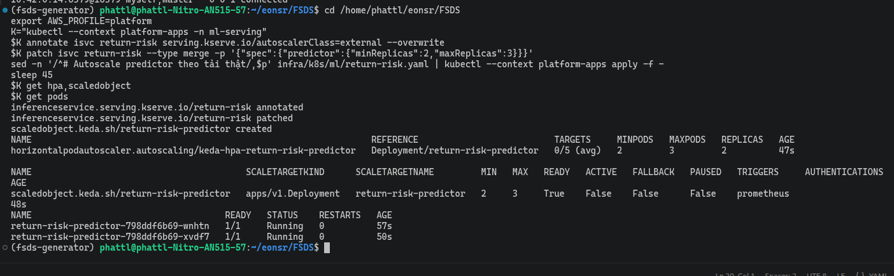
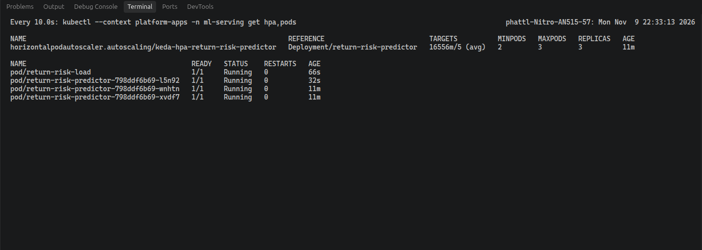
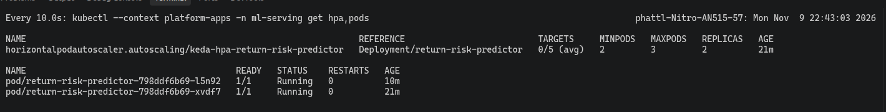
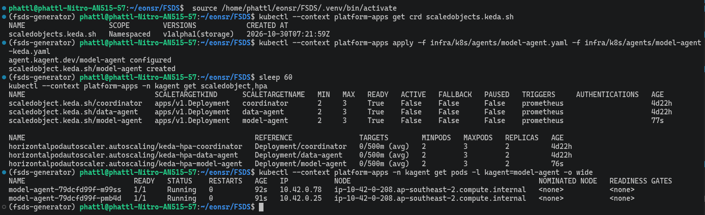
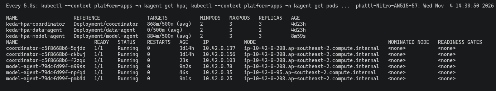
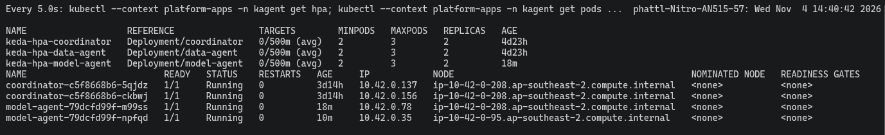
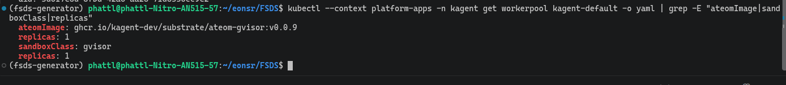
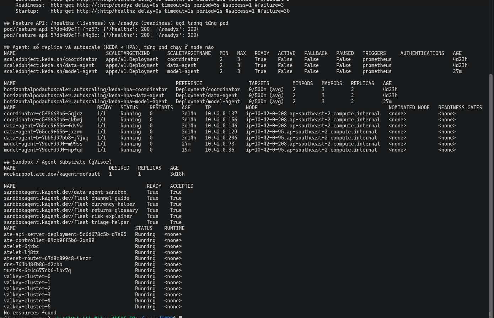
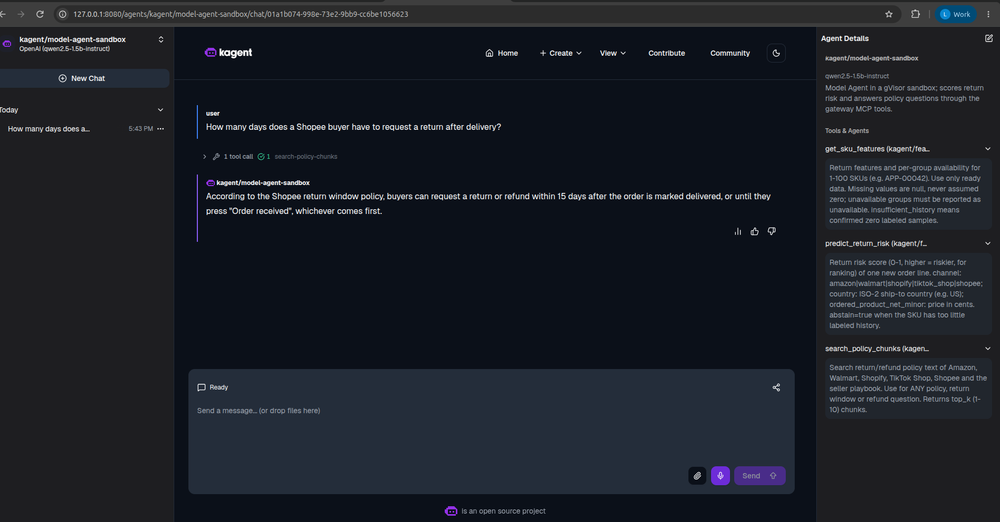

# Data Agent and Model Agent on EKS

MCP, multiple replicas, autoscaling, Sandbox and publishing.

The system has two Agents:

- **Data Agent** fetches SKU features through MCP (the protocol Agents use to call tools).
- **Model Agent** uses online features, calls KServe to predict return risk, and uses RAG (finding relevant document passages) to look up return policies.

Every call goes through the [Agent Gateways](agent_gateways.md). Shared model configuration: [Model Config](global_model_config.md).

Code: [Data Agent](../../infra/k8s/agents/data-agent.yaml), [Model Agent](../../infra/k8s/agents/model-agent.yaml), [KEDA Data Agent](../../infra/k8s/agents/data-agent-keda.yaml), [KEDA Model Agent](../../infra/k8s/agents/model-agent-keda.yaml).

On this page, "pods 2 → 3 → 2" means: there are 2 pods at first, under load autoscaling (automatically adding or removing pods) goes up to 3, and when the load ends it returns to 2.

## Model Agent has the same full set as Data Agent

Agent 2 (online features + predict + RAG) is documented to the same level as Agent 1. The table below compares each item for both Agents:

| Item | Data Agent (Agent 1) | Model Agent (Agent 2) |
|---|---|---|
| Tools | `get_sku_features`, `get_policy_chunks` | `get_sku_features` (online features), `predict_return_risk` (KServe), `search_policy_chunks` (RAG) — [manifest](../../infra/k8s/agents/model-agent.yaml) |
| Chat with tool calls on EKS | [screenshot](../evidence/aws/kagent-ui-coordinator-data-agent-20261030.png) | predict: [screenshot](../evidence/aws/kagent-ui-model-agent-tool-20261030.png), RAG: [screenshot](../evidence/aws/rag-model-agent-answer-20261030.png) |
| Multiple replicas + KEDA | 2 → 3 → 2 ([log](../evidence/aws/keda-data-agent-20261030.txt)) | min 2, max 3, 2 → 3 → 2: [apply screenshot](../evidence/aws/keda-model-agent-apply.png), [under load](../evidence/aws/keda-scale-up-model-agent-coordinator.png), [after load](../evidence/aws/keda-scale-down-model-agent-coordinator.png), [per-pod log](../evidence/aws/keda-model-agent.txt) |
| gVisor Sandbox | `data-agent-sandbox` can call tools ([screenshot](../evidence/aws/substrate-sandbox-agent-ui-20261031.png)) | `model-agent-sandbox` READY, calls `search_policy_chunks`, answers 15 days ([screenshot](../evidence/aws/model-agent-sandbox-chat-20261106.png)) — [manifest](../../infra/k8s/agents/sandbox/model-agent-sandbox.yaml) |
| Published to the registry | [entry](../../infra/k8s/agents/registry/data-agent.yaml) | [entry](../../infra/k8s/agents/registry/model-agent.yaml); the registry UI shows all 3 Agents ([screenshot](../evidence/aws/agent-registry-ui-20261030.png)) |
| MCP calls through the gateway | `tools/list`, `get_sku_features` | both Model Agent-specific tools, in the smoke test on EKS ([JSON](../evidence/aws/gateway-smoke-20261106.json), table below) |
| Backend with multiple replicas + autoscaling | MCP `feature-mcp` 2 → 3 → 2 ([log](../evidence/aws/feature-mcp-autoscale.txt)) | KServe `return-risk` 2 → 3 → 2 ([under-load screenshot](../evidence/aws/return-risk-scale-up-20261109.png), [after load](../evidence/aws/return-risk-scale-down-20261109.png), [log](../evidence/aws/return-risk-autoscale.txt)); MCP `feature-mcp` same as the left column ([Web API and MCP](web_api_mcp.md)) |

Model Agent eval on EKS (Jenkins #13, [details](agent_evaluation.md)): predict passed **12/12**, policy passed **3/5**.
Policy is below the 0.95 threshold, so the build is red. Reason: Qwen 1.5B sometimes writes the tool call out as text instead of actually calling the tool.
The smoke test (a quick end-to-end check) was rerun after splitting out `feature-mcp`: [24/24 PASS](../evidence/aws/gateway-smoke-20261109.json).

Model Agent MCP checks in the smoke test (`recorded 2026-11-06T10:23:46Z`, 24/24 PASS overall):

| Check | Result |
|---|---|
| MCP without key | 401 (blocked) ✅ |
| MCP `initialize` with key | 200 ✅ |
| `tools/list` | all of `get_policy_chunks`, `get_sku_features`, `predict_return_risk`, `search_policy_chunks` ✅ |
| `get_sku_features` HOM-01815 | has non-null values ✅ |
| `predict_return_risk` HOM-01815 | has `score` and `model_version` ✅ |
| `search_policy_chunks` | ≥ 1 chunk ✅ |
| A2A agent card `model-agent` with key / without key | 200 / 401 ✅ |
| Tool not on the list (`delete_all_features`) | blocked ✅ |

**KServe `return-risk`** (the backend that returns prediction scores to Model Agent):

- KEDA scales on the metric `return_risk_predictions_total`, minimum 2 pods, maximum 3.
- Load sent to `:predict` for 150 seconds: after about 48 seconds it went up to 3 pods (HPA metric at that point `11237m/5`, i.e. about 11.2 against a threshold of 5). About 495 seconds later it returned to 2.
- Only one HPA (Kubernetes autoscaler) remains, the one created by KEDA.

## EKS evidence

Example with SKU APP-00042: 15,306 labeled rows, 2,599 Returns, rate 0.1698. Model Agent calls the prediction tool and gets a score of 0.1661. These numbers match calling the API directly.

**KEDA Data Agent.** Sent 3 requests/second to the agent card for 150 seconds; the pod count went **2 → 3 → 2**.
The script [`keda_scale_test.sh`](../../scripts/evidence/keda_scale_test.sh) also records each pod's name at every point in time.
The script [`eks_runtime_proof.sh`](../../scripts/evidence/eks_runtime_proof.sh) prints the ScaledObject/HPA, the node each Agent pod runs on, the WorkerPool and the SandboxAgents ([output](../evidence/aws/eks-runtime-proof-part2.png)).
Note: this is load on the A2A route, not load that makes the LLM run inference. [EKS log](../evidence/aws/keda-data-agent-20261030.txt).

### KEDA Model Agent (EKS `platform-apps`)

[ScaledObject](../../infra/k8s/agents/model-agent-keda.yaml) configuration: minimum 2 pods, maximum 3; add a pod when each pod receives more than 0.5 requests/second on route `a2a-model-agent`.

How it was tested: run [`keda_scale_test.sh`](../../scripts/evidence/keda_scale_test.sh), sending 3 agent-card requests/second for 150 seconds. At each point, the script records **each pod's name suffix**.

Results in the log [keda-model-agent.txt](../evidence/aws/keda-model-agent.txt), the pod count went **2 → 3 → 2**:

- Up to 3 after 54 seconds, when the metric reached `target=792m/500m` (0.792 against a threshold of 0.5). The new pod is `smvxc`.
- Back to 2 after 468 seconds, once the load had stopped. Pod `gljwt` was removed; `bqckg` and `smvxc` stayed.

The run in the screenshots below gave similar results: up to 3 after about 27 seconds, back to 2 after about 8 minutes (the HPA waits for stabilization before scaling down).
The load here is A2A agent-card requests, not load that makes the LLM run inference.
The HPA's Events section has a few scattered `FailedGetExternalMetric` lines over 45 hours. That was the period when the cluster was off, so Prometheus did not respond.

Pod placement: `podAntiAffinity` (a rule that spreads pods across different nodes) is only a preference here, not a requirement.
The first two Model Agent pods are on the same node, because the other node was almost out of CPU.
The third pod went to the other node. When scaling back to 2 pods, the HPA kept the two pods that are on different nodes.

**Sandbox.** The Sandbox uses Agent Substrate with gVisor (an isolation layer for running containers). The Agent in the Sandbox can call `get-sku-features`.
The 1.5B CPU model copied `830847` wrongly as `83,084`; the screenshot below only shows that the tool call path inside the Sandbox works, not that the number is correct.

State on EKS at the first capture ([eks-runtime-proof.txt](../evidence/aws/eks-runtime-proof.txt), WorkerPool had been running for 3d18h):

- `workerpool kagent-default`: DESIRED 1, REPLICAS 1.
- Six SandboxAgents (`data-agent-sandbox` and five `fleet-*`) are all `READY True`, `ACCEPTED True`. After the cluster was rebuilt, this state changed (see Limitations).
- The Substrate pods in `ate-system` are all Running: api server, controller, two `atelet`, `atenet-router`, DNS, rustfs, six `valkey-cluster`.

Kubernetes has no RuntimeClass (`No resources found`). Substrate applies gVisor through the WorkerPool's `sandboxClass` and the `ateom-gvisor` image, not through a RuntimeClass.

Sandbox code: [deploy_substrate.sh](../../scripts/setup/deploy_substrate.sh), [manifest](../../infra/k8s/agents/sandbox/fleet-agents.yaml).

## Additional evidence for Model Agent (EKS `platform-apps`)

- **Probes and health** (Kubernetes checks on its own whether a pod is alive / ready): [eks-runtime-proof-20261106.txt](../evidence/aws/eks-runtime-proof-20261106.txt).
  The Feature API has Liveness `/healthz`, Readiness `/readyz` and Startup; calling `/healthz` and `/readyz` inside each pod returns 200.
  The three Agent Deployments only declare **Readiness** `/.well-known/agent-card.json`, with no Liveness or Startup.
- **Direct MCP calls through the gateway:** [gateway-smoke-20261106.json](../evidence/aws/gateway-smoke-20261106.json), **24/24 PASS**. Includes `predict_return_risk` (with `score`, `model_version`),
  `search_policy_chunks` (≥ 1 chunk), a tool not on the list being blocked, and the 401/403/429 codes.
- **SandboxAgent:** `model-agent-sandbox` is `READY True`, `ACCEPTED True` on WorkerPool `kagent-default` (`sandboxClass: gvisor`).
  Reaching this state required rebuilding Substrate's valkey cluster: after the nodes were replaced, the cluster still held the old pod IPs, which crashed `ate-api` and `kagent-controller`.
  Test chat through the kagent UI: asked for Shopee's return deadline. The Agent called `search_policy_chunks` (once, successfully) and answered 15 days, matching the document `rag/corpus/shopee-returns.md`.

## Limitations

- The combined Swagger screenshot of the Feature API (endpoint list, `/healthz`, `/readyz`) is in [Web API and MCP](web_api_mcp.md).
- The three Agents only declare a Readiness probe (agent card), with no Liveness or Startup.
- In the capture after the WorkerPool was rebuilt ([eks-runtime-proof-20261106.txt](../evidence/aws/eks-runtime-proof-20261106.txt)), the old SandboxAgents report `ACCEPTED False`: the five `fleet-*` have `READY True`, while `data-agent-sandbox` has `READY Unknown`. The error is `WorkerPool kagent-default not found`, recorded when they were reconciled (state synchronized) before the new WorkerPool existed; adding an annotation does not make them reconcile again. This does not affect `model-agent-sandbox`.
- When a question lacks a price or quantity, the small model may fill in wrong parameters on its own.

The [Registry](agent_registry.md) has the publishing evidence. [Agent Evaluation](agent_evaluation.md) records the PII limitation and the scoring results.

[Section index](README.md) · [Main index](../README.md)
