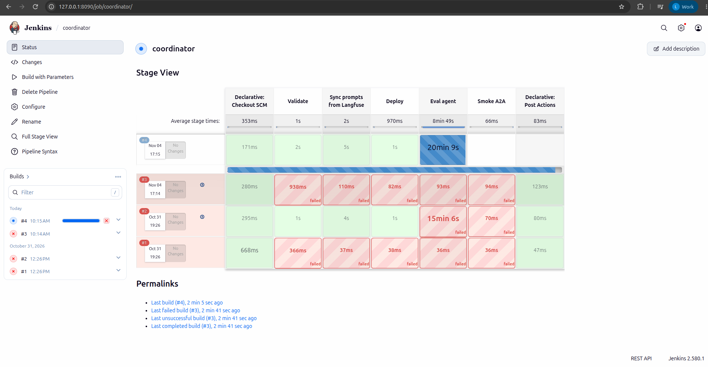

# CI/CD on AWS

CI/CD (automated test, build and deploy) for the RAG pipeline, MCP server/Agents, the Coordinator and stream features.

Code / config: [RAG Jenkinsfile](../../ci/jenkins/rag-pipeline.Jenkinsfile), [Agent Jenkinsfile](../../ci/jenkins/feature-api-agents.Jenkinsfile).

The results below come from runs on AWS; the docs do not claim the services are still up.

## On AWS

**Conclusion:** the Jenkins pipelines have run on AWS and gone through all deploy steps. The builds that failed all stopped at the eval step (Agent scoring),
not at build or deploy: `feature-api-agents` #13 (policy part 3/5), `coordinator` #2 (red) and #4 (ran too long). Build `coordinator` #9 passed 12/12.

Runtime environment:

- Jenkins runs on EC2 `i-0d657089ba4a4ea7e` (private IP `10.42.0.151`). The web UI only listens on `127.0.0.1:8090` and is not exposed.
- Jenkins gets the code from a git bundle (a packaged repo file), builds images and pushes them to ECR
  `665116832975.dkr.ecr.ap-southeast-2.amazonaws.com/platform`.
- The Kubernetes deploy steps use context `platform-apps` (two `r6i.xlarge` nodes). RAG and stream features are deployed with Docker Compose on EC2.

Each row in the table is one build. The "Stages" column lists the steps in the order they ran.

| Pipeline / code | Stages | Result |
|---|---|---|
| [feature-api-agents](../../ci/jenkins/feature-api-agents.Jenkinsfile) #8 | Test, Build, Push ECR, Deploy MCP server, Sync prompts from Langfuse, Deploy Agent, Eval agent, Smoke | Green. The eval gate reached **12/12 = 1.00 ≥ 0.95**. See the [JSONL and PII limitation](agent_evaluation.md#on-aws). |
| [rag-pipeline](../../ci/jenkins/rag-pipeline.Jenkinsfile) #2 | Test, Build, Push, Release config, Deploy, DAG import, Run DAG | Green. The DataHub lineage screenshot on AWS is in [RAG Pipeline](rag_pipeline.md). |
| [feature-api-agents](../../ci/jenkins/feature-api-agents.Jenkinsfile) #13 | Ran after splitting MCP into its own pod: Test, Build, Push, Deploy MCP server (2 releases and the gateway), Sync prompts, Deploy Agent, Eval agent | Steps up to Deploy Agent green. **Eval agent red**: Data 12/12, predict 12/12, policy 3/5 ([details](agent_evaluation.md)). |
| [stream-features](../../ci/jenkins/stream-features.Jenkinsfile) #7 | 2 PyFlink jobs version: Test, Build (image includes the `tests/flink` directory), Push, Release config, Deploy, Verify | Green. The Verify step checks that exactly 2 jobs are RUNNING ([screenshot](../evidence/aws/jenkins-stream-features-7-20261109.png)). |
| [stream-features](../../ci/jenkins/stream-features.Jenkinsfile) #2 (Flink SQL version) | Test, Build, Push, Release config, Deploy, Verify | Green. |
| [coordinator](../../ci/jenkins/coordinator.Jenkinsfile) | Validate, Sync, Deploy, Eval agent | #2: first three steps green, **Eval agent red** after 15 minutes 6 seconds. #4: first three steps green, **Eval agent ran more than 20 minutes without finishing**, so it did not pass the gate. #9: Eval agent passed 12/12, but the gate only scores routing. Details and LLM numbers: [Agent Evaluation](agent_evaluation.md#coordinator-on-aws-2026-11-04). |





Problems hit on the first runs and how they were handled:

- The EC2 IAM role lacked the `eks:DescribeCluster` permission, so Jenkins could not create a kubeconfig. The permission was added.
- Checking out from a bundle on the machine requires enabling `ALLOW_LOCAL_CHECKOUT`; the bundle's remote is declared as a plain directory path.
  JCasC (Jenkins configuration as code) substitutes variables in `scriptPath` itself, so the Jenkinsfile path has to be built by string concatenation instead of using a variable.
- The agentgateway key is copied into Vault through the Jenkins container. The key value is not written in the docs.
- Redis loses its data when the nodes scale to 0. So before the eval, `ml_feature_materialize` must be run with `full_reload` to reload the features.

The Jenkins Stage View screenshot only shows whether each step is green or red. Per-question scoring results are in the JSONL file of the Agent eval harness.
For now the eval gate only blocks the pipeline after the deploy; when the eval fails, the just-deployed Agent is not rolled back automatically.

<details>
<summary>Reference: design, development guide and records from before the AWS deployment</summary>

Local records keep their original environment and are not a substitute for cloud evidence.

<!-- Purpose: local Jenkins CI/CD for the ML Platform / LLM Platform: setup, configuration, jobs, secrets. -->
## CI/CD — Jenkins

CI/CD (test, build and automated deploy) for the RAG pipeline, the MCP server with agents,
the coordinator and the stream feature jobs. Secrets must live in Jenkins or a similar tool, not in code.

## Setup

| Component | File |
|---|---|
| Jenkins 2.580.1 LTS image + pinned plugins + docker/compose/kubectl/helm/kind/uv | [`docker/Dockerfile.jenkins`](../../docker/Dockerfile.jenkins) |
| Configuration as code (JCasC): users, credentials, 4 jobs | [`infra/jenkins/jenkins.yaml`](../../infra/jenkins/jenkins.yaml) |
| Startup (fetches secrets from Vault) | [`scripts/setup/setup_jenkins.sh`](../../scripts/setup/setup_jenkins.sh), service `jenkins` (profile `ci`) |
| Pipelines | [`ci/jenkins/`](../../ci/jenkins/stream-features.Jenkinsfile): `stream-features`, `feature-api-agents`, `coordinator`, `rag-pipeline` |

```bash
scripts/setup/setup_vault.sh      # first: Vault + read-only token
scripts/setup/setup_jenkins.sh    # UI http://localhost:8090, user admin, password in Vault secret/platform/jenkins
```

## Decisions

- **Secrets**: Jenkins only holds 2 credentials — `vault-ci-token` (read-only Vault token) and
  `kind-kubeconfig`. DB/MinIO passwords are fetched from Vault at build time (`scripts/setup/vault_env.sh`).
  The Jenkins admin password is randomly generated, stored in Vault, and loaded through an environment variable at every startup.
- **Jobs take code from git `main`** (`file:///repo`): CI runs exactly the committed code, not the version being edited in the
  working tree. So the `ci/jenkins/*` files must be committed before the first build.
- **Use `network_mode: host` and put JENKINS_HOME at the same path as on the host**: builds call `docker compose` through
  the host's Docker socket, so every relative bind mount in the workspace must exist on the host at that exact path.
- Builds run directly on the controller (1 executor). That is enough locally; on GKE, split them out to a separate agent.

## Evidence

- The Jenkins container is `Up`, and the `/login` page returns 200. The Jenkins API lists all the jobs `coordinator`,
  `feature-api-agents`, `rag-pipeline`, `stream-features` and the two credentials `vault-ci-token`, `kind-kubeconfig`; all are created by JCasC.
- Changing the admin password: delete `secret/platform/jenkins` and rerun `setup_jenkins.sh` (done once, login
  with the new password OK).
- **Not built yet** (local record): the Jenkinsfiles had not been committed to `main`. This state has been superseded by the AWS results in the section below.

## Publishing images through the local registry

```text
Jenkins (network host)
  Test → Build image:<SHA> → Push localhost:5001/image:<SHA>
                                      │ host port 5001
                                registry:2.8.3 + volume registry-data
                                      │ Docker network kind, registry:5000
  Deploy Helm / KServe / KFP ───→ kubelet/containerd pull image:<SHA>
  Deploy Agent → Eval agent (accuracy ≥ 0.95) → artifacts JSONL/JSON
```

The Docker registry here (where images are stored) is different from the MLflow model registry and the agent registry. The registry only listens on `127.0.0.1:5001`,
and the HTTP registry is not exposed. Configured following [kind local registry](https://kind.sigs.k8s.io/docs/user/local-registry/):
each node's containerd maps `localhost:5001` in an image to `http://registry:5000`.
The script checks that `config_path` is enabled, and writes `hosts.toml` and the ConfigMap `kube-public/local-registry-hosting`.
It does not recreate the cluster or restart nodes. When `config_path` is missing, the script stops and reports that the node needs registry configuration.

```bash
## Existing platform cluster; setup does not delete data. up_ml_base.sh also calls this step.
scripts/setup/setup_kind_registry.sh
curl -fsS http://localhost:5001/v2/_catalog

## Feature API: build → tag/push → helm upgrade --atomic, IfNotPresent.
REGISTRY=localhost:5001 scripts/setup/deploy_kind_feature_api.sh "$(git rev-parse HEAD)"
## KFP: the script builds/pushes the train image with the same TAG before compile/submit.
REGISTRY=localhost:5001 scripts/run/run_training_pipeline.sh
## KServe: takes the production model, builds/pushes an image tagged version+git SHA+content hash, then applies.
REGISTRY=localhost:5001 scripts/run/deploy_return_risk.sh
```

`REGISTRY` defaults to `localhost:5001`; switch to ECR/Artifact Registry with this variable, and log in to
Docker along with the target cluster's pull credential configuration. The shared script `scripts/run/push_images.sh`
takes a list of images with source tags; if `TAG` is set, it retags them to that SHA. `latest` is never published.
The old name `push_images_gke.sh` is only a compatibility wrapper for `REGISTRY_URL`, and also needs the image list.

Every Jenkinsfile that builds images has a **Push** stage before the deploy step, so the deploy uses exactly the image just pushed:

- The Feature API deploys with `SKIP_BUILD_PUSH=1`, so it does not rebuild the image after the Push step.
- RAG and stream publish images tagged with the git SHA, and generate the Compose override file `out/ci-compose-images.yaml`.
  The deploy step runs `--no-build --pull always` with that same SHA, including the Flink taskmanager. The later check stages also use this same override file.

SHA tags are only correct when the working tree is clean. If you run by hand with uncommitted code, set a separate `TAG` and do not reuse it.

The **Eval agent** stage has been wired into the Feature API and coordinator pipelines, see the [eval gate](agent_evaluation.md#use-in-ci).
If the score is below the threshold or there is no data to score, the build is red; this gate does not yet roll back the applied agent.
Local record: **no evidence yet of a real Jenkins run** for the new registry/eval gate changes.
This state has been superseded by the AWS results below.

</details>

[Section index](README.md) · [Main index](../README.md)
