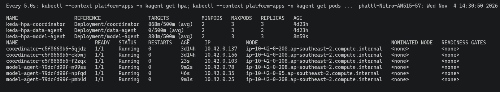
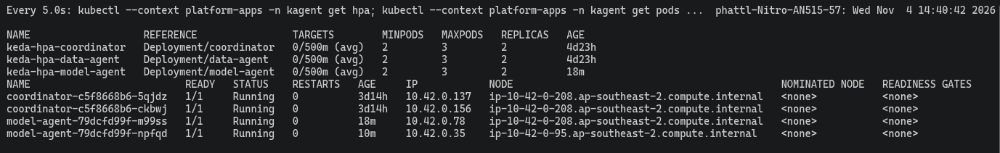

# Coordinator Agent on EKS

Orchestrating two Agents, with multiple replicas, autoscaling and publishing.

The Coordinator is the orchestrating Agent. It receives a question, calls Data Agent and Model Agent through the A2A gateway, then combines the features and prediction into one answer.
Code: [coordinator.yaml](../../infra/k8s/agents/coordinator.yaml), [KEDA](../../infra/k8s/agents/coordinator-keda.yaml).

## EKS evidence

Test question: SKU APP-00042, Channel Amazon US, 1 unit at 25 USD.
The Coordinator returns a Return rate of **0.1698** and a risk score of **0.1661**, matching the numbers from calling the API directly.

The Coordinator has been published in the [Registry](agent_registry.md).
Its prompt, named `platform-coordinator` with label `production`, is managed in Langfuse. When CI deploys, the prompt is synced into a ConfigMap.

## Autoscaling on EKS

[Coordinator KEDA](../../infra/k8s/agents/coordinator-keda.yaml) configuration: minimum 2 pods, maximum 3; add a pod when each pod receives more than 0.5 requests/second on route `a2a-coordinator`.

Run [`keda_scale_test.sh`](../../scripts/evidence/keda_scale_test.sh). The log [keda-coordinator.txt](../evidence/aws/keda-coordinator.txt) shows the pod count going **2 → 3 → 2**:
up to 3 after about 55 seconds, and back to 2 after about 8 minutes.
This test ran at the same time as the Model Agent one; per-pod screenshots are in [Agents](agents.md#keda-model-agent-eks-platform-apps).

The `Events` section of the log contains an old `FailedGetExternalMetric` warning (repeated tens of thousands of times over 2 days).
At that time the EKS nodes were scaling to 0, so the KEDA metrics API did not respond.
This warning does not appear in the scaling run recorded here; the `SuccessfulRescale` events below belong to this run.

## Limitations

The `Eval agent` gate passed 12/12 (Jenkins #9), but it only scores routing to the right Agent, not the numbers in the answer.
The first two runs were red or did not finish, because the CPU-hosted LLM slows down when several calls overlap.
See also: [CI/CD](cicd.md), [Agent Evaluation](agent_evaluation.md#coordinator-on-aws-2026-11-04).

[Section index](README.md) · [Main index](../README.md)
