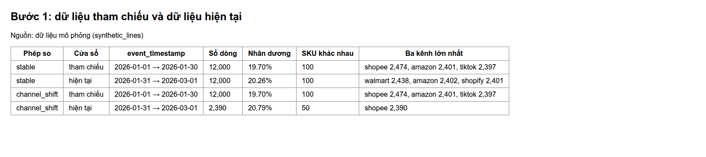
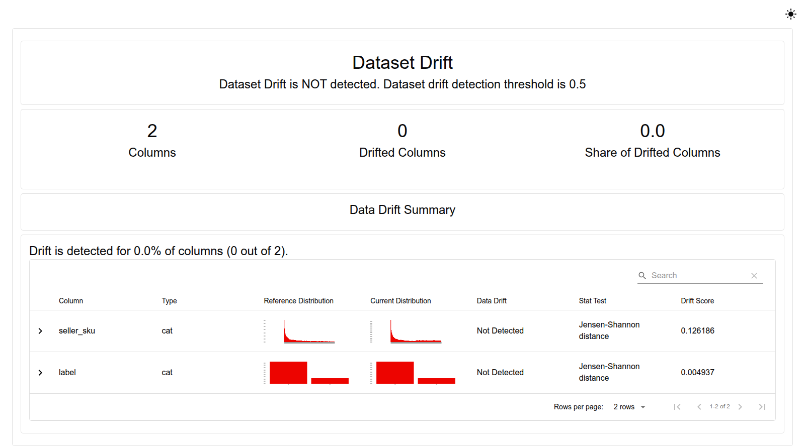
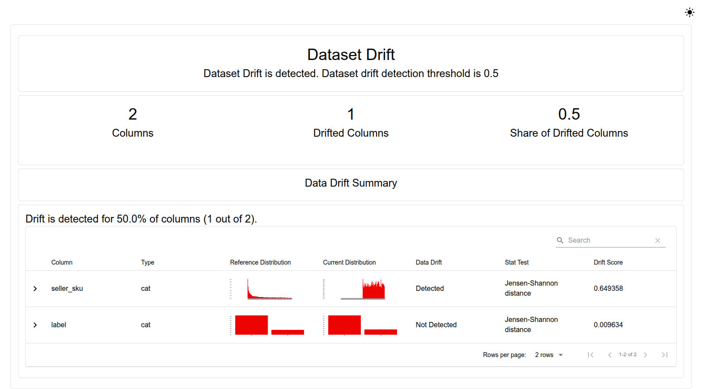
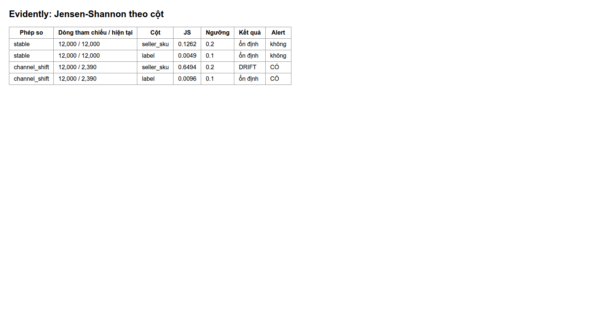
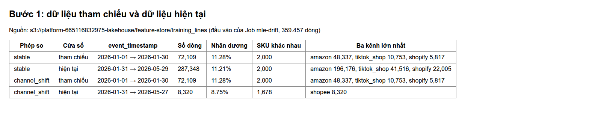
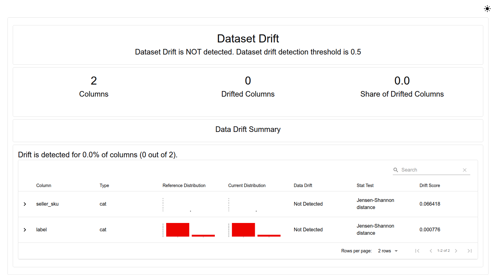
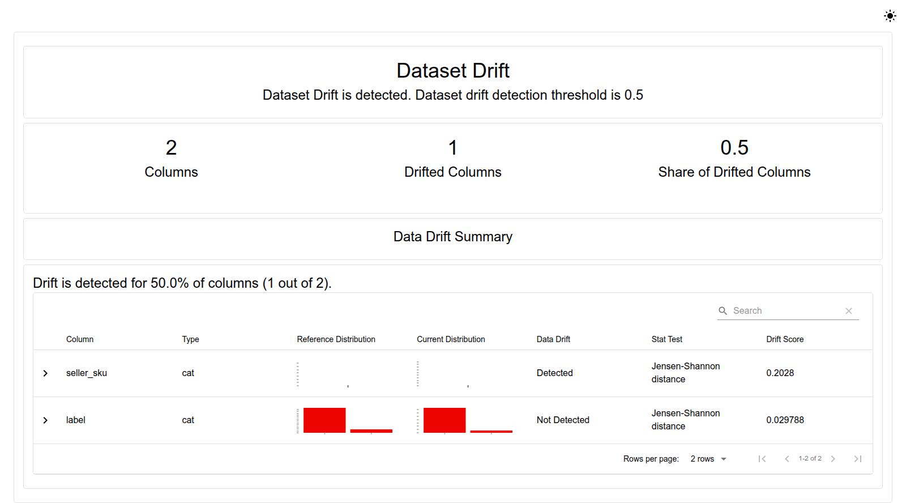
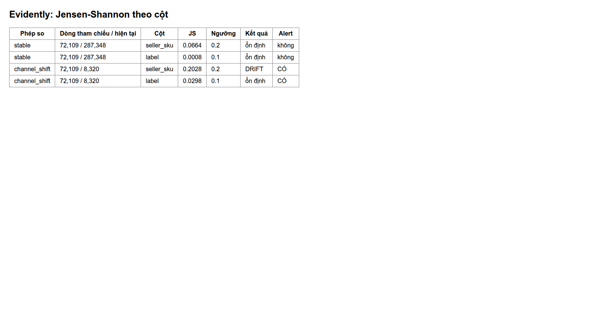

# Drift Monitoring on AWS

Per-Channel drift detection.

Drift is when new data has a different distribution from the data the model was trained on. When that happens, the model's prediction scores may no longer be reliable.
Here an Evidently Job running on EKS compares new data against reference data and raises an alert when the shift exceeds a threshold.
The Job is run on demand when a check is needed; it does not yet retrain the model automatically when drift is found.

The results below come from runs on AWS; the docs do not claim the services are still up.

<a id="on-aws-pipeline-a-2026-10-31"></a>
## Drift on EKS

**Conclusion:** the comparison on stable data raises no alert. The comparison that simulates orders concentrating on one marketplace (Shopee only)
correctly reports drift on column `seller_sku`, with a score of 0.2028, above the 0.2 threshold. Rerunning the Job a second time gave exactly the same numbers.

Method:

- Data: the `training_lines` table on S3 in the AWS environment (`s3://platform-665116832975-lakehouse/feature-store/training_lines`, 2‰ sample).
- Two comparisons, both using the first 30 days as reference data:
  - `stable`: compared with all the data after that. This is the no-change case, so no alert is expected.
  - `channel_shift`: compared with the data after that but **keeping only the Shopee Channel**, simulating an order mix concentrating on one marketplace. An alert is expected.
  - The old "Sale Event" batch is reference material only and is not used for this AWS measurement.
- Where it runs: Job [`infra/k8s/ml/drift-job.yaml`](../../infra/k8s/ml/drift-job.yaml) on EKS, context `platform-apps`, namespace `kubeflow`, Job name `mle-drift`.
  The Job uses the service account `pipeline-runner`; through Pod Identity, this account can only read `feature-store/*`.
- Versions: **Evidently 0.7.23 and pandas 2.3.3**. pandas 3 makes Evidently fail on import, so this run uses pandas 2.3.3.

Results: [mle-drift-20261031.json](../evidence/aws/mle-drift-20261031.json).

The drift score uses JS (Jensen-Shannon) distance: 0 means the two distributions are identical, larger means more different. A column counts as drifted when its score exceeds that column's threshold.

| Comparison | Reference / current rows | JS `seller_sku` (threshold 0.2) | JS `label` (threshold 0.1) | Alert |
|---|---:|---:|---:|---|
| `stable` | 72,109 / 287,348 | 0.0664 | 0.0008 | no |
| `channel_shift` | 72,109 / 8,320 | **0.2028 > 0.2** | 0.0298 | **yes: seller_sku** |

How to read it: the `stable` batch raises no alert. The `channel_shift` batch keeps only Shopee, so the SKU proportions change and the `seller_sku` column exceeds its threshold;
the `label` column (return label) stays below its threshold. These numbers were measured on the AWS S3 data; the numbers from the local Sale batch are not used in their place.

### Step by step with screenshots

The process has four steps. The four screenshots right below were run **locally on simulated data** (60 days, 400 rows per day, the Shopee Channel concentrating on the second half of the SKU catalog).
The purpose is to show the process works before moving it to EKS. The JS scores in these screenshots are **not** the AWS measurements in the table above.

1. **Reference and current data:** from `training_lines`, take the first 30 days as reference. For `stable`, the current data is the rest; for `channel_shift`, it is the rest but Shopee only.

   
2. **`stable` report:** Evidently compares each column with Jensen-Shannon distance. The batch has the same distribution, so no column exceeds its threshold.

   

3. **`channel_shift` report:** column `seller_sku` exceeds the 0.2 threshold, column `label` does not.

   

4. **Results table and alert** (same structure as `mle-drift-20261031.json`):

   

**Evidently reports from EKS.** To get real report screenshots from EKS, the Job [`mle-drift`](../../infra/k8s/ml/drift-job.yaml) was rerun (namespace `kubeflow`, input still `training_lines` on S3 as before):

1. The pod is kept for 15 minutes after it finishes, enough time to copy the HTML reports out with `kubectl -n kubeflow cp <pod>:/tmp/drift ./drift-eks`.
2. Screenshot the reports with [`capture_drift_evidence.py`](../../scripts/evidence/capture_drift_evidence.py) (`--html-dir drift-eks --summary drift-eks/summary.json`).

The rerun's results **match the previous run down to every decimal place** ([drift-summary-eks.json](../evidence/aws/drift-summary-eks.json)), meaning the measurement is stable and reproducible.

**Step 1 on EKS: reference and current data.** The screenshot below is built from the same `training_lines` dataset on S3 (the Job's input, 359,457 rows), using the function `ml.drift.comparisons` with `--reference-days 30`.
The computed row counts are **exactly equal** to `reference_rows`/`current_rows` in the Job's summary (stable 72,109 / 287,348; channel_shift 72,109 / 8,320).
So the screenshot correctly describes the two data ranges Evidently compared:

- Reference: Jan 1–Jan 30. Current: from Jan 31.
- In `channel_shift`, the current data is Shopee only: 8,320 rows, 1,678 SKUs, positive label rate 8.75% (reference is 11.28%).









Note when reading the `channel_shift` screenshot: the `seller_sku` distribution chart is almost empty, because this column has thousands of distinct values and each value is a tiny share.
The key information is the Jensen-Shannon score and the `Detected` verdict. The `Alert` column in the summary table is the verdict for the whole comparison, not for each column.

<details>
<summary>Reference: design, development guide and records from before the AWS deployment</summary>

Local records keep their original environment and are not a substitute for cloud evidence.

<!-- Purpose: monitor model input data drift with Evidently, with a runnable proof. -->
## Data drift monitoring (Evidently)

Evidently compares the input data distribution of a new batch with a reference batch (the training period) and warns when they differ.
This warning is a signal to recheck the model **before** trusting its prediction scores, e.g. when a Sale Event changes the SKU mix.

| Component | File |
|---|---|
| Drift check + summary | [`ml/drift.py`](../../ml/drift.py), test [`tests/unit/test_drift.py`](../../tests/unit/test_drift.py) |
| "Sale Event" batch | `generator.generate_order_lifecycle --sku-zipf-s 0.3` (promoted SKUs spread evenly) |
| Results | [`evidence/mle-drift-summary-20261021.json`](../evidence/mle-drift-summary-20261021.json), HTML in `out/drift/` |

## How it is measured

- Columns: `seller_sku`, `label`, both categorical. Method: **Jensen-Shannon** distance.
- Thresholds: `seller_sku` is 0.2. This column has about 100 values; sampling noise alone on about 1,000 rows already gives a score of 0.14, so the threshold must be above that.
  `label` uses the default threshold of 0.1.
- `alert` fires when at least one column has drifted.

**Pitfall hit:** when the data has more than 1,000 rows, Evidently switches the method from chi-square to Jensen-Shannon on its own.
The two methods read in opposite directions: chi-square returns a p-value, where a **small** number means drift; Jensen-Shannon returns a distance, where a **large** number means drift.
The first version of the code read every number as a p-value, so the conclusion was completely reversed: it reported `label` drift and missed `seller_sku`.
The bug was found by recomputing with scipy's chi-square. Fix: determine the comparison direction from the method name recorded in the metric; tests cover both directions and values right at the threshold.

## Proof

| Batch compared with reference (first 30 days, 2,307 lines) | `seller_sku` | `label` | alert |
|---|---|---|---|
| 15 days later, same distribution (1,165 lines) | 0.136 | 0.005 | **no** |
| 5-day Sale Event, zipf 0.3 (1,228 lines) | **0.436** | 0.001 | **yes** |

Manual check: the top SKU makes up 27.9% of the reference batch but only 3.3% of the Sale Event, while the return rate stays almost
unchanged (0.299 / 0.306 / 0.300). This matches the result that only `seller_sku` drifted.

## Run

```bash
uv run --no-project --with evidently==0.7.23 --with s3fs==2026.9.0 --with pyarrow \
  env PYTHONPATH=. AWS_ENDPOINT_URL_S3=http://localhost:9000 AWS_ACCESS_KEY_ID=... AWS_SECRET_ACCESS_KEY=... \
  python -m ml.drift --reference s3://platform/feature-store/training_lines \
    --sale-truth out/order_lifecycle_sale/_truth/lines.jsonl --out out/drift
```

</details>

[Section index](README.md) · [Main index](../README.md)
