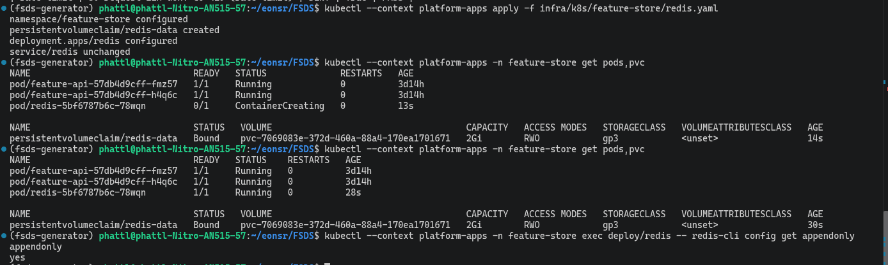
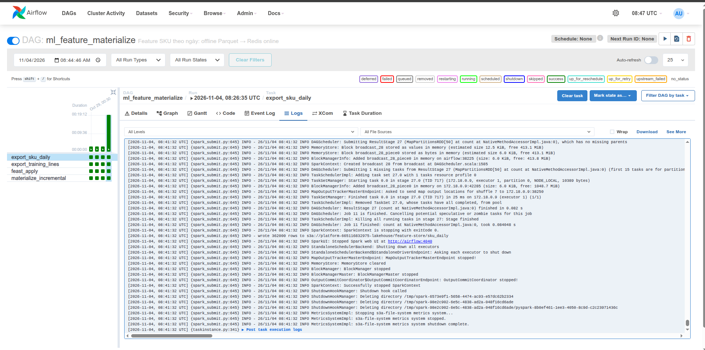
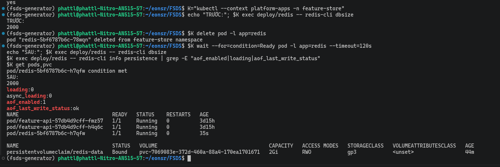

# Feature Store on AWS

This page covers incremental materialization from the offline store to the online store. "Materialize" means copying feature values
from the offline store (Parquet files on S3, used for training) to the online store (Redis, used when serving requests).
"Incremental" means each run copies only the new time range since the previous run, not everything from scratch.

Code / configuration: [DAG](../../dags/ml_feature_materialize.py), [Feast](../../feature_repo/feature_store.yaml).

The results below come from AWS runs; they do not confirm that the service is currently running.

### On AWS

The `ml_feature_materialize` DAG on Airflow EC2 once failed at the `feast_apply` task. Cause:
- The `feast apply` command imports every `.py` file in `feature_repo/`, including the helper script `replay_return_events.py`.
- That script uses `datetime.UTC`, which only exists from Python 3.11.
- Airflow's Feast venv runs Python 3.10, so the import failed.


Fix: add [`feature_repo/.feastignore`](../../feature_repo/.feastignore) so Feast skips the two scripts that are not
feature definitions; covered by test `test_feast_apply_skips_helper_scripts`. On rerun all four tasks are green and Redis has
`DBSIZE` 2000 (2,000 keys, one key per SKU).


## On AWS

Where the components live:
- Airflow and Spark run with Docker Compose on EC2.
- The offline store (Parquet) and the Feast registry (where Feast stores feature definitions) are on S3.
- The online store is Redis on EKS, reached through NodePort 30379.

Run `manual__2026-10-29T00:30:43+00:00` of the [ml_feature_materialize DAG](../../dags/ml_feature_materialize.py)
completed 4/4 tasks, per the [receipt](../evidence/aws/data-platform-aws-20261027.json) (entry `airflow_ml_feature_materialize`).
The four tasks do the following:

1. `export_sku_daily` calls [export SKU features](../../spark_jobs/gold/export_sku_daily_features.py).
2. `export_training_lines` calls [export training set](../../spark_jobs/gold/export_training_lines.py), keeping only labels available before the 2026-06-30 Cutoff.
3. `feast_apply` registers the [feature repo](../../feature_repo/feature_store.yaml). This task's log shows credentials are taken from the EC2 IAM role.
4. `materialize_incremental` loads the new time range of `sku_return_daily` into Redis.


The receipt records two errors fixed in this run: a duplicated `run_id` column when exporting training lines, and a missing
`feature_repo` mount when running `feast_apply`. That is why the Gantt chart still shows failed attempts while the Graph shows the final state as success.

Note: at this point the offline store of `sku_return_24h` is still empty. A successful `feast_apply` only proves that the feature definitions
were registered; it does not prove that the stream pusher wrote data. The stream run has its own evidence: [Streaming Feature](stream_features.md).

<details>
<summary>Reference: design, development guide and records from before the AWS deployment</summary>

The local records keep their original environment and are not a substitute for cloud evidence.

### A/B batch publication (design implemented in code, not yet run on AWS)

This section describes code and tests that exist in the repo; there has been no AWS run yet, so it is not cloud evidence.

Idea: keep two batch feature copies, A and B (two feature sets for the same SKUs). One copy is being served ("active"),
the other is loaded fresh elsewhere. Readers are switched to the new copy only once it has finished loading and passed checks. This way readers
never see a half-loaded copy.

How Redis is split (one standalone Redis, several numbered DBs):
- DB0 is for stream features.
- DB1 and DB2 alternate holding batches: if this run loads into DB1, the next run loads into DB2.
- The DBs share RAM, CPU and the AOF file. This is **not** two Redis instances with independent fault tolerance.
- The manifest sets `maxmemory-policy noeviction`, so loading does not automatically evict old data from RAM when it is full.
- RAM for both copies must be measured before enabling this on the cloud; the current limit is still 256 MB.

**Write side.** The `publish_batch` task at the end of the DAG calls `feature_repo/publish_batch.py`, which follows these steps:

1. Hold the writer lock (only one writing process at a time) in Redis DB0, then read the "active" pointer on S3
   (the pointer says which copy is being served).
2. If the active copy has lost all its data but the registry still remembers the loaded watermark, stop with an error. Recovery requires explicitly
   running with `full_reload=true`. On the first run (bootstrap), when there is no active copy yet, loading proceeds normally.
3. Pick the non-active DB as the "candidate", and block readers belonging to that DB's old generation. If there are still
   active reads on that DB, stop with an error before deleting or loading anything. A reader using an old cached pointer
   is rejected by Redis and must refresh its pointer, so it can never read the new slot believing it is the old copy.
4. Copy the source Parquet to a dedicated prefix `publications/releases/<release_id>/sku_daily` (checked by ETag), with its own registry
   under the same prefix. This way the next export does not overwrite this copy's source data.
5. Clear the candidate DB only after fencing the old readers, then apply/materialize the **full** snapshot up to the `end` watermark.
   Then reconcile each SKU (count, rate and data lineage) against the snapshot, and check the total key count. On error, clean up the candidate.
6. Write an immutable `validation=passed` record to S3, then swap `publications/active.json` with a conditional
   write (only if the ETag is still the old ETag). If loading or reconciliation fails, the pointer does not change and the old copy keeps being served.

The publisher does not materialize incrementally into the candidate slot, because that slot has its own state and watermark and must be built
in full before publication. The guard function of the old incremental flow is still used to check the active copy; this function does not
delete the registry or self-heal. DB1/DB2 hold only batches; DB0 must never be flushed.

**Read side.** The Feature API and KServe share the reader `feature_repo/publication.py`:

- The S3 pointer is cached for 5 seconds. Each batch read pins one manifest/registry/DB set, which does not change midway.
- The reader holds a lease (a time-limited read right) in Redis, at most 30 seconds. Results are returned only if the lease is still
  valid when the read finishes. A Lua script uses the Redis clock and also checks the generation so it never reads a slot that has been reused.
- A request reading A keeps reading A when B is published. Slot A is reused only once every reader on it has expired
  or finished. If a lease has expired, the result is discarded. A request that only needs stream features does not need the batch pointer.
- If the pointer cache expires and S3 fails, the batch part reports unavailable rather than keeping the old pointer forever; the stream part can still run.
- The API additionally returns `batch_status`, `stream_status`, `batch_release`, `batch_cutoff`. How to interpret the statuses:
  - SKU is in the record but cannot be read: unavailable.
  - SKU is outside the snapshot: not_available (it does not conclude by itself that it is a new SKU).
  - Count = 0 has been confirmed: insufficient_history.
  - Only feature groups with valid data are used.
- If the predictor lacks the count, or cannot select/read a batch copy, it does not score and returns `score=null`,
  `abstain=true`, `reason=feature_data_unavailable`. On a successful read the result includes the copy and Cutoff used.

The writer lock **does not expire by itself**. If the writing process dies, the operator must verify that the run and the Feast child process
have stopped before releasing the lock. The lock is not removed automatically, since that could let two writers overlap. Records and offline data
of old releases are kept on S3 for traceability; the S3 cleanup policy and the threshold for data considered too old are not decided yet.


<!-- Purpose: how to build and run the feature store (Feast) for the ML Platform, -->
## Feature store (Feast) — ML Platform step 2

The Airflow pipeline builds OFFLINE features, loads a separate ONLINE batch copy, reconciles it, then publishes it.
The evidence below records the old incremental flow, which predates the A/B publication mechanism (the new A/B mechanism exists in code but has not run on AWS).

## Data path

```
Iceberg Gold (lifecycle_fact_order_lines + lifecycle_label_segments)
   │ ① Spark: export_sku_daily_features.py — snapshot of each SKU at 00:00 UTC every day
   ▼
Parquet  s3://platform/feature-store/sku_daily/          ← OFFLINE store (MinIO locally; AWS: S3)
   │ ② feast apply — writes definitions to the registry s3://platform/feature-store/registry.db
   │ ③ feast materialize-incremental <end> — loads only snapshots in (previous run, end]
   ▼
Redis in the kind platform cluster, NodePort 30379     ← ONLINE store
```

The DAG [`dags/ml_feature_materialize.py`](../../dags/ml_feature_materialize.py) runs in order: step ①, then exports the training
set (`export_training_lines.py`, the KFP input), then step ②, and finally step ③.

| Component | File |
|---|---|
| Feature definitions (entity `sku`, view `sku_return_daily`) | [`feature_repo/features.py`](../../feature_repo/features.py) |
| Feast configuration (reads environment variables) | [`feature_repo/feature_store.yaml`](../../feature_repo/feature_store.yaml) |
| Function computing the daily snapshot | `sku_daily_features` in [`spark_jobs/lib/order_lifecycle_gold.py`](../../spark_jobs/lib/order_lifecycle_gold.py) |
| Spark job exporting Parquet | [`spark_jobs/gold/export_sku_daily_features.py`](../../spark_jobs/gold/export_sku_daily_features.py) |
| kind cluster + Redis | [`infra/k8s/kind-config.yaml`](../../infra/k8s/kind-config.yaml), [`infra/k8s/feature-store/redis.yaml`](../../infra/k8s/feature-store/redis.yaml) |
| Checks | [`tests/spark/check_sku_daily_features.py`](../../tests/spark/check_sku_daily_features.py) |

## Why daily snapshots, keyed by SKU

The old feature `feat_sku_return_rate_90d` is computed **per Order Line** at order time. When a new order arrives there is no
precomputed row for it yet, so it cannot be used for serving directly. The daily snapshot uses the **same** window and the same
sweep (`_sweep`) as the old feature, so one definition serves both purposes:

- Training: Feast PIT join (point-in-time join) takes the latest snapshot **before** the order time.
- Serving: Redis holds the latest snapshot.

The test proves two things:
1. The numbers in the snapshot match a count written in plain Python.
2. A line placed at exactly 00:00 gets exactly that day's snapshot numbers, i.e. training and serving use the same definition.

Features lag by at most 1 day. Labels already take 30 days to mature, so this lag is negligible.

## Redis keeps data when the Pod is replaced

Redis keeps data in RAM, so it must write to disk to avoid losing data when the Pod is replaced:
- The Redis manifest uses a PVC (Kubernetes persistent volume) named `redis-data`, 2 GiB, mounted at `/data`.
- Redis writes the AOF (append-only file: a log of every write command) into that same directory, with `appendonly yes`, `appendfsync everysec`.
- The PVC uses the cluster's default StorageClass (AWS currently uses gp3).
- The replacement Pod reattaches the old PVC and reads the AOF to rebuild the data in RAM.

### Verification on EKS

Initial problem: Redis on EKS was running the old manifest (`--save "" --appendonly no`, no PVC, RAM only).
When the EKS node group was scaled to 0 and back up, the Redis pod lost all its data (`dbsize = 0`). The gateway smoke test reported
`FAIL` on exactly one row: `get_sku_features APP-00042` returned all `null`. Resolution:

1. Apply the current manifest (PVC `redis-data` 2 GiB gp3, AOF `appendonly yes`, `Recreate`): PVC `Bound`, pod `Running`, `appendonly yes`.

   

2. Reload the batch with the `ml_feature_materialize` DAG using `full_reload=true` (after changing `PLATFORM_FEAST_REDIS` to the current EKS node IP): all four tasks green, Redis has **2,000 keys** (the number of SKUs), AOF writing normally.

   

3. Replace the Redis pod (`kubectl delete pod -l app=redis`): new pod `Ready`, `dbsize` **2000 before and 2000 after**, `loading 0`, `aof_enabled 1`, `aof_last_write_status ok`, PVC `redis-data` still `Bound`.

   

**Extra test: shut down all nodes and bring them back (19:53).** The EKS node group was scaled to 0 at 17:43, then 2 new nodes were brought up at
19:49 (node IPs entirely different from before). Result after the cluster restarted ([output](../evidence/aws/redis-after-node-restart.txt)):
- The Redis pod was recreated on a new node and reattached **the same PVC** `redis-data` (`pvc-7069083e…`, `Bound`).
- `dbsize` is still **2000**; `aof_enabled 1`, `loading 0`, `aof_last_write_status ok`.
- No reload from Airflow was needed, unlike the first time.

Limitations:
- The test proves that data survives pod replacement and a full node shutdown (the PVC is preserved). If the PVC is deleted the data is lost;
  PVC and AOF do not replace backups.
- The reload from Airflow only restores batch features. Stream features (e.g. `approved_returns_24h`) need the
  online PyFlink job to run again before they have values.

The Deployment uses the `Recreate` strategy: stop the old Pod before creating the new one, accepting a short interruption during updates
and recovery. Deleting the PVC or the whole local cluster can still lose data; PVC/AOF do not replace backups. With the
every-second sync policy, a sudden machine crash can lose roughly the last second of changes; see [Redis persistence](https://redis.io/docs/latest/operate/oss_and_stack/management/persistence/).

How to verify after each deployment:
1. Record the value of a known feature and `DBSIZE`.
2. Replace the Pod (keep the PVC).
3. Look up the same feature again and check that the AOF was loaded.

This must be tested before closing D3. If Redis was already empty, a new PVC does not get the old data back by itself: run
`full_reload` to reload the batch from Parquet; stream features need their own recovery path.

### Order of switching to the new flow

The operator runs every step on the cloud. Vault S1 and endpoint D4 must be handled before enabling the pipeline.

1. Deploy the DAG code and `feature_repo` to EC2. Run the DAG to create the first publication, then check the record and data.
2. Build and push the Feature API and predictor images with the publication module. The deploy script passes
   `FEAST_PUBLICATION_ROOT=s3://<bucket>/feature-store/publications` to both readers.
3. Check the following cases:
   - The response shows the correct release and Cutoff.
   - If loading B fails, A is still read; switch to B only after B passes.
   - While reads of A are still running, DB A is not reused.
   - When there is no pointer yet, a reader with the new mode enabled must report the batch as not ready, not fall back to reading DB0.
4. During the transition, DB0 may still hold old-style (legacy) batch features. Do not clear all of DB0 because stream shares it.
   Measure memory usage before deciding to clean up legacy data. Readers without the opt-in variable keep running the old flow.

Checked locally: unit tests for publication and the API, integration tests with Redis 7.4 + Feast 0.66, and mutation tests.
These checks do not yet replace verification of S3/IAM, rollout and recovery on AWS.

## Running locally

RAM: enable only what you need. Do not run alongside DataHub.

```bash
## 1. Needs Gold order_lifecycle in the catalog. If missing, run the Data Platform pipeline (~5 minutes with fixtures):
bash scripts/run/run_order_lifecycle_live.sh --phase source
bash scripts/run/run_order_lifecycle_live.sh --phase airflow     # stops the stack automatically when done

## 2. kind cluster + Redis, attached to the Compose network
scripts/setup/setup_kind_feature_store.sh

## 3. Bring the stack back up, load Variables (including platform_feast_root / platform_feast_redis)
docker compose --profile airflow --profile spark up -d minio-init
docker compose --profile airflow --profile spark up -d --wait airflow spark-master spark-worker-1 spark-worker-2
scripts/setup/setup_airflow.sh

## 4. Run the DAG twice with different simulated watermarks (or UI http://localhost:8081 → Trigger w/ config)
docker compose --profile airflow exec airflow airflow dags trigger ml_feature_materialize \
  --conf '{"end": "2026-05-01T00:00:00Z"}'
docker compose --profile airflow exec airflow airflow dags trigger ml_feature_materialize \
  --conf '{"end": "2026-06-01T00:00:00Z"}'

## 5. Redis has data (number of keys = number of SKUs)
kubectl --context kind-platform -n feature-store exec deploy/redis -- redis-cli dbsize
```

The log of the `materialize_incremental` task in the second run starts from the end watermark of the first run, rather than reloading from
the beginning. That is the evidence of the "incremental" property.

Feast remembers the loaded watermark in the registry. To capture the evidence from scratch, delete the registry before step 4. Redis should also be
cleared, with `kind delete cluster` and then rerunning step 2:

```bash
docker compose run --rm --entrypoint sh minio-init -c \
  'mc alias set local http://minio:9000 $MINIO_ROOT_USER $MINIO_ROOT_PASSWORD && mc rm local/platform/feature-store/registry.db'
```

`end` is **simulated** time. On the first load, Feast only scans from 1 year before the real time (ttl = 0), so the simulated
data must fall within that range.

## Shutdown

```bash
kind delete cluster --name platform        # Redis does not keep data; materialize again to restore it
docker compose --profile spark --profile airflow down
```

## Evidence

Local run (fixture of 15 orders / 2 SKUs, Cutoff 2026-06-01):

| Run | `end` | `materialize_incremental` log | Result |
|---|---|---|---|
| mat_4 | 2026-05-01 | `sku_return_daily from 2025-10-22 … to 2026-05-01` | success |
| mat_5 | 2026-06-01 | `sku_return_daily from 2026-05-01 … to 2026-06-01` | success |

- `export_sku_daily`: `wrote 304 rows` (2 SKUs × 152 days).
- Redis `dbsize` = 2; `get_online_features` returns exactly the 2026-06-01 snapshot from Parquet.
- Features = 0 in this fixture is correct, because within the 90 days before the Cutoff no line yet has a label matured for 30 days.
  Only large-scale data (at the training step) produces numbers > 0.

</details>

[Section index](README.md) · [Main index](../README.md)
