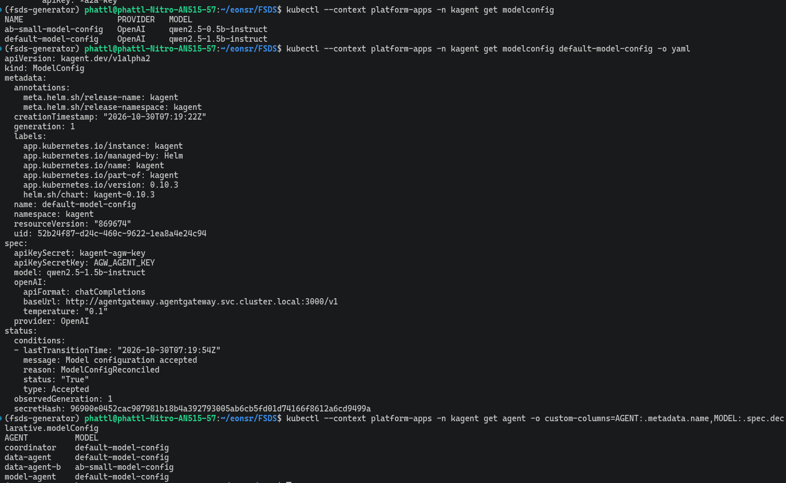

# Global Model Config

A shared model configuration for every Agent.

Agents do not declare their own model. They point to **one** `ModelConfig` named `default-model-config`; change the model once there and all three Agents
(Data, Model, Coordinator) follow, without editing each Agent's manifest.

Code: [kagent Helm values](../../infra/k8s/agents/kagent-values.yaml) (creates `default-model-config`), [Data Agent](../../infra/k8s/agents/data-agent.yaml),
[Model Agent](../../infra/k8s/agents/model-agent.yaml), [Coordinator](../../infra/k8s/agents/coordinator.yaml),
[ModelConfig for A/B branch B](../../infra/k8s/agents/ab-data-agent.yaml).

## What the configuration contains

| Field | Value | Why |
|---|---|---|
| `provider` | `OpenAI` | llama.cpp server speaks an OpenAI-style API (`/v1/chat/completions`), so kagent's standard OpenAI provider works; no custom provider needed |
| `model` | `qwen2.5-1.5b-instruct` | Matches llama.cpp's `--alias` ([LLM Inference](llm_inference_platform.md)); the gateway and llama.cpp identify the model by this name |
| `baseUrl` | `http://agentgateway.agentgateway.svc.cluster.local:3000/v1` | Agents **do not call** llama.cpp directly but go through agentgateway: API key, rate limit, PII guardrail and token metrics ([Gateways](agent_gateways.md)) |
| `apiKeySecretRef` / `apiKeySecretKey` | Secret `kagent-agw-key`, key `AGW_AGENT_KEY` | The gateway key lives in a Kubernetes Secret, not in the manifest |
| `temperature` | `0.1` | Tool-calling Agents need stable, low-randomness output |

## The path of one Agent LLM call

```
Agent (data / model / coordinator)
  └─ modelConfig: default-model-config
       └─ POST {baseUrl}/chat/completions  + Authorization: Bearer <AGW_AGENT_KEY>
            └─ agentgateway: route /v1 (API key, PII guardrail, rate limit)
                 └─ Service qwen.llm:8080 (llama.cpp, Qwen2.5-1.5B-Instruct GGUF)
```

Every LLM call from all three Agents goes through the same door, so LLM telemetry (token counts, TTFT = time to first token, per-turn duration) is collected in one place:
[Observability](observability.md).

## Changing the model and comparing two configurations

- **Change it for all Agents:** edit `model` in `default-model-config` (and the matching alias in llama.cpp). Agents do not need their manifests redeployed.
- **Try a different configuration for one Agent:** create a second `ModelConfig` and have the Agent reference it. A/B Testing does exactly this:
  `ab-small-model-config` uses `qwen2.5-0.5b-instruct`, with the same prompt and tools as Data Agent and only the model different; results are compared in
  [A/B Testing](ab_testing.md).
- **Limitation:** all three Agents share one 1.5B CPU model, so tool-calling quality is capped by the small model (see
  [Agent Evaluation](agent_evaluation.md)); a shared ModelConfig also means a model failure affects every Agent at once.

## Evidence

EKS screenshot showing three Agents sharing the model:


Commands run on EKS show:
- There are two ModelConfigs: `default-model-config` (1.5B model) and `ab-small-model-config` (0.5B model).
- The three Agents `coordinator`, `data-agent`, `model-agent` use `default-model-config`; only the A/B `data-agent-b` uses `ab-small-model-config`.
- `status` is `Accepted`. The API key part only names the Secret `kagent-agw-key`, without exposing the key value.



Commands used:

```bash
kubectl --context $KCTX -n kagent get modelconfig
kubectl --context $KCTX -n kagent get modelconfig default-model-config -o yaml   # provider, model, baseUrl, secret
kubectl --context $KCTX -n kagent get agent -o custom-columns=AGENT:.metadata.name,MODEL:.spec.declarative.modelConfig
```

[Section index](README.md) · [Main index](../README.md)
