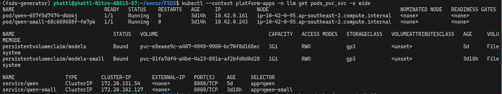
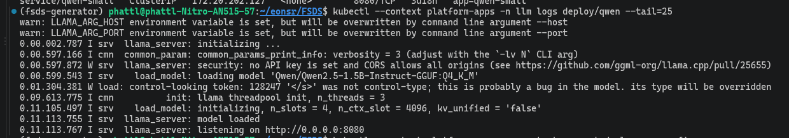

# LLM Inference Platform on EKS

This page covers inference, custom models, agentgateway and benchmarking.

On the EKS cluster `platform-apps`, llama.cpp (a server that runs LLMs) self-hosts the Qwen2.5-1.5B-Instruct model on CPU.
The model is in GGUF format, Q4_K_M compression (4-bit quantization), and is stored on a PVC (a volume attached to the pod).
This is an off-the-shelf model brought in for self-hosting; there is no evidence of custom fine-tuning yet. Agents call the model through agentgateway using an OpenAI-compatible API.

**Conclusion:** the model runs reliably on EKS. Both the baseline and optimized configurations were measured with llm-d-benchmark, on the same cluster and the same workload: 42 requests per configuration, no errors.
Under high load (0.4 requests/second), optimized cuts TTFT p50 by 46% and TTFT p90 by 40% compared with baseline. Under low load, baseline is faster because it uses more CPU threads.
One LLM pod can serve about 0.3 requests/second; above that the system is overloaded (details in the benchmark section).

Code: [`llm.yaml`](../../infra/k8s/agents/llm.yaml), [gateway](../../infra/k8s/agents/agentgateway.yaml), [benchmark](../../scripts/evidence/bench_llm.py), [llm-d baseline vs optimized](../../scripts/evidence/run_llmd_ab.sh).

## Setup on EKS

The commands below run from the repo root, once EKS `platform-apps` has workers, a kubeconfig and the EBS CSI driver.
Prepare the default `gp3` StorageClass as in [Cloud setup](../shared/cloud_setup.md#3-kubernetes-for-the-ml-platform--llm-platform);
the PVC in `llm.yaml` uses the cluster's default StorageClass.

### 1. Create the PVC and llama.cpp

```bash
export KCTX=platform-apps
kubectl --context "$KCTX" get nodes
kubectl --context "$KCTX" get storageclass
kubectl --context "$KCTX" apply -f infra/k8s/agents/llm.yaml
kubectl --context "$KCTX" -n llm rollout status deployment/qwen --timeout=15m
kubectl --context "$KCTX" -n llm get pvc models
kubectl --context "$KCTX" -n llm logs deployment/qwen --tail=50
```

The manifest creates namespace `llm`, PVC `models` **3 GiB**, and the `qwen` Deployment and Service on port 8080.
The PVC uses `ReadWriteOnce` mode (only one node can attach it at a time), so the Deployment uses the `Recreate` strategy: the new pod only uses the volume once the old pod has released it.
The `gp3` StorageClass uses `WaitForFirstConsumer`, meaning the PVC waits until a pod uses it before it binds (attaches to a real volume).

The llama.cpp image is pinned by image digest.

- The parameter `-hf Qwen/Qwen2.5-1.5B-Instruct-GGUF:Q4_K_M` downloads the GGUF model from Hugging Face automatically on the first run.
- `LLAMA_CACHE=/models` puts the cache on the PVC, so a replacement pod reuses the downloaded model file. The pod needs outbound access to the registry and the model download location.
- The startup probe allows up to about 10 minutes to download and load the model. The readiness probe checks `/health`; only once it passes does the Service route requests to the pod.

| Current configuration | Purpose |
|---|---|
| `--threads 3`, `--parallel 4` | Use 3 CPU threads and 4 slots (4 requests processed concurrently). The numbers were chosen from the EKS benchmark below |
| `--ctx-size 16384` | Total context of 16,384 tokens, i.e. 4,096 tokens per slot with the 4-slot configuration |
| `--flash-attn on`, KV cache `q8_0` | Reduces KV cache memory compared with the default configuration to serve the chosen context |
| `--jinja`, `--alias qwen2.5-1.5b-instruct` | Enables the chat template that supports tool calling and sets the model name for clients/gateway |
| `--metrics` | Exposes `/metrics` for Prometheus; the pod has a scrape annotation for port 8080 |

### 2. Check the LLM API

Open a port-forward in one terminal:

```bash
kubectl --context "$KCTX" -n llm port-forward svc/qwen 18080:8080
```

In another terminal, check health and send a chat message:

```bash
curl --fail-with-body http://127.0.0.1:18080/health
curl --fail-with-body http://127.0.0.1:18080/v1/chat/completions \
  -H 'Content-Type: application/json' \
  -d '{"model":"qwen2.5-1.5b-instruct","messages":[{"role":"user","content":"Reply with OK."}],"max_tokens":16,"temperature":0}'
```

Expected result: health returns HTTP 200; chat returns JSON with `choices` and the reply content.

### 3. Connect agentgateway

[`agentgateway.yaml`](../../infra/k8s/agents/agentgateway.yaml) declares the model `qwen2.5-1.5b-instruct`
with `baseUrl: http://qwen.llm.svc.cluster.local:8080/v1`. The gateway receives its API key through the Secret
`agentgateway-keys`, field `AGW_AGENT_KEY`. On a fresh setup, create the key once; if the Secret already exists, keep it:

```bash
kubectl --context "$KCTX" apply -f infra/k8s/agents/agentgateway.yaml
if ! kubectl --context "$KCTX" -n agentgateway get secret agentgateway-keys >/dev/null; then
  agw_key="agw_$(openssl rand -hex 16)"
  kubectl --context "$KCTX" -n agentgateway create secret generic agentgateway-keys \
    --from-literal=AGW_AGENT_KEY="$agw_key"
  unset agw_key
fi
kubectl --context "$KCTX" -n agentgateway rollout restart deployment/agentgateway
kubectl --context "$KCTX" -n agentgateway rollout status deployment/agentgateway --timeout=180s
```

Agents call the gateway at `http://agentgateway.agentgateway.svc.cluster.local:3000/v1`, using the same API key
and model name as above. The gateway configuration also has MCP and A2A routes and a small model for A/B testing; those routes only work when the corresponding
workload exists. This setup step only builds the call path to Qwen 1.5B; for policy verification see [Gateway](agent_gateways.md).

To check the call path through the gateway, open a port-forward in one terminal:

```bash
kubectl --context "$KCTX" -n agentgateway port-forward svc/agentgateway 13000:3000
```

In another terminal, set `KCTX=platform-apps`, read the key from the Secret and call the 1.5B model:

```bash
agw_key=$(kubectl --context "$KCTX" -n agentgateway get secret agentgateway-keys \
  -o jsonpath='{.data.AGW_AGENT_KEY}' | base64 -d)
curl --fail-with-body http://127.0.0.1:13000/v1/chat/completions \
  -H "Authorization: Bearer $agw_key" -H 'Content-Type: application/json' \
  -d '{"model":"qwen2.5-1.5b-instruct","messages":[{"role":"user","content":"Reply with OK."}],"max_tokens":16,"temperature":0}'
unset agw_key
```

The steps above are a reproduction guide based on the repo configuration. Numbers measured on AWS are in the sections below.

## Deployment check on EKS

The `llm` namespace on cluster `platform-apps` contains:

- Deployments `qwen` (1.5B) and `qwen-small` (0.5B, branch B of the A/B test); each deployment has a pod in state `1/1 Running`.
- PVCs `models` 3 GiB and `models-small` 1 GiB, both `Bound` (gp3). The model lives on the PVC, so a pod restart does not need to download it again.
- `ClusterIP` Services (reachable only inside the cluster) on port 8080.



The llama.cpp startup log shows: downloading `Qwen2.5-1.5B-Instruct-GGUF:Q4_K_M`, `n_threads = 3`, `n_slots = 4`, then `model loaded` and `listening on 0.0.0.0:8080`.
The warning `no API key is set` comes from llama.cpp. This server does not check API keys itself, but it is only reachable from inside the cluster through the `ClusterIP` Service;
API key checks are handled by [agentgateway](agent_gateways.md).



## Benchmark with llm-d-benchmark

The two main metrics when measuring an LLM:

- **TTFT** (time to first token): time from sending the request to receiving the first token.
- **TPOT** (time per output token): average time to generate each subsequent token.

[llm-d-benchmark](https://github.com/llm-d/llm-d-benchmark) has a `run` (run-only) mode: it measures an **already running** endpoint
without rebuilding the whole stack. The `inference-perf` harness runs as a pod in namespace `llm-bench` and calls `/v1/completions`
on the Service `qwen.llm:8080`. Requests use streaming so TTFT can be measured. The llama.cpp server speaks the same OpenAI protocol, so it can be called directly.

Workload: [`llmd-inference-perf-qwen-cpu.yaml`](../../infra/k8s/benchmark/llmd-inference-perf-qwen-cpu.yaml), taken from llm-d-benchmark's `sanity_random`
and scaled down to suit CPU: three levels of 0.1 / 0.2 / 0.4 requests/second, 60 s each, prompt ~128 tokens, generating ~32 tokens.
Run command and installation (Python 3.14, pinned commit): [`run_llmd_benchmark.sh`](../../scripts/evidence/run_llmd_benchmark.sh).

**Compatibility check with llama.cpp (local, before running on EKS).** The llm-d-benchmark and inference-perf documentation does not list llama.cpp as
a supported engine (only vLLM, SGLang, TGI), so it was tried locally first:

1. Run the llama.cpp container with the same pinned image as on EKS. The Qwen2.5-0.5B Q4_K_M model is used instead of 1.5B because it runs on a local machine, but with `--alias qwen2.5-1.5b-instruct`.
2. Run `inference-perf` (the core harness llm-d-benchmark uses) with the repo workload, one level of 0.5 requests/second for 20 s.

| Check | Result |
|---|---|
| `GET /v1/models` | `id` = `qwen2.5-1.5b-instruct` (alias); llm-d-benchmark matches the model by this id in its verify step |
| `POST /v1/completions`, streaming, `stream_options.include_usage` | `text_completion` chunks, `choices[0].text`, 24 chunks for `max_tokens=24`, the last chunk has `usage` (24 tokens) |
| `ignore_eos` | `false` stops at 3 tokens, `true` generates the full 60 tokens: llama.cpp honors this parameter |
| Wrong `model` field name | still returns a result, not rejected |
| Run `inference-perf` | 10/10 succeeded, 0 errors; mean TTFT 0.51 s, mean TPOT 26 ms, mean request 1.32 s; output tokens counted client-side 31.7 vs server-side 32.7 |

Full results: [`llmd-inference-perf-llamacpp-local-20261104.json`](../evidence/llmd-inference-perf-llamacpp-local-20261104.json).
Conclusion: llama.cpp is compatible enough to run llm-d-benchmark. The numbers above were measured with the 0.5B model on a local machine, **not EKS numbers**, and are not for comparison with the tables below.

**Real run on EKS with llm-d-benchmark.** Run-only mode pointed at the Service `qwen.llm:8080` (llama.cpp, Qwen2.5-1.5B), harness `inference-perf`, workload
[`llmd-inference-perf-qwen-cpu.yaml`](../../infra/k8s/benchmark/llmd-inference-perf-qwen-cpu.yaml), run from the admin machine with
[`run_llmd_benchmark.sh`](../../scripts/evidence/run_llmd_benchmark.sh). Sequence:

1. The tool creates a `smoketest` pod to check the model; the pod reads `/v1/models` successfully.
2. The tool creates the harness pod. The pod downloads the tokenizer from Hugging Face, then runs the three load levels in turn.
3. The pod finishes with `harness_rc: 0` (success exit code) after 3 minutes 52 seconds.

The first run (Nov 4) only measured the optimized configuration. Full results in [llmd-benchmark/](../evidence/aws/llmd-benchmark/summary_lifecycle_metrics.json)
(`run_metadata.yaml`, per-level reports, `stdout.log`).

### Baseline vs optimized (Nov 10, 2026)

To see what the optimization buys, llm-d-benchmark was rerun on **two llama.cpp configurations on the same cluster, same day, same workload**, changing only the parameters of the `qwen` Deployment:

| Configuration | llama.cpp parameters |
|---|---|
| baseline | original configuration A: `--threads 4`, `--parallel 2`, `--ctx-size 8192`, KV cache f16, `--flash-attn off` |
| optimized | current configuration in [`llm.yaml`](../../infra/k8s/agents/llm.yaml): `--threads 3`, `--parallel 4`, `--ctx-size 16384`, KV cache `q8_0`, `--flash-attn on` |

Run command: [`run_llmd_ab.sh`](../../scripts/evidence/run_llmd_ab.sh). The script patches the Deployment to baseline, measures, re-`apply`s `llm.yaml`, measures again,
then prints the tables with [`compare_llmd_runs.py`](../../scripts/evidence/compare_llmd_runs.py).
Baseline ran at 05:09 UTC. The first optimized measurement failed because the admin machine lost its connection to the EKS API (its outbound IP was not on the allow list), so it was rerun at 06:07 UTC.
Both runs had `harness_rc: 0`, with 42/42 successful requests each.
Results: [`baseline-20261110/`](../evidence/aws/llmd-benchmark/baseline-20261110/summary_lifecycle_metrics.json),
[`optimized-20261110/`](../evidence/aws/llmd-benchmark/optimized-20261110/summary_lifecycle_metrics.json).

**Table 1. Baseline** (`--threads 4`, `--parallel 2`), [`baseline-20261110/`](../evidence/aws/llmd-benchmark/baseline-20261110/summary_lifecycle_metrics.json):

| Load (req/s, 60 s) | OK / errors | TTFT p50 / p90 (s) | TPOT p50 (ms) | Request p50 / p90 (s) | Achieved (req/s) | Output tokens/s |
|---|---:|---:|---:|---:|---:|---:|
| 0.1 | 6 / 0 | 1.79 / 2.37 | 66 | 3.78 / 5.67 | 0.097 | 2.87 |
| 0.2 | 12 / 0 | 1.77 / 2.89 | 95 | 5.44 / 6.59 | 0.189 | 6.09 |
| 0.4 | 24 / 0 | 9.41 / 21.10 | 151 | 14.20 / 25.56 | 0.316 | 9.84 |

**Table 2. Optimized** (`--threads 3`, `--parallel 4`, flash-attn, KV `q8_0`), [`optimized-20261110/`](../evidence/aws/llmd-benchmark/optimized-20261110/summary_lifecycle_metrics.json):

| Load (req/s, 60 s) | OK / errors | TTFT p50 / p90 (s) | TPOT p50 (ms) | Request p50 / p90 (s) | Achieved (req/s) | Output tokens/s |
|---|---:|---:|---:|---:|---:|---:|
| 0.1 | 6 / 0 | 1.95 / 2.84 | 103 | 5.34 / 8.70 | 0.099 | 2.80 |
| 0.2 | 12 / 0 | 1.97 / 3.88 | 141 | 7.73 / 9.24 | 0.189 | 5.75 |
| 0.4 | 24 / 0 | 5.12 / 12.73 | 253 | 13.50 / 19.52 | 0.335 | 10.61 |

**Table 3. Optimized vs baseline** (negative means optimized is lower; for latency, lower is better):

| Load (req/s) | TTFT p50 | TTFT p90 | TPOT p50 | Request p90 | Achieved (req/s) | Output tokens/s |
|---|---:|---:|---:|---:|---:|---:|
| 0.1 | +9% | +20% | +56% | +53% | +2% | −2% |
| 0.2 | +11% | +34% | +48% | +40% | 0% | −6% |
| 0.4 | **−46%** | **−40%** | +68% | **−24%** | **+6%** | **+8%** |

Reading the results:

- **At 0.4 requests/second (the system is saturated), optimized is clearly better.** Compared with baseline: TTFT p50 drops 46% (9.41 s → 5.12 s), TTFT p90 drops 40% (21.1 s → 12.7 s),
  request p90 drops 24%, requests handled per second rise 6%, tokens generated per second rise 8%.
  Reason: baseline has only 2 slots, so the third request onwards has to queue. Queueing time counts toward TTFT, so baseline's TTFT shoots up.
  Baseline's TPOT is lower (151 ms vs 253 ms) because only 2 requests share the CPU at a time, but users still wait longer for the first token.
- **At 0.1–0.2 requests/second, baseline is faster.** TPOT is 33–36% lower, request p50 about 30% faster.
  Reason: baseline uses 4 threads, optimized only 3 (leaving 1 vCPU for other pods). This matches the thread-count table in the section below: 4 threads is fastest with only 1 request.
- **Optimized is kept.** The system's real load has many overlapping requests: the Coordinator calls 2 Agents in parallel, giving 2–4 concurrent LLM requests.
  Under this load, tail latency (p90) and time to first token matter more than the speed of a single request.
- **Limits of the comparison.** The two configurations differ in several parameters at once, so this table cannot isolate the effect of each parameter.
  The per-parameter breakdown is in the `bench_llm.py` table (laptop: A vs B; EKS: 6/3/4 threads). Each load level has only 6–24 requests and each configuration was measured once,
  so no confidence intervals are computed. Treat differences under ~10% as a tie.
- The optimized run on Nov 4 gave numbers close to the Nov 10 run: at 0.4 req/s, TTFT p50 was 5.62 s vs 5.12 s, achieved 0.340 vs 0.335 req/s.
  The practical limit is still about 0.3 requests/second per LLM pod. This matches the multi-turn Agent chains slowing down when requests overlap
  ([Agent Evaluation](agent_evaluation.md#coordinator-on-aws-2026-11-04)).

Two adjustments required for llm-d-benchmark to run on this EKS cluster (already in the script):

1. Use `--no-pvc`. By default the tool creates a 20 GiB `ReadWriteMany` PVC, but EBS `gp3` only supports `ReadWriteOnce`, so it fails with `Volume capabilities not supported`.
2. Lower the harness pod's resources from the default 16 CPU / 32 GiB to 1 CPU / 2 GiB. Otherwise the pod is stuck in `Pending` (`Insufficient cpu/memory`) because the node has only 4 vCPUs.

The numbers in the table in the section below come from a different tool, [`bench_llm.py`](../../scripts/evidence/bench_llm.py), measured with a different configuration (thread count, concurrency level), so they are not directly comparable with the llm-d-benchmark tables above.

## Re-measurement on EKS

Purpose: choose the CPU thread count for llama.cpp. The `r6i.xlarge` node has only 4 vCPUs, but configuration B (the winning configuration in the [laptop benchmark](reference/llm_platform_agents.md), not branch B of the A/B test) sets 6 threads, based on a 6-core laptop.
The same script was run, called through `kubectl port-forward svc/qwen`, changing only `--threads` each time. The "Concurrency" column is the number of requests sent at the same time:

| Threads | Concurrency | p50 (s) | p95 (s) | requests/s | output tokens/s |
|---|---:|---:|---:|---:|---:|
| 6 (old) | 1 | 5.66 | 6.25 | 0.188 | 9.9 |
| | 2 | 8.63 | 14.70 | 0.204 | 10.6 |
| | 4 | 11.02 | 12.60 | 0.342 | 17.7 |
| **3** | 1 | 5.38 | 5.62 | 0.204 | 10.7 |
| | 2 | 7.70 | 14.97 | 0.214 | 11.3 |
| | 4 | **10.96** | **12.44** | **0.345** | **17.8** |
| 4 | 1 | **4.74** | 5.19 | 0.229 | 12.0 |
| | 2 | 7.60 | 13.93 | 0.225 | 11.8 |
| | 4 | 12.57 | 19.14 | 0.269 | 14.0 |

- 6 threads is more than 4 vCPUs, so the threads compete for CPU; it loses or ties at every level.
- 4 threads is fastest with only 1 request. But with 4 requests, p95 rises to 19.1 s and tokens/s drops 21% compared with 3 threads.
  Reason: llama.cpp takes all 4 vCPUs, competing for CPU with the Agents, KEDA and exporters running on the same node.
- **3 threads** chosen: the Coordinator calls 2 Agents in parallel, so the real load is 2–4 concurrent requests; 1 vCPU is left for other pods.
- Each level has only 8 requests, so differences under ~10% are treated as a tie. Data: [`evidence/aws/bench-llm-eks-t6-20261030.json`](../evidence/aws/bench-llm-eks-t6-20261030.json),
  [`t3`](../evidence/aws/bench-llm-eks-t3-20261030.json), [`t4`](../evidence/aws/bench-llm-eks-t4-20261030.json).


[Gateway policy and proof](agent_gateways.md).

[Section index](README.md) · [Main index](../README.md)
