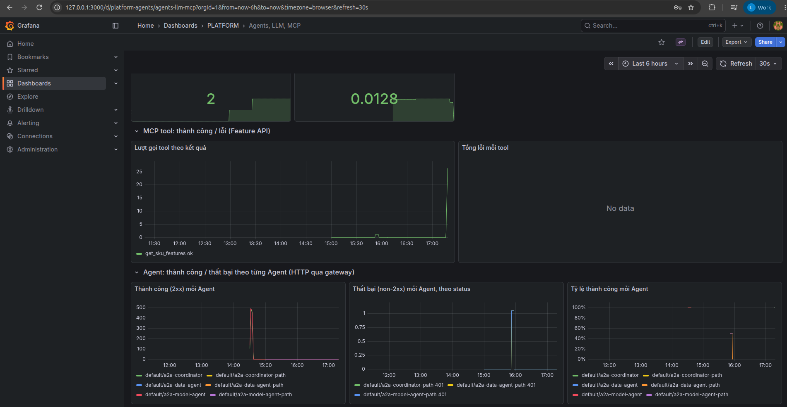

# Observability on AWS

This page covers API, infrastructure, log, trace, LLM and Agent telemetry.

Code and configuration: the dashboards and metrics are linked alongside the EKS screenshots below.

The results below come from past runs on AWS. They do not mean the service is running when you read this.

## On EKS

The observability stack covers three kinds of data: metrics (measurements, viewed in Grafana via Prometheus), logs (viewed in Grafana via Loki) and traces (the path of a request through services, viewed in Jaeger).

Grafana is available at `https://grafana.<ip>.sslip.io`. Login has two layers: NGINX basic auth `ops`, then the Grafana admin account.
The screenshots below show the "Agents, LLM, MCP" dashboard over a 3-hour window. That window contains: the Qwen benchmark, one run of [`gateway_smoke`](../evidence/aws/gateway-smoke-20261030.json) (passed 17/17),
chats with the Coordinator and the KEDA load test.

The guardrail panel has a "Response Mask" entry. This entry records the very time the gateway wrongly masked a 17-digit Return rate (`0.16980269175486737`) as `<PHONE_NUMBER>`
(the same `phoneNumber` guardrail later also masked seven-digit counts in the eval, see [Agent Evaluation](agent_evaluation.md); details of the first occurrence in [LLM and agents](reference/llm_platform_agents.md#on-eks)).

Jaeger receives agentgateway traces over OTLP. The example below is a trace of the MCP command `tools/list`; the trace has one child span (one processing step) going to the `features` backend:

**Logs.** Fluent Bit runs as a DaemonSet (one pod per node). It reads container logs, attaches the labels `namespace`, `pod`, `app`, then pushes them to Loki
([`fluent-bit-values.yaml`](../../infra/k8s/observability/fluent-bit-values.yaml)).
Screenshot below: in Grafana, open Explore, select Loki, query `{namespace="feature-store"}`, 1-hour window:

The two tall bars (about 1.5 thousand and 1 thousand log lines) coincide with the [load test on EKS](web_api_mcp.md#load-test-on-eks)
(3,004 requests in 60 seconds).

**EC2 resource metrics.** node-exporter runs on EC2 on port `:9100`; Prometheus in EKS scrapes it through the machine's private IP.
Grafana Explore has 4 queries:

- CPU %: computed from idle time in `node_cpu_seconds_total`;
- RAM %: from `MemAvailable/MemTotal`;
- disk % for `/` and `/mnt/platform-data` (the EBS volume holding data);
- network: bytes received per second, ignoring the `lo`, veth, docker and bridge interfaces.

The screenshot above is a 15-minute window, but the graph only has data from 00:01. Reason: before that, Prometheus was still scraping the IP of the **old** EC2 (`10.42.0.12`, a machine that had been replaced),
even though the ConfigMap had been changed to `10.42.0.151`. The sidecar responsible for reloading config was disabled, and the Prometheus pod had run for 13 hours without restarting, so the new config had not been loaded.
Fix: enable `configmapReload` in [`prometheus-values.yaml`](../../infra/k8s/observability/prometheus-values.yaml); the covering test is
`test_prometheus_reloads_config_when_targets_change`.

### Per-request LLM and Agent telemetry

**Tokens per request.** kagent (ADK) records an OpenTelemetry span named `generate_content` for each LLM call, and sends it to Jaeger over
OTLP. Example: sending a policy question to the coordinator makes Jaeger record a trace of 13 spans across 3 services, in order:

1. the coordinator calls the LLM;
2. the coordinator calls the A2A tool `kagent__NS__model_agent` through agentgateway;
3. model_agent calls the LLM and then answers.

Opening the tags of the `generate_content` span (of model_agent) shows:

- `gen_ai.usage.input_tokens` = 1536 (tokens sent to the LLM);
- `gen_ai.usage.output_tokens` = 31 (tokens generated by the LLM);
- `gen_ai.request.model` = `qwen2.5-1.5b-instruct`;
- `finish_reasons` = STOP (the LLM ended the answer by itself).

Total tokens for this request = input + output = 1567.

To get an average over all requests, use the agentgateway metric. `agentgateway_gen_ai_client_token_usage` is a histogram that records one sample per
request, so `_sum / _count` gives the average tokens per request. Over 30 minutes: average input **947**, output **43.9**, and the input portion read from
cache is **728**:

**Call and error counts per MCP tool.** The Feature API counts with the metric `mcp_tool_calls_total{tool, outcome}`. `outcome` is `error`
when the tool returns `isError`, even if the HTTP status is still 200.

To get real errors to count, MCP was called directly with 5 invalid inputs: an empty SKU list, a malformed SKU, `top_k=50` (over the limit of 10), Channel `ebay`, an invalid `chunk_id`.
The result is 5 input validation errors:

Calls per Agent (A2A by route) and per tool through the gateway: see the dashboard screenshot in the section above.

**Success / failure per Agent.** The dashboard [`platform-agents.json`](../../infra/k8s/observability/dashboards/platform-agents.json)
has three additional panels, split by each Agent's `route` (`a2a-data-agent`, `a2a-model-agent`, `a2a-coordinator`):

- successful requests (2xx);
- failed requests, split by `status`;
- success rate.

Note: these are HTTP statuses through the gateway (401 missing key, 429, 5xx…), not the A2A task status inside the Agent.
Load was generated with `gateway_smoke.py` (one pair of requests with and without a key per Agent) and the KEDA load test.
The dashboard has been applied to the ConfigMap `grafana-dashboards-platform` on EKS. The screenshot below uses the **Last 6 hours** window, in the browser's time zone (UTC+7):

- **Success (2xx):** a peak of about 500 requests in a 5-minute window at ~14:30 (KEDA load test, 3 requests/second, 150 seconds) for `a2a-coordinator`, `a2a-data-agent`, `a2a-model-agent`, each route with its own line color.
- **Failure (non-2xx):** `401` statuses on `a2a-coordinator-path`, `a2a-data-agent-path`, `a2a-model-agent-path` at ~16:00 (the `gateway_smoke.py` run: requests without a key to each Agent), split by route and by status.
- **Success rate:** close to 100% for each Agent, dropping low exactly when the smoke run's 401s occurred.

Reference: design, development guide and records from before the AWS deployment

The local records keep their original environment and are not a substitute for cloud evidence.

<!-- Purpose: observability stack (metrics, logs, traces, LLM/agent telemetry) in kind, -->
## Observability — ML Platform / LLM Platform

Deployed with `bash scripts/setup/deploy_kind_observability.sh` (namespace `observability`). Viewed over HTTPS + basic auth
(the ingress from [`docs/ml-llm-platform/cicd.md`](cicd.md)) at the hosts `grafana.`, `traces.`, `metrics.` on `172-25-0-2.sslip.io:30443`.

| Component | Chart / version | Role | File |
|---|---|---|---|
| Prometheus | prometheus-community/prometheus 29.36.2 | metrics, 6-hour retention; scrapes pods with the `prometheus.io/scrape` annotation | [`prometheus-values.yaml`](../../infra/k8s/observability/prometheus-values.yaml) |
| Loki | grafana/loki 7.3.0 (SingleBinary) | logs, 1 Gi PVC, 24-hour retention | [`loki-values.yaml`](../../infra/k8s/observability/loki-values.yaml) |
| Fluent Bit | fluent/fluent-bit 0.58.3 | reads container logs on the node, attaches namespace/pod/app labels, pushes to Loki | [`fluent-bit-values.yaml`](../../infra/k8s/observability/fluent-bit-values.yaml) |
| Jaeger | jaegertracing/jaeger 4.16.1, image **2.10.0** | traces (OTLP :4317), stored in RAM | [`jaeger-values.yaml`](../../infra/k8s/observability/jaeger-values.yaml) |
| Grafana | grafana/grafana 10.5.15 | views all three; Data & AI Platform dashboard | [`grafana-values.yaml`](../../infra/k8s/observability/grafana-values.yaml), [`dashboards/`](../../infra/k8s/observability/dashboards/platform-agents.json) |

Data sources:
- **Web API** (Feature API, from v7): `/metrics` with `http_requests_total{method,handler,status}` and
  `http_request_duration_seconds{handler}` (prometheus_client, middleware in [`serving/app.py`](../../serving/app.py));
  MCP requests are grouped under `handler="/mcp"`.
- **agentgateway**: `agentgateway_requests_total{route,status}`, `agentgateway_mcp_requests_total{method,resource}`
  (calls per tool), `agentgateway_gen_ai_client_token_usage{gen_ai_token_type=input|output}` (tokens per request),
  `agentgateway_gen_ai_server_request_duration` (time per LLM turn); OTLP traces sent to Jaeger.
- **TTFT and PII (agentgateway)**: `agentgateway_gen_ai_server_time_to_first_token` (streaming requests only),
  `agentgateway_gen_ai_server_time_per_output_token`; a regex guardrail on both models blocks requests containing email / credit
  card / SSN (HTTP 403 `pii_detected`) and masks email/phone/card in responses, counted in
  `agentgateway_guardrail_checks_total{phase,action}`. Phone numbers are not blocked in requests (quantities, prices and SKU codes are easily
  mistaken for them).
- **Errors per MCP tool** (Feature API v8): `mcp_tool_calls_total{tool,outcome=ok|error}` — MCP errors return HTTP 200 with
  `isError`, so they are not visible through `http_requests_total`.
- **llama.cpp**: `llamacpp:predicted_tokens_seconds`, `llamacpp:requests_processing`.
- **kagent**: controller + Agent traces (Helm `otel.tracing`).
- **Logs**: logs of every pod are shipped to Loki by Fluent Bit; viewed in Grafana Explore (Loki has no UI of its own).

## Dashboard "Data & AI Platform — Agents, LLM, MCP"

| Group | Panels |
|---|---|
| LLM | total requests; average input / output tokens per request; total tokens; tokens/second by type; time per turn p50/p95; llama.cpp tokens/second |
| Agent & MCP | calls per Agent (A2A through the gateway); calls per MCP tool; total Agent / tool calls |
| LLM: TTFT, PII | TTFT p50/p95; time per output token; guardrail by phase/action; total requests blocked for PII; block rate |
| MCP tool | calls by tool + outcome; total errors per tool |
| Gateway / Web API | requests/second by route; failed requests by status; Feature API requests/second + 5xx; p95 latency by handler |

## Verification

- Prometheus: after 60 test requests, the Feature API's `http_requests_total` records `/features 200 = 30`, `/features 422 = 30`.
- Loki: `count_over_time({job="fluent-bit"}[10m])` has logs from every namespace (agentgateway, feature-store, kagent…).
- Jaeger: `/api/services` lists `agentgateway` after tracing is enabled.
- Grafana: the Prometheus/Loki/Jaeger datasources are all `OK`. Access through the ingress goes in order: basic auth `ops`, then the Grafana login form, then the
  dashboard.

Errors encountered and how they were resolved:
- Jaeger 2.22 (the chart's default version) only serves the v3 API at `/api/v3/...`, while Grafana calls `/api/services` and gets 404. Resolution: pin Jaeger to version 2.10.0.
- The ingress has basic auth, so requests to Grafana carry an `Authorization: Basic` header. Grafana assumes it is one of its own accounts and returns 401.
  Resolution: set `grafana.ini: auth.basic.enabled=false`.
- The "pod data-agent" panel needs kube-state-metrics (disabled to save resources), so this panel was dropped.

PII and TTFT (time to first token) check, by calling `/v1/chat/completions` through the gateway:

| Request | Result |
|---|---|
| "Email the refund to jane.doe@example.com" | 403 `pii_detected` |
| "My card is 4111 1111 1111 1111" | 403 |
| "Return risk of 2 units of sku-00003 for 4500 cents?" | 200 |
| request with `stream: true` | has `time_to_first_token` |

The `guardrail_checks_total` counter afterwards: Request/Allow 2, Request/Reject 2, Response/Allow 1.

Tool error check: calling `get_sku_features` through the gateway while MinIO is down increases `mcp_tool_calls_total{outcome="error"}`
by exactly the number of failed calls.

[Section index](README.md) · [Main index](../README.md)
