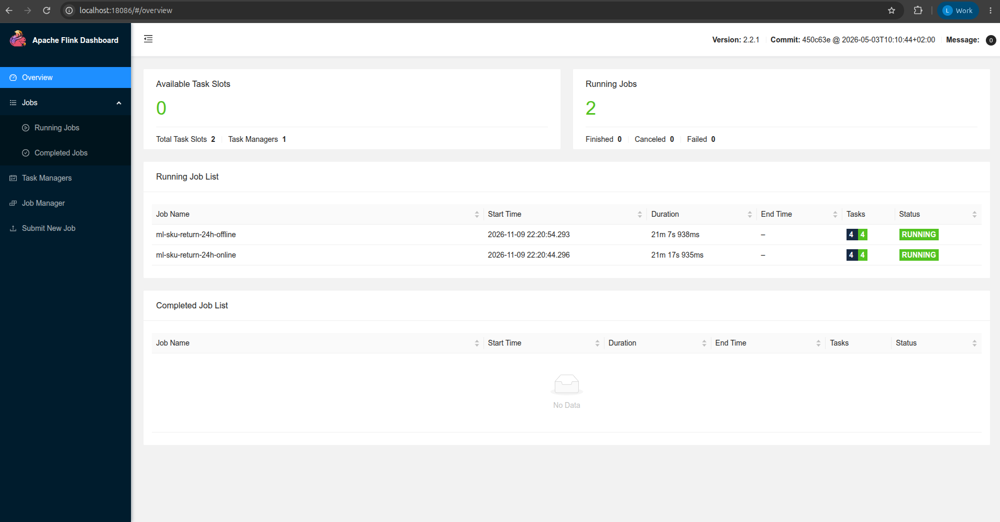
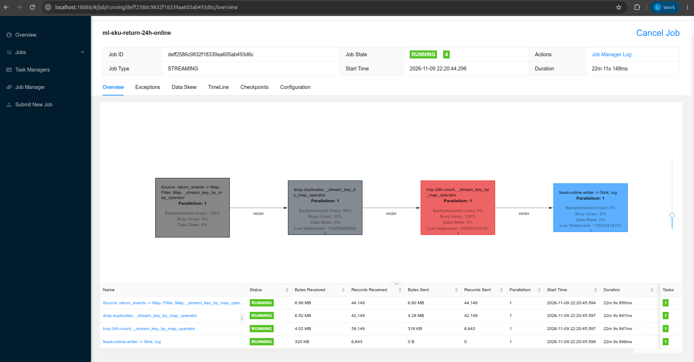
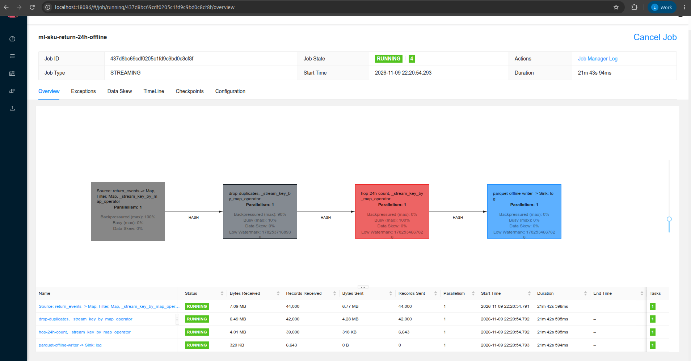
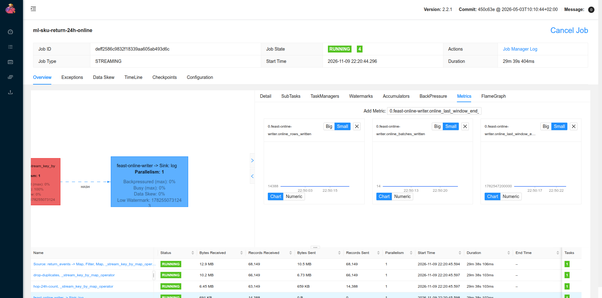
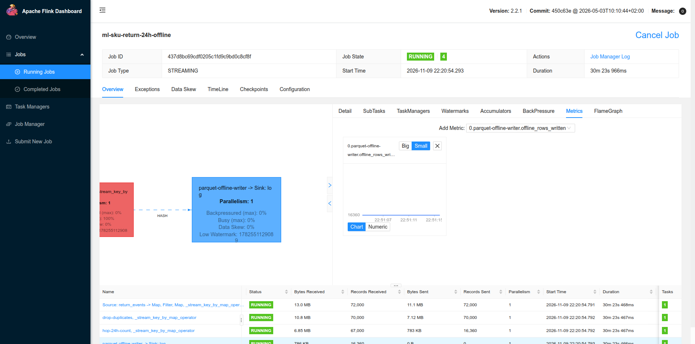
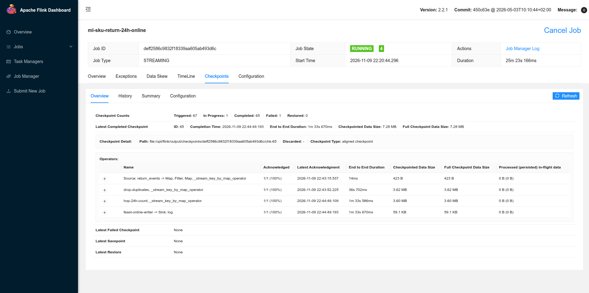
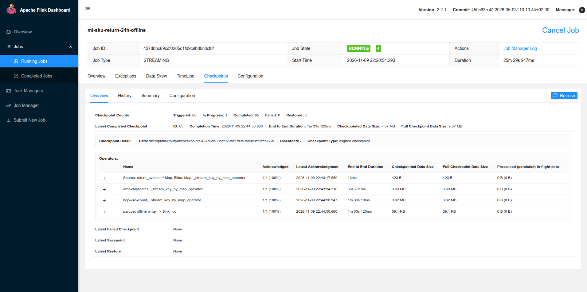
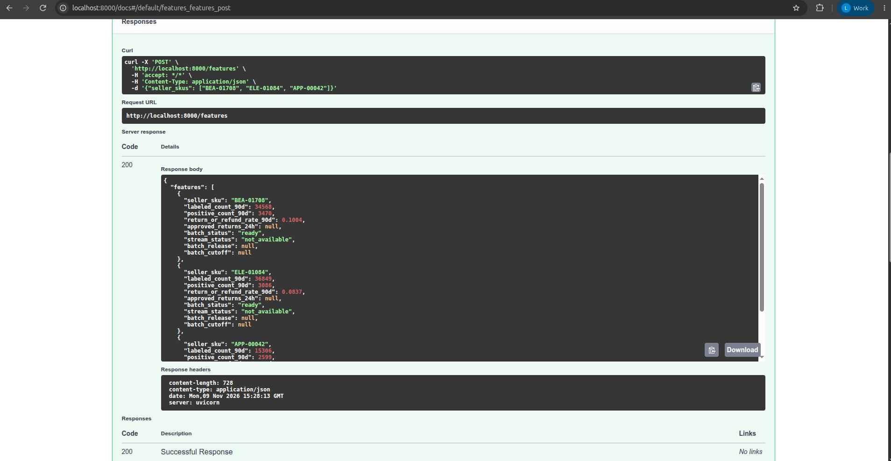
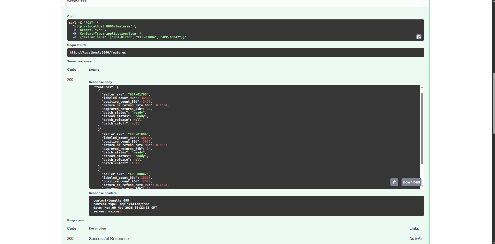
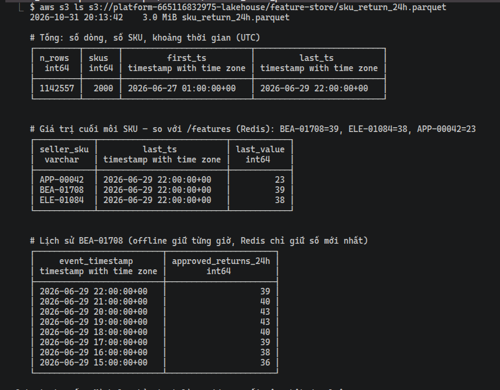

# Streaming Features on AWS

This page covers pushing streaming features into the offline and online stores.

Code / configuration: [PyFlink job](../../flink_jobs/ml/sku_return_feature.py), [submit 2 jobs](../../scripts/ml/run_stream_feature_jobs.py),
[Flink ML image](../../infra/docker/Dockerfile.flink-ml), [CI](../../infra/jenkins/stream-features.Jenkinsfile).

The results below come from AWS runs; they do not confirm that the service is currently running.

## Two PyFlink jobs: online and offline (current version)

This version replaces the old approach using Flink SQL + `feast-pusher` (described in the section below). There is only one PyFlink
DataStream file, but it is submitted as **two jobs** running in parallel. Each job reads Kafka with its own consumer group
(so they do not compete for messages) and writes to its own store: the online job writes Redis, the offline job writes Parquet on S3.

Terms used in the diagram:
- **HOP 24h sliding 1h**: a time window 24 hours long, with a new window every hour. Each window yields
  the number of approved Returns for one SKU in the 24 hours before the window end.
- **Event time**: computed by when the event happened, not when the message reached Flink.
- **Watermark**: the point in time at which Flink believes "every older message has arrived". A window only closes and emits its result once the watermark
  passes it. Here the watermark lags the latest event by 1 hour, to wait for late messages.

```text
Kafka order_snapshots.return_events
  ├─► job ml-sku-return-24h-online : parse → deduplicate (KeyedProcessFunction, key record_sha256)
  │     → HOP 24h sliding 1h on event time (watermark lag 1h) → 2 s batch → Feast push ONLINE → Redis EKS
  └─► job ml-sku-return-24h-offline: same computation → 60 s batch → one new Parquet part file
        → s3://…/feature-store/sku_return_24h/ (Feast FileSource reads the whole directory, training uses PIT join)
```

| Component | Details |
|---|---|
| Job | [`sku_return_feature.py`](../../flink_jobs/ml/sku_return_feature.py), flag `--sink online\|offline` |
| Cluster | Separate Flink **2.2.1** (`flink-ml-jobmanager`/`taskmanager`, UI on port 8086), split from the Data Platform's 1.20 cluster. Reason: PyFlink 1.20 needs apache-beam < 2.49, which pulls in numpy < 1.25, while Feast 0.66 needs numpy ≥ 2; the two library sets cannot be installed together |
| Online | Feast `push(..., PushMode.ONLINE)`: Redis in exactly the Feast format the Feature API reads via `get_online_features` |
| Offline | Parquet `part-<min>-<max>-<n>.parquet`, schema `seller_sku`, `event_timestamp` (UTC), `approved_returns_24h` |
| Monitoring | Besides Flink's built-in metrics (records in/out, checkpoints, backpressure), each job has its own metrics shown in the Flink UI: `duplicates_dropped`, `<sink>_rows_written`, `<sink>_batches_written`, `<sink>_last_window_end_ms` |
| Event time | The Kafka record timestamp is set to `effective_at` (when the Return took effect). The watermark is computed per partition right at the source, lagging at most 1 hour. The topic sets `retention.ms=-1` (never delete messages) because records carry past timestamps; with the default, Kafka would treat them as expired |
| Guarantees | The batch being accumulated lives in the processing-time window state, so it is saved in checkpoints (periodic state snapshots). When restoring from a checkpoint, a batch may be written again (at-least-once). Duplicate rows have the same values, so the PIT join (point-in-time join: takes the value as of order time) result does not change |
| Test | [`tests/flink/test_sku_return_feature.py`](../../tests/flink/test_sku_return_feature.py) runs the job on a mini cluster inside the image and checks three things: (1) each window's count matches an independently written count, including with duplicate, late and non-approved messages; (2) Feast can read the part-file directory and the PIT join is correct; (3) the CLI rejects invalid configuration |

Running on EC2 (the AWS overlay is already set in `COMPOSE_FILE`):

```bash
# Laptop: sync the new code to /opt/platform (compose changed ⇒ run the whole playbook, not just --tags code)
#   ansible-playbook -i inventory.ini site.yml --ask-vault-pass        (directory infra/aws/ansible)
# In the EC2 session, cd /opt/platform:
sudo install -d -o 9999 -g 9999 /mnt/platform-data/flink-ml
# Point the registry's offline source to the part directory (only the feast_apply task, no Spark export):
docker compose --profile airflow exec airflow airflow tasks test ml_feature_materialize feast_apply "$(date -u +%F)"
docker compose --profile stream --profile flink-ml up -d --wait kafka flink-ml-jobmanager flink-ml-taskmanager
# Delete the old topic: messages from the Oct 30–31 run carry publish-time timestamps, which make the watermark jump incorrectly.
docker compose --profile stream exec -T kafka /opt/kafka/bin/kafka-topics.sh --bootstrap-server localhost:9092 \
  --delete --if-exists --topic order_snapshots.return_events
python3 -m scripts.ml.run_stream_feature_jobs                       # submit 2 jobs
# Mount the new script: the script is baked into the platform-feast image, and the old image replays messages WITHOUT event time.
docker compose --profile stream --profile ml-stream run --rm -T --no-deps \
  -v "$PWD/feature_repo/replay_return_events.py:/opt/feature_repo/replay_return_events.py:ro" feast-pusher \
  python replay_return_events.py < ~/return_events.jsonl     # replays 401,129 Returns
# Check: CreateTime must be June 2026 (1782…), not the run time.
docker compose --profile stream exec -T kafka /opt/kafka/bin/kafka-console-consumer.sh --bootstrap-server localhost:9092 \
  --topic order_snapshots.return_events --from-beginning --max-messages 1 --property print.timestamp=true | cut -c1-40
```

**Small local smoke run** on a Flink 2.2.1 cluster + real Kafka in Compose, submitted with `flink run -py`:
- Job `ml-sku-return-24h-offline` in state RUNNING.
- Sent 5 messages, 1 of them a duplicate. The job wrote a part file containing 51 windows.
- Compared with an independently written count (without Flink) for windows closed by the watermark: **all 51/51 windows match**.
- Flink's REST/UI shows all the metrics `duplicates_dropped`, `offline_rows_written`, `offline_batches_written`, `offline_last_window_end_ms`.
- Error found during the real run (fixed): in PyFlink 2.2, the window and TTL constructors take the `Time` type, not `Duration`.

**Full-scale rehearsal** locally: 401,129 messages, 2,000 SKUs, 3 partitions, real Redis, with the S3 API emulated by moto.
The first version had a silent bug: the watermark was generated **after** merging messages from all 3 partitions. The fast-reading partition pushed the watermark
ahead of the slow-reading partitions, so messages from the slow partitions were treated as late and **dropped, while the job still reported
RUNNING**. With only some windows closed, the result was already missing 1,193 windows, and 37,284 windows did not match the independent count (column `wrong_or_missing` of [`stream_feature_reconcile.py`](../../scripts/evidence/stream_feature_reconcile.py): wrong counts or missing windows).
Fix: event time is taken from the Kafka record timestamp (set by [`replay_return_events.py`](../../feature_repo/replay_return_events.py)),
the watermark is generated at the source for each partition separately, and idleness is enabled (a partition with no new messages does not hold
the watermark still).

### On AWS

Jenkins pipeline `stream-features` run #7 went green ([screenshot](../evidence/aws/jenkins-stream-features-7-20261109.png), commit `4cc4502`, `DATA_STORAGE=s3`).
This pipeline builds the Flink ML cluster on EC2, submits 2 jobs, then checks that exactly 2 jobs are RUNNING.

Then **401,129** Return events were replayed into 3 partitions (151,254 + 117,583 + 132,292). The first record has
`CreateTime:1782518400289`, i.e. its event time falls in June 2026 (the data's time), not the run time.







Monitoring: each job has its own metrics, see the screenshots below. The `duplicates_dropped` metric only appears after the first duplicate message; this replay is keyed by Order Line so there were no duplicates, which is why that metric is absent from the screenshots.









**Before the replay**, the Feature API returned `approved_returns_24h: null`, `stream_status: not_available` (Redis had no stream features yet), so the values that appear afterwards were written by the online job.



**While the replay was running**, the same call returned real numbers and `stream_status: ready`, i.e. the online job had written to Redis; the numbers keep changing with each window.



**Re-checked by manual counting while the replay was still running** ([`stream_feature_reconcile.py`](../../scripts/evidence/stream_feature_reconcile.py), without Flink, [output](../evidence/aws/stream-reconcile-midrun-20261109.txt)):
the script recounts from the source data and compares with the Flink results, up to the hour mark 06-28 05:00.
- S3: all 56,231 result rows are correct, with no extra rows.
- Redis: all 2,000 SKUs are correct.
- BEA-01708 = 29, ELE-01084 = 34, APP-00042 = 26 in both places, matching the Swagger screenshot above.

The earlier check (up to 06-27 11:00) also matched 20,316/20,316 rows.

**Limitation:** the check above stopped at 06-28 05:00, when the job had processed only about 40–48% of the messages. There is no check for the final window yet. The full-scale local rehearsal matched 114,638 windows before it stopped.

<a id="on-aws-pipeline-a-2026-10-30"></a>
## Previous version: Flink SQL + pusher on AWS

The deployed order streams (Amazon notifications, TikTok webhooks) only report order status; they have no Return events.
So on AWS, approved Returns are taken from the Gold layer and **replayed** into Kafka, in the order in which
the system learned about each Return.

Limitation: the feature has actually reached Redis and Parquet, but the `return-risk` v1 model was trained while this feature was still empty,
so that model does not use this feature yet.

The diagram below goes through 5 steps, numbered ① to ⑤ (`⋈` is a join of two tables):

```text
Trino (EC2) ──① Gold: fact_return_labels_dp3 ⋈ fact_order_lines_dp2, label=1, 3 days before 2026-06-30
   │            sql/ml/return_events_replay.sql → ~/return_events.jsonl (401,129 rows)
   ▼
replay_return_events.py ──② Kafka order_snapshots.return_events (3 partitions, total offset 401,129)
   ▼
Flink ml-sku-return-24h ──③ deduplicate by Order Line, HOP 24h sliding 1h → Kafka ml.sku_return_24h
   │                       flink_jobs/ml/sku_return_feature_a.sql 
   ▼
feast-pusher ──④ push ONLINE_AND_OFFLINE: Redis EKS (NodePort) + S3 sku_return_24h.parquet
   ▼
Feature API EKS ──⑤ /features returns approved_returns_24h
```

Three errors in the first run (fixed):

1. **Trino read the local store by mistake.** The `docker compose` command ran without the AWS overlay file, so Trino used the MinIO catalog
   of the local environment instead of S3. Fix: the runbook sets
   `COMPOSE_FILE=docker-compose.yml:docker-compose.aws.yml:docker-compose.aws-stream.yml` once for the whole session.
2. **The replay command did not run.** `run feast-pusher` only enabled the `ml-stream` profile, so Compose reported
   "depends on undefined service kafka". Fix: add `--profile stream --no-deps`.
   Note: the Flink job being in state `RESTARTING` while the source topic does not exist yet is normal. Kafka creates the topic automatically on the first
   message, and Flink retries automatically.
3. **Job stuck in `RESTARTING`, every checkpoint failing.**
   - The first suspicion was a lack of RAM, since the log had `OutOfMemoryError: Java heap space`. The taskmanager on AWS was increased to
     4 GB ([`docker-compose.aws-stream.yml`](../../docker-compose.aws-stream.yml)) but it still failed.
   - The new taskmanager log showed the root cause: `Size of the state is larger than the maximum permitted memory-backed state.
     Size=72467011, maxSize=5242880`. The job had not declared a checkpoint location, so Flink kept checkpoints in the
     JobManager's memory (at most 5 MB), while the deduplication state + HOP window weighed about 80 MB.
   - Fix: in [`sku_return_feature_a.sql`](../../flink_jobs/ml/sku_return_feature_a.sql) add
     `SET 'state.checkpoints.dir' = 'file:///opt/flink/output/checkpoints'` (a directory on the EBS volume, mounted into both the JobManager
     and the taskmanager). Covered by test `test_stream_feature_checkpoints_go_to_disk_not_jobmanager_memory`.
   - Before the fix, the feature reached the API but only up to the 2026-06-27 09:00 window.

After the fix, the new job ran through all 3 days of replayed data: 401,129 events in, 76/76 checkpoints succeeded (each
about 79 MB, written to `file:/opt/flink/output/checkpoints/…`), no errors.


**Re-checked by manual counting (without Flink).** To be sure Flink computed correctly, a separate Python script on EC2
recomputed from the source data and compared with what Flink had written:

1. Re-read the source event file `~/return_events.jsonl`, dropping rows sent twice (duplicate `order_line_key`).
2. For each row Flink wrote to the `ml.sku_return_24h` table (each row = one SKU at one hour mark `window_end`), count
   that SKU's Return events in the 24 hours before that mark (from `window_end − 24h`, excluding `window_end` itself).
3. Compare that count with Flink's. Rows left behind by the earlier failed run were checked too.

Result: **all 1,004,354 rows match, none differ**, across 2,000 SKUs in total. The final hour mark
(2026-06-29 22:00) also matches what the Feature API reads from Redis:

| SKU | Flink final window | Feature API `/features` |
|---|---:|---:|
| BEA-01708 | 39 | 39 |
| ELE-01084 | 38 | 38 |
| APP-00042 | 23 | 23 |


**Online and offline from the same push.** For each batch, the pusher calls `store.push(..., to=PushMode.ONLINE_AND_OFFLINE)` once.
Feast writes the latest value to **Redis** (the very numbers in the `/features` screenshot above) and appends history to
**Parquet on S3** (`feature-store/sku_return_24h.parquet`). In this version there is only one Flink SQL job, and online and offline
share one push; the current version splits into two PyFlink jobs (section above).

The offline file on S3 was read back with [`offline_store_proof.sh`](../../scripts/evidence/offline_store_proof.sh) (file 3.0 MiB). Output: [stream-offline-parquet-s3-20261107.txt](../evidence/aws/stream-offline-parquet-s3-20261107.txt).
- The file has **1,142,557 rows, 2,000 SKUs**, from 06-27 01:00 to 06-29 22:00 UTC.
- Final values BEA-01708 = 39, ELE-01084 = 38, APP-00042 = 23, **match Redis**.
- Offline keeps the value for every hour (for example BEA-01708 goes 36, 38, 39, 40, 43, 43, 40, 39), so training can
  take exactly the value as of order time (point-in-time join).
- The row count is larger than the number of windows checked above, for two reasons: the pusher is at-least-once (it may write a batch more than
  once), and the file still contains messages from the earlier failed job. Duplicate rows have the same values, so the PIT join result does not change.



The final window stops at 06-29 22:00, not 06-30 00:00. Reason: the watermark always lags the latest event by 1 hour, and
the stream never ends by itself, so the later windows were never closed. Job code: [`sku_return_feature_a.sql`](../../flink_jobs/ml/sku_return_feature_a.sql),
replay: [`replay_return_events.py`](../../feature_repo/replay_return_events.py),
[`return_events_replay.sql`](../../sql/ml/return_events_replay.sql), pusher:
[`push_stream_features.py`](../../feature_repo/push_stream_features.py).

## CI/CD

[`infra/jenkins/stream-features.Jenkinsfile`](../../infra/jenkins/stream-features.Jenkinsfile): test (ruff, docstrings, Spark
check [`check_order_snapshot_ml.py`](../../tests/spark/check_order_snapshot_ml.py)) → build the Flink, Feast and Flink ML images
and run `tests/flink` inside the image → deploy → verify.

- `DATA_STORAGE=s3` (AWS): Kafka + the Flink ML cluster; [`run_stream_feature_jobs.py`](../../scripts/ml/run_stream_feature_jobs.py)
  cancels jobs with the same name, then submits the 2 PyFlink jobs. Verify: exactly 2 jobs RUNNING.
- Local: the Flink SQL variant A [`sku_return_feature_a.sql`](../../flink_jobs/ml/sku_return_feature_a.sql) + `feast-pusher`,
  submitted by [`run_sku_return_feature.py`](../../scripts/ml/run_sku_return_feature.py). Verify: 1 job `ml-sku-return-24h` RUNNING
  and the pusher running.

The earlier order-lifecycle (v2) variant, which looked SKUs up in a PostgreSQL warehouse, was removed with that pipeline
(archived in git tag `v2-archive`).

[Section index](README.md) · [Main index](../README.md)
