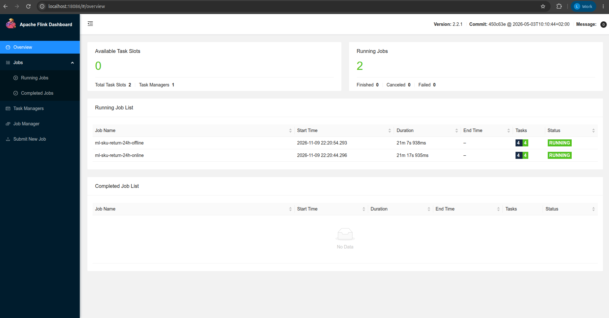
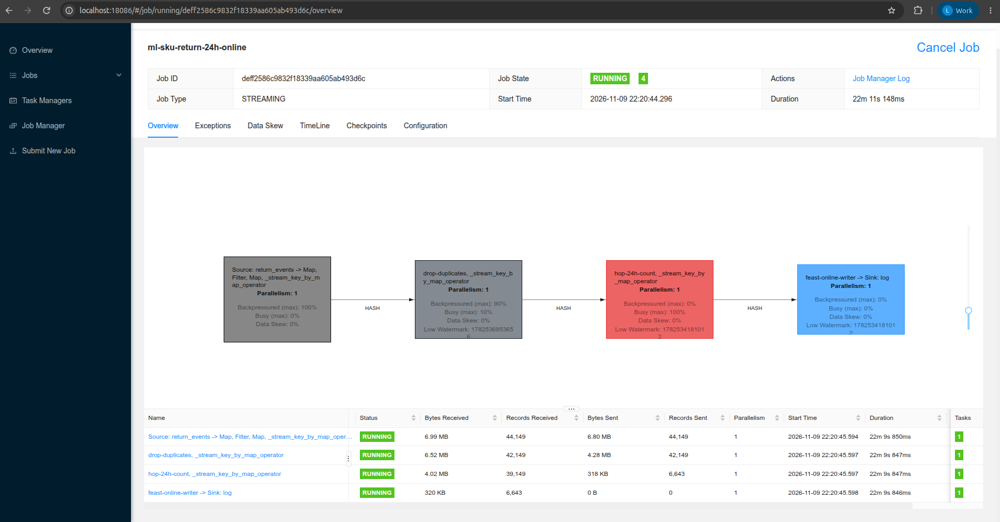
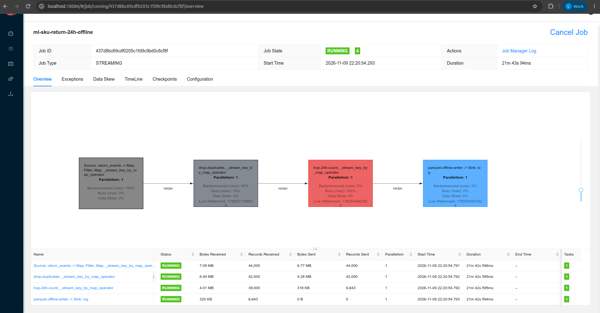
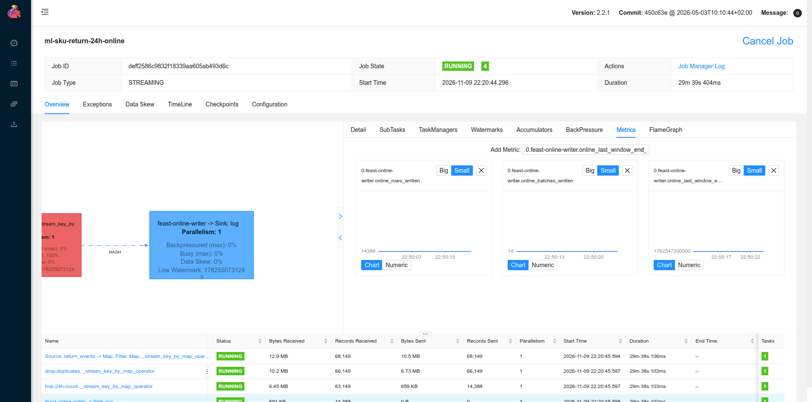
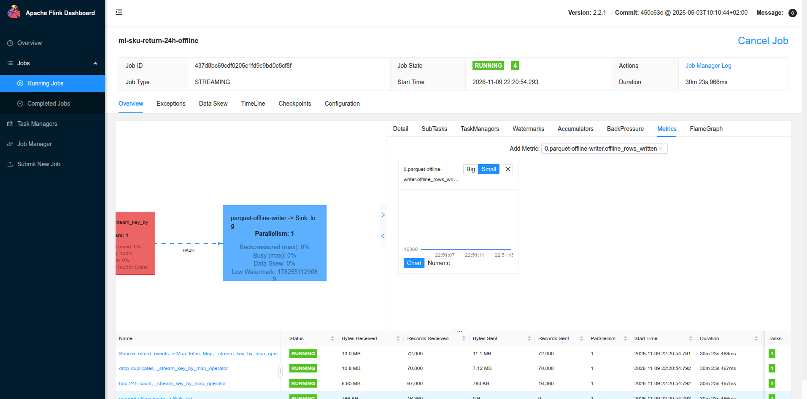
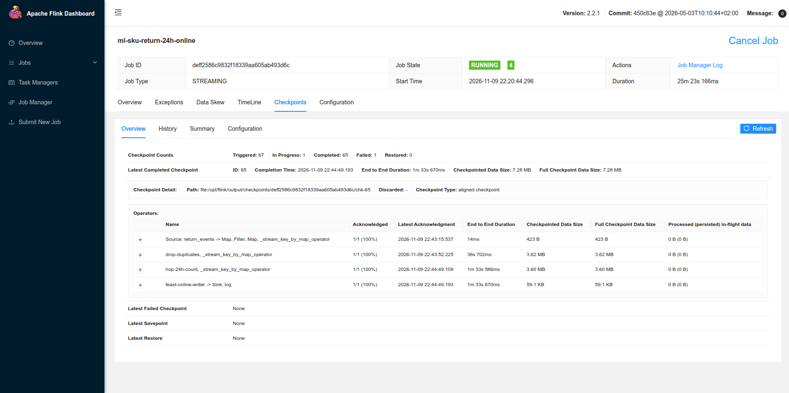
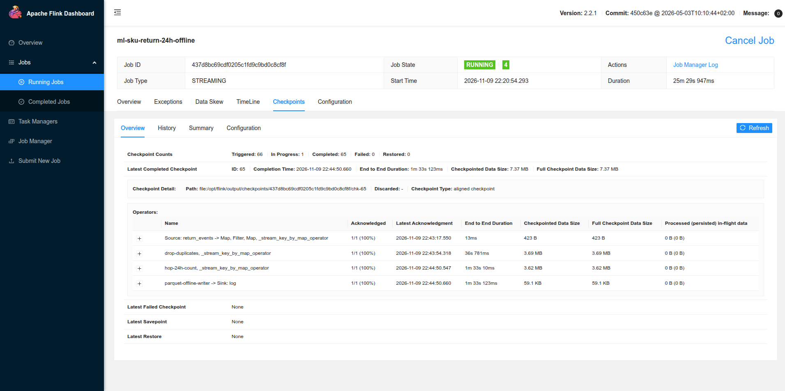
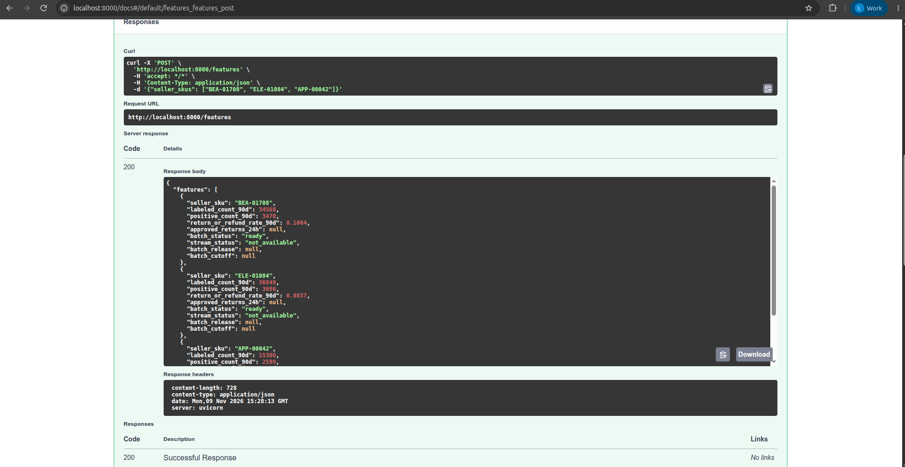
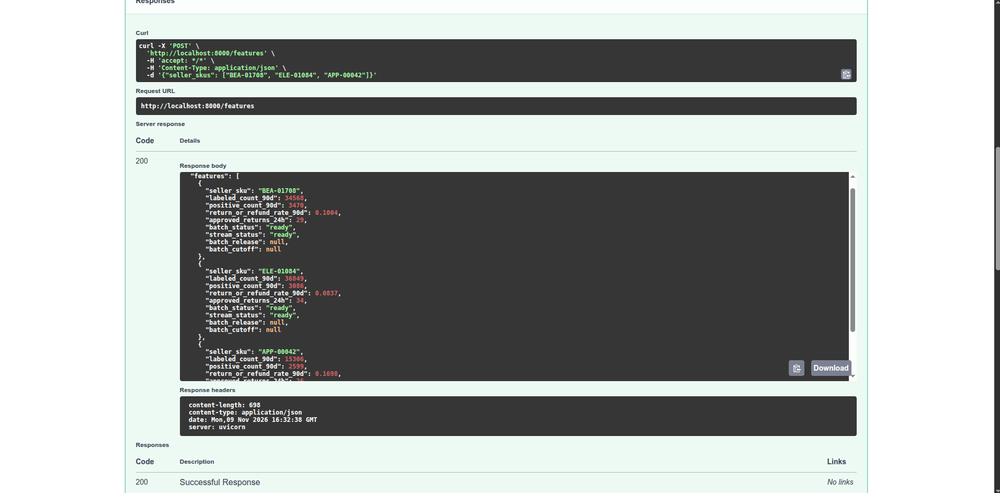
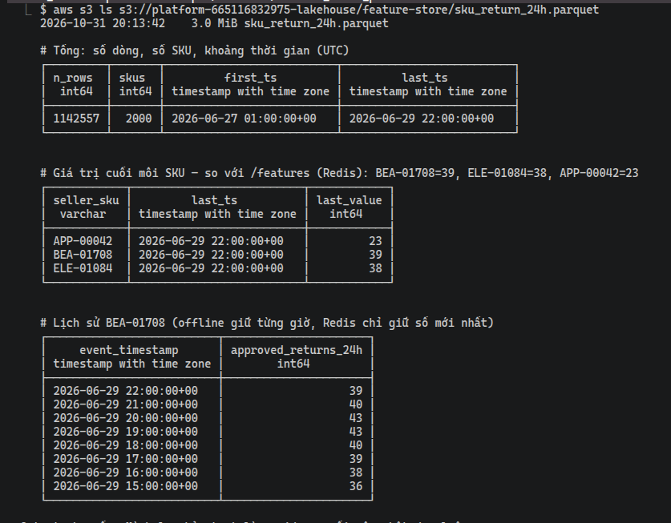

# Streaming Feature trên AWS

EDAI-2, dòng 12: push streaming feature vào offline và online store.

Code / cấu hình: [job PyFlink](../../flink_jobs/ml/sku_return_feature.py), [submit 2 job](../../scripts/run/run_stream_feature_jobs.sh),
[image Flink ML](../../docker/Dockerfile.flink-ml), [CI](../../ci/jenkins/stream-features.Jenkinsfile).

Các kết quả dưới đây thuộc các lần chạy AWS, không xác nhận dịch vụ đang bật.

## Hai job PyFlink: online và offline (bản hiện tại)

Bản này thay cho cách cũ dùng Flink SQL + `feast-pusher` (mô tả ở mục bên dưới). Chỉ có một file PyFlink
DataStream, nhưng file đó được submit thành **hai job** chạy song song. Mỗi job đọc Kafka bằng consumer group riêng
(nên không giành tin của nhau) và tự ghi vào kho của mình: job online ghi Redis, job offline ghi Parquet trên S3.

Thuật ngữ dùng trong sơ đồ:
- **HOP 24h trượt 1h**: cửa sổ thời gian (window) dài 24 giờ, cứ mỗi giờ tạo một cửa sổ mới. Mỗi cửa sổ cho ra
  số Return đã duyệt của một SKU trong 24 giờ trước mốc kết thúc cửa sổ.
- **Event time**: tính theo thời điểm sự kiện xảy ra, không theo lúc tin tới Flink.
- **Watermark**: mốc thời gian Flink tin rằng "mọi tin cũ hơn đã tới". Cửa sổ chỉ đóng và ghi kết quả khi watermark
  vượt qua nó. Ở đây watermark trễ 1 giờ so với sự kiện mới nhất, để chờ tin tới muộn.

```text
Kafka order_snapshots.return_events
  ├─► job ml-sku-return-24h-online : parse → bỏ trùng (KeyedProcessFunction, key record_sha256)
  │     → HOP 24h trượt 1h theo event time (watermark trễ 1h) → lô 2 s → Feast push ONLINE → Redis EKS
  └─► job ml-sku-return-24h-offline: cùng phép tính → lô 60 s → một file part Parquet mới
        → s3://…/feature-store/sku_return_24h/ (Feast FileSource đọc cả thư mục, train dùng PIT join)
```

| Thành phần | Chi tiết |
|---|---|
| Job | [`sku_return_feature.py`](../../flink_jobs/ml/sku_return_feature.py), cờ `--sink online\|offline` |
| Cluster | Flink **2.2.1** riêng (`flink-ml-jobmanager`/`taskmanager`, UI cổng 8086), tách khỏi cluster 1.20 của EDAI-1. Lý do: PyFlink 1.20 cần apache-beam < 2.49, kéo theo numpy < 1.25, trong khi Feast 0.66 cần numpy ≥ 2; hai bộ thư viện không cài chung được |
| Online | Feast `push(..., PushMode.ONLINE)`: Redis đúng định dạng Feast mà Feature API đọc qua `get_online_features` |
| Offline | Parquet `part-<min>-<max>-<n>.parquet`, schema `seller_sku`, `event_timestamp` (UTC), `approved_returns_24h` |
| Monitor | Ngoài số đo sẵn của Flink (bản ghi vào/ra, checkpoint, backpressure), mỗi job có metric riêng hiện trên Flink UI: `duplicates_dropped`, `<sink>_rows_written`, `<sink>_batches_written`, `<sink>_last_window_end_ms` |
| Event time | Timestamp của bản ghi Kafka được đặt bằng `effective_at` (lúc Return có hiệu lực). Watermark tính riêng cho từng partition ngay ở source, trễ tối đa 1 giờ. Topic đặt `retention.ms=-1` (không tự xoá tin) vì bản ghi mang thời gian trong quá khứ, nếu để mặc định Kafka sẽ coi chúng là đã hết hạn |
| Đảm bảo | Lô đang gom nằm trong state của cửa sổ thời gian xử lý, nên được lưu vào checkpoint (ảnh chụp state định kỳ). Khi khôi phục từ checkpoint, một lô có thể bị ghi lại lần nữa (at-least-once: ít nhất một lần). Dòng bị ghi trùng có cùng giá trị nên PIT join (point-in-time join: lấy giá trị đúng tại thời điểm đặt đơn) không đổi kết quả |
| Test | [`tests/flink/test_sku_return_feature.py`](../../tests/flink/test_sku_return_feature.py) chạy job trên mini cluster trong image và kiểm ba điều: (1) số của từng cửa sổ khớp với một phép đếm viết riêng, kể cả khi có tin trùng, tin trễ, tin không phải approved; (2) Feast đọc được thư mục file part và PIT join đúng; (3) CLI từ chối cấu hình sai |

Chạy trên EC2 (overlay AWS đã đặt trong `COMPOSE_FILE`):

```bash
# Laptop: đồng bộ code mới lên /opt/platform (compose đổi ⇒ chạy cả playbook, không chỉ --tags code)
#   ansible-playbook -i inventory.ini site.yml --ask-vault-pass        (thư mục infra/aws/ansible)
# Trong phiên EC2, cd /opt/platform:
sudo install -d -o 9999 -g 9999 /mnt/platform-data/flink-ml
# Registry trỏ offline sang thư mục part (chỉ task feast_apply, không chạy Spark export):
docker compose --profile airflow exec airflow airflow tasks test ml_feature_materialize feast_apply "$(date -u +%F)"
docker compose --profile stream --profile flink-ml up -d --wait kafka flink-ml-jobmanager flink-ml-taskmanager
# Xoá topic cũ: tin của lần chạy 30–31/10 mang timestamp thời điểm phát, làm watermark nhảy sai.
docker compose --profile stream exec -T kafka /opt/kafka/bin/kafka-topics.sh --bootstrap-server localhost:9092 \
  --delete --if-exists --topic order_snapshots.return_events
scripts/run/run_stream_feature_jobs.sh                       # submit 2 job
# Mount script mới: script nằm sẵn trong image platform-feast, image cũ phát lại tin KHÔNG có event time.
docker compose --profile stream --profile ml-stream run --rm -T --no-deps \
  -v "$PWD/feature_repo/replay_return_events.py:/opt/feature_repo/replay_return_events.py:ro" feast-pusher \
  python replay_return_events.py < ~/return_events.jsonl     # phát lại 401.129 Return
# Kiểm: CreateTime phải là 06/2026 (1782…), không phải thời điểm chạy.
docker compose --profile stream exec -T kafka /opt/kafka/bin/kafka-console-consumer.sh --bootstrap-server localhost:9092 \
  --topic order_snapshots.return_events --from-beginning --max-messages 1 --property print.timestamp=true | cut -c1-40
```

**Chạy thử nhỏ ở local (smoke)** trên cluster Flink 2.2.1 + Kafka thật trong Compose, submit bằng `flink run -py`:
- Job `ml-sku-return-24h-offline` ở trạng thái RUNNING.
- Gửi vào 5 tin, trong đó có 1 tin trùng. Job ghi ra file part chứa 51 cửa sổ.
- So với phép đếm viết riêng (không dùng Flink) cho các cửa sổ đã đóng theo watermark: **cả 51/51 cửa sổ khớp**.
- REST/UI của Flink hiện đủ các metric `duplicates_dropped`, `offline_rows_written`, `offline_batches_written`, `offline_last_window_end_ms`.
- Lỗi gặp khi chạy thật (đã sửa): trong PyFlink 2.2, hàm tạo cửa sổ và TTL nhận kiểu `Time`, không nhận `Duration`.

**Diễn tập đúng quy mô** ở local: 401.129 tin, 2.000 SKU, 3 partition, Redis thật, còn S3 API được giả lập bằng moto.
Bản đầu có lỗi âm thầm: watermark được sinh **sau** khi đã gộp tin từ cả 3 partition. Partition đọc nhanh đẩy watermark
vượt lên trước partition đọc chậm, nên tin của partition chậm bị coi là tới trễ và **bị bỏ đi, trong khi job vẫn báo
RUNNING**. Khi mới đóng được một phần cửa sổ, kết quả đã thiếu 1.193 cửa sổ, và 37.284 cửa sổ không khớp phép đếm riêng (cột `sai_hoac_thieu` của [`stream_feature_reconcile.py`](../../scripts/evidence/stream_feature_reconcile.py): số đếm sai hoặc cửa sổ bị thiếu).
Cách sửa: event time lấy từ timestamp của bản ghi Kafka (do [`replay_return_events.py`](../../feature_repo/replay_return_events.py)
đặt), watermark sinh ngay ở source cho từng partition riêng, và bật idleness (partition không có tin mới không giữ
watermark đứng yên).

### Trên AWS

Pipeline Jenkins `stream-features` lần #7 chạy xanh ([ảnh](../evidence/aws/jenkins-stream-features-7-20261109.png), commit `4cc4502`, `DATA_STORAGE=s3`).
Pipeline này dựng cluster Flink ML trên EC2, submit 2 job, rồi kiểm đúng 2 job đang RUNNING.

Sau đó phát lại **401.129** sự kiện Return vào 3 partition (151.254 + 117.583 + 132.292). Bản ghi đầu tiên có
`CreateTime:1782518400289`, tức event time rơi vào tháng 6/2026 (thời gian của dữ liệu), không phải lúc chạy.







Theo dõi (monitor): mỗi job có metric riêng, xem các ảnh dưới. Metric `duplicates_dropped` chỉ xuất hiện khi gặp tin trùng đầu tiên; lần phát lại này khoá theo Order Line nên không có tin trùng, vì vậy metric đó không có trong ảnh.









**Trước khi phát lại**, Feature API trả `approved_returns_24h: null`, `stream_status: not_available` (Redis chưa có feature stream), nên giá trị xuất hiện sau đó là do job online ghi.



**Khi replay đang chạy**, cùng lời gọi đó trả số thật và `stream_status: ready`, tức job online đã ghi vào Redis; số tiếp tục thay đổi theo cửa sổ.



**Kiểm tra lại bằng cách đếm tay khi replay còn chạy** ([`stream_feature_reconcile.py`](../../scripts/evidence/stream_feature_reconcile.py), không dùng Flink, [output](../evidence/aws/stream-reconcile-midrun-20261109.txt)):
script tự đếm lại từ dữ liệu gốc rồi so với kết quả Flink, tính đến mốc giờ 06-28 05:00.
- S3: cả 56.231 dòng kết quả đều đúng, không có dòng thừa.
- Redis: cả 2.000 SKU đều đúng.
- BEA-01708 = 29, ELE-01084 = 34, APP-00042 = 26 ở cả hai nơi, khớp với ảnh Swagger ở trên.

Lần kiểm tra trước đó (đến 06-27 11:00) cũng khớp 20.316/20.316 dòng.

**Giới hạn:** lần kiểm tra trên dừng ở mốc 06-28 05:00, lúc job mới xử lý khoảng 40–48% số tin. Chưa có số kiểm tra cho cửa sổ cuối cùng. Buổi diễn tập cùng quy mô ở local khớp được 114.638 cửa sổ trước khi dừng.

<a id="trên-aws-pipeline-a-2026-10-30"></a>
## Bản trước: Flink SQL + pusher trên AWS

Các stream đơn hàng đã triển khai (thông báo Amazon, webhook TikTok) chỉ báo trạng thái đơn, không có sự kiện Return.
Vì vậy trên AWS, các Return đã duyệt được lấy từ tầng Gold rồi **phát lại** vào Kafka, theo đúng thứ tự thời điểm
hệ thống biết về Return đó.

Giới hạn: feature đã tới Redis và Parquet thật, nhưng model `return-risk` v1 được train khi feature này còn rỗng,
nên model đó chưa dùng feature này.

Sơ đồ dưới đi qua 5 bước, đánh số ① đến ⑤ (`⋈` là phép join hai bảng):

```text
Trino (EC2) ──① Gold: fact_return_labels_dp3 ⋈ fact_order_lines_dp2, label=1, 3 ngày trước 2026-06-30
   │            sql/ml/return_events_replay.sql → ~/return_events.jsonl (401.129 dòng)
   ▼
replay_return_events.py ──② Kafka order_snapshots.return_events (3 partition, tổng offset 401.129)
   ▼
Flink ml-sku-return-24h ──③ bỏ trùng theo Order Line, HOP 24h trượt 1h → Kafka ml.sku_return_24h
   │                       flink_jobs/ml/sku_return_feature_a.sql 
   ▼
feast-pusher ──④ push ONLINE_AND_OFFLINE: Redis EKS (NodePort) + S3 sku_return_24h.parquet
   ▼
Feature API EKS ──⑤ /features trả approved_returns_24h
```

Ba lỗi khi chạy lần đầu (đã sửa):

1. **Trino đọc nhầm kho local.** Lệnh `docker compose` chạy thiếu file overlay AWS, nên Trino dùng catalog MinIO
   của môi trường local thay vì S3. Cách sửa: runbook đặt biến
   `COMPOSE_FILE=docker-compose.yml:docker-compose.aws.yml:docker-compose.aws-stream.yml` một lần cho cả phiên.
2. **Lệnh phát lại không chạy.** `run feast-pusher` chỉ bật profile `ml-stream`, nên Compose báo
   "depends on undefined service kafka". Cách sửa: thêm `--profile stream --no-deps`.
   Lưu ý: job Flink ở trạng thái `RESTARTING` khi topic nguồn chưa có là bình thường. Kafka tự tạo topic khi có tin
   đầu tiên, và Flink tự thử lại.
3. **Job `RESTARTING` mãi, checkpoint nào cũng hỏng.**
   - Nghi ngờ đầu tiên là thiếu RAM, vì log có `OutOfMemoryError: Java heap space`. Đã tăng taskmanager trên AWS lên
     4 GB ([`docker-compose.aws-stream.yml`](../../docker-compose.aws-stream.yml)) nhưng vẫn hỏng.
   - Log mới của taskmanager chỉ ra nguyên nhân gốc: `Size of the state is larger than the maximum permitted memory-backed state.
     Size=72467011, maxSize=5242880`. Job chưa khai nơi lưu checkpoint, nên Flink giữ checkpoint trong bộ nhớ của
     JobManager (tối đa 5 MB), trong khi state bỏ trùng + cửa sổ HOP nặng khoảng 80 MB.
   - Cách sửa: trong [`sku_return_feature_a.sql`](../../flink_jobs/ml/sku_return_feature_a.sql) thêm
     `SET 'state.checkpoints.dir' = 'file:///opt/flink/output/checkpoints'` (thư mục trên ổ EBS, mount vào cả JobManager
     lẫn taskmanager). Có test `test_stream_feature_checkpoints_go_to_disk_not_jobmanager_memory`.
   - Trước khi sửa, feature đã tới được API nhưng chỉ tới cửa sổ 2026-06-27 09:00.

Sau khi sửa, job mới chạy hết 3 ngày dữ liệu phát lại: nhận vào 401.129 sự kiện, 76/76 checkpoint thành công (mỗi lần
khoảng 79 MB, ghi vào `file:/opt/flink/output/checkpoints/…`), không có lỗi.


**Kiểm tra lại bằng cách đếm tay (không dùng Flink).** Để chắc Flink tính đúng, một script Python riêng trên EC2
tự tính lại từ dữ liệu gốc rồi so với những gì Flink đã ghi:

1. Đọc lại file sự kiện gốc `~/return_events.jsonl`, bỏ các dòng bị gửi trùng (trùng `order_line_key`).
2. Với mỗi dòng Flink đã ghi vào bảng `ml.sku_return_24h` (mỗi dòng = một SKU tại một mốc giờ `window_end`), đếm
   số sự kiện Return của SKU đó trong 24 giờ trước mốc ấy (từ `window_end − 24h`, không tính chính `window_end`).
3. So số vừa đếm với số Flink ghi. Cả các dòng do lần chạy hỏng trước đó để lại cũng được kiểm tra.

Kết quả: **cả 1.004.354 dòng đều khớp, không dòng nào lệch**, tổng cộng 2.000 SKU. Mốc giờ cuối cùng
(2026-06-29 22:00) cũng khớp với số mà Feature API đọc ra từ Redis:

| SKU | Flink cửa sổ cuối | Feature API `/features` |
|---|---:|---:|
| BEA-01708 | 39 | 39 |
| ELE-01084 | 38 | 38 |
| APP-00042 | 23 | 23 |


**Online và offline từ cùng một lần push.** Với mỗi lô, pusher gọi `store.push(..., to=PushMode.ONLINE_AND_OFFLINE)` một lần.
Feast ghi giá trị mới nhất vào **Redis** (chính là số trong ảnh `/features` ở trên) và nối thêm lịch sử vào
**Parquet trên S3** (`feature-store/sku_return_24h.parquet`). Ở bản này chỉ có một job Flink SQL, online và offline
đi chung một lần push; bản hiện tại tách thành hai job PyFlink (mục trên).

Đọc lại file offline trên S3 bằng [`offline_store_proof.sh`](../../scripts/evidence/offline_store_proof.sh) (file 3,0 MiB). Output: [stream-offline-parquet-s3-20261107.txt](../evidence/aws/stream-offline-parquet-s3-20261107.txt).
- File có **1.142.557 dòng, 2.000 SKU**, từ 06-27 01:00 tới 06-29 22:00 UTC.
- Giá trị cuối BEA-01708 = 39, ELE-01084 = 38, APP-00042 = 23, **khớp với Redis**.
- Offline giữ giá trị của từng giờ (ví dụ BEA-01708 lần lượt là 36, 38, 39, 40, 43, 43, 40, 39), để khi train có thể
  lấy đúng giá trị tại thời điểm đặt đơn (point-in-time join).
- Số dòng lớn hơn số cửa sổ đã kiểm tra ở trên, vì hai lý do: pusher là at-least-once (có thể ghi một lô hơn một
  lần), và file còn chứa tin của job hỏng trước đó. Các dòng trùng có cùng giá trị nên PIT join không đổi kết quả.



Cửa sổ cuối dừng ở 06-29 22:00, không tới 06-30 00:00. Lý do: watermark luôn trễ 1 giờ sau sự kiện mới nhất, và
luồng stream không tự kết thúc, nên các cửa sổ sau đó chưa bao giờ được đóng. Code job: [`sku_return_feature_a.sql`](../../flink_jobs/ml/sku_return_feature_a.sql),
phát lại: [`replay_return_events.py`](../../feature_repo/replay_return_events.py),
[`return_events_replay.sql`](../../sql/ml/return_events_replay.sql), pusher:
[`push_stream_features.py`](../../feature_repo/push_stream_features.py).

<details>
<summary>Tham khảo: thiết kế, hướng dẫn phát triển và ghi nhận trước triển khai AWS</summary>

Các ghi nhận local giữ nguyên môi trường, không dùng thay bằng chứng cloud.

<!-- Mục đích: job đẩy stream feature vào kho OFFLINE và ONLINE của Feast, -->
## Stream feature vào Feast — ML Platform bước 3

Mục tiêu: deploy các job đẩy **streaming feature** (feature tính liên tục từ luồng sự kiện) vào kho OFFLINE và ONLINE.

## Đường đi của dữ liệu

```
Kafka order_lifecycle.seller_postsales.return_events     (publisher của Data Platform)
   │ ① Flink SQL sku_return_feature.sql (chạy liên tục)
   │    - bỏ bản retry trùng theo record_sha256
   │    - tra line_id → seller_sku ở PostgreSQL warehouse_lifecycle.fact_order_lines (lookup join, cache)
   │    - HOP 24h trượt 1h theo event time, đếm Return "approved"
   ▼
Kafka ml.sku_return_24h        {seller_sku, event_timestamp = window_end, approved_returns_24h}
   │ ② feast-pusher (push_stream_features.py, service Compose)
   │    store.push(..., to=ONLINE_AND_OFFLINE), commit offset SAU khi push
   ├──► Redis trong kind (ONLINE)          feature view sku_return_24h
   └──► s3://platform/feature-store/sku_return_24h.parquet (OFFLINE, train dùng PIT join)
```

| Thành phần | File |
|---|---|
| Job Flink | [`flink_jobs/ml/sku_return_feature.sql`](../../flink_jobs/ml/sku_return_feature.sql) |
| Submit job (điền credential từ `.env`) | [`scripts/run/run_sku_return_feature.sh`](../../scripts/run/run_sku_return_feature.sh) |
| Jar JDBC + PostgreSQL cho Flink | [`docker/Dockerfile.flink`](../../docker/Dockerfile.flink) |
| Pusher | [`feature_repo/push_stream_features.py`](../../feature_repo/push_stream_features.py), image [`docker/Dockerfile.feast`](../../docker/Dockerfile.feast), service `feast-pusher` |
| Feature view | `sku_return_24h` trong [`feature_repo/features.py`](../../feature_repo/features.py) |

## Vì sao làm vậy

- **Sự kiện Return không có SKU**, chỉ có `line_id`. Flink tra SKU từ warehouse PostgreSQL, thay vì phải chở cả
  thông tin đơn hàng vào Kafka. Kết quả tra được cache 1 giờ, vì một line không bao giờ đổi SKU.
- **Không cho Flink ghi thẳng vào Redis.** Làm vậy sẽ bỏ qua Feast: kho offline không có dữ liệu, và lúc train
  không PIT join được.
- **At-least-once (ít nhất một lần)**: pusher chỉ commit offset Kafka sau khi push xong. Nếu pusher chết giữa chừng,
  nó đọc lại từ offset cũ và có thể ghi trùng dòng vào offline. Dòng trùng có cùng giá trị nên PIT join không đổi.

**Giới hạn (đã đánh dấu `Giới hạn:` trong SQL):**
- Cửa sổ HOP chỉ được phát ra khi có tin. SKU không còn Return mới thì Redis giữ số cũ cho tới khi có tin mới.
- Mỗi lần push offline, pusher đọc rồi ghi lại cả file. Cách này chỉ ổn ở quy mô demo.

## Chạy local

```bash
## 0. Đã có Gold (docs/ml-llm-platform/feature_store.md bước 1) và Redis trong kind (setup_kind_feature_store.sh)

## 1. Bảng tra line → SKU: publish warehouse từ Gold hiện tại (run_id = generation_id của Gold).
##    Máy chật RAM thì chạy thẳng job export_order_lifecycle.py bằng Spark local[2] (driver 1g) thay vì DAG.
docker compose --profile airflow --profile spark up -d --wait airflow spark-master spark-worker-1 spark-worker-2
docker compose --profile airflow exec airflow airflow dags unpause dp_order_lifecycle_warehouse
docker compose --profile airflow exec airflow airflow dags trigger dp_order_lifecycle_warehouse \
  --conf '{"run_id": "<generation_id>", "cutoff": "2026-06-01T00:00:00.000000Z"}'
docker compose --profile airflow --profile spark stop airflow spark-master spark-worker-1 spark-worker-2

## 2. Kafka + Flink + pusher
docker compose --profile stream --profile flink --profile ml-stream up -d kafka flink-jobmanager flink-taskmanager feast-pusher

## 3. Phát event vận hành vào Kafka
.venv/bin/python -m generator.publish_order_lifecycle_events --source out/order_lifecycle_live \
  --bootstrap localhost:9094 --epoch 1 --manifest out/stream-ml-1.json

## Lần đầu (làm TRƯỚC bước 3): tạo topic và đăng ký view với Feast
for t in carrier.delivery_events seller_postsales.return_events seller_postsales.refund_events seller_wms.stock_operations; do
  docker compose exec kafka /opt/kafka/bin/kafka-topics.sh --bootstrap-server localhost:9092 \
    --create --if-not-exists --topic order_lifecycle.$t --partitions 3 --replication-factor 1
done
docker compose exec kafka /opt/kafka/bin/kafka-topics.sh --bootstrap-server localhost:9092 \
  --create --if-not-exists --topic ml.sku_return_24h --partitions 1 --replication-factor 1
docker compose --profile ml-stream run --rm --no-deps feast-pusher feast apply

## 4. Submit job Flink (UI: http://localhost:8082)
scripts/run/run_sku_return_feature.sh

## 5. Kiểm
docker compose --profile ml-stream logs feast-pusher | grep pushed
kubectl --context kind-platform -n feature-store exec deploy/redis -- redis-cli dbsize
```

## CI/CD

[`ci/jenkins/stream-features.Jenkinsfile`](../../ci/jenkins/stream-features.Jenkinsfile) chạy lần lượt các stage:

1. **Test**: ruff, test docstring + renderer stream, test Spark `check_sku_daily_features.py`.
2. **Build**: build image Flink, Feast, Flink ML; chạy `tests/flink` bên trong image.
3. **Deploy**, chia hai nhánh theo `DATA_STORAGE`:
   - `DATA_STORAGE=s3` (AWS): dựng Kafka + cluster Flink ML. Script `run_stream_feature_jobs.sh` huỷ job cùng tên
     (nếu có) rồi submit 2 job. Stage **Verify** kiểm có đúng 2 job RUNNING.
   - Local: chạy Flink SQL bản B + pusher như mô tả ở mục này. Stage **Verify** kiểm có đúng 1 job
     `ml-sku-return-24h` RUNNING và pusher đang chạy.

Secret không nằm trong repo. Pipeline lấy Jenkins credential `platform-postgres` và `platform-minio`
(username/password) qua `withCredentials`; [`run_sku_return_feature.sh`](../../scripts/run/run_sku_return_feature.sh)
chỉ đọc `.env` khi chạy tay. Pipeline này đã chạy trên Jenkins EC2 (`stream-features`, bản Flink SQL #2 và bản PyFlink #7 đều xanh), xem [CI/CD](cicd.md#trên-aws).

## Bằng chứng

Lần chạy local (fixture 15 đơn / 2 SKU):

- Warehouse: bảng `warehouse_lifecycle.fact_order_lines` có 30 line, mỗi line ánh xạ `line_id` sang `sku-A` hoặc `sku-B`.
- Flink job `ml-sku-return-24h`: **RUNNING** (job streaming, không tự dừng).
- Pusher in ra `pushed 72 rows, last 2026-02-05 10:00:00+00:00`. Consumer group `feast-pusher` có lag = 0
  (lag là số tin Kafka chưa đọc; 0 nghĩa là đã đọc hết).
- Offline: `sku_return_24h.parquet` có 72 dòng. Online: `sku-A = 5`, `sku-B = None`. Kết quả `None` là đúng, vì
  sku-B không có Return approved nào.
- **Kiểm tra lại bằng cách đếm tay**: script tự đếm từ file JSONL gốc (bỏ dòng trùng `source_event_id`, tra SKU
  từ PostgreSQL, đếm trong 24 giờ trước mỗi mốc giờ) → cả 72 dòng kết quả đều khớp, không lệch.
- Cửa sổ cuối dừng ở 02-05 10:00 vì watermark chỉ tiến khi có tin mới (luồng không tự kết thúc).

</details>

[Mục lục phần này](README.md) · [Mục lục chung](../README.md)
