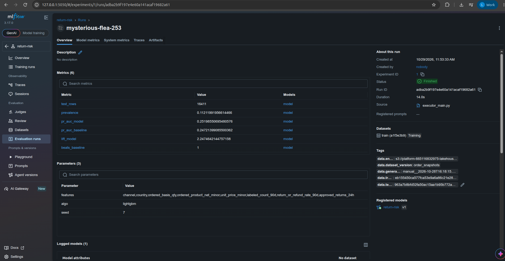
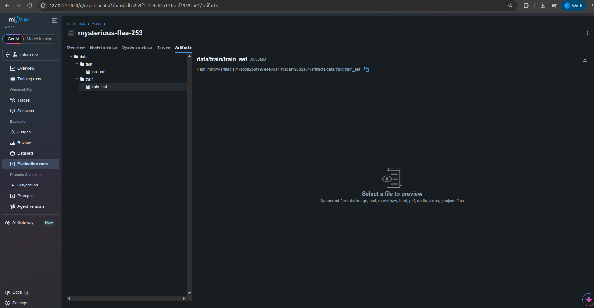
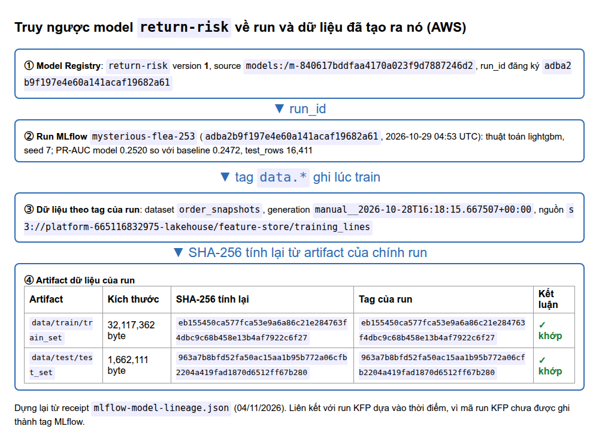

# Training Pipeline and MLflow on AWS

This page covers a training pipeline with ≥4 steps, model/data versioning and tags.

Code / configuration: [Pipeline](../../ml/training_pipeline.py), [train logic](../../ml/train_lib.py).

The results below come from AWS runs; they do not confirm that the service is currently running.

## On AWS

Kubeflow Pipelines (KFP) 2.17.2 runs on EKS. MLflow 3.17.0 runs on EC2, with artifacts stored on S3.

KFP run `train-aws-3` (ID `0485ebd9-d74f-4db9-9b70-aaac07e5cb24`) completed successfully (SUCCEEDED) all 5 steps in 10 minutes 42 seconds.
The [AWS receipt](../evidence/aws/data-platform-aws-20261027.json) (entry `ml_eks`) records the image used and the sample size: a 2‰ (two per thousand) sample, giving 359,457 rows.
[Pipeline code](../../ml/training_pipeline.py), [train logic](../../ml/train_lib.py), [Dockerfile](../../docker/Dockerfile.train).

| Step in the graph | Work |
|---|---|
| `load-features` | Reads training_lines from the S3 offline store, calls Feast historical features by event time; Pod Identity `kubeflow/pipeline-runner` grants S3 access |
| `split` | Splits train/test by Order date; outputs train_set and test_set |
| `train` | LightGBM on train_set, outputs the model |
| `evaluate` | Compares the model's PR-AUC with the baseline on the same test_set |
| `register` | Writes the model, metrics, metadata and dataset to MLflow; sets production only if it beats the baseline |


MLflow run `mysterious-flea-253` is linked to model `return-risk` v1 and dataset `train (a1f3e3b9)`. Metrics in the UI:
- The PR-AUC of both the model and the baseline is displayed rounded to 0.25. Do not infer the exact gap between the two numbers
  from this rounded chart (the exact numbers are in the table below).
- `beats_baseline=1` (the model beats the baseline), lift 2.25, prevalence (share of positive labels) 0.11, test set of 16,411 rows.

The Registry gives v1 the tags `latest=true`, `production=true` and the alias `production`.


**Data versioning.** The `register` step records the data used for training in three ways:
- Tags: `data.dataset_version`, `data.generation_id`, `data.train_sha256`, `data.test_sha256`, `data.entity_path`.
- Artifacts: `data/train`, `data/test`.
- Dataset input `train`.

Checked on AWS (MLflow 3.17.0 on EC2) with [`mlflow_run_data_proof.py`](../../scripts/evidence/mlflow_run_data_proof.py); the script exits with code 0:
1. Calls the MLflow REST API and finds run `mysterious-flea-253` (`run_id adba2b9f197e4e60a141acaf19682a61`).
2. Downloads the two train and test artifacts.
3. Recomputes SHA-256 (the file hash) and compares it with that run's own tags.

Full result: [mlflow-run-data-proof.json](../evidence/aws/mlflow-run-data-proof.json).

| Set | Artifact | Size | Recomputed SHA-256 = tag |
|---|---|---:|---|
| train | `data/train/train_set` | 32,117,362 bytes | `eb155450…922c6f27`, **match** |
| test | `data/test/test_set` | 1,662,111 bytes | `963a7b8b…ff67b280`, **match** |

Values recorded in the run:
- Tags: `data.dataset_version = order_snapshots`, `data.entity_path = s3://platform-665116832975-lakehouse/feature-store/training_lines`,
  `data.generation_id = manual__2026-10-28T16:18:15.667507+00:00`, plus `data.train_sha256` and `data.test_sha256`.
- Parameters: `algo = lightgbm`, `seed = 7`.
- Metrics: `test_rows = 16411`, `pr_auc_model = 0.2520` vs `pr_auc_baseline = 0.2472`, `lift_model = 2.247`, `beats_baseline = 1`.

The MLflow UI of this very run (screenshot below) shows the Tags (`data.dataset_version`, `data.generation_id`, `data.train_sha256`, `data.test_sha256`, `data.entity_path`), the dataset input `train (a1f3e3b9)` and the registered model `return-risk v1`.

### Statistical check of the result (notebook)

The notebook [`05_retrain_and_bootstrap`](../../notebooks/05_retrain_and_bootstrap.ipynb) retrains with exactly `ml/train_lib.py` on the run's train/test sets (SHA-256 matches the MLflow tags):

| Check | Result |
|---|---|
| Reproduce the MLflow numbers | Model PR-AUC 0.2520 and baseline 0.2472 match exactly (difference 0) |
| Model − baseline difference | +0.0048. Bootstrap with 1,000 resamples (sampling with replacement): 95% confidence interval `[-0.0003, +0.0099]`; the model beats the baseline in about 96% of samples |
| 5 seeds (7–11) | model 0.2512–0.2532 (standard deviation 0.0008), all 5 beat the baseline |
| Feature importance | ~85% on `return_or_refund_rate_90d`, a column the baseline also uses |

Conclusion: the result is reproducible, and the model tends to beat the baseline. But the confidence interval touches 0, so it is **not yet established** that the model is better than a simple rule. In addition, the bootstrap treats rows as independent of each other, so the true confidence interval may be even wider.



The Artifacts tab has two directories `data/train` and `data/test` (`train_set` 30.63 MiB = 32,117,362 bytes, exactly the size the script measured).



**Tracing back from the model to the data and the training run.** The same script, but starting from the model being served:
`python3 scripts/evidence/mlflow_run_data_proof.py --model return-risk --version 1`. The script does three steps:
1. Gets model version `return-risk` v1 from the registry.
2. Goes to the run that registered that version (`run_id`, run name, time, parameters, metrics).
3. Compares the SHA-256 tags with that run's own `data/train` and `data/test` artifacts.

The result is a chain of links: model v1, to the run, to the data hashes, to the data files. The link between the MLflow run
and the KFP run relies on the KFP screenshot from the same day ([`kfp-runs-20261029.png`](../evidence/aws/kfp-runs-20261029.png)) and the
run time, because the `register` code does not yet record the KFP run ID as an MLflow tag.

Result on AWS ([mlflow-model-lineage.json](../evidence/aws/mlflow-model-lineage.json)):

| Trace-back step | Value |
|---|---|
| Model in the registry | `return-risk` **v1**, `source = models:/m-840617bddfaa4170a023f9d7887246d2` |
| Run that registered the model | `mysterious-flea-253`, `run_id adba2b9f197e4e60a141acaf19682a61` (matches the run captured above) |
| The run's train/test data | `data/train/train_set`, `data/test/test_set`, recomputed SHA-256 **matches** the two tags `data.train_sha256`, `data.test_sha256` |

So from model `return-risk` v1 we trace back to exactly the run that trained it and exactly the two datasets (by hash) that run used. The KFP run ID is not in MLflow,
so the MLflow run ↔ KFP run link still relies on the KFP screenshot and the run time.


The image above is **rendered from the receipt** [mlflow-model-lineage.json](../evidence/aws/mlflow-model-lineage.json) with [`render_model_lineage.py`](../../scripts/evidence/render_model_lineage.py), not a screenshot of the MLflow UI;
UI screenshots of the same run (Tags, Artifacts, Registry) are in the sections above. The run's 04:53 UTC timestamp (11:53 Vietnam time) matches the registration time of version 1 in the Registry screenshot (11:53:47). Limitation: there is no screenshot yet of the
**Model Version 1** page showing the *Source run* link; that page should be captured the next time MLflow is brought up.

The receipt records the earlier failed runs, caused by "OOM/reading the file store" (OOM = out of memory) and port-forward. In this successful run, KFP caching was disabled.

<details>
<summary>Reference: design, development guide and records from before the AWS deployment</summary>

The local records keep their original environment and are not a substitute for cloud evidence.

<!-- Purpose: pipeline that trains the return-risk model on Kubeflow + versioning in MLflow -->
## Training the return-risk model — Kubeflow Pipelines + MLflow

The Kubeflow pipeline has these steps: load from the offline feature store, split, train, evaluate.
Each run saves the model, data and metadata to MLflow, then automatically sets the `latest` / `production` tags.

## Path

```
s3://platform/feature-store/training_lines   (Spark export_training_lines.py: labeled lines + attributes at order time)
   │ ① load_features: Feast get_historical_features — PIT join sku_return_daily + sku_return_24h
   ▼ ② split: test = the last `test_days` order days (no random split)
   ▼ ③ train: LightGBM, fixed seed
   ▼ ④ evaluate: model PR-AUC vs baseline (the SKU's 90-day return rate) on the SAME test set
   ▼ ⑤ register: MLflow run (params, metrics, model, train/test files + sha256, dataset_version)
        → new "return-risk" model version: tag latest=true; alias + tag production ONLY if it beats the baseline
```

| Component | File |
|---|---|
| Pure logic (testable without KFP) | [`ml/train_lib.py`](../../ml/train_lib.py), test [`tests/unit/test_train_lib.py`](../../tests/unit/test_train_lib.py) |
| 5-step KFP pipeline | [`ml/training_pipeline.py`](../../ml/training_pipeline.py) |
| Image for the steps | [`docker/Dockerfile.train`](../../docker/Dockerfile.train) (built on `platform-feast`) |
| Training set export | [`spark_jobs/gold/export_training_lines.py`](../../spark_jobs/gold/export_training_lines.py), task `export_training_lines` of DAG `ml_feature_materialize` |
| MLflow server | service `mlflow` (profile `ml`), [`docker/Dockerfile.mlflow`](../../docker/Dockerfile.mlflow) |
| Submit | [`scripts/run/run_training_pipeline.sh`](../../scripts/run/run_training_pipeline.sh) |

## Decisions

- **Only use features known at order time**: taken from `fact_order_lines` (Channel, account, quantity, amount, unit price),
  plus SKU features from Feast. Drop every column known only after ordering (delivery, cancellation, return, refund), because using them is leakage
  (leaking the answer into the training data).
- **Production gate**: the model must beat the baseline on PR-AUC. If it loses, the version is still saved (tag `latest`) but
  is not deployed. MLflow forbids an alias named `latest` (since `models:/return-risk/latest` already carries that meaning), so
  `latest` is a **tag**; `production` is both an alias (used for deployment) and a tag.
- **Disable MLflow job execution** (`MLFLOW_SERVER_ENABLE_JOB_EXECUTION=false`): this feature runs 7 huey processes
  using about 1 GB of RAM and once got the container OOM-killed. Tracking and the registry do not need it.

## Finding: default v2 data has no signal

The first run (`small` set, 3,325 lines, test 757 lines) gave model PR-AUC **0.287**, baseline **0.291**, prevalence **0.291**.
PR-AUC equal to prevalence means both the model and the baseline are only as good as guessing.

Cause: `generator/generate_order_lifecycle.py` chooses the return/refund scenario **independently** of SKU, Channel and price (every line
has the same price and the same quantity), so the data has nothing to learn. The production gate correctly blocked this model.

Fix: add the option `--sku-return-skew S`.
- The default S = 0 gives exactly the same data as before; checked 3,631/3,631 lines with unchanged content.
- S > 0: each SKU gets a factor `exp(S·z)`, with `z ~ N(0,1)` fixed per SKU, multiplied by a per-Channel factor. Covered by test
  `test_sku_return_skew_creates_learnable_signal`.
- The small set with S = 1.0: the per-SKU return rate ranges from 7% to 54%, with the overall rate still about 29%.

## Running locally

```bash
docker compose --profile ml up -d mlflow                     # UI http://localhost:5050
kubectl --context kind-platform apply -k "github.com/kubeflow/pipelines/manifests/kustomize/cluster-scoped-resources?ref=2.17.2"
kubectl --context kind-platform apply -k "github.com/kubeflow/pipelines/manifests/kustomize/env/platform-agnostic?ref=2.17.2"
## The submit script builds/pushes platform-train:<git-SHA> itself, then compiles KFP with the same image.
scripts/setup/setup_kind_registry.sh
scripts/run/run_training_pipeline.sh train-N                 # KFP UI: kubectl port-forward svc/ml-pipeline-ui 8888:80
```

## Evidence

Run `train-3` (KFP 2.17.2 in kind): **SUCCEEDED** all 5 steps.

| Item | Value |
|---|---|
| Train / test set | 2,568 / 757 lines (test = last 10 days), test prevalence 0.291 |
| Model / baseline PR-AUC | 0.287 / 0.291, so `beats_baseline = false` |
| MLflow | model `return-risk` **v2**: tag `latest=true`, `production=false`, no production alias |
| Data version (run tags) | `data.dataset_version`, `data.generation_id`, `data.train_sha256`, `data.test_sha256`, `data.entity_path`; artifacts `data/train`, `data/test`; dataset input `train` |

This data has **no signal** (see the section above), so the production gate rejecting it is correct. To get a
`production` version for KServe, rerun on a dataset generated with `--sku-return-skew`.

</details>

[Section index](README.md) · [Main index](../README.md)
