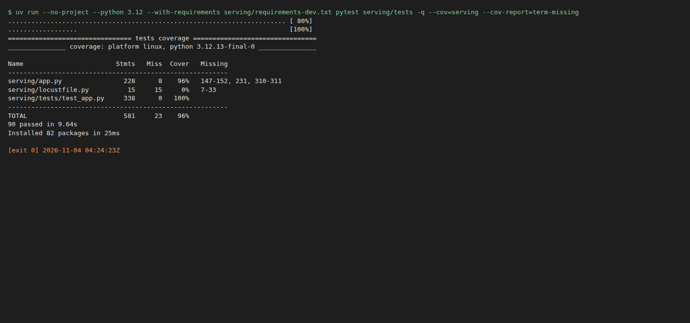
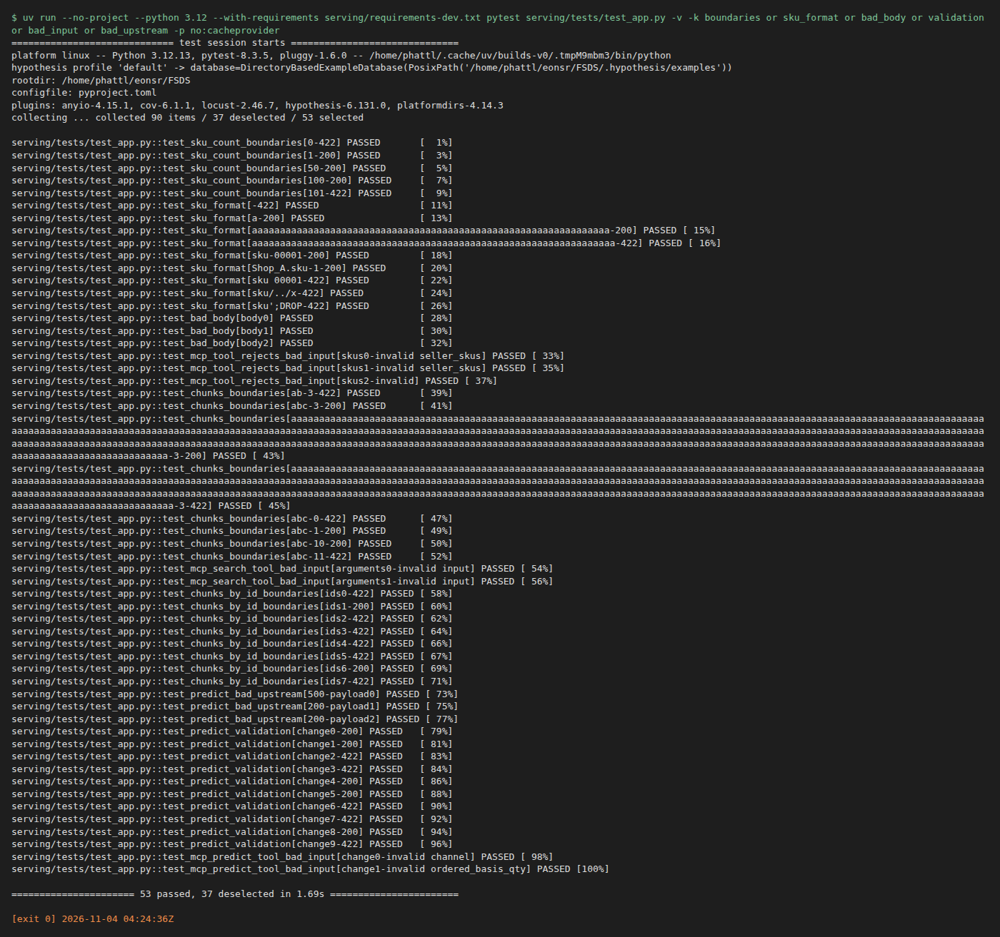
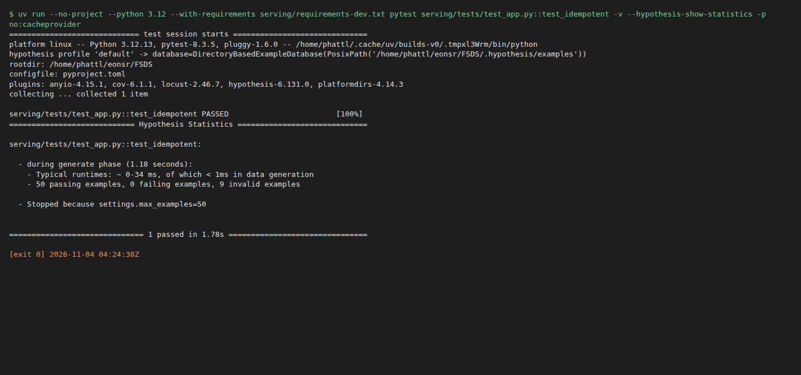
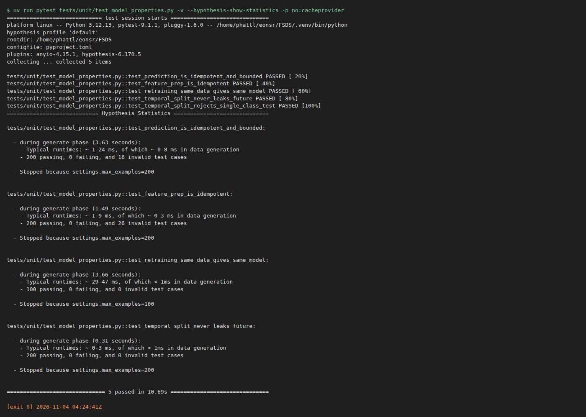
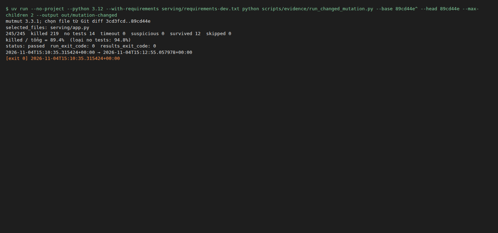
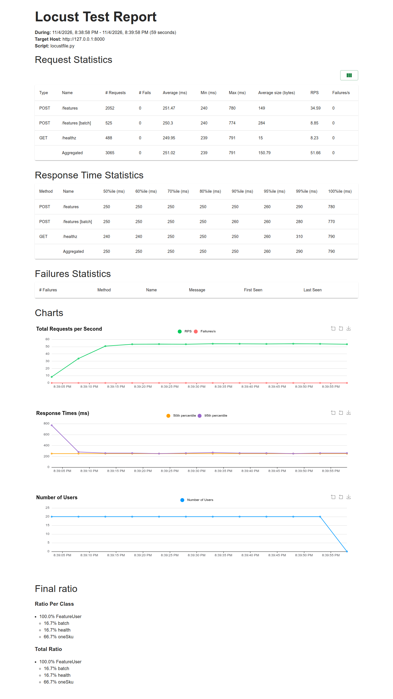

# Validation and Verification

This page covers coverage >90%, EP/BVA, mutation >80%, property-based testing and Locust.

**Conclusion:** coverage (the share of code lines exercised by tests) reaches 96%, the mutation score exceeds the 80% threshold, and the Locust load test on EKS
ran 3,004 requests without errors. Tests run on the development machine; only the load test calls into the EKS cluster.

A short explanation of the test types:

- **EP/BVA** (Equivalence Partitioning / Boundary Value Analysis): split inputs into equivalence groups and test exactly the values at the boundaries, e.g. 0, 1, the limit and the limit + 1.
- **Property-based** (Hypothesis library): instead of writing individual examples, declare a property that must always hold and let the library generate hundreds of inputs to test.
- **Mutation testing** (mutmut): deliberately change the code into many small faulty versions (called mutants) and run the tests. The tests are good if they detect most of these mutants.
- **Locust**: a load testing tool that simulates many users calling the API at the same time.

## Code verification

PR tests run on the development machine and are not recorded as tests run on AWS. Result: 86 tests pass, coverage of `serving/app.py` reaches **98%**, overall **96%**.

- [API tests](../../serving/tests/test_app.py) use fixtures, MagicMock/AsyncMock and httpx MockTransport to replace real services.
- EP/BVA tests SKU counts 0/1/50/100/101 and lengths 0/1/64/65.
- Hypothesis checks idempotency: repeating the same request, or sending duplicate SKUs, still gives the same result.
- [Model properties](../../tests/unit/test_model_properties.py) checks that prediction and training give consistent results, and the time-based data split.


### Screenshots of each test type

The screenshots below are **real terminal output** from the run on the development machine. The script
[`capture_testing_evidence.py`](../../scripts/evidence/capture_testing_evidence.py) runs the tests and captures them, with a `.txt` file of the same name.
This run came after the tests and code had changed, so the numbers differ from the coverage screenshot above: **90 tests pass, `serving/app.py` 96%, total 96%** (still above the 90% threshold).

**Coverage** (`pytest --cov=serving`): [`testing-coverage-20261104.txt`](../evidence/testing-coverage-20261104.txt)



**EP/BVA**: 53 tests by equivalence group and boundary value (SKU count 0/1/100/101, SKU format, wrongly typed body, `top_k`, missing or invalid prediction fields):



**Property-based (hypothesis)**, checking two groups of properties:

- API (`test_idempotent`).
- Model: prediction does not change for the same input; with a time-based split the training set contains no future data; retraining on the same data yields the same model.





The mutation (mutmut) screenshots are in the section below. **Locust** runs on EKS; the report screenshot is in the [Load test on EKS](#load-test-on-eks) section.

## Mutation testing (mutmut)

### Historical result: whole file

The [`[tool.mutmut]`](../../pyproject.toml) configuration selects the file `serving/app.py` for creating mutants, uses the test suite
[`serving/tests/test_app.py`](../../serving/tests/test_app.py), and copies the `rag` directory along so the RAG branches can be tested.
Run offline with dependencies already in the cache (mutmut 3.3.1):

```bash
UV_OFFLINE=1 uv run --offline --no-project --python 3.12 --with-requirements serving/requirements-dev.txt mutmut run --max-children 2
UV_OFFLINE=1 uv run --offline --no-project --python 3.12 --with-requirements serving/requirements-dev.txt mutmut results
```

The run (laptop, 4 processes, ~2.5 minutes): **171 mutants** on `serving/app.py`.

| Result | Count | Meaning |
|---|---:|---|
| killed | 138 | tests fail when the code is changed, i.e. the tests caught the bug |
| timeout | 19 | tests exceed mutmut's time limit (the changed code makes the request hang) — counted as caught |
| no tests | 9 | `load_store` loads real Feast; tests replace it with a fake `store_factory` so this function never runs (intentional) |
| survived | 5 | all 5 are **equivalent mutants** (below) |

**Mutation score** = (killed + timeout) / (171 − no tests) = 157/162 = **96.9%**. Counting killed only: 138/162 = 85.2%.

The 5 surviving mutants (not caught by tests), viewable with `mutmut show <name>`. All 5 are equivalent mutants: the change does not alter the code's behavior, so no test can catch them.

- `x_fetch_features__mutmut_29/32/33`: change `zip(VIEWS.values(), results, strict=True)` to `strict=None`, `strict=False`, or drop `strict` entirely.
  `results` comes from `asyncio.gather` over `VIEWS` itself, so the two sequences always have the same length. Therefore `strict` never changes behavior.
- `x_create_app__mutmut_17/25`: change the MCP `host="0.0.0.0"` to `None` or `"XX0.0.0.0XX"`. The MCP SDK only enables
  DNS-rebinding protection when host is `localhost`/`127.0.0.1`; every other value gives the same behavior.


The image was built from the [real output](../evidence/mutmut-serving-20261031.txt). The output file keeps the full timeout/no tests list; the image drops those lines for brevity.
The first run inside the AI tool's sandbox hung, because the sandbox blocks the local sockets that `TestClient` needs; this was not a test failure.

This run mutated all of `serving/app.py`; at the time there was no step for selecting files by Git diff. The result is kept as is
as historical evidence, not as proof of mutating only the changed code.

### Selecting changed files from Git

Goal: run mutation only on recently changed files, instead of the whole repo. The script [`run_changed_mutation.py`](../../scripts/evidence/run_changed_mutation.py) does the following:

1. Takes two Git refs `--base` and `--head` and resolves them to full commit SHAs.
2. Gets the list of added or modified Python files with `git diff --no-renames --diff-filter=AM --name-only`.
   A renamed file is treated as deleting the old file and adding a new one; deleted files are not mutated.
3. Drops test files, then keeps only files listed in `paths_to_mutate` of the Web API configuration (currently `serving/app.py`).
4. Writes the full list of selected and excluded files to the manifest.

The DAG, ML and feature publication modules are outside the Web API scope, so they do not count as verified by this run.

The script exports the code and tests **exactly at the head commit** to a temporary directory, then creates a separate mutmut configuration containing only the
selected files. The working tree and the original configuration are not modified; uncommitted changes are not in this export.
`also_copy` includes `rag` and `feature_repo` so the API can import internal modules; these modules are not mutated.
Note: the script selects by **changed file** and still mutates the whole file, not just the changed lines.

Run from the repo root with Python 3.12 and the dependencies in `serving/requirements-dev.txt`:

```bash
# Preview the scope, without running mutation.
uv run --no-project --python 3.12 --with-requirements serving/requirements-dev.txt \
  python scripts/evidence/run_changed_mutation.py \
  --base '89cd44e^' --head 89cd44e --dry-run --output out/mutation-plan

# Real run on the same two refs; the output must be a new directory.
uv run --no-project --python 3.12 --with-requirements serving/requirements-dev.txt \
  python scripts/evidence/run_changed_mutation.py \
  --base '89cd44e^' --head 89cd44e --max-children 2 --output out/mutation-changed
```

To check a different change, replace the two refs with the base/head to evaluate. The script compares the two commits directly
and does not look for a merge-base.

Statuses recorded in the manifest:

- No matching files: records `skipped` (not `passed`).
- Run with `--dry-run` and matching files exist: records `planned`.

The output directory keeps the log `run.txt`, per-mutant results `results.txt`, the configuration
`mutation-config.toml` and `manifest.json`. The manifest has the code SHA, the configuration SHA and the mutmut version.

The script's pass threshold is **killed / total mutants >80%**. This calculation is stricter than the historical report above: the denominator includes `no tests`, and timeouts are not added
to killed. The manifest also records two calculations that exclude `no tests`, for comparison with the historical report.
The script returns an error when there are unchecked mutants, when the run fails, when the result is empty, or when the score does not pass. A skip status is not counted as a pass.

### Local result: files selected from Git diff

Comparing base `3cd3fcd` (`89cd44e^`) with head `89cd44e`: this commit adds/modifies 11 Python files,
but only **`serving/app.py`** is within the Web API scope, so only this file is selected. The API tests and out-of-scope modules are listed
in `excluded_files` and do not count as mutation-tested in this run.
Mutmut 3.3.1 ran with 2 processes, finished in about 3 minutes 31 seconds, exit code 0.

| Result | Mutants |
|---|---:|
| Killed | 219 |
| Survived | 12 |
| No tests | 14 |
| Timeout | 0 |
| Total | 245 |

**Score by the strict calculation = 219/245 = 89.4%, above the 80% threshold** (the denominator includes `no tests`).
Excluding `no tests`, score = 219/231 = **94.8%**.

Limitation: it is not yet established whether the 12 surviving mutants are equivalent mutants;
the 14 mutants with no covering test are still a gap in the test suite. The other statuses are 0; there are no unchecked mutants.

Evidence: [manifest and code SHA](../evidence/mutation-changed-serving-20261103.json),
[run log](../evidence/mutation-changed-serving-20261103.txt),
[per-mutant results](../evidence/mutation-changed-serving-results-20261103.txt),
[configuration actually run](../evidence/mutation-changed-serving-config-20261103.toml).
This is a local verification, limited to changed files within the Web API scope. It is not limited per line, and it is not a Jenkins/AWS run.

**Rerun, with a screenshot.** Same command and same two refs (`89cd44e^` .. `89cd44e`), finished in 2 minutes 20 seconds, exit code 0. The result is **identical to the previous run**:
245 mutants, 219 killed, 14 no tests, 12 survived, 0 timeout (score 89.4%; excluding no tests 94.8%), same code SHA
([manifest](../evidence/mutation-changed-serving-20261104.json), [log](../evidence/mutation-changed-serving-20261104.txt), [per mutant](../evidence/mutation-changed-serving-results-20261104.txt)).
Getting the same result on rerun means the check is reproducible. Note: the runner configuration SHA in the manifest differs between the two runs, even though the saved configuration files are identical; the cause has not been determined.



The image is terminal output with spinner characters filtered out, built from `run.txt` and `manifest.json` of this very run with
[`capture_testing_evidence.py --mutation-dir`](../../scripts/evidence/capture_testing_evidence.py). Mutation was not rerun just to take the screenshot.

#### Load test on EKS

**Conclusion:** the Feature API on EKS handles 20 concurrent users for 60 s without errors. The ~250 ms latency users see is almost entirely the network path
from Vietnam to Sydney; the API itself takes on average only 1.8 ms per request (see the reading of the numbers at the end of the section).

How it was run: Locust ran on a laptop (Vietnam), through `kubectl port-forward svc/feature-api` to the cluster in Sydney
(ap-southeast-2). 20 users, 60 s, using [`serving/locustfile.py`](../../serving/locustfile.py) with real SKUs
`APP-00042,APP-00482,ELE-01103`. Port-forward is used instead of the ingress to avoid the ingress rate limit of 50 requests/second.

| Request | Count | Errors | p50 | p95 | p99 | req/s |
|---|---:|---:|---:|---:|---:|---:|
| `POST /features` | 1,999 | 0 | 250 ms | 270 ms | 290 ms | 33.6 |
| `POST /features [batch]` | 530 | 0 | 250 ms | 270 ms | 280 ms | 8.9 |
| `GET /healthz` | 475 | 0 | 250 ms | 270 ms | 280 ms | 8.0 |
| **Total** | **3,004** | **0** | 250 ms | 270 ms | 290 ms | **50.5** |

HTML report: [`evidence/aws/load-test-feature-api-20261030.html`](../evidence/aws/load-test-feature-api-20261030.html).

**Rerun** (same configuration, after the EKS nodes were brought back up): 59 seconds, 20 users, through `kubectl port-forward svc/feature-api` (host `127.0.0.1:8000`),
HTML report [locust-feature-api-eks.html](../evidence/aws/locust-feature-api-eks.html), data [locust-feature-api-eks_stats.csv](../evidence/aws/locust-feature-api-eks_stats.csv).

| Request | Count | Errors | p50 | p95 | p99 | req/s |
|---|---:|---:|---:|---:|---:|---:|
| `POST /features` | 2,052 | 0 | 250 ms | 260 ms | 290 ms | 34.6 |
| `POST /features [batch]` | 525 | 0 | 250 ms | 260 ms | 280 ms | 8.9 |
| `GET /healthz` | 488 | 0 | 240 ms | 260 ms | 310 ms | 8.2 |
| **Total** | **3,065** | **0** | 250 ms | 260 ms | 290 ms | **51.7** |



The two runs gave nearly identical results (3,004 and 3,065 requests, both without errors, p50 250 ms), so performance is stable across the two cluster start-ups.
On the response-time chart, p95 is about 800 ms in the first second (while connections are still being established), then settles at about 260 ms.

How to read the numbers:

- `/healthz` does almost no processing yet still takes ~250 ms. So nearly all the time is the network path from the laptop to Sydney, not the API.
- Measured on the server side (metric `http_request_duration_seconds` of the pod receiving the load): `/features` averages **1.8 ms**
  (4.57 s for 2,536 requests).
- Port-forward sends all load to 1 pod. The requests/second figure is limited by 20 users each waiting ~250 ms of network per request, not by the API.
- There were no failed requests.

[Section index](README.md) · [Main index](../README.md)
