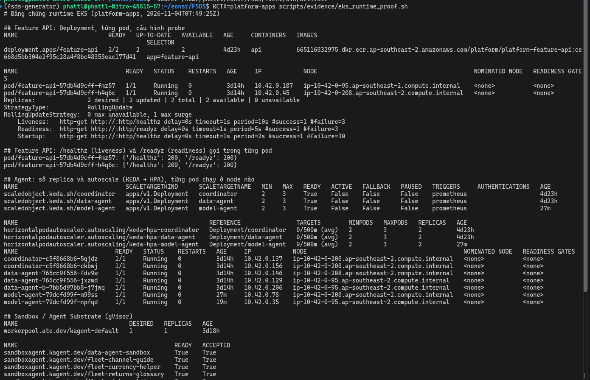
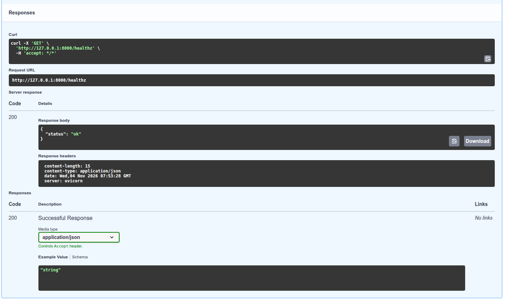
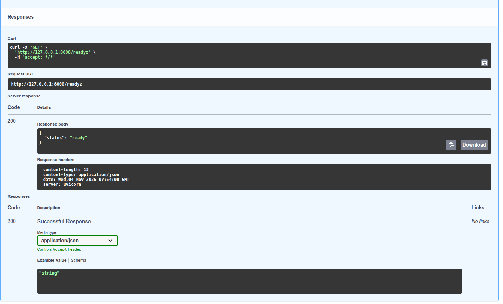
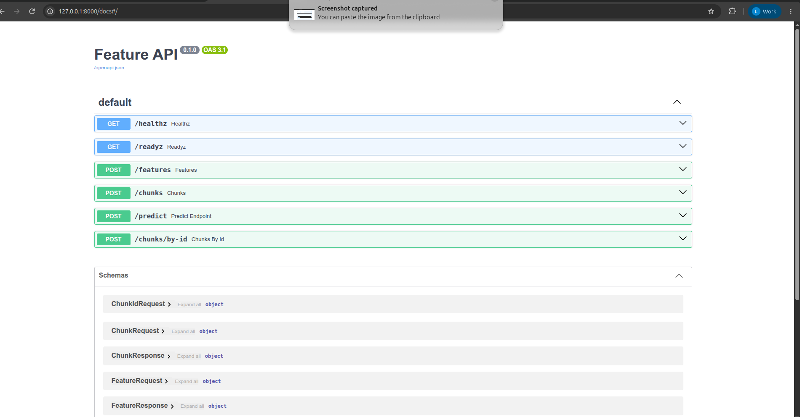
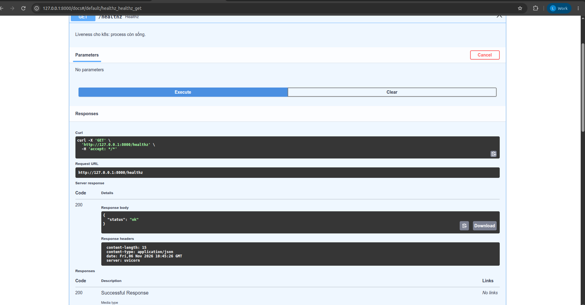
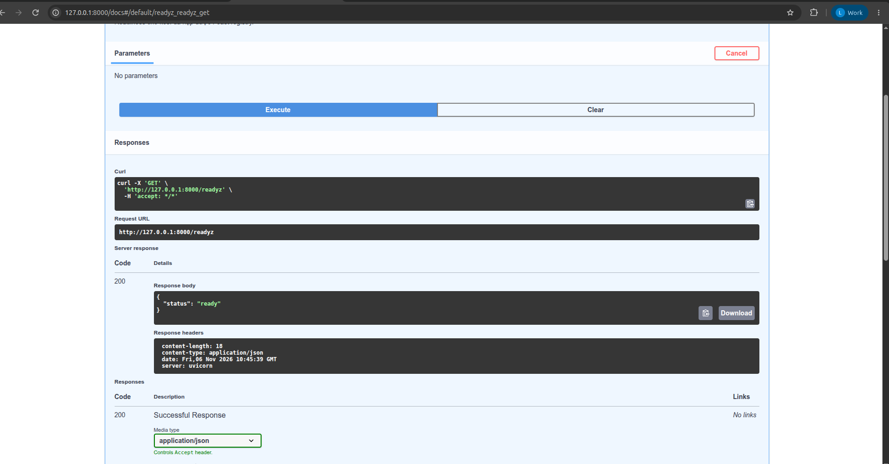
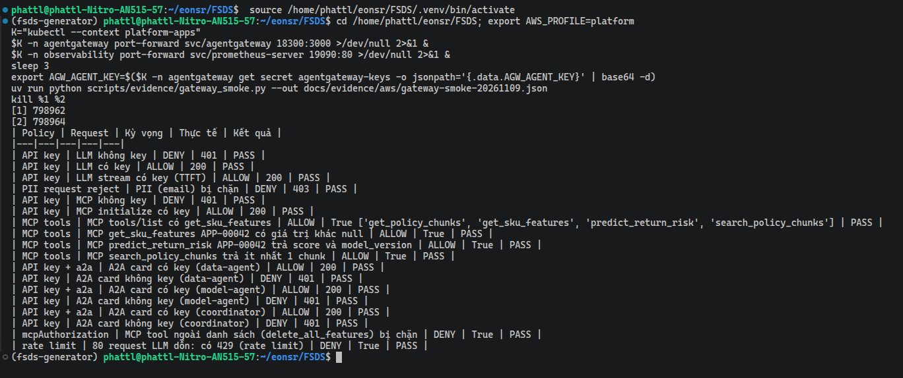
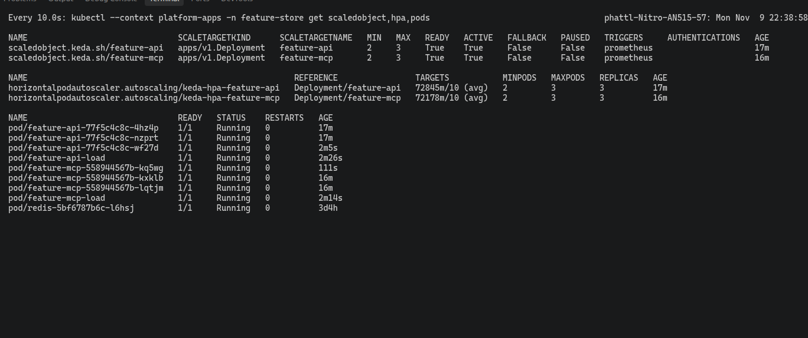
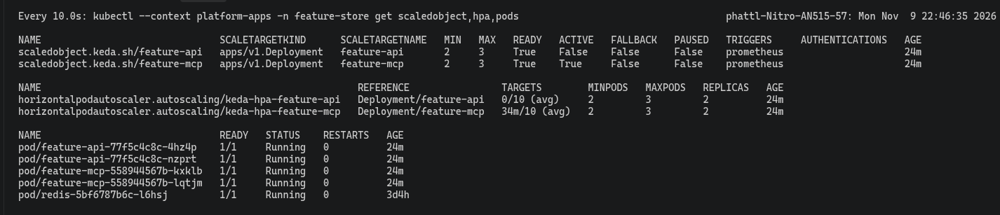

# Web API and MCP on EKS

This page covers FastAPI/Pydantic, health checks, async, MCP and Helm rolling update/fallback.

Code / configuration: [API](../../serving/app.py), [Helm values](../../infra/helm/feature-api/values.yaml). [API tests and EKS load](validation_verification.md).

The results below come from AWS runs; they do not confirm that the service is currently running.

### On EKS

The Feature API is installed with Helm; KEDA keeps at least 2 pods. The API sits behind the HTTPS ingress `https://api.<ip>.sslip.io`
(Let's Encrypt certificate). The `helm upgrade` to image `813627b-pii1` (the number-rounding build, see
[LLM and agents](reference/llm_platform_agents.md#on-eks)) created revision 2, a rolling update with no downtime.


The Swagger screenshots above only show `/features` and `/predict`; probes and health have their own evidence (cluster `platform-apps`).

**Probes configured in the Deployment** (output of [`eks_runtime_proof.sh`](../../scripts/evidence/eks_runtime_proof.sh), file [eks-runtime-proof.txt](../evidence/aws/eks-runtime-proof.txt)):
- Deployment `feature-api` has 2/2 pods, running on two different nodes.
- `RollingUpdate` strategy with `0 max unavailable, 1 max surge`: always keeps the full set of old pods and adds at most 1 new pod at a time.
- Three Kubernetes probes:
  - `Liveness` (is the pod still alive) calls `/healthz`, period 10 s, restart after 3 consecutive failures.
  - `Readiness` (is the pod ready to receive requests) calls `/readyz`, period 5 s, failure threshold 3.
  - `Startup` (has the pod finished starting) calls `/healthz`, period 2 s, at most 30 attempts.
- Calling `/healthz` and `/readyz` **inside each pod** returns `200`.



**Called through Swagger** (port-forward `svc/feature-api`, `http://127.0.0.1:8000/docs`): `GET /healthz` returns `200 {"status": "ok"}` and `GET /readyz` returns `200 {"status": "ready"}`.





**Swagger (EKS, port-forward `svc/feature-api`):** the overview screenshot lists six endpoints (`/healthz`, `/readyz`, `/features`, `/chunks`, `/predict`, `/chunks/by-id`).
The `/metrics` endpoint is deliberately hidden from the schema (`include_in_schema=False`); Prometheus scrapes it. The next two screenshots are direct calls from Swagger.







#### MCP server on EKS

MCP (Model Context Protocol) is the protocol Agents use to call tools. The MCP server uses the `mcp` library in stateless + JSON mode
(no session kept between requests), at path `/mcp/`. This server runs in a **separate pod**, split from the REST pod:

```text
agentgateway /mcp ──► Service feature-mcp ──► pod feature-mcp-*  (API_SURFACE=mcp: /mcp/, /healthz, /readyz, /metrics)
Ingress api.…     ──► Service feature-api ──► pod feature-api-*  (API_SURFACE=rest: /features, /predict, /chunks, …)
                                  both    ──► Feast/Redis, KServe return-risk, pgvector
```

How the split works:
- Two Helm releases (`feature-api`, `feature-mcp`) share the chart [`infra/helm/feature-api`](../../infra/helm/feature-api/Chart.yaml), the image and the code
  [`serving/app.py`](../../serving/app.py) (`create_app(surface=…)` selects which part is enabled).
- [`values-mcp.yaml`](../../infra/helm/feature-api/values-mcp.yaml) sets `surface: mcp` and a ClusterIP Service (reachable only inside the cluster).
- Each release has its own Deployment, probes, Helm `--atomic` and ScaledObject, so MCP scales and rolls back independently of REST.
- Test `test_surface_splits_rest_and_mcp_pods`: the REST pod returns 404 at `/mcp/`, the MCP pod returns 404 at `/features`.

Actual run on EKS after the split:
- `feature-api` returns 200 at `/features` and 404 at `/mcp/`; `feature-mcp` does the opposite.
- `helm list` shows two releases, both on image `4cc4502`.
- The gateway points to `feature-mcp`.

The Registry and Grafana screenshots below were taken before the split.

Four tools share code with REST:

| Tool | What it does | Matching REST endpoint |
|---|---|---|
| `get_sku_features(seller_skus)` | online features from Feast/Redis | `POST /features` |
| `predict_return_risk(...)` | calls KServe `return-risk` | `POST /predict` |
| `search_policy_chunks(query, top_k)` | searches return policies (RAG, pgvector) | `POST /chunks` |
| `get_policy_chunks(chunk_ids)` | fetches chunks by id | `POST /chunks/by-id` |

Agents do not call the pod directly; they go through the `/mcp` route of [agentgateway](agent_gateways.md) (API key, only the four tools above are allowed).
The smoke test on EKS after the split passed **24/24 PASS** ([gateway-smoke-20261109.json](../evidence/aws/gateway-smoke-20261109.json)). Some of its checks:
- An MCP call without a key is rejected with 401; `initialize` with a key returns 200.
- `tools/list` returns all four tools.
- `get_sku_features` has values; `predict_return_risk` has `score` and `model_version`; `search_policy_chunks` returns at least 1 chunk.
- A tool outside the list is blocked.



The MCP server is registered in the Agent Registry, and Grafana counts each tool call by outcome (`mcp_tool_calls_total{tool,outcome}` exported by the Feature API):


Agents that use these tools: [Data Agent / Model Agent](agents.md); route and MCP backend configuration: [Agent Gateways](agent_gateways.md).

In the API screenshot, `approved_returns_24h` is still `null`. A later AWS stream run has data: [Streaming Feature](stream_features.md).

#### Helm rolling update and automatic rollback on EKS

Bottom line first: neither upgrade, including the deliberately broken one, dropped a single request (763/763 returned 200).

How it was tested: run [`helm_rollout_fallback_test.sh`](../../scripts/evidence/helm_rollout_fallback_test.sh) on cluster `platform-apps` (release `feature-api`, namespace `feature-store`).
During two `helm upgrade --atomic` runs, a probe pod **inside the cluster** sends `POST /features` continuously, once every 0.2 seconds.
With `--atomic`, if the new release does not come up within the timeout, Helm rolls back to the previous one automatically. Full log: [feature-api-helm-rollout.txt](../evidence/aws/feature-api-helm-rollout.txt).

| Step | Result |
|---|---|
| 1. Good rolling update (change `envChecksum`, `--timeout 4m`) | revision **13** `deployed`; rolling update `maxUnavailable 0, maxSurge 1` |
| 2. Broken release (`envSecret=does-not-exist`, `--timeout 90s`) | new pod `CreateContainerConfigError: secret "does-not-exist" not found`; revision **14** `failed` (`context deadline exceeded`) |
| 3. Automatic rollback (`--atomic`) | Helm creates revision **15** `deployed`, description `Rollback to 13`; the two old pods kept running and were never replaced |
| Continuous load during both upgrades | **763 requests, 763 returned 200**, no errors |

Final `helm history`: 13 `superseded`, 14 `failed`, 15 `deployed` (`Rollback to 13`). This is evidence for both requirements: rolling update without downtime and automatic fallback when the new release fails to start.
The older record of the local run (583/583 requests, rollback revision 12 → 13) remains in the reference section below.

#### Feature API and MCP server autoscaling (KEDA)

Each Helm release has its own [ScaledObject](../../infra/helm/feature-api/templates/scaledobject.yaml) (KEDA scaling configuration),
enabled in [`values-aws.yaml`](../../infra/helm/feature-api/values-aws.yaml):
- Minimum 2 pods, maximum 3 pods.
- Scales on requests/second over the last 1 minute:
  `sum(rate(http_requests_total{pod=~"<release>-.*", handler!~"/healthz|/readyz|/metrics"}[1m]))`, threshold 10 requests/second per pod.
- The formula ignores probe requests and `/metrics` (same approach as for Agents), so with no real load the pod count returns to 2.
- Releases `feature-api` (REST) and `feature-mcp` (MCP) scale independently of each other.

How it was measured: [`feature_api_scale_test.sh`](../../scripts/evidence/feature_api_scale_test.sh) generates `POST /features` load from a
pod in the cluster, then records the target value and pod count over time until the pod count returns to 2.

**On EKS** (4 `curl` threads in the cluster, 150 seconds, both releases in parallel):

| Release | Load | Up to 3 pods | Back to 2 pods | Log |
|---|---|---:|---:|---|
| `feature-api` | `POST /features` | ~47 s, `60538m/10` | ~489 s | [feature-api-autoscale.txt](../evidence/aws/feature-api-autoscale.txt) |
| `feature-mcp` | `POST /mcp/` `tools/list` | ~46 s, `59296m/10` | ~490 s | [feature-mcp-autoscale.txt](../evidence/aws/feature-mcp-autoscale.txt) |

The "Up to 3 pods" column records the time and the target value at that moment: `m` is the Kubernetes milli-unit, so `60538m/10` means an average of about 60.5 requests/second per pod against a threshold of 10 (HPA shows `(avg)`, the evidence file says "threshold 10/second per pod").
Timestamps are only as precise as the script's 15–25 second sampling interval. HPA events record `New size: 3` and `New size: 2`.
Returning to 2 pods takes a long time because HPA waits for a 5-minute stabilization window before scaling down. The load here is short in-cluster requests, not production traffic.





#### Load test on EKS

Locust (a load generation tool) ran on a laptop in Vietnam, through `kubectl port-forward svc/feature-api` to the cluster in Sydney
(ap-southeast-2). Configuration: 20 users, 60 s, the same file [`serving/locustfile.py`](../../serving/locustfile.py), real SKUs
`APP-00042,APP-00482,ELE-01103`. Port-forward is used to avoid the ingress rate limit of 50 requests/second.

| Request | Count | Errors | p50 | p95 | p99 | req/s |
|---|---:|---:|---:|---:|---:|---:|
| `POST /features` | 1,999 | 0 | 250 ms | 270 ms | 290 ms | 33.6 |
| `POST /features [batch]` | 530 | 0 | 250 ms | 270 ms | 280 ms | 8.9 |
| `GET /healthz` | 475 | 0 | 250 ms | 270 ms | 280 ms | 8.0 |
| **Total** | **3,004** | **0** | 250 ms | 270 ms | 290 ms | **50.5** |

HTML report: [`evidence/aws/load-test-feature-api-20261030.html`](../evidence/aws/load-test-feature-api-20261030.html).

How to read the numbers:
- `/healthz` does almost nothing yet still takes about 250 ms. So nearly all the time is the network path from the laptop to Sydney, not the API.
- Measured on the server side (`http_request_duration_seconds` of the pod receiving the load): `/features` averages only **1.8 ms**
  (4.57 s divided by 2,536 requests).
- Port-forward sends all load to 1 pod. The req/s figure is limited by 20 users each waiting about 250 ms of network per round, not
  by the API.
- There were no errors.

<details>
<summary>Reference: design, development guide and records from before the AWS deployment</summary>

The local records keep their original environment and are not a substitute for cloud evidence.

<!-- Purpose: Web API that pulls SKU features from the ONLINE store, -->
## Web API for pulling features — ML Platform / LLM Platform

FastAPI + pydantic + health checks for k8s, using async.

```
Agent / client ──POST /features {"seller_skus": [...]}──► serving/app.py
                                                            │ await get_online_features_async
                                                            ▼
                                             Feast registry (MinIO) + Redis (kind platform)
```

| Endpoint | Purpose |
|---|---|
| `GET /healthz` | liveness: the process is alive |
| `GET /readyz` | readiness: has the Feast registry been loaded; returns 503 if not |
| `POST /features` | 1–100 SKUs (`^[A-Za-z0-9_.-]{1,64}$`), returns 4 features per SKU |

Each feature view (feature group) is looked up separately and in parallel (`asyncio.gather`). If a SKU is not in Redis yet, or
a view fails or is not registered, that view's features return `null`. Only when **every** view fails does it return 503.

Returned features: `labeled_count_90d`, `positive_count_90d`, `return_or_refund_rate_90d`
(view `sku_return_daily`), `approved_returns_24h` (view `sku_return_24h`).
Duplicate SKUs in a request are looked up only once; results keep the order of first appearance.

`POST /chunks` `{"query": "...", "top_k": 3}` (query 3–500 characters, top_k 1–10) searches return-policy passages
in Feast RAG (pgvector). This endpoint is only enabled when the pod has the `FEAST_RAG_REGISTRY` variable; otherwise it returns 503. Chunk loading pipeline:
[`docs/ml-llm-platform/rag_pipeline.md`](rag_pipeline.md).

Code: [`serving/app.py`](../../serving/app.py). Tests: [`serving/tests/test_app.py`](../../serving/tests/test_app.py).

## Test

```bash
uv run --no-project --python 3.12 --with-requirements serving/requirements-dev.txt \
  pytest serving/tests -o pythonpath=. --cov=serving --cov-report=term-missing
```

Result: 84 pass, coverage of `serving/app.py` 98% (only `load_store`, the real Feast loading part, is missing).

| Technique | Where |
|---|---|
| fixture + mock | `store` (MagicMock + AsyncMock faking `get_online_features_async`), `client` |
| Equivalence partitioning + boundary value | `test_sku_count_boundaries` (0 / 1 / 50 / 100 / 101 SKUs), `test_sku_format` (length 0 / 1 / 64 / 65, unusual characters) |
| Property-based (idempotency) | `test_idempotent` (Hypothesis): calling twice and sending duplicate SKUs give the same result |

## Mutation testing (mutmut)

The [`[tool.mutmut]`](../../pyproject.toml) configuration selects `serving/app.py`, uses the test suite
[`serving/tests/test_app.py`](../../serving/tests/test_app.py) and copies `rag` to test the RAG branches.
Run offline with cached dependencies (mutmut 3.3.1):

```bash
UV_OFFLINE=1 uv run --offline --no-project --python 3.12 --with-requirements serving/requirements-dev.txt mutmut run --max-children 2
UV_OFFLINE=1 uv run --offline --no-project --python 3.12 --with-requirements serving/requirements-dev.txt mutmut results
```

Mutation testing checks the quality of the test suite: the tool makes small changes to the code (each change is called a mutant), then checks whether the
tests fail. A failing test means the test "killed" that mutant.

The run (laptop, 4 processes, about 2.5 minutes): **171 mutants** on `serving/app.py`.

| Result | Count | Meaning |
|---|---:|---|
| killed | 138 | tests fail when the code is changed, i.e. the tests catch the bug |
| timeout | 19 | tests exceed mutmut's time limit (the changed code makes the request hang) — counted as caught |
| no tests | 9 | `load_store` loads real Feast; tests replace it with a fake `store_factory` so this function never runs (intentional) |
| survived | 5 | all 5 are **equivalent mutants** (below) |

**Mutation score** = (killed + timeout) / (171 − no tests) = 157/162 = **96.9%** (killed only: 138/162 = 85.2%).

The 5 surviving mutants, viewable with `mutmut show <name>`:
An "equivalent mutant" is a change that does not alter the program's behavior, so no test can kill it.
- `x_fetch_features__mutmut_29/32/33`: change `zip(VIEWS.values(), results, strict=True)` to `strict=None`, `False`,
  or drop `strict` entirely. Because `results` comes from `asyncio.gather` over `VIEWS` itself, the two sequences always have the same length, so
  `strict` never changes behavior. These are equivalent mutants; no test can kill them.
- `x_create_app__mutmut_17/25`: change the MCP `host="0.0.0.0"` to `None` or `"XX0.0.0.0XX"`. The MCP SDK only enables
  DNS-rebinding protection when host is `localhost`/`127.0.0.1`; every other value gives the same behavior, so these are also equivalent mutants.


The image was built from the [real output](../evidence/mutmut-serving-20261031.txt). The output file keeps the full timeout/no tests list;
the image drops those lines for brevity. The first run inside the AI tool's sandbox hung because the sandbox blocks local sockets (which
`TestClient` needs), not because of a test failure.

Mutation scope: mutmut 3.3.1 only lets you select mutants by name (`mutmut run [MUTANT_NAMES]...`); `mutmut run --help` has
no option to select lines by Git diff. This run mutated **all of `serving/app.py`** (the most-changed file of the Web API)
per the configuration above, so it does not claim to mutate only the changed lines. Next time, to limit by file, use
`git diff --name-only <base> -- '*.py'` to get the list of changed files, then update `paths_to_mutate` accordingly before
running. This still cannot limit mutation to individual lines within a file.

## Load test (locust)

Ran the real API (uvicorn, 1 worker) in image `platform-feast:0.66.0`, connected to the Feast registry on MinIO and Redis in kind.
Load: 20 users, 60 s, split 4 : 1 : 1 across three request types (single SKU / batch of 10 SKUs / `healthz`). File: [`serving/locustfile.py`](../../serving/locustfile.py).

| Request | Count | Errors | p50 | p95 | p99 | req/s |
|---|---:|---:|---:|---:|---:|---:|
| `POST /features` | 5,811 | 0 | 6 ms | 19 ms | 34 ms | 97.6 |
| `POST /features [batch]` | 1,495 | 0 | 7 ms | 20 ms | 32 ms | 25.1 |
| `GET /healthz` | 1,402 | 0 | 3 ms | 10 ms | 16 ms | 23.6 |
| **Total** | **8,708** | **0** | 6 ms | 18 ms | 31 ms | **146.3** |

HTML report: [`evidence/load-test-feature-api-20261021.html`](../evidence/load-test-feature-api-20261021.html).
Limitations:
- Locust ran in the same container as the API (same 14 GB machine).
- At that time the `sku_return_24h` view was not registered yet, so each request actually read Redis only once.
- These numbers are a local baseline, not GKE numbers.

## MCP tool

The same app also exposes an MCP server (`mcp` library 2.3.0) at `/mcp/`. The first version had only one tool, `get_sku_features(seller_skus)`,
sharing the `fetch_features` function with REST; the current version has four tools, see [MCP server on EKS](#mcp-server-on-eks).
- **Stateless + JSON** mode: an MCP request can be handled by any replica, with no sticky session (pinning a client to
  a fixed replica), so it scales to multiple replicas like a regular API.
- Invalid input or a Redis error returns `isError: true` with a clear message (`ToolError`), so the LLM can correct its call.
- Tests: `test_mcp_*` in [`serving/tests/test_app.py`](../../serving/tests/test_app.py).

```bash
curl -s -X POST http://platform-control-plane:30800/mcp/ -H 'Content-Type: application/json' \
  -H 'Accept: application/json, text/event-stream' \
  -d '{"jsonrpc":"2.0","id":1,"method":"tools/call","params":{"name":"get_sku_features","arguments":{"seller_skus":["sku-A"]}}}'
```

## Running in k8s with helm (kind `platform`)

```bash
bash scripts/setup/deploy_kind_feature_api.sh [tag]
```

| Part | File |
|---|---|
| Image (built on `platform-feast:0.66.0`, 1.02 GB, mostly the shared Feast layer) | [`docker/Dockerfile.serving`](../../docker/Dockerfile.serving) |
| Helm chart: Deployment with 2 replicas + NodePort Service 30800 | [`infra/helm/feature-api/`](../../infra/helm/feature-api/Chart.yaml) |
| Build → `kind load` → Secret from `.env` → `helm upgrade --install --atomic` | [`scripts/setup/deploy_kind_feature_api.sh`](../../scripts/setup/deploy_kind_feature_api.sh) |

- **Rolling update**: `maxUnavailable: 0, maxSurge: 1`, i.e. add 1 new pod and only remove an old pod once the new pod is Ready.
  `preStop: sleep 5s` is added so kube-proxy has time to remove the old pod from the Service before that pod shuts down. Without this step, the first
  measurement dropped 1/366 requests exactly when the old pod shut down.
- **Automatic fallback**: uses `helm upgrade --atomic --timeout`. If the new pod is not Ready within the timeout, Helm rolls back to the
  previous revision automatically.
- Probes: `startupProbe` + `livenessProbe` call `/healthz`, `readinessProbe` calls `/readyz`.
- Secret `feature-api-env` (MinIO, registry and Redis keys) is created from `.env` when the script runs; it is not in Git.
- The pod can resolve `minio` (172.23.0.3) because the kind node is attached to the `platform_default` network.
  Redis is called through the in-cluster Service `redis.feature-store.svc.cluster.local:6379`.
- Requests: 50m CPU / 128Mi RAM, limit 384Mi.

### Verification

Throughout the test, a container sends `POST /features` every 0.2 s. Test steps:
1. 3 rolling updates (v1 → v2 → v1 → v2).
2. One deliberately broken release: `envSecret=does-not-exist` prevents the new pod from starting, with `--timeout 45s`.

| Result | |
|---|---|
| Requests | **583 / 583 returned 200**, 0 errors |
| Broken release | revision 12 `failed`, then Helm automatically created revision 13 `Rollback to 11`; the 2 old pods served throughout |

Log: [`evidence/feature-api-helm-rollout-20261021.txt`](../evidence/feature-api-helm-rollout-20261021.txt).
Feature values at that time were `null` because Redis had just restarted and had not been materialized yet.

### Version v3: adds RAG chunk search

Image v3 adds `feast[postgres]`, `fastembed` and the model `BAAI/bge-small-en-v1.5` baked into the image
(`RAG_MODEL_CACHE=/opt/models`); the Secret adds `FEAST_RAG_REGISTRY`, `RAG_PG_*`. Helm revision 14, 1 replica
(`REPLICAS=1`, the local machine was short on RAM; rolling update/rollback was already demonstrated above with 2 replicas).

| Test | Result |
|---|---|
| `POST /chunks` "How long does a Walmart buyer have to return?" | `walmart-returns / Return window` ranks first, distance 0.127 |
| MCP via agentgateway `tools/call search_policy_chunks` "Can a TikTok buyer get a refund without returning the item?" | `tiktok-shop-returns / Refund only` |

Agents using the tool: [`docs/ml-llm-platform/reference/llm_platform_agents.md`](reference/llm_platform_agents.md).

</details>

[Section index](README.md) · [Main index](../README.md)
